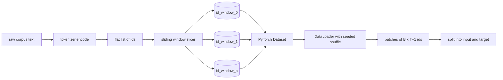
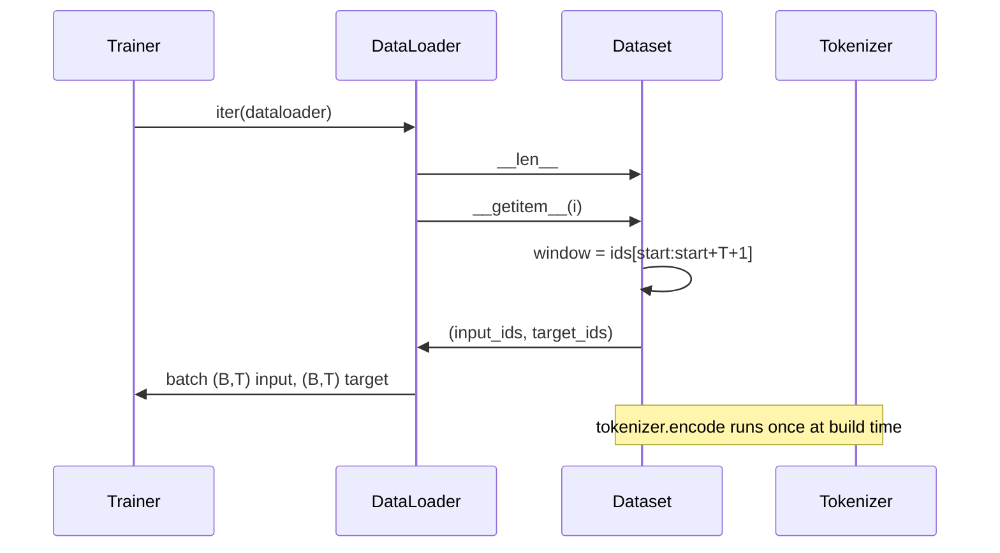

# Utiliza el conjunto de datos de la ventana deslizante

> Una vez se ha realizado un entrenamiento, es una de las identidades de tokens a la función de gradiente.

**Type:** Build
**Languages:** Python
**Prerequisites:** Phase 04 lessons, Phase 07 transformer lessons, 本 phase 的 Lesson 30
**Time:** ~90 分钟

## Objetivos de aprendizaje


```figure
cap-sliding-window
```
- 通过只调用一次Tokenizer,把原始 corpus 转换为Token ids 流──
- Utiliza el paso de recarga configurable, y luego, la janela de longitud fija.
- Construir un Dataset PyTorch, para predicción de tokens siguientes  regresar a la entrada y tensores de objetivo 
- Utilizando DataLoader  empaquetado conjunto de datos,并使用按时 设定种子的确定性混──
- 推理步步、冗余和有效数据集大小 之间的权衡──

##  marco

Una vez pre-entrenamiento de un grupo de tokens, un nuevo modelo.`(B, T)`ID de entrada y `(B, T)`El objetivo de los ids, entre los cuales el objetivo es la entrada de la pipeline de datos, es generar este contrato de forma determinista y reproducible, desde el corpus de posibles números de GB de texto original.

Este curso construirá esta línea de datos. El Tokenizer de la clase anterior transformará el texto en una lista de ides planos de larga duración.

## 形状 contrato

LM causal 消费形状为 `(B, T)`De las identidades, entre ellas `B`Es el tamaño del lote,`T`Es la longitud del contexto.`t`El objetivo es la posición.`t+1`Esto significa que cada ejemplo de entrenamiento                                                                                                                                                                                                                                                                                                                                                                                                                                                                                                                      `T+1`个原始 ids──window step 控制相邻的例子 之间有多少重叠──



Slicer  nunca cruzará las fronteras del cuerpo  Si la última ventana  no tiene suficientes ID  llenar `T+1`La posición, el cortador, la dejará.`<|pad|>`填充尾部 también es una opción válida, pero hará que la máscara de pérdida sea compleja.

## ¿Por qué usar la ventana deslizante?

El corpus de entrenamiento es una larga serie de IDs. Si el modelo sólo ve una ventana que no se superpone, cada ejemplo de entrenamiento lo enseña igual.`T`个边界――调整步骤 会移动这些边界,让模型 看到更多这样的预测-next-token 任务――

paso para`T`会产生不重叠的窗户――stride 为 `T // 2`Se producen cientos de cincuenta sobreposiciones, y se hace un conjunto de datos válido.`1`Se producirá la mayor carga, y se aumentará el conjunto de datos.`T`倍──代价是每时代 需要更多的计算──收益是边界多样性更高──大多数预训运行使用等于背景长度的步骤,因为 corpus 已经远大于模型 在一个时代内能跑完的规模,因此边界多样性论点更弱──

## Clasificación de conjunto de datos

PyTorch Dataset tiene dos métodos necesarios.`__len__`返回 ejemplos 数量──`__getitem__`Es decir, en forma de tensores, devuelve un ejemplo. Nuestro conjunto de datos  almacenamiento  codificación                                                                                                                                                                                                                                                                                                                                                                                                                                                                                                     



El cambio por uno ocurre en`__getitem__`内部── Datos de juego 返回 `(input, target)`, entre ellos `input = window[:-1]`¿ Qué ?`target = window[1:]`Los dos son tensores PyTorch largos.

## El deslizamiento determinista

Uso `shuffle=True`de DataLoader se encuentra en el generador aleatorio PyTorch 读取──通过传入一个按时 设定种子的显式 `torch.Generator`, cada vez que reinicia la operación se puede obtener el mismo cambio. Cuando se piensa en comparar dos sólo para una operación de un hiperparámetro, esta propiedad es importante.

El contrato de semillas de la clase es muy simple.`epoch_seed = base_seed + epoch_index` semilla base en la construcción  índice de época  por el entrenador en cada época  incremento  uso de la misma semilla base 重新运行,总会在每个时代看到相同顺序──

## Muestradora de lotes

El muestreo por defecto de PyTorch se hará a diario. Esto es lo que se necesita para preparar el conjunto de datos.`B`Siguiente `__getitem__`No se apila  resultados para montar un lote. Porque cada ejemplo en la construcción es de la misma longitud, así que no se necesita lógica de relleno.

Este curso para la simple forma de mantener`num_workers=0` En la producción y en la operación, los trabajadores se`__getitem__`Para nuestra línea de llamadas, esto es básicamente no-op, porque el trabajo es sólo hacer una receta de tensor en memoria, pero con una API de Dataset se puede hacer de forma efectiva para apoyar a los trabajadores.

## 计算 ejemplos

对于长度为  por el tiempo`N`La longitud del contexto`T`Y el paso `S`, ejemplos 数量是 `max(0, 1 + (N - (T + 1)) // S)` El entrenador puede pasar por los pasos totales de cada época de cálculo.

## 本课不做什么

No va desde el disco de streaming;. corpus se codifica completamente en la memoria, y se conserva como un solo tensor;. Para varios millones de ids, esto es inferior a cien MB, y es una forma adecuada para este tipo de datos.

No procesa múltiples documentos. El corpus se considera un artículo de continuidad de los documentos. Cuando el corpus se construye, se inserta.`<|endoftext|>`IDs para codificar el siguiente documento límite.

## ¿Cómo leer el código?

`main.py`Definimos dos clases y un ayudante.`SlidingWindowDataset`Es el conjunto de datos PyTorch.`make_dataloader`Retorn a un buen DataLoader configurado, y con un generador semillado.`_encode_corpus_to_ids`Es una llamada de Tokenizer de una sola vez. En el proceso de la demostración se realiza la construcción de un pequeño Tokenizer, codificación del corpus, construcción de un conjunto de datos y un cargador de datos, impresión de un lote, y la firma de un contrato de forma.`code/tests/test_dataset.py`En los ensayos medianos se fijó la fórmula de recuento de ventanas ∙shift-by-one 属性 ‧deterministic shuffle 和 step trade-off―

运行 demo──然后把背景长度从16 改为32,观察每时代的例子 数量如何下降──这个数字就是你的每时代步骤预算──
