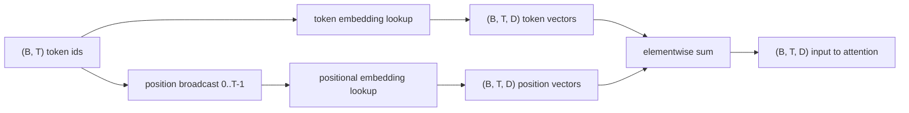
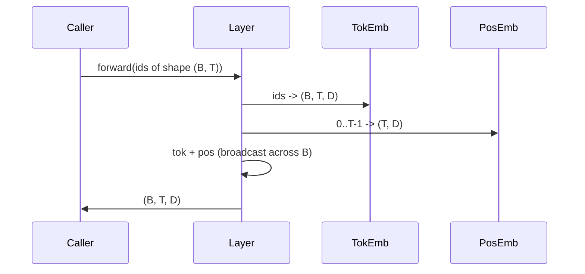

# Token y posiciones de inserción

> Las ids es un número completo. El modelo necesita vector. Las tablas de búsqueda se encuentran entre las dos.

**Type:** Build
**Languages:** Python
**Prerequisites:** Phase 04 lessons, Phase 07 transformer lessons, 本 phase 的 Lessons 30 和 31
**Time:** ~90 分钟

## Objetivos de aprendizaje


```figure
cc-embedding-lookup
```
- Construir una tabla de búsqueda de embedding de tokens,把 vocabulario ids 映射到密集向量──
- Construir una tabla de búsqueda por posición index de posiciones aprendidas integradas 
- Construir una inserción posicional sin parámetros sinusoidal fija 
- Colocar los tokens y las incorporaciones posicionales 组合成 Entrada única del bloque de transformador―
- En comparación con las incorporaciones aprendidas y sinusoidales en generalización de longitud y con el conteo de parámetros,

##  marco

El primer contacto con el modelo con el token id, se realiza en la matriz de embodo de tokens para buscar filas. En esta matriz cada línea de vocabulario tiene una línea, cada dimensión del modelo tiene una fila.

Los símbolos de identificación de tokens en sí mismos no tienen orden. El modelo necesita una segunda señal, le dice que la posición uno no es diferente a la posición diecisiete. Estas señales tienen dos tipos principales: la posición de inserción aprendida, la posición de búsqueda de cada posición y la posición de inserción sinusoidal fija.`SinusoidalPositionalEmbedding`¿ Qué pasa ?`max_context_length`预计算一张 fija mesa, su `forward`Las líneas de trabajo de los módulos de formación de la formación se incrementarán en el tiempo que superen la frontera; por lo tanto, estos dos módulos deberán ejecutar la mayor longitud de contexto posible.

Esta clase construirá ambos, y los combinará con el embedding de tokens.

## 形状 contrato

La entrada de la etapa de incorporación es forma`(B, T)`La salida es forma de un token.`(B, T, D)`El tensor, entre ellos.`D`Es la dimensión del modelo. Cada elemento de lote tiene la misma longitud de contexto.`T` Cada posición tiene la misma dimensión vectorial `D`¿Qué es eso?



组合方式是 sum, no es concatenation.`D`En la red mantenerse invariable, y hacer que el modelo, basado en cada característica, decida el significado o la posición de cada uno de los niveles.

## Embeding de la señal Matrix

Embedding de símbolo es una forma`(V, D)`de parámetros tensor, entre ellos `V`Es el tamaño del vocabulario.`nn.Embedding(V, D)`Exposición de ello. Entrajes de un pequeño Gaussian 中抽取, para modelos a escala de transformador, tradicionalmente significa 为零, desviación estándar 约为`0.02`◊ La precisión de la iniciación no es tan importante, es importante que se mantenga en armonía entre las diferentes operaciones.

Pasar hacia adelante es una operación de indexación.`(B, T)`int64 ids 映射为 `(B, T, D)`floats──backward pass  sólo se colocará Gradient 累积到前进pass 中被触碰过的行── dos de las filas nunca aparecieron en el lote en este paso 收到零 Gradient──

Una pequeña detalle. La proyección de salida del modelo termina con una carga común de peso. Cuando ocurre esta situación, cada paso hacia atrás pasará por el lado de salida.

## Aparecido en el embodimiento posicional

Aprendió posicionamiento de incrustación es el segundo `nn.Embedding`, forma `(max_context_length, D)` mirando de la posición id `0, 1, 2, ..., T-1`Como clave... pasa hacia adelante...

La mesa aprendida de la falta es, si el modelo sólo entrenar a la posición `T-1`, no puede consultar la posición .`T`那一行不存在──使用这种方案的生产单独解码模型会把最大的文本长度进入建筑,并拒绝处理更长输入──

## Emblazo sinusoidal de posición

La inserción posicional sinusoidal es de la posición hasta la función de Vektor.`p`Y característica `i` producirse:

```python
angle = p / (10000 ** (2 * (i // 2) / D))
emb[p, 2k]     = sin(angle)
emb[p, 2k + 1] = cos(angle)
```

Esta función no tiene parámetros. Cada posición tiene un único vector. La longitud de onda se transfiere a través de las dimensiones de las características.

Por la misma elección`sin`Y `cos`La naturaleza de lo que se obtiene es, posición.`p + k`处的矢量是位置 `p`处 Vector's linear function── esto proporciona una capa de atención ▌ un método sencillo de aprendizaje de offsets de posición relativa──modelo no necesita un parámetro individual para expresar  hacia atrás 

Este curso se desarrollará en la construcción de la tabla sinusoidal completa una vez y se seguirá adelante en la indicación de la misma.

## 组合:

Pipeline de entrada 按顺序做三件事──读取 Token ids──查找 token vectors──加上位置 vectors──返回 sum──



Sumada de paso Central de radiodifusión 会沿批量维度 复制 `(T, D)`Tensor de posición: PyTorch 会自动处理,因为 tensor de posición está en forma posterior`(1, T, D)`¿Qué es eso?

## En el análisis de la comparación

Este curso se desarrolla en dos variantes de los mismos insumos, y se imprime dos diagnósticos.

La primera es el conteo de parámetros. La variante aprendida se incrementará en la incorporación de los tokens.`max_context_length * D`个参数──sinusoidal variante 增加零个──

El segundo es la similitud cosínica entre los embebidos de posiciones próximas. La variante sinusoidal tiene una disminución plana y predecible, ya que la función es continua. La variante aprendida tiene una similitud casi casual en la inicialización, ya que las filas son extraídas independientemente. Después de entrenamiento, la variante aprendida generalmente también se desarrolla una estructura plana similar, pero debe encontrar esta estructura en los datos.

## 本课不做什么

No se construye codificación posicional rotativa (RoPE) o AliBi. Son la selección moderna de la producción de transformadores.`(B, T, D)`Los vectores de la aplicación de la transformación de la posición, pero se aplican en la etapa de proyección de atención, en lugar de entrada.

No se entrenan los embedidos. Se entrenan los resultados de los modelos. Se trata de los resultados de los modelos.

## ¿Cómo leer el código?

`main.py`定义了三个 módulos。`TokenEmbedding`包装                                                                                                                                                                                                                                                                                                                                                                                                                                                                                                                           `nn.Embedding(V, D)`¿Qué es eso?`LearnedPositionalEmbedding`包装                                                                                                                                                                                                                                                                                                                                                                                                                                                                                                                           `nn.Embedding(L, D)`¿Qué es eso?`SinusoidalPositionalEmbedding`预计算 table,并把它暴露为缓冲.`EmbeddingComposer`Colocar embedding simbólico y embedding posicional  unidos.`code/tests/test_embeddings.py`En los ensayos se fijó la forma, el comportamiento de la transmisión, el número de parámetros y la fórmula sinusoidal.

运行 demo──然后把 la dimensión del modelo `D`Desde 64 改为 32, observar las bandas de longitud de onda sinusoidales 如何变化──
