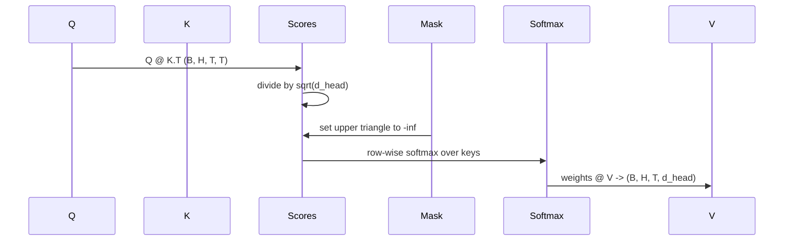

# Atención personal de varias cabezas

> Una proyección lineal, tres visitas, una cabeza, una máscara...

**Type:** Build
**Languages:** Python
**Prerequisites:** Phase 04 lessons, Phase 07 transformer lessons, Lessons 30 through 32 of this phase
**Time:** ~90 minutes

## Objetivos de aprendizaje
- Se puede realizar la proyección en una línea de la cantidad de la pregunta / clave / valor, y se puede dividir en H 个头.
- Utilización de la correcta regeneración y el tipo de d 处理计算 escalada de atención de producto punto-
-  aplicar máscara causal, evitar que algún lugar se preocupe en el futuro.
- 检查固定输入下 Cada cabeza de los pesos de atención,并推理 cada cabeza 关注的内容──
- En tarea de juguete 上训练一个小小注意区, observar la pérdida 随着各头 专门化而下降──


```figure
cap-multihead-attention
```

## El marco

La atención es una función que permite que el símbolo de un token pueda obtener información de otros símbolos de la misma secuencia. La atención propia muestra preguntas, claves y valores que provienen de la misma entrada.

El modo de alta eficiencia es el uso de una capa lineal desde `D` proyección hasta `3 * D`, recorte en tres imágenes, y luego remodelar en H 个 cabeza, cada tamaño por `D // H`◊matmul·softmax 和加权求和都作为批量 tensor 操作执行, por lo que cada cabeza puede funcionar y funcionar en el acelerador―

Este curso construirá este bloque. También se incorporará a la máscara causal, para que el mismo código pueda ser utilizado como un modelo de lenguaje solo para el decodificador.

## El contrato de forma

输入是 `(B, T, D)`◊ Exportación es `(B, T, D)`✿ máscara ✿`(T, T)`, o puede transmitirse hasta él. En el bloque, la forma del tensor medio es`(B, H, T, d_head)`, entre ellos `d_head = D // H`约束条件是 `D % H == 0`¿Qué es eso?

```mermaid
flowchart LR
    A["(B, T, D) 输入"] --> B[Linear D -> 3D]
    B --> C["拆分为 Q, K, V"]
    C --> D["reshape 为 (B, H, T, d_head)"]
    D --> E["scores = Q @ K.T / sqrt(d_head)"]
    E --> F[应用 causal mask]
    F --> G[对 keys 做 softmax]
    G --> H["context = weights @ V"]
    H --> I["reshape 为 (B, T, D)"]
    I --> J[输出 Linear D -> D]
    J --> K["(B, T, D) 输出"]
```



两个线性层(QKV proyección y proyección de salida) es el único parámetro del bloque.

## La división de QKV

朴实实现将有三个独立线性层,分别用于 Q、K 和 V──高效实现只有一个层,输出 `3 * D`个特征并分分结果――二是数学上等价,因为三个分分乘以 `(D, D)`Las multiplicidades de la matriz de peso, son iguales a una vez multiplicadas por ellas.`(3D, D)`权重的矩阵乘法──

Alta eficiencia versión más rápida, ya que el acelerador solo se inicia una vez matmul, en lugar de tres veces. También es más fácil de iniciar, ya que la matriz de tres hijos se encuentra en el mismo tensor de parámetros, puede iniciar juntos.

## La cabeza se remodela

Después de la separación, Q 、 K 、 V 、 V `(B, T, D)`◊ Para convertirlo en H 个 paralelos Atención  problema, remodelamos 为 `(B, T, H, d_head)`, retransponer por`(B, H, T, d_head)`△head 维度现在位于 lot 维度旁边, por lo tanto PyTorch 会把 por cabeza atención 视为跨 `B * H`个独立实例的批量操作.

`d_head`维度保持在最后, por lo tanto, el puntaje matmul `Q @ K.transpose(-2, -1)`Se reducirá en esta dimensión.`(B, H, T, T)`Los puntajes de atención por cabeza

## Escalado

Las puntuaciones se encuentran en el softmax`sqrt(d_head)`Si no hay esta escala, los productos de punto se seguirán.`d_head`En este estado, el aprendizaje se detiene, y en este estado, el aprendizaje se detiene.`sqrt(d_head)`Puede dejar que las diferencias de puntajes en diferentes tamaños de cabeza se mantengan constantes.

## La máscara causal

En concreto, en softmax 之前,`(T, T)`Matriz de puntaje Cada elemento de la línea de la esquina se sustituye por negativo infinito.



Cuando construimos la máscara, la registramos como buffer, por lo que se encuentra en el mismo dispositivo y no forma parte del gráfico gradiente.`(T, T)`区域。

## La proyección de salida

 obtener por cabeza vectores de contexto `(B, H, T, d_head)`Después, nosotros transponemos`(B, T, H, d_head)`, reformulado para`(B, T, D)`, y la última aplicación .`(D, D)`线性投影──output projection 让模型可以混合各个头──没有它,H个头只能通过后层重组,块会受到人为限制──

## Inspección de peso de atención

Este curso está en el pase hacia adelante.`return_weights=True`Después de la configuración de la bandera, el bloque se encuentra junto a la salida y vuelve a la forma de`(B, H, T, T)`Los pesos de atención de cada cabeza, en el caso de la muestra, se imprimen en la entrada corta, en el mapa de calor de la cabeza, por lo que se puede ver la estructura del triángulo causal y el punto de atención de cada posición.

En el modelo de entrenamiento, diferentes cabezas aprenderán diferentes modos. Algunas cabezas se preocuparán por un Token anterior que se encuentra cerca. Algunas cabezas se preocuparán por la secuencia de inicio. Algunas cabezas se centrarán en la atención.

## La demostración de entrenamiento

`main.py`La demo de abajo se hará un bloque de atención, se llega a una cabeza de LM muy pequeña, y repite la tarea de entrenamiento de todo el modelo. Cada línea de entrada es una id al azar, en todo el texto siguiente.`log(64) ~ 4.16`) baja a muy baja de `1.0`¿Qué es eso?

El objetivo de la demostración no es entrenar un modelo útil. El objetivo es confirmar que el gradiente puede fluir por cada parte del bloque, y que cada cabeza puede aprender algo en una pregunta obvia.

## Lo que esta lección no hace

No añadirá un bloque de alimentación hacia adelante. La capa transformadora del modelo real es la atención.

No se realiza codificación rotativa o posicional AliBi. Los dos se aplican en los pasos de la proyección QKV del mismo bloque, pero son unidades de enseñanza independientes.

No logrará inferencias Usando el caché KV.

## Cómo leer el código

`main.py`Definido .`MultiHeadSelfAttention` Esta clase 包含 dos líneas 线性层和一个注册的面具缓冲──前传会依次执行投影、重型、重点、重量、重量、重量、重量、重量、重量、重量、重量、重量、重量、重量、重量、重量、重量、重量、重量、重量、重量、重量、重量、重量、重量、重量、重量、重量、重量、重量、重量、重量、重量、重量、重量、重量、重量、重量、重量、重量、重量、重量、重量、重量、重量、重量、重量、重量、重量、重量、重量、重量、重量、重量、重量、重量、重量、重量、重量、重量、重量、重量、重量、重量、重量、重量、重量、重量、重量、重量、重量、重量、重量、重量、重量、重量、重量、重量、重量、重量、重量、重量、重量、重量、重量、重量、重量、重量、重量、重量、重量、重量、重量、重量、重量、重量、重量、重量、重量、重量、重量、重量、重量、重量、重量、重量、重量、重量、重量、重量、重量、重量、重量、重量、重量、重量、重量、重量、重量、重量、重量、重量、重量、重量、重量,重量,重量,重量,重量,重量,重量,重量,重量,重量,重量,重量,重量,重量,重量,重量,重量,重量,重量,重量,重量,重量,重量,重量,重量,重量,重量,重量,重量,重量,重量,重量,重量,重量,重量,重量,重`code/tests/test_attention.py`En el medio de los ensayos se fija la propiedad de la forma de contrato, la propiedad de causalidad, la propiedad de la máxima suavidad, la propiedad de la división de la cabeza y el flujo gradiente.

¿Qué es eso?`n_heads`Desde 4  aumentar hasta 8                                                                                                                                                                                                                                                                                                                                                                                                                                                                                                                        `d_model=32`, por lo tanto `d_head=4`), observar el mapa de calor cómo cambia¬¬¬¬¬¬¬¬¬¬¬¬¬¬¬¬¬¬¬¬¬¬¬¬¬¬¬¬¬¬¬¬¬¬¬¬¬¬¬¬¬¬¬¬¬
