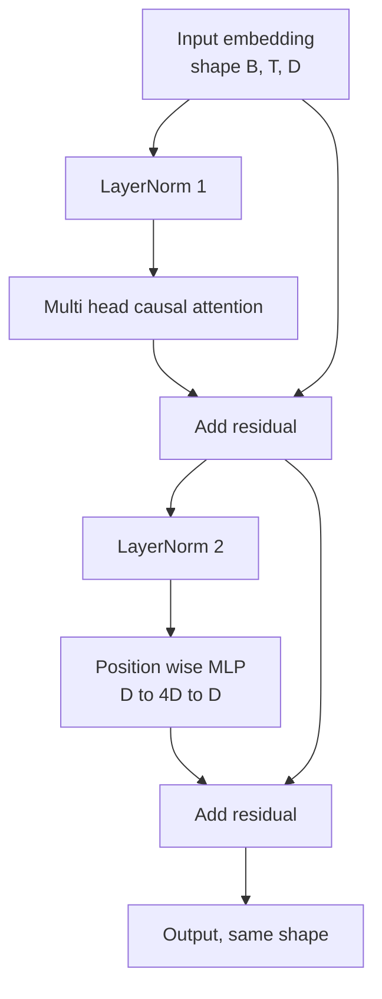
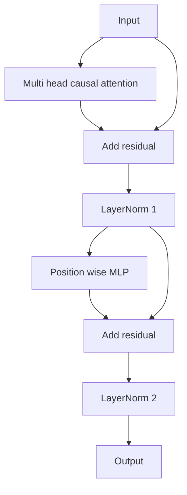

# Desde el punto de implementación del bloque de transformador

> Un bloque es la unidad básica de cada decodificador moderno del LLM. La norma de capas, la atención múltiple, los residuos, los MLP, los residuos.

**Type:** Build
**Languages:** Python
**Prerequisites:** Phase 19 lessons 30 to 33 (tokenizer, embeddings, attention math, batched data loader)
**Time:** ~90 minutes

## Objetivos de aprendizaje

- Desde cuatro componentes de movimiento construyendo PyTorch en el bloque de transformador:LayerNorm, atención causal de múltiples cabezas, conexiones residuales, MLP inteligente de posición,
- La norma de capa se coloca en dos configuraciones: pre-LN y post-LN, y explica por qué una de ellas no necesita calentamiento y también puede ser entrenada de forma estable.
- En atención multi cabeza en lograr el enmascaramiento causal, hacer Token `i`No puedo ver los Tokens `j > i`¿Qué es eso?
- Seguido de 12 capas de pila entre dos variables de flujo gradiente, no depende de la definición de resultados.
- En el siguiente ensayo, el bloque se puede sustituir directamente por un solo elemento de reposición.

## El problema

transformador es repetir un bloque. Si este bloque empieza por equivocarse, repite 12 veces, el modelo que obtienes ya sea en la primera época que se despliegue, ya sea que todo el camino necesita calentamiento.

Una vez que se ve claro, la reparación es de la máquina. Este bloque tiene dos caminos residuales y dos posiciones de normalización.

## El concepto

Cada decodificador sólo bloqueador de transformador de un funcionario, que recibe forma por`(batch, sequence, embedding)`del tensor,并返回相同形状的 tensor──内部由两个子层 完成工作──



Es pre-LN 变体──LayerNorm 位于 residual rama 内部,在 sublayer 之前──residual connection 会把未归一化的信号向前传递──

Después de LN 变体会把 LayerNorm 移到残留添加 之后──



forma 完全相同── entrenamiento comportamiento no es el mismo── utilizar después de LN 时, en la ruta residual de la marcha inversa 必须穿越 LayerNorm──在十二层深度和学习率`3e-4`Bajo, este Gradiente se acrecentó lo suficientemente rápido, hasta que se necesitara un horario de calentamiento. Pre-LN 让残留路 保持未归化, por lo tanto, el Gradiente 能干净地传播到嵌入层──正因如此, después de GPT-2 发布的配置都使用 Pre-LN──

### Atención de la cabeza múltiple causal

La subcapa de atención se pondrá en tres formas de proyectar en la consulta, llave, tensores de valor.`(B, T, D)`Reforma hasta `(B, H, T, D/H)`, entre ellos `H`Es el número de cabezas.`softmax(Q K^T / sqrt(d_k))`, poner la máscara en el extremo superior, a través de la máscara de la máscara, y luego multiplicar`V`Las cabezas serán escritas en forma individual.`(B, T, D)`El máscara es la única parte de un modelo que tiene consecuencias.

### El MLP

MLP 会把同一个两层网络独立应用到每个代币──隐藏宽是嵌入宽的四倍,激活是 GELU,并且在第二线线的后接中落──MLP 内部没有代币相互交流──所有代币混合都发生在注意中──

### Las conexiones residuales hacen dos cosas.

Los bloques de los que se trata la norma de los gradientes se pueden transformar en formas adicionales, manteniendo así la norma de los gradientes a través de los 12 niveles.


```figure
cc-transformer-block
```

## Construye el mismo

`code/main.py`实现:

- `class LayerNorm`,带可学习的规模 和 shift、biased eps,并应用到每个代币向量──
- `class MultiHeadAttention`,带 `num_heads`¿Qué es esto?`head_dim = d_model // num_heads`、Fusion QKV projección 、registration of causal mask 、Attención de abandono 和 abandono residual ‖
- `class FeedForward`, contiene dos líneas de capa de activación GELU y de abandono.
- `class TransformerBlock`,带 `pre_ln`bandera, utilizada para intercambiar entre dos variables.
- Una demo, construir 6 capas pre-LN stack y 6 capas post-LN stack, usar la misma entrada,并打印 (a) forma de salida,(b) Una vez hacia atrás pasar 后 Embedding 处的 Gradient norma。

¿Qué es eso ?

```bash
python3 code/main.py
```

输出: dos pilas de comprobación de forma, así como las normas de gradiente. En el mismo ritmo de aprendizaje.

## El establo

- `torch`Utilizando matemáticas tensoras, Autograd y`nn.Module`de plomería.
- No se utiliza`transformers`, no utiliza pesas preentrenadas. Este bloque de los primitivos 实现.

## Modelos de producción en la naturaleza

Tres modos convertirán el bloque de la biblioteca en algo que se puede entregar.

**Fused QKV projection.**Tres niveles de energía de la base de datos de la base de datos de la base de datos de la base de datos de la base de datos de la base de datos de la base de datos de la base de datos de la base de datos de la base de datos de la base de datos de la base de datos de la base de datos de la base de datos de la base de datos de datos de la base de datos de la base de datos de datos de la base de datos de datos de la base de datos de datos de la base de datos de datos de la base de datos de datos de datos de la base de datos de datos de datos de datos de la base de datos de datos de datos de datos de datos de datos de datos de datos de datos de datos de datos de datos de datos de datos de datos de datos de datos de datos de datos de datos de datos de datos de datos de datos de datos de datos de datos de datos de datos de datos de datos de datos de datos de datos de datos de datos de datos de datos de datos de datos de datos de datos de datos de datos de datos de datos de datos de datos de datos de datos de datos de datos de datos de datos de datos de datos de datos de datos de datos de datos de datos de datos de datos de datos de datos de datos de datos de datos de datos de datos de datos de datos de datos de datos de datos de datos de datos de datos de datos de datos de datos de datos de datos de datos de datos de datos de datos de datos de datos de datos de datos de datos de datos de datos de datos de datos de datos de datos de datos de datos de datos de datos de datos de datos de datos de datos de datos de datos de datos de datos de datos de datos de datos de datos de datos de datos de datos de datos de datos de datos de datos de datos de datos de datos de datos de datos de datos de datos de datos de datos de datos de datos de datos de datos de datos de datos de datos de datos de datos de datos de datos de datos de datos de datos de datos de datos de datos de datos de datos de datos de datos de datos de datos de datos de datos de datos de datos de datos de datos de datos de datos de datos de datos de datos de datos de datos de datos de datos de datos de datos de datos de datos de datos de datos de datos de datos de datos de datos de datos de datos de datos de datos de datos de datos de datos de datos de`3 * d_model`La capa lineal puede realizar el mismo trabajo en un solo lanzamiento, luego en el último eje de la separación de salida y salida. El camino fusionado en cada tipo de acelerador es más rápido, y coincide con las implementaciones de referencia de GPT-2、LLaMA y Mistral.

**Registered causal mask buffer.**Máscara sólo depende de la mayor longitud de la imagen.`register_buffer`Se divide una vez, cada paso adelante se corta de la ventana activa, y se salta de la distribución de cada llamada. Si se olvida de esto, la máscara se convierte en el punto caliente del distribuidor.

**Dropout in two places, not three.**El abandono debe estar en la atención softmax 后 ([[Attención abandono]]), así como en el segundo lineal de MLP 后 ([[Restaur de abandono]]) 后 ([[Restaur de abandono]]) 后 ([[Restaur de abandono]]) 后 ([[Restaur de abandono]]) 后 ([[Restaur de abandono]]) 后 ([[Restaur de abandono]]) 后 ([[Restaur de abandono]]) 后 ([[Restaur de abandono]]) 后 ([[Restaur de abandono]]) 后 ([[Restaur de abandono]] 后 ([[Restaur de abandono]]) 后 ([[Restaur de abandono]] 后 ([[Restaur de abandono]] 后]]) 后 ([[Restaur de abandono]] 后]] 后 ([[Restaur de abandono]] 后]] 后]] 后]] 后]] 后]] 后]] 后]] 后]] 后]] 后]] 后]] 后]] 后]] 后]] 后]] 后]] 后]] 后]] 后]] 后]] 后]] 后]] 后]] 后]]

## Usalo

- El bloque de este curso puede ser modificado directamente en la lección 35 de la GPT 组装──
- Pre-LN 变体是每个现代开权LLM 使用形式──post-LN 变体是 2017年原始注意论文使用形式──了解二者就足以阅读你会遇到的任何解码架构──
- Cuando se cambia el color GELU a SiLU, se activa la serie LLaMA.

## Los ejercicios

1. 给块 中每个线路 添加 `bias=False`bandera──Modern Open Weights LLM 发布时线性层 不带偏见──测量在12层、768 dim 模型中能节省多少参数──
2. Usando el RMSNorm  sustitución `nn.LayerNorm`,并验证 forma de salida 不变──
3. Añade una bandera, regresa a la primera cabeza de Atención pesas, como `(B, T, T)`tensor― dibujar en la esquina, confirmar la suavidad 后它为零―
4. Construye un chequeo de cordura, ¿no?`(2, 16, 384)`Tenso en el`H=6`Se envían dos cambios, y se afirma que en el peso inicial es igual y se desprende de la misma.`not torch.allclose`)。

## Términos clave

| Term | What people say | What it actually means |
|------|-----------------|------------------------|
| Pre-LN | "Pre norm" | LayerNorm 位于 residual branch 内部，在每个 sublayer 之前；residual 携带未归一化的 signal |
| Post-LN | "Post norm" | LayerNorm 位于 residual add 之后；这是 2017 年论文发布的形式，并且需要 warmup |
| Causal mask | "Triangle mask" | Attention logits 的上三角被设为负无穷，因此当 j 大于 i 时，Token i 不能读取 Token j |
| Fused QKV | "Combined projection" | 一个宽度为 3D 的 linear，而不是三个宽度为 D 的 linears；一个 kernel，一次 matmul |
| Residual stream | "Skip connection" | 自上而下流过每个 block 的未归一化 tensor；也是每个 block 添加到的对象 |

## Leer más

- Fase 7 lección 02 ((auto-atención desde cero), entender este bloque 底层的 Atención matemática。
- Fase 7 lección 05(transformador completo), comprenda el codificador de decodificador de la misma estructura 版本。
- Fase 10 lección 04 ((pre-entrenamiento mini GPT), entender este bloque
- Fase 19 lección 35 ((esta pista), se pondrá 12 bloques de este tipo  acumulado en un modelo GPT 
