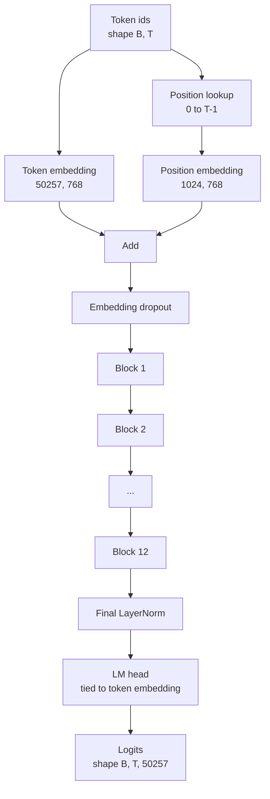
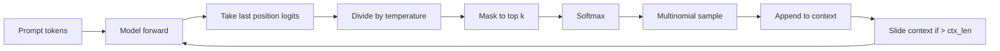

# GPT 模型组装

> 十二个块 堆叠, una Token Embedding, una aprendizaje obtenido de la posición Embedding, una LayerNorm final, así como un modelo de lenguaje de peso-bado cabeza. Éste es el completo 1.24 mil millones de parámetros GPT 模型──本课将把这些组件组装成一个可运行的类,统计参数确认模型匹配参考的 124M 形状,并使用多号样本,温度和顶-k 生成文本──

**Type:** Build
**Languages:** Python
**Prerequisites:** Phase 19 lessons 30 到 34
**Time:** ~90 分钟

## Objetivos de aprendizaje

- 将 lección 34 组装成完整 GPT 模型:Token Embedding、Position Embedding、N 个块、最终 LayerNorm、language model head──
- 复现 1.24 亿参数配置:vocacab 50257 文本 1024 嵌入 768 十二个头十二层──
- Para el modelo de lenguaje, el peso está vinculado a la incorporación de tokens, y explica por qué esto puede ahorrar alrededor de 38 millones de parámetros en esta escala.
- Utiliza muestreo multinomial, escala de temperatura y truncado de la parte superior de k de la página de texto,并用滑窗 保持 context length。
- Controle 124M  objetivos de la medida de parámetros cuenta 和 adelante pasar 成本。

## El problema

bloque transformador 单独存在时什么也做不了―― necesitas convertir los IDs de los tokens 转变成向量,混入位置信息,让它们穿越堆,再投投回词汇逻辑―― omitir cualquier paso de estos cuatro pasos, el modelo o no puede avanzar, o la información de la posición se desplaza, o no puede hablar―

La forma del modelo también es importante. Referencia GPT-2 pequeño en la configuración precisa de arriba es 1.24 millones de parámetros. Estos números no son misteriosos. Vocab 50257  multiplicando por embebedimiento 768 es una tabla de tokens. La posición 1024  multiplicando por 768 es una tabla de posiciones.

## El concepto



Los tokens se convierten en tokens vectores. Los tokens se convierten en tokens vectores. Los tokens de posición se convierten en tokens de posición.

### Enlace de peso

Embedding de símbolo de la forma es `(vocab, d_model)`◊ cabezal de modelo de lenguaje 需要从 `d_model`投影回    proyectos de proyectos`vocab`△ se transfieren entre sí. △ se vinculan, es decir, literalmente, se usa el mismo tensor de parámetros, con dos veces. En la vocabulario 50257 y d_modelo 768 abajo, esta matriz tiene 3800 millones de parámetros.

### La inserción de posición es aprender de, no sinusoidal

GPT-2 使用学习得到的位置嵌入式位置表是一个形状为`(1024, 768)`El modelo en cada paso adelante 查找位置 0到T-1,并把查找结果加到Token Embedding 上── es el esquema de posición más simple  RoPE、ALiBi、T5 relativa sesgo es un esquema de sustitución), también 124M 参考模型使用的方案──

### Generación: temperatura, top-k, multinomal

La generación es autoregresista. Cada paso, el modelo regresa en cada posición al vocabulario completo de las logas superiores. Sólo toma una última posición, aparte de la temperatura, para que todos los logos superiores fuera de los logos superiores se encuentren en la máscara de infinito negativo, de la probabilidad de obtener una probabilidad de máxima, y luego, de la distribución obtenida, muestra un token.



Tres rotos, para hacer frente a tres diferentes comportamientos. La temperatura 接近零会退化成贪. La temperatura 为一时匹配模型的自然分布.


```figure
cc-gpt-assembly
```

## Construye el mismo

`code/main.py` realización:

- `class GPTConfig`Clasificación de datos, con un valor de 124M:`vocab_size=50257`¿Qué es esto?`context_length=1024`¿Qué es esto?`d_model=768`¿Qué es esto?`num_heads=12`¿Qué es esto?`num_layers=12`¿Qué es esto?`mlp_expansion=4`¿Qué es esto?`dropout=0.1`¿Qué es esto?`use_bias=True`¿Qué es esto?`weight_tying=True`¿Qué es eso?
- `class GPTModel`, contiene Embedding Token, Embedido de posición, Embedido abandonado, 12 `TransformerBlock`、 Finales LayerNorm, así como en la bandera 打开时绑定到代币嵌入的 `lm_head`¿Qué es eso?
- `count_parameters`ayudante, regresa el único parámetro de cuenta, por lo tanto, el cálculo de peso se corre correcta.
- `generate`Función, ejecutar temperatura, top-k, multinomio y contexto de ventana corredera.
- Una demostración, construir un modelo, imprimir parámetros contados y no con referencia 124M en el control, luego de un instante fijo generar una secuencia corta, mostrar el pipeline de extremo a extremo operable.

¿Qué es eso ?

```bash
python3 code/main.py
```

输出:parámetro de conteo con 124M 参考值的对照、 desde el instante fijo 生成的代币 ids, así como la confirmación de la memoria compartida de embedimiento de los tokens y de la cabeza de LM en el momento de la vinculación 打开时 和 Token Embedding──

Para hacer que la demostración se mantenga rápida, el guión también se ejecutará de un pequeño configurador.`d_model=64`¿Qué es esto?`num_layers=2`),并 inline 打印生成的代币序列──124M configuración 会被构建, pero sólo ejecutar el conteo de parámetros 和一次前传──

## El establo

- `torch`Utilizando matemáticas tensores, autogrado y plomería de módulos.
- `code/main.py`En la re-realización local del mismo patrón de bloque en la lección 34.

## Modelos de producción en la naturaleza

Tres modos deciden si un modelo sólo puede correr o realmente entregar.

**把 residual projections 初始化得小一些。**La proyección de salida de la atención y la segunda línea de MLP entrarán directamente en la adición residual. Si se utilizan desviaciones estándar similares a otras líneas, iniciarán las proyecciones, el flujo residual aumentará con la profundidad, y se introducirá en la supercalentadora.`1 / sqrt(2 * num_layers)`缩放;residual stream 就能在十二层中保持合理范围──

**缓存 position id tensor，不要重复计算。** `torch.arange(T)`Se distribuye el nuevo interior en cada paso.`__init__`En el contexto máximo, dividido una vez, cada vez que se utiliza, se cortan las entradas anteriores, se saltan al distribuidor 往返──

**在 parameter 层面 tie weights，而不只是 copy。** configuración `lm_head.weight = token_embedding.weight`¿Cómo se puede hacer una copia de un parámetro, un gráfico de autocráneo, una acumulación?

## Usalo

- La forma del modelo de esta clase es la misma que la de la siguiente clase que debe entrenarse.
- Se puede obtener la familia LLaMA, sin necesidad de cambiar el bloque o la cabeza.
- Para reemplazar GELU por SiLU, para reemplazar LayerNorm por RMSNorm, se puede obtener el resto de variaciones de la familia LLaMA.
- Función de generación se puede utilizar para cualquier logs Source, no sólo se limita a este modelo. Puede extraer logs de un archivo GPT-2 preentrenado en la lección 37 y volver a usar el mismo ciclo de generación.

## Los ejercicios

1. 解除 LM head 与 Token Embedding 的绑定并重新统计参数──验证差值为 50257 乘以 768 = 3800 millones──
2. Se aprenderá a colocar la posición de la tabla sinusoidal en el cálculo de la construcción.
3. Por generación 添加 `greedy=True`bandera, saltar por muestreo, 并选择 argmax── confirmación de la secuencia en varias veces de la operación.
4. 添加                                                                                                                                                                                                                                                                                                                                                                                                                                                                                                                           `repetition_penalty`旋, antes de softmax , será un prompt o logit de cualquier token generado en la historia excepto en una constante.  Usar un prompt fijo  mostrar un valor mayor que uno para reducir el número de repeticiones en la salida.
5. En el`top_k`旁边添加 `top_p`(nucleus) muestreo── utilizó dos líneas de verificación para confirmar la probabilidad de retener tokens 之和超过 `top_p`¿Qué es eso?

## Términos clave

| Term | What people say | What it actually means |
|------|-----------------|------------------------|
| Weight tying | “Tied embeddings” | LM head 和 Token Embedding 共享同一个 parameter tensor；节省 vocab times d_model 参数，并匹配 GPT-2 参考模型 |
| Position embedding | “Learned positions” | 一个单独的 table，形状为 (context length, d_model)，加到 token vectors 上；端到端学习得到 |
| Sliding window context | “Context cap” | 当 prompt 加生成 tokens 超过 context length 时，丢弃最旧的 tokens，让 active window 能放下 |
| Top-k sampling | “K truncation” | 保留值最高的 K 个 logits，把其余 logits mask 成 negative infinity，并在剩余项上 softmax |
| Temperature | “Sampling temperature” | 在 softmax 前用 T 除以 logits；T 小于 1 会变尖锐，T 等于 1 保持自然 distribution，T 大于 1 会变平坦 |

## Leer más

- Fase 19 lección 34, conocer el bloque de la acumulación del modelo.
- Fase 19 lección 36, aprender a usar la pérdida de entropía cruzada 驱动本模型的训练循环──
- Fase 19 lección 37, aprender cómo poner los pesos preentrenados GPT-2 加载到这个精确建筑 中──
- Fase 7 lección 07 ((GPT modelado de lenguaje causal), entender la siguiente predicción simbólica de matemáticas。
- Fase 10 lección 04 ((pre-entrenamiento mini GPT), conocer la misma arquitectura 上的原始训练过程──
