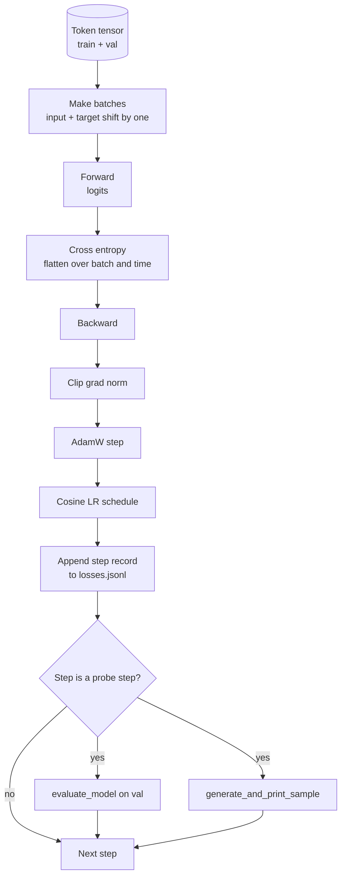

# El ciclo de formación y la evaluación

> La forma de aprender a hacer el trabajo de la escuela de la escuela de la escuela de la escuela de la escuela de la escuela de la escuela de la escuela de la escuela de la escuela de la escuela de la escuela de la escuela de la escuela de la escuela de la escuela de la escuela de la escuela de la escuela de la escuela de la escuela de la escuela de la escuela de la escuela de la escuela de la escuela de la escuela de la escuela de la escuela de la escuela de la escuela de la escuela de la escuela de la escuela de la escuela de la escuela de la escuela de la escuela de la escuela de la escuela de la escuela de la escuela de la escuela de la escuela de la escuela de la escuela de la escuela de la escuela de la escuela de la escuela de la escuela de la escuela de la escuela de la escuela de la escuela de la escuela de la escuela de la escuela de la escuela de la escuela de la escuela de la escuela de la escuela de la escuela de la escuela de la escuela de la escuela de la escuela de la escuela de la escuela de la escuela de la escuela de la escuela de la escuela de la escuela de la escuela de la escuela de la escuela de la escuela de la escuela de la escuela de la escuela de la escuela de la escuela de la escuela de la escuela de la escuela de la escuela de la escuela de la escuela de la escuela de la escuela de la escuela de la escuela de la escuela de la escuela de la escuela de la escuela de la escuela de la escuela de la escuela de la escuela de la escuela de la escuela de la escuela de la escuela de la escuela de la escuela de la escuela de la escuela de la escuela de la escuela de la escuela de la escuela de la escuela de la escuela de la escuela de la escuela de la escuela de la escuela de la escuela de la escuela de la escuela de la escuela de la escuela de la escuela de la escuela de la escuela de la escuela de la escuela de la escuela de la escuela de la escuela de la escuela de la escuela de la escuela de la escuela de la escuela de la escuela de la escuela de la escuela de la escuela de la escuela de la escuela de la escuela de la escuela de la escuela de la escuela de la escuela de la escuela de la escuela de la escuela de la escuela de la escuela de la escuela de la escuela de la escuela de la escuela de la escuela de la escuela de la escuela de la escuela de la escuela de la escuela de la escuela de la escuela de la escuela de`calc_loss_batch`ayudante ∼ en el mantenimiento de datos `evaluate_model`Pasa cada paso de una vez.`generate_and_print_sample`La sonda de determinación, así como el registro de pérdida JSONL que puede ser dibujado después.

**Type:** Build
**Languages:** Python
**Prerequisites:** Phase 19 lessons 30 到 35
**Time:** ~90 分钟

## Objetivos de aprendizaje

- Construir un bucle de entrenamiento, para la próxima predicción de tokens Utiliza la entrada correcta y alineación de objetivos para calcular la pérdida de entropía cruzada―
- Configurar AdamW, hacer que la desintegración de peso  se utiliza para los tensores de peso, no se utiliza para los tensores de LayerNorm o de sesgo 
- 实现带线性变暖和宇宙衰退的学习率时间表,并读取 LR 随时间的变化──
- Uso `evaluate_model`En el caso de las evaluaciones realizadas en divisiones, la pérdida de evaluaciones puede ser comparada.
- Cada paso`generate_and_print_sample`Para que se pueda detectar la divergencia en la curva de pérdida, se puede crear una muestra de la determinación.
- Para que cada paso de pérdida se perpetue en JSONL, para volver a cargar, dibujar, y hacer el registro de entrenamiento como entregable.

## El problema

Un guión de entrenamiento que sólo imprime pérdida y todo lo que no hace fracasa en tres aspectos. No puede decirte si la pérdida es debido a que la causa correcta está en la baja. El modelo puede ser que sólo esté sobrepeso en el conjunto de entrenamiento, pero nunca realmente aprendió. No puede decirte si la divergencia está comenzando.

En este curso, el ciclo utiliza tres formas de medir. Cada paso en el lote de entrenamiento es la pérdida. Cada paso en el lote de entrenamiento es la pérdida. Cada paso en el lote de entrenamiento es el resultado de un seguimiento.

## El concepto



La parte más evidente es la alineación de pérdidas y la división de la decadencia de AdamW.

### Alineación de pérdidas

模型在每个位置预测下一个代币―― Si el lote de entrada es de los tokens `[t0, t1, t2, t3]`, entonces el lote objetivo   debe ser `[t1, t2, t3, t4]`◊ Entropia cruzada en forma plana `(batch * seq, vocab)`上计算,并对照 objetivo plano `(batch * seq,)`◊ Olvidar el cambio, se va a entrenar el modelo en la predicción de sí mismo; esto va a recibir hasta cero pérdida, pero no aprender a nada útil.

### AdamW decadencia dividido

La desintegración del peso regularizará los tensores de peso, pero no regularizará las escalas de normalización o los sesgos. La desintegración se coloca en la escala de LayerNorm.

### Calentamiento más horario cosino

El calentamiento se realizará en unos cientos de pasos para reducir la tasa de aprendizaje desde la rampa de cero hasta el valor objetivo, permitiendo que el estado de optimización tenga tiempo para llenar. El descomposición de la cosina se realizará en los pasos restantes para reducir la tasa de aprendizaje hacia cero, haciendo que la etapa final sea más pequeña en el tamaño de los pasos y los pesos de la melodía de la melodía. Este conjunto es el más común en el programa de capacitación de LLM de pesos abiertos, ya que elimina la mayoría de los momentos de vulnerabilidad de los primeros mil pasos y los últimos mil pasos.

### Evaluación realizada

`evaluate_model`Se puede calcular el número de lotes de la validación, la pérdida acumulada, la pérdida de los lotes, la pérdida acumulada, la pérdida de los lotes, y luego regresar.

### Muestreo cualitativo como señal temprana

Una pérdida de entrenamiento Bajó muy bien, pero las muestras generadas son todas del mismo token. El modelo es malo. Una curva de pérdida parece plana, pero las muestras generadas se convierten en un modelo de palabras que están aprendiendo.


```figure
cap-training-loop
```

## Construye el mismo

`code/main.py` realización:

- `make_batches(token_ids, batch_size, context_length)`, dará una gran cantidad de tensores de símbolo 成 entrada y pares de objetivos.
- `calc_loss_batch(model, inputs, targets)`, ejecutar hacia adelante, planear,并 devolver entropía transversal escalar.
- `evaluate_model(model, val_loader, max_batches)`, en ningún grado, abajo, en los lotes de validación de un número fijo,并返回 mean loss──
- `generate_and_print_sample(model, prompt, max_new_tokens)`, en el instante fijo 上运行 lección 35 de la función de generación 并印印结果──
- `build_param_groups(model, weight_decay)`, genere dos grupos lista de parámetros de AdamW
- `cosine_with_warmup(step, warmup_steps, total_steps, max_lr, min_lr)`, regresar a la etapa de LR.
- `train(...)`, , , , , , , , , , , , , , , , , , , , , , , , , , , , , , , , , , , , , , , , , , , , , , , , , , , , , , , , , , , , , , , , , , , , , , , , , , , , , , , , , , , , , , , , , , , , , , , , , , , , , , , , , , , , , , , , , , , , , , , , , , , , , , , , , , , , , , , , , , , , , , , , , , , , , , , , , , , , , , , , , , , , , , , , , , , , , , , , , , , , , , , , , , , , , , , , , , , , , , , , , , , , , , , , , , , , , , , , , , , , , , , , , , , , , , , , , , , , , , , , , , , , , , , , , , , , , , , , , , , , , , , , , , , , , , , , , , , , , , , , , , , , , , , , , , , , , , , , , , , , , , , , , , , , , , , , , , , , , , , , , , , , , , , , , , , , , , , , , , , , , , , , , , , , , , , , , , , , , , , , , , , , , , , ,`outputs/losses.jsonl`,并每 `eval_every`pasos 打印 evaluación pérdida 和 muestra。
- Una demostración, en datos sintéticos 上训练小模型少量步骤, escribir en JSONL registro, y en puntos de la sonda 打印评估损失和样本── esta demostración en la CPU 上远低于一分钟即可完成──

¿Qué es eso ?

```bash
python3 code/main.py
```

输出: cada paso de pérdida 行、 cada paso de la sonda de pérdida de evaluación、 cada paso de la sonda de la muestra generada, así como el final `outputs/losses.jsonl`, puedes usarlo .`json.loads`按行加载它──

## El establo

- `torch`Utilizado en autograd, Optimizer y módulos.
- `main.py`En la reaparición de la lección 35 `GPTModel`Y los módulos de apoyo.

## Modelos de producción en la naturaleza

Tres modos convertirán el ciclo de libros de texto en algo que se puede hacer toda la noche.

**Gradient norm clipping 不可协商。**Un mal lote de datos (normal datos, picos de LR, números de límites) se producirá un enorme Gradiente, eliminar el resultado de la formación de un par de horas.`backward`Después,`step`之前调用 `torch.nn.utils.clip_grad_norm_(params, max_norm=1.0)`, permite que el optimizador  mantener en el rango de seguridad ⋅ el valor de recorte es un parámetro libre; 1 es el valor predeterminado de la mayoría de las configuraciones ⋅

**可恢复的 JSONL logging，而不是 pickled state。**                                                                                                                                                                                                                                                                                                                                                                                                                                                                                                                             `{"step": int, "train_loss": float, "lr": float}`行写入 JSONL es resistente: cualquier accidente dejará un artefacto legible, puedes grabarlo, puedes usar treinta líneas de Python 绘图, también puedes leer el último paso para recuperar el entrenamiento.

**Eval batches 来自固定 slice。**Los tokens de validación en el script  se cortan en lotes al iniciar, en lugar de generar en movimiento.

## Usalo

- El ciclo de este curso es el mismo que el entrenamiento en datos reales de 124M  modelo de esqueleto ⋅ ⋅ ⋅ ⋅ ⋅ ⋅ ⋅ ⋅ ⋅ ⋅ ⋅ ⋅ ⋅ ⋅ ⋅ ⋅ ⋅ ⋅ ⋅ ⋅ ⋅ ⋅ ⋅ ⋅ ⋅ ⋅ ⋅ ⋅ ⋅ ⋅ ⋅ ⋅ ⋅ ⋅ ⋅ ⋅ ⋅ ⋅ ⋅ ⋅ ⋅ ⋅ ⋅ ⋅ ⋅ ⋅ ⋅ ⋅ ⋅ ⋅ ⋅ ⋅ ⋅ ⋅ ⋅ ⋅ ⋅ ⋅ ⋅ ⋅ ⋅ ⋅ ⋅ ⋅ ⋅ ⋅ ⋅ ⋅ ⋅ ⋅ ⋅ ⋅ ⋅ ⋅ ⋅ ⋅ ⋅ ⋅ ⋅ ⋅ ⋅ ⋅ ⋅ ⋅ ⋅ ⋅ ⋅ ⋅ ⋅ ⋅ ⋅ ⋅ ⋅ ⋅ ⋅                                                                                                                                                                                                                                                                                                       `datasets`El cargador de la línea, el circuito, puede funcionar en forma constante.
- JSONL log es convertir la carrera de entrenamiento en prueba de entregable.
- La sonda de muestras de determinación es una pérdida escalar irreparable.

## Los ejercicios

1. 添加                                                                                                                                                                                                                                                                                                                                                                                                                                                                                                                           `weight_decay_groups()`Pruebas unitarias, escala de confirmación y parámetros de sesgo 落入 no grupo de desintegración, y los pesos lineales y de incorporación 落入 grupo de desintegración。
2. Usando un pequeño texto en el archivo bytes  sustituir los tokens aleatorios sintéticos, hacer demo en el contenido de lectura  Entrenamiento  Prueba generada muestra  Uso de caracteres existentes en el archivo 
3. Por el horario cosino 添加一个 `min_lr`piso, valor `max_lr`del 10%,并重新绘图──
4. Además de JSONL log`eval_every`pasos 保存一个检查点──添加 `resume_from`bandera para volver a cargar el estado del modelo y el estado del optimizador.
5. En la pérdida 旁边记录每步吞吐量 (tokens por segundo),并确认它保持在稳定区间──

## Términos clave

| Term | What people say | What it actually means |
|------|-----------------|------------------------|
| Loss alignment | “Shift by one” | Input tokens 位于 positions 0..T-1，target tokens 位于 positions 1..T；cross entropy 在 flattened shapes 上计算 |
| Decay split | “Two groups” | AdamW 接收带 weight decay 的 matrix shaped tensors，以及不带 decay 的 scale 或 bias tensors |
| Warmup | “Ramp” | learning rate 在固定步数内从零爬升到目标值，让 Optimizer state 可以填充 |
| Eval batches | “Held out batches” | validation token tensor 的一个固定 slice，在 script 启动时 slice 一次，并在每个 probe 中相同使用 |
| Qualitative probe | “Sample print” | 每 K steps 从固定 prompt 打印一次短 generation，用于捕捉单靠 loss 会隐藏的 failure modes |

## Leer más

- Fase 19 lección 35, entender el modelo de ciclo 驱动的模型──
- Fase 19 lección 37, aprender cómo poner pesas preentrenadas en el mismo modelo.
- Fase 10 lección 04 ((pre-entrenamiento mini GPT), comprender el proceso de datos de verdad
- Fase 10 lección 10 (evaluación), comprender la pérdida de entropía cruzada 之外更廣的 eval surface──
