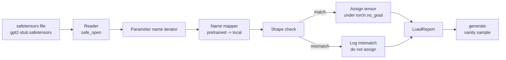

# Carga de pesas entrenadas

> Desde el entrenamiento de cero un modelo de parámetros de 124 millones es la decisión presupuestaria; carga un punto de control público es la operación diaria.

**Type:** Build
**Languages:** Python
**Prerequisites:** Phase 19 lessons 30 to 36
**Time:** ~90 minutes

## Objetivos de aprendizaje

- Uso `safetensors`Biblioteca de Python 读取 file safetensors,并检查 tensor names 和 shapes。
- Se puede leer el nombre de cada parámetro pre-entrenado 映射到课 35 GPT modelo 内部一个参数──
- 处理 publicado GPT-2 pesos con este modelo de pista  entre diferentes dos conjuntos de nombres约定:`wte/wpe/h.N.attn.c_attn/c_proj`Y `mlp.c_fc/c_proj`,对应本地命名的 `tok_embed/pos_embed/blocks.N.attn.qkv/out_proj`Y `mlp.fc1/fc2`¿Qué es eso?
- En cualquier asignación de peso 发生前,检测并拒绝形状不匹配,并给出清晰错误──
- Utiliza pesas cargadas 生成一个短续作,并确认代币来自加载分布,而不是 distribución inicial aleatoria。

## El problema

Los pesos publicados no son para tu arquitectura 打包的. Ellos llevan el nombre original de implementación de uso.`(2304, 768)`de la `transformer.h.0.attn.c_attn.weight`Su modelo                                                                                                                                                                                                                                                                                                                                                                                                                                                                                                                            `(2304, 768)`de la `blocks.0.attn.qkv.weight`(Es la misma Matrix, simplemente la convención de diseño no es igual), o tu modelo utiliza `nn.Linear`, se transformará en forma de almacenamiento Matrix. El mismo parámetro aparecerá con tres pequeños diferentes tipos de identidad.

 blind copy loader  blind copy loader  blind copy loader  blind copy loader  blind copy loader  blind copy loader  blind copy loader  blind copy loader  blind copy loader  blind copy loader loader loader loader loader loader loader loader loader loader loader loader loader loader loader loader loader loader loader loader loader loader loader loader loader loader loader loader loader loader loader loader loader loader loader loader loader loader loader loader loader loader loader loader loader loader loader loader loader loader loader loader loader loader loader loader loader loader loader loader loader loader loader loader loader loader loader loader loader loader loader loader loader loader loader loader loader loader loader loader loader loader loader loader loader loader loader loader loader loader loader loader loader loader loader loader loader loader loader loader loader loader loader loader loader loader loader loader loader loader loader loader loader loader loader loader loader loader loader loader loader loader loader loader loader loader loader loader loader loader loader loader loader loader loader loader loader loader loader loader loader loader loader loader loader loader loader loader loader loader loader loader loader loader loader loader loader loader loader loader loader loader loader loader loader loader loader loader loader loader loader loader loader loader loader loader loader loader loader loader loader loader loader loader loader loader loader loader loader loader loader loader loader loader loader loader loader loader loader loader loader loader loader loader loader loader loader loader loader loader loader loader loader loader loader loader loader loader loader loader loader loader loader loader loader loader loader loader loader loader loader`LoadReport`Las notas, las faltas y las desajustes de forma, te permiten leer lo que pasó.

## El concepto



Nombre de mapa                                                                                                                                                                                                                                                                                                                                                                                                                                                                                                                          `torch.no_grad()`内部, por lo tanto autograd no seguirá el proceso de carga―Report 会保存每个名的结果―

### La convención de nombramiento de GPT-2

Pesos publicados GPT-2 使用如下名称:

| Pretrained name | Shape | Meaning |
|-----------------|-------|---------|
| `wte.weight` | (50257, 768) | Token Embedding |
| `wpe.weight` | (1024, 768) | Position Embedding |
| `h.N.ln_1.weight` | (768,) | block N 的 LayerNorm 1 scale |
| `h.N.ln_1.bias` | (768,) | block N 的 LayerNorm 1 shift |
| `h.N.attn.c_attn.weight` | (768, 2304) | 融合 QKV linear weight |
| `h.N.attn.c_attn.bias` | (2304,) | 融合 QKV linear bias |
| `h.N.attn.c_proj.weight` | (768, 768) | Attention output projection |
| `h.N.attn.c_proj.bias` | (768,) | Attention output projection bias |
| `h.N.ln_2.weight` | (768,) | LayerNorm 2 scale |
| `h.N.ln_2.bias` | (768,) | LayerNorm 2 shift |
| `h.N.mlp.c_fc.weight` | (768, 3072) | MLP fc1 weight |
| `h.N.mlp.c_fc.bias` | (3072,) | MLP fc1 bias |
| `h.N.mlp.c_proj.weight` | (3072, 768) | MLP fc2 weight |
| `h.N.mlp.c_proj.bias` | (768,) | MLP fc2 bias |
| `ln_f.weight` | (768,) | Final LayerNorm scale |
| `ln_f.bias` | (768,) | Final LayerNorm shift |

Hay dos hechos inesperados que se deben hacer.`c_attn`¿Qué es esto?`c_proj`¿Qué es esto?`c_fc`Esta matriz de almacenamiento de líneas, en comparación con`nn.Linear.weight`期望方式是转置的──Loader 会在分配时转置──LM head 完全不在文件中;model dependió con `wte`de peso, por lo tanto, una vez `wte`¿Qué pasa? ¿Qué pasa?

### La convención local de nombres

本轨的模型 使用描述性名称:

| Local name | Meaning |
|------------|---------|
| `tok_embed.weight` | Token Embedding |
| `pos_embed.weight` | Position Embedding |
| `blocks.N.ln1.scale` | block N 的 LayerNorm 1 scale |
| `blocks.N.ln1.shift` | LayerNorm 1 shift |
| `blocks.N.attn.qkv.weight` | 融合 QKV |
| `blocks.N.attn.qkv.bias` | 融合 QKV bias |
| `blocks.N.attn.out_proj.weight` | Attention output projection |
| `blocks.N.attn.out_proj.bias` | Output projection bias |
| `blocks.N.ln2.scale` | LayerNorm 2 scale |
| `blocks.N.ln2.shift` | LayerNorm 2 shift |
| `blocks.N.mlp.fc1.weight` | MLP fc1 |
| `blocks.N.mlp.fc1.bias` | MLP fc1 bias |
| `blocks.N.mlp.fc2.weight` | MLP fc2 |
| `blocks.N.mlp.fc2.bias` | MLP fc2 bias |
| `final_ln.scale` | Final LayerNorm scale |
| `final_ln.shift` | Final LayerNorm shift |

El mapeo es una función fija.

### El accesorio de la planta

El GPT-2 real tiene un peso de aproximadamente 0,5 GB. El demo no los descarga; genera una fijación de pequeños safetensores en su primera operación, adopta la misma convención de nombramiento GPT-2, y utiliza formas de 12 bloques, y no de 768 de modelo 192. Este fijo tiene una estructura correcta, puede desencadenar el camino de código de cada línea en el cargador.


```figure
cc-weight-remap
```

## Construye el mismo

`code/main.py` realización:

- Una lección 35 `GPTModel`De pequeño en pequeño, hacer que este curso se incluya.
- `make_pretrained_to_local(num_layers)`,展开每层条目──
- `load_safetensors(model, path)`,代 nombres、mapping nombres、检查形、转置 conv1d estilo pesas, y`torch.no_grad()`Mi misión es volver.`LoadReport`¿Qué es eso?
- `make_stub_safetensors(path, cfg)`, generar un archivo fijo de la adopción de la convención de nombres previamente entrenado de la precisión.
- Una demostración: la primera operación en la creación`outputs/gpt2-stub.safetensors`, construir un modelo nuevo, capturar al azar init 生成 una continuación, cargar el estúb, volver a capturar otra continuación, imprimir los dos,并验证两者不同(加载确实改变了模型) 

运行:

```bash
python3 code/main.py
```

Producción:caminado de fijación, nombre de cada uno de los registros de carga,`LoadReport`resumen ‧carga previa ‧continuidad de carga posterior, así como un solo tensor malo injectado en el dispositivo  provocando una desajuste de forma, para cubrir el camino de falla¬¬¬¬¬¬¬¬¬¬¬¬¬¬¬¬¬¬¬¬¬¬¬¬¬¬¬¬¬¬¬¬¬¬¬¬¬¬¬¬¬¬¬¬¬¬¬¬¬¬¬¬¬¬¬¬¬¬¬¬¬¬¬¬¬¬¬¬¬¬¬¬¬¬¬¬¬¬¬¬¬¬¬¬¬¬¬¬¬¬¬¬¬¬¬¬¬¬¬¬¬¬¬¬¬¬¬¬¬¬¬¬¬¬¬¬¬¬¬¬¬¬¬¬¬¬¬¬¬¬¬¬¬¬¬¬¬¬¬¬¬¬¬¬¬¬¬¬¬¬¬¬¬¬¬¬¬¬¬¬¬¬¬¬¬¬¬¬¬¬¬¬¬¬¬¬¬¬¬¬¬¬¬¬¬¬¬¬¬¬¬¬¬¬¬¬¬¬¬¬¬¬¬¬¬¬¬¬¬¬¬¬¬¬¬¬¬¬¬¬¬¬¬¬¬¬¬¬¬¬¬¬¬¬¬¬¬¬¬¬¬¬¬¬¬¬¬¬¬¬¬¬¬¬¬¬¬¬¬¬¬¬¬¬¬¬¬¬¬¬¬¬¬¬¬¬¬¬¬¬¬¬¬¬¬¬¬¬¬¬¬¬¬¬¬¬¬¬¬¬¬¬¬¬¬¬¬¬¬¬¬¬¬¬¬¬¬¬¬¬¬¬¬¬¬¬¬¬¬¬¬¬¬¬¬¬¬¬¬¬¬¬¬¬¬¬¬¬¬¬¬¬¬¬¬¬¬¬¬¬¬¬¬¬¬¬¬¬¬¬¬¬¬¬¬¬¬¬¬¬¬¬¬¬¬¬¬¬¬¬¬¬¬¬¬¬¬¬¬¬¬¬¬¬¬¬¬¬¬¬¬¬¬¬¬¬¬¬¬¬¬¬¬¬¬¬¬¬¬¬¬¬¬¬¬¬¬¬¬¬¬¬¬¬¬¬¬¬¬¬¬¬¬¬¬¬¬¬¬¬¬¬¬¬

## El establo

- `safetensors`Usado en formato de disco y lector de transmisión.
- `torch`Utilizando el modelo y las matemáticas de tareas.
- No se utiliza`transformers`, no utiliza `huggingface_hub`, no realicen llamadas de red.

## Modelos de producción en la naturaleza

Tres patrones que permiten que el cargador se mantenga confiable frente a los pesos que no hayas creado.

**始终在任何 assignment 前验证 file。**打开文件,列出每个子名称 及其dtype 和形状,运行完整映射和形状检查, sólo en el éxito después de comenzar la asignación──半加载模型 是静默失败机器──

**每次 assignment 都记录 source name 和 destination name。**Cuando algo parece ir en contra, el registro te dirá qué tensor ha llegado a dónde; el método alternativo es leer hexdumps.`LoadReport`clase de datos 会跟踪 `loaded`¿Qué es esto?`missing`¿Qué es esto?`unexpected`Y `shape_mismatch`Las listas, y en última imprimir resumen.

**LM head 是 weight tying alias，不是单独 copy。**Carga`tok_embed`后设置 `model.lm_head.weight = model.tok_embed.weight`Es un patrón de regulación.`lm_head.weight`Parámetro 会破坏 tied,并让参数数 翻倍──

## Usalo

- Cargador 适用于任何使用预训练命名公约的安全感器文件──真实GPT-2文件(small / medium / large / xl)无需代码变更 即可工作;只有模型配置 不同──
- Una vez que se actualice el mapa de nombres, el mismo patrón se puede extender a LLaMA、Mistral、Qwen pesos。Cheques de forma 和 informe 保持不变。
- La generación de la cordura después de la carga es una puerta rápida: si las muestras de post carga parecen muestras de pre-carga, la carga no cambia el modelo, también significa que el mapeo  silenciosamente pierde cada tensor.

## Los ejercicios

1. Por cargador 添加 `dtype`Argumento, en la asignación 时将 cada tensor lanzar a la meta dtype(`bfloat16`¿Qué es esto?`float16`¿Qué es esto?`float32`)■ confirmación `float32`modelo puede ser bajado hasta `bfloat16`No se puede generar.
2. 添加                                                                                                                                                                                                                                                                                                                                                                                                                                                                                                                           `expected_layers`Argumento, rechazo carga `h.N`Indices y modelo de`num_layers`No coinciden los puntos de control.
3. Colocar el cargador 接入 lección 35 función de generación,并生成 dos muestras并排: uno proviene de un init aleatorio, uno de un fijo cargado。
4. 添加出口路径:使用预训练命名公约 将当前模型状态 写入一个新的安全感器文件──圆路载机 并确认报告 中形状不匹配 为零──
5. 扩展 `NAME_MAP`以处理 LLaMA naming convention (((无偏见、RMSNorm、fused qkv layout), y en el estub LLaMA fijo que usted genera 上重新运行 loader。

## Términos clave

| Term | What people say | What it actually means |
|------|-----------------|------------------------|
| Name map | "Key remapping" | 从 pretrained tensor names 到 local parameter names 的 function；通常是一个 literal dict，每个 layer index 一个 entry，并在 loop 中展开 |
| Shape mismatch | "Bad shape" | Pretrained tensor 存在于 mapped name 下，但其 dimensions 与 local parameter 不一致；loader 会拒绝 assignment 并记录这对 name |
| Transpose-on-load | "Conv1d layout" | Published GPT-2 将 Attention 和 MLP projections 存储为 nn.Linear 期望形式的转置；loader 会在 assignment 时转置 |
| Weight tying alias | "Shared LM head" | 设置 model.lm_head.weight = model.tok_embed.weight，让 head 和 Embedding 共享 storage；正因为如此，head 不在 file 中 |
| Load report | "Coverage summary" | 一个小型 dataclass，跟踪 loaded、missing、unexpected 和 shape_mismatch lists；打印它可以判断加载是否成功 |

## Leer más

- Fase 19 lección 35: Arquitectura de las pesas de recepción.
- Fase 19 lección 36: generar un ciclo de entrenamiento del mismo punto de control de forma.
- Fase 10 lección 11 ((cuantización):memoria 紧张时如何处理负载重量──
- Fase 10 lección 13 ((construcción de una línea de LLM completa): carga y inferencia 周边的完整生命周期──
