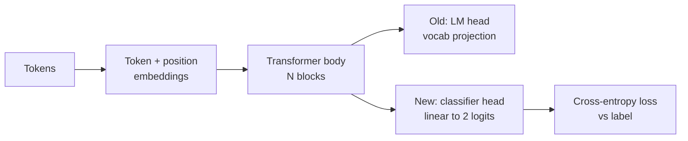
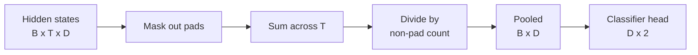
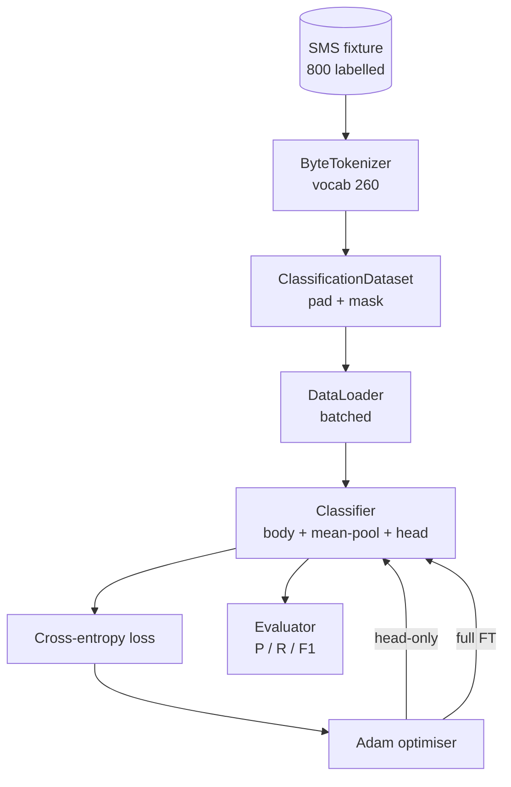

# Capstone Lección 38: a través de la cabeza de cambio  realizar clasificador Fine-Tuning

> El primer capstone de la pista B。El modelo de lenguaje entrenado es una superposición de bloques de autoatención, el final es la cabeza de predicción de tokens。 Cuando se quiere hacer spam vs ham 时, la cabeza es errónea, pero el cuerpo 基本是对的。本课会拆掉头,把一个二级线线层 接到集成表示 上,并用两种方式训练类分类器:final-layer only 和 full fine-tuning。Eval Using held-out split 上的精度、recall 和 F1。

**Type:** Build
**Languages:** Python (torch, numpy)
**Prerequisites:** Phase 19 lessons 30-37 (NLP LLM track: tokenizer, embedding table, attention block, transformer body, pre-training loop, checkpointing, generation, perplexity)
**Time:** ~90 minutes

## Objetivos de aprendizaje

- En caso de no reiniciar el cuerpo, reemplazar la cabeza del modelo de lenguaje por la cabeza de clasificación.
- 实现 dos regímenes de entrenamiento: cuerpo congelado (sólo con la cabeza) y ajuste completo,并共享同一个训练循环──
- Construir una tubería de datos consciente del tokenizador, responsable de relleno, relleno de máscaras,并对注意输出做聚合.
- Desde los logits en bruto  calcular precisión “recall” F1 y matriz de confusión―
-                                                                                                                                                                                                                                                               

## El problema

Ya estás en el corpus genérico  un pequeño transformador ⋅ cabeza de salida ⋅ pondrá el último estado oculto ⋅ proyectar hasta el vocabulario de 1000 tokens ⋅ ahora tienes 800 ⋅ 条标注为垃圾邮件或的短信,希望构建一个二进制分类器──这里有三种选择──

错误选择是基于800 ejemplos de la formación de cero un nuevo clasificador.  El cuerpo del modelo entrenado ya ha codificado una estructura útil: identidad de la palabra, posición, simple coocurrencia.  Perderlo es un desperdicio de la construcción y el cálculo de su consumo.

两个正确选择是头交换 后结身体,以及头交换 后让身体可训练――Head-only training 快速,memory 几乎免费,在这么少的数据上也不太容易过匹配──Full fine-tuning 更慢,在小数据上可能过匹配,但当下游域 偏离预训体时可以达到更高的精度──

Este curso se desarrollará en el mismo tiempo, para que puedas estar en el mismo fijo.

## El concepto



El modelo es una función:`f_theta(tokens) -> hidden_states`La cabeza es una función:`g_phi(hidden) -> logits`◊ Cambiar de cabeza significa retenerse `theta`Y sustituye`g_phi`Los parámetros del cuerpo son una parte costosa. La cabeza es sólo una capa lineal.

Hay dos grupos de parámetros de entrenamiento  muy importante:

- `theta`Cada bloque de atención tiene varios millones de pesos.
- `phi`(cabeza):`hidden_dim * num_classes`Peso más un sesgo.

En el entrenamiento solo en la cabeza, tu objetivo `phi`计算 gradientes,并让 `theta`Los gradientes son los que permiten pasar por los parámetros del cuerpo.`requires_grad=False`Para hacer esto, optimizar, ver la cabeza, el cuerpo, mantenerse congelado.

En el ajuste fino completo, se permite que los gradientes regresen a través de toda la pila. Los pesos del cuerpo se mueven en forma adecuada.

## La cuestión de la unión

Clasificador  necesita cada secuencia un vector, en lugar de cada Token un vector──三种常见选择:

- **Mean pool**: según la máscara de atención 加权, a la secuencia arriba de estados ocultos 取平均──
- **CLS pool**:前置一个特殊代币,并只使用它的输出──这是BERT's做法──
- **Last-token pool**: utilizar el último token no empateado. Esta es la práctica de los clasificadores de la clase GPT.

Este curso utiliza la ponderación de la media de la máscara de atención con peso manifiesto.



## Los datos

Ochocientos mensajes de SMS, 400 mensajes de spam y 400 mensajes de jamón, todos en el centro.`code/main.py`En el generador de datos determinista se utiliza semilla fija, se seleccionan plantillas y se reemplazan los rellenos de ranura, se producen mensajes de longitud entre 5 y 25 tokens.

Datos 按 80/20 split:640 train,160 test。 Splits 使用 stratified, therefore test set 保持 50/50 balance。 one balance 已知的 held-out set 能让精度 和回忆 被当作可信数字 解读。

## Las métricas

Clasificación binaria Clasificación binaria Clasificación binaria Clasificación binaria Clasificación binaria Clasificación binaria Clasificación binaria Clasificación binaria Clasificación binaria Clasificación binaria Clasificación binaria Clasificación binaria Clasificación binaria Clasificación binaria Clasificación binaria Clasificación binaria Clasificación binaria Clasificación binaria Clasificación binaria Clasificación binaria Clasificación binaria Clasificación binaria Clasificación binaria Clasificación binaria Clasificación binaria Clasificación binaria Clasificación binaria Clasificación binaria Clasificación binaria Clasificación binaria Clasificación binaria Clasificación binaria Clasificación binaria Clasificación binaria Clasificación binaria Clasificación binaria Clasificación binaria Clasificación binaria Clasificación binaria Clasificación binaria Clasificación binaria Clasificación binaria Clasificación binaria Clasificación binaria Clasificación binaria Clasificación binaria Clasificación binaria Clasificación binaria Clasificación binaria Clasificación binaria Clasificación binaria Clasificación binaria Clasificación binaria Clasificación binaria Clasificación binaria Clasificación binaria Clasificación binaria Clasificación binaria Clasificación binaria Clasificación binaria Clasificación binaria Clasificación binaria Clasificación binaria Clasificación binaria Clasificación binaria Clasificación binaria Clasificación binaria Clasificación binaria Clasificación binaria Clasificación binaria Clasificación binaria Clasificación binaria Clasificación binaria Clasificación binaria Clasificación binaria Clasificación binaria Clasificación binaria Clasificación binaria Clasificación binaria Clasificación binaria Clasificación binaria Clasificación binaria Clasificación binaria Clasificación binaria Clasificación binaria Clasificación binaria Clasificación binaria Clasificación Clasificación binaria Clasificación Clasificación binaria Clasificación binaria Clasificación Clasificación Clasificación binaria Clasificación Clasificación Clasificación Clasificación Clasificación Clasificación Clasificación Clasificación Clasificación Clasificación Clasificación Clasificación Clasificación Clasificación C

- `TP`:预测为垃圾邮件, en realidad es spam.
- `FP`El spam es un "hamo".
- `FN`Previo: Previo: Por el jamón, en realidad es spam.
- `TN`Previo: Previo: para jamón, en realidad es jamón.

Tres métricas principales:

- `precision = TP / (TP + FP)`¿Cuál es la proporción real de mensajes marcados como spam?
- `recall = TP / (TP + FN)`¿Cuál es la proporción de marcas de modelos en el spam real?
- `F1 = 2 * P * R / (P + R)`◊ la media armónica de la persona

Matriz de confusión 会把四个计数打印为2x2 grid。Demo 会把两个 entrenamiento regímenes resultados fueron escritos hasta el punto de salida。


```figure
cap-classifier-head-swap
```

## Arquitectura



El cuerpo es un transformador muy pequeño: vocab 260 ̊ oculto 64 ̊4 cabezas ̊ 2 bloques ̊ secuencia máxima 32 ̊.`pretrain_quick`El ayudante se encuentra en el mismo texto de fijación en cinco épocas de entrenamiento de LM, haciendo que el cuerpo tenga un punto de partida extraordinario.

## Lo que construirás

La implementación es una `main.py`加一个试验模块(`code/tests/test_main.py`)。

1. `ByteTokenizer`:把 bytes 映射到 ids,并保留一个pad id──
2. `Block`Un bloque de transformador de la capa de alimentación y de transmisión de la atención de la cabeza múltiple. Pre-norma.
3. `LMBody`:Token + posición Embebidos 加上一叠块── retornar estados ocultos──
4. `MeanPool`: en el eje de la secuencia hacer media ponderada en máscara
5. `Classifier`:cuerpo,pool, cabeza lineal.En diferentes regímenes, el cuerpo es el mismo caso.
6. `freeze_body`Y `unfreeze_body`: cambio de parámetros del cuerpo                                                                                                                                                                                                                                                                                                                                                                                                                                                                                                                     `requires_grad`¿Qué es eso?
7. `train_classifier`Un modelo de recepción y un grupo de parámetros de configuración de optimización para el momento.
8. `evaluate`: Se puso el ensayo de ejecución y no regresó`Metrics(precision, recall, f1, confusion)`¿Qué es eso?
9. `run_demo`:先简短预训练 body,然后训练并评估头脑,再训练并评估完整,打印两个报告,并以零退出──

## Por qué es importante la comparación

Regimen de solo cabeza normalmente entrenar más rápido,并以更平滑的方式 underfit── en este fijo, entrenamiento solo cabeza 后二十个时代, usted normalmente verá la precisión 接近 0.9、回忆 接近 0.85──Total ajuste fino 大约慢三倍, el resultado final va a flotar en varios puntos dentro, dependiendo de la semilla aleatoria──

Este curso no es un ganador. Le enseña a entender los números y el costo. Este curso es un trabajo de trabajo de 800 ejemplos y un cuerpo pequeño.`train_classifier`Función 处理两种情况, juntos 只是一次调用──

## Se extienden los objetivos

- Añade el tercer régimen, sólo descongelar el último bloque. Esto a veces se llama ajuste parcial.
- 添加学习率调节器──对头 用kosine时间表,并对身体 使用更小的常率,是常见的生产设置──
- Usó el pool de atención aprendida  sustituir el pool medio: una带有一个学习查询的小注意层── en secuencias más largas arriba suele ser superior al pool medio──

La implementación te dio ganchos. Las pruebas fijaron el contrato.
