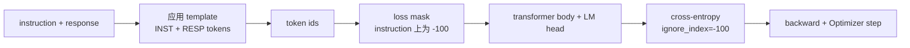
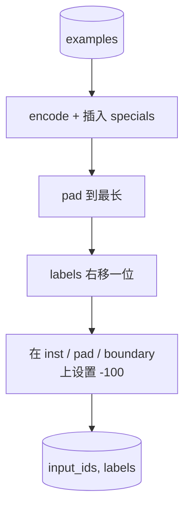
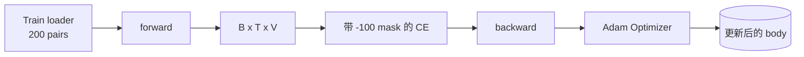

# Capstone 课程 39: A través de la regulación supervisa  realizar la regulación de instrucciones

> Modelo base preentrenado puede prolongar una secuencia, pero no puede seguir una instrucción. El ajuste fino supervisado es la menor modificación de este punto: hacia el modeloing por instrucción 和 expectativa respuesta 配对组合的样本,并训练主体来预测响应代币. El clave es que sólo desees perder 计算反应, no instrucción.`ignore_index=-100`屏蔽 instrucción tokens, en 200 pares de instrucción-respuesta 上训练,并使用精确匹配在持久的分分上评估──

**Type:** Build
**Languages:** Python (torch, numpy)
**Prerequisites:** Phase 19 lessons 30-37 (NLP LLM track: tokenizer, embedding table, attention block, transformer body, pre-training loop, checkpointing, generation, perplexity)
**Time:** ~90 minutes

## Objetivos de aprendizaje

- Se formará una secuencia causal de datos de instrucción-respuesta con tokens de límite manifiesto.
- Construir una función de collage, proteger los tokens de instrucción, hacer que la entropía cruzada sólo calcular los tokens de respuesta.
- En el objetivo SFT, entrenar un pequeño cuerpo transformador,并 observar cambios en la métrica de evaluación.
- 实现 avidez 和 generación de muestras de temperatura,并 observar el límite de respuesta-inicio。
- Para completar la generación, calcular el partido exacto.

## El problema

Usar la predicción de los siguientes tokens  El modelo base de entrenamiento                                                                                                                                                                                                                                                                                                                                                                                                                                                                                                             `"What is the capital of France?"`, continuará con este problema, o elaborará una nueva frase. El modelo tiene capacidad lingüística, pero no tiene contrato de formato.

El contrato SFT es una plantilla de cadena. Cada ejemplo de entrenamiento se convierte en una serie de tres regiones:

```text
<INST> What is the capital of France? <RESP> The capital of France is Paris.
```

Los tokens de límite son los tokens especiales que se mantienen durante el entrenamiento.`<RESP>`Después de todo, todo es respuesta, y la respuesta es sólo parte de la evaluación. El siguiente objetivo de la señal de base sigue siendo aplicable.

Pero aquí hay una trampa. Si se da a toda la serie una pérdida de entropía cruzada normal, también se da instrucción en el modelo de entrenamiento.

## El concepto



`ignore_index`Sí `torch.nn.functional.cross_entropy`Una función... cualquier posición objetivo es igual a`ignore_index`Ciudad Contribución Zero Pérdida 和零 Gradiente──PyTorch En el medio de la práctica es `-100`◊La función de colado para cada caso construye dos tensores:`input_ids`(cuadro completo) y `labels`(El artículo`input_ids`de la vice-prefectura, entre las posiciones de instrucción están cubiertas por`-100`)。

模型在前传期间 看到整个序列; Atención puede asistir a la instrucción。Loss 只有计算响应代币──这正是你想要的:condition on the instruction, predict the response。

## Los datos

`main.py`En la determinación se generaron doscientos pares de instrucciones y respuestas.

- hecho de un solo disparo ((X 的首都)
- la aritmética
- extracción de la lista
- resumen de una frase
- código(impresión, orden)
- definición

Cada tarea tiene una instrucción templada y una respuesta determinista. Es un diseño simple. El juego exacto es muy frágil, y la clase utiliza una fijación, la respuesta correcta es un determinado código.

Se dividen en 160 trenes, 40 pruebas, un conjunto de pruebas que cubren todas las seis clases de tareas, por lo que se puede informar de una coincidencia exacta por categoría.

## Tokenización y empate

El tokeniser es de nivel de byte, y tiene tres especiales reservados:

- `INST_ID = 256`: 标记 instrucción región 的开始──
- `RESP_ID = 257`: Marca el límite entre instrucción y respuesta 
- `PAD_ID = 258`: para el relleno de lotes de longitud variable.

El proceso es`[INST] inst_bytes [RESP] resp_bytes [PAD]*` Función de collado:

1. Tokenises Cada ejemplo
2. Para que cada muestra de la serie se encuentre en el lote, se debe llevar a la longitud de la serie más larga.
3.  Construcción `labels`= 右移一位的 `input_ids`(objetivos de LM causales), y:
   - 将 instrucción región 替换为 `-100`¿Qué es eso?
   - 将 region de relleno 替换为 `-100`¿Qué es eso?
   - ¿ Qué ?`RESP_ID`posición límite 本身替换为 `-100`(你不训练模型预测 boundary token; se prevé el contenido posterior)



El cambio es un truco causal estándar:`input_ids`La posición`i`预测 posición `i+1`, por lo tanto `labels[i] = input_ids[i+1]`(entrada 丢弃最终位置,target 丢弃第一位置) mask 在转变 后应用,以落在正确位置上──

## Formación



El ciclo es el estándar PyTorch SFT ciclo。Adam, tasa de aprendizaje 约3e-4到1e-3, en este fijo 上训练十到二十个时代, no utiliza cronómetro。模型足够小(oculto 96、2 bloques、máxima longitud 64), puede en dos minutos dentro de la CPU 上训到收──

Cada cinco épocas, el ciclo se encuentra en un conjunto de espera arriba ejecutar un muy pequeño pase de evaluación y imprimir coincidencia exacta. Veamos coincidencia exacta desde la era uno de 0.0 hasta la era quince 左右 de 0.85, es la clave de esta clase: puedes ver al mismo tiempo el modelo de aprendizaje de formato y respuesta.

## Generación

eval 时,模型获得 instrucción prefijo `[INST] inst_bytes [RESP]`,并生成 tokens, hasta:

- 序列 alcanzar `max_len`, o
- 模型触发一个特殊停止 heurística:连续两个句子结束字节(`.`¿Qué es esto?`!`¿Qué es esto?`?`)。

Este curso ofrece descodación codificada,并附带一个可选温度样本.

## Evaluación exacta

La correspondencia exacta es la métrica de texto más estricta. La cadena de respuesta de la predicción se normaliza (minúsculas, barras blancas, dobles espacios de colapso), y la misma respuesta de referencia normalizada.

Las líneas de SFT reales utilizarán el modelo de prueba de nivel F1 (lección 41) y el modelo de juez  complementar el juego exacto―Exact-match  sigue siendo útil, porque no tiene diferencia; si muestra 0,7, significa que el 70% de las instrucciones de prueba 字符生成黄金反应―


```figure
cc-sft-loss-mask
```

## Lo que construirás

                                                                                                                                                                                                                                                                                                                                                                                                                                                                                                                             `main.py`Además, las pruebas se componen.

1. `InstructionTokenizer`:带 reserved specials 的 byte-level encoder。编码 instrucción prefijo 或 full pair。
2. `make_dataset`Se trata de un proyecto de investigación que se desarrolla en el campo de la investigación y la investigación.
3. `SFTDataset`: para cada caso regresar `(input_ids, labels)`, y ya está listo para la máscara.
4. `sft_collate`:emplenamiento dinámico, construcción de tensor de lote, en instrucción y en posición de almohadilla 上设置 `-100`¿Qué es eso?
5. `TinyGPT`El cuerpo del transformador 加 ligado o desligado cabeza de LM.
6. `train_sft`:SFT loop,带 per-epoch eval hooks──
7. `generate`Desde el prefijo  realizar la decodificación causal, codiciado o muestrado,并带 stop heurística。
8. `exact_match`:comparación de cuerdas normalizada, regreso `[0, 1]`En el interior de la flota.
9. `run_demo`: Construir datos, entrenar veinte épocas, evaluar, imprimir por categoría,并成功时以零 退出──

## Por qué la máscara importa

没有面具,Loss将把指示令牌当作目标――模型会学习预测指示―― es un objetivo diferente,并将从两方面产生更差的模型―― primero, la capacidad del modelo se desperdicia para reestructurar los insumos proporcionados por el usuario总会―― segundo, en la mayoría de los lotes de los tokens de instrucción, la cantidad de tokens de respuesta es mayor, por lo que la respuesta pérdida en el Gradiente 总和中占比较小; Optimizer en la parte que realmente te preocupa es más baja la tasa de aprendizaje efectiva que la previsión――máscara no es polaca; es el objetivo――

## Se extienden los objetivos

- 添加学习速度升温,随后使用阴阳衰变――SFT对 LR比预训更敏感――
- 添加 per token Loss logging,并绘制训练过程中的 Loss curve──注意早期时代 由模板代币(`<RESP>`、prefijos comunes) 主导,后期 épocas 由真实答案代币 主导。
- evaluar  extender a BLEU-1 o chrF.
- Añadir con formato multi-turn de la plantilla de chat, y incluir el seguimiento de fijo 上訓練。

实现会给你格式合约、面具和循环── desde el modelo base hasta el seguidor de instrucciones 目标变化,就是一个拼接函数──
