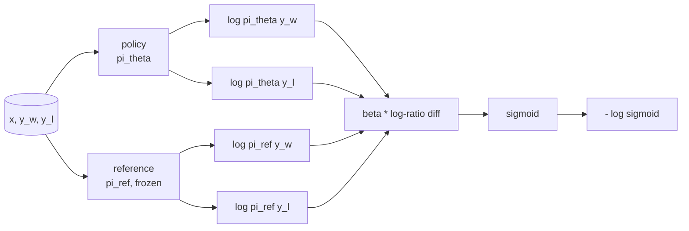
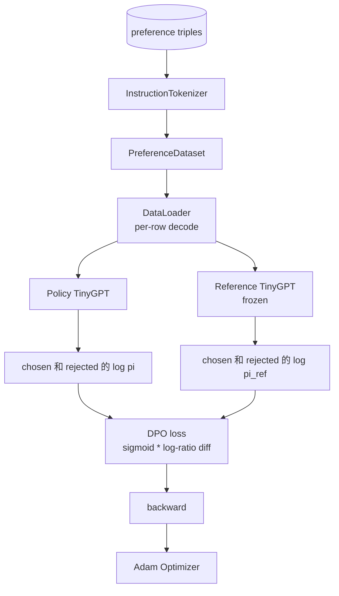

# Capstone  Curso 40: Desde zero empezar a implementar la optimización directa de preferencias

> Modelos de recompensa y PPO es clásico RLHF pila. DPO va a comprimir esta pila en una pérdida supervisada, directamente con pares de preferencias ordenar la política. 本课会从奖励差异身份推导 DPO loss,提供可工作的参考模型 加政策模型,计算每代币日记-概率,并在一个由选和拒绝的完成的 组成的偏好固定上训练小变压器.

**Type:** Build
**Languages:** Python (torch, numpy)
**Prerequisites:** Phase 19 lessons 30-37 (NLP LLM track: tokenizer, embedding table, attention block, transformer body, pre-training loop, checkpointing, generation, perplexity)
**Time:** ~90 minutes

## Objetivos de aprendizaje

- La pérdida de DPO se reduce a la diferencia de log-ratio escalada de la sigmoide, y se conecta a la recompensa implícita.
- Construir un modelo de referencia + par de modelos de política, entre los cuales se puede congelar la referencia ‒la política de formación―.
- En dos modelos, calcula las probabilidades de registro a nivel de secuencia,并 enmascarar los tokens de la llamada.
- En el`(prompt, chosen, rejected)`triples 上训练政策,并观察 elegido log-prob comparado rechazado 上升──
- Utiliza pruebas Fixed Loss math、Gradient sign 和 reference invariance 的行为──

## El problema

Tienes un modelo SFT. Seguirá las instrucciones, pero la salida no está estable; hay algunos completos 清晰,有些冗长或错误. También tienes un pequeño conjunto de datos de pares de preferencias: para el mismo prompt, el ser humano elegirá un completo 标为, otro 标为拒绝.

经典 RLHF 答案是两阶段管线――先用偏好――训练奖励模型――再用 PPO 根据奖励 优化政策―― 这可行,但成本很高:PPO 期间内存中有两个模型,需要KL控制让政策 接近参考,且当奖励模型 脆弱时会出现奖励黑客――

DPO utiliza una pérdida supervisada  sustituir esta dos fases  modelo de recompensa  Política  Directamente en pares de preferencias  Entrenamiento,并带有指向SFT referencia  Penalties KL  En el modelo de preferencias Bradley-Terry  Tiene la misma solución óptima, pero el código es menor 

## El concepto

Desde el modelo Bradley-Terry comenzó.`x`Y dos completos `y_w`(elegido)`y_l`(rechazado), humanos prefer prefer prefer prefer `y_w`La probabilidad es

```math
P(y_w > y_l \mid x) = \sigma\big( r(x, y_w) - r(x, y_l) \big)
```

Entre ellos `r`Es una función de recompensa latente.`r`, y luego entrenar la política .`pi`, con el anclaje KL maximizar `r`¿Qué es esto ?

```math
\max_{\pi} \; \mathbb{E}_{x, y \sim \pi} \big[ r(x, y) \big] - \beta \, \mathrm{KL}(\pi \,\|\, \pi_{\text{ref}})
```

El DPO                                                                                                                                                                                                                                                                                                                                                                                                                                                                                                                           `pi*`Puede usar.`r`写成 forma cerrada:

```math
\pi^*(y \mid x) = \frac{1}{Z(x)} \, \pi_{\text{ref}}(y \mid x) \exp\!\left( \frac{r(x, y)}{\beta} \right)
```

¿ Qué ?`r`Cuentas de nuevo:

```math
r(x, y) = \beta \big( \log \pi^*(y \mid x) - \log \pi_{\text{ref}}(y \mid x) \big) + \beta \log Z(x)
```

`log Z(x)`项对 `y_w`Y `y_l`Depende de lo que sea.`x`, en lugar de`y`), por lo tanto, en el cálculo de la diferencia de preferencias 时会抵消:

```math
\begin{aligned}
r(x, y_w) - r(x, y_l) = \beta \big( &\log \pi_\theta(y_w \mid x) - \log \pi_{\text{ref}}(y_w \mid x) \\
&- \log \pi_\theta(y_l \mid x) + \log \pi_{\text{ref}}(y_l \mid x) \big)
\end{aligned}
```

代入 Bradley-Terry sigmoid,并对偏好对取负记录概率:

```math
\begin{aligned}
L_{\text{DPO}}(\theta) = -\mathbb{E}_{(x, y_w, y_l)} \Big[
  \log \sigma\big( \beta \big( &\log \pi_\theta(y_w \mid x) - \log \pi_{\text{ref}}(y_w \mid x) \\
  &- \log \pi_\theta(y_l \mid x) + \log \pi_{\text{ref}}(y_l \mid x) \big) \big)
\Big]
\end{aligned}
```

Éste es el caso de la pérdida. Es un sigmoide de un sigmoide de un sigmoide, que se calcula en cuatro logos de probabilidades. No hay un modelo de recompensa independiente.



## El signo del gradiente

Antes de cualquier entrenamiento, hay un control de salud mental útil.`log pi_theta(y_w | x)`求 Gradiente:

```math
\frac{\partial L_{\text{DPO}}}{\partial \log \pi_\theta(y_w \mid x)} = -\beta \big(1 - \sigma(z)\big)
```

Entre ellos `z`Es el argumento de sigmoide.`z`Por lo tanto, el objetivo de la política de desarrollo de la región es mejorar la probabilidad de logro de la finalización elegida, reducir las pérdidas.`log pi_theta(y_l | x)`El Gradiente 为正: Mejorar la probabilidad de registro rechazado 会增加 Loss──训练会把选 往上推,把拒绝 往下推──referencia es congelada; no se moverá──

## Los datos

Este curso ofrece 12 triples de preferencias.`(prompt, chosen, rejected)` completado 短且精确── rechazado 冗长、偏题或错误── estos pares 覆盖与课39 相同的任务族(capital、arithmetic、list), por lo tanto, desde la base de SFT 开始的政策会有一个合理起点──

El DPO en producción utilizará miles de pares; el enfoque de este es la pérdida de matemáticas y un bucle capaz de funcionar en un conjunto de datos pequeño de arriba a abajo, y la brecha de registro-probos elegido-versus-rechazado aumentará de forma evidente.

## Invariante de referencia

El DPO                                                                                                                                                                                                                                                                                                                                                                                                                                                                                                                           

- Parámetros de referencia nunca recibirán gradientes.
- Las probabilidades de registro de referencia en las épocas nunca cambiarán.
- política desde la referencia comparables pesos 开始──(optimal `theta`Es una referencia y una actualización aprendida; el primer libro de la política de referencia es un comienzo bien definido.

 Implementar estas características de la siguiente manera:

- pases hacia adelante 期间用 `torch.no_grad()`包裹的参考──
- Para cada parámetro de referencia  configuración `requires_grad=False`¿Qué es eso?
- En referencia                                                                                                                                                                                                                                                                                                                                                                                                                                                                                                                            `policy.load_state_dict(reference.state_dict())`La política de construcción.


```figure
cap-dpo-preference
```

## Arquitectura



模型与课39 中使用的TinyGPT 相同(descoder-only、causal、byte tokeniser) ⋅referencia 和 política compartida arquitectura; entrenamiento durante los pesos de la política de referencia 发生漂移, mientras que la referencia 保持固定──

## Lo que construirás

                                                                                                                                                                                                                                                                                                                                                                                                                                                                                                                             `main.py`Además, las pruebas se componen.

1. `InstructionTokenizer`:带 `INST`Y `RESP`forma y lección 39 相同──
2. `TinyGPT`La forma y la lección 39 son iguales, por lo que te hace saltar más allá de 39, también mantén tu autonomía.
3. `make_preferences`¡ ¡ ¡ ¡ Volver a la ciudad !`(prompt, chosen, rejected)`triples.
4. `sequence_log_prob`:给定 model、prompt prefijo 和 completado, regreso completado 上 siguientes-token log-probabilidades 的总和(不包含快速位置贡献) 』
5. `dpo_loss`:接收四个日记-probabilidades 和 `beta`, retorno por tensor de pérdida de ejemplo y delta de recompensa implícita para el registro.
6. `train_dpo`: por época de ciclo, en política 和 referencia 下计算 seleccionado y rechazado log-probs, aplicado Perdida,并执行 Adam paso。
7. `evaluate_margins`: en cualquier momento política de devolución Abajo medio margin de probabilidad de registro rechazado elegido
8. `run_demo`Desde un pequeño calentamiento pre-treino construir referencia 和 política, copiar pesas, entrenar trinta pasos, imprimir por paso Perdida 和 margen,并成功时至零 退出──

## Por qué funciona la DPO

En el modelo de preferencia Bradley-Terry, la DPO en matemáticas es igual al RLHF, sólo diferencia en la parámetriz de la recompensa.`r(x, y) = beta * (log pi(y|x) - log pi_ref(y|x))`Se puede identificar de las preferencias, más o menos sobre `x`La función, mientras que se va a pagar en el valor diferencial. La política de forma cerrada.`pi`En comparación`pi_ref`Cualquier desviación de la información hará que la relación de registro se mueva, y sigmoide se mueve, por lo que en la política se va demasiado lejos cuando el Gradiente húmedo.

## Se extienden los objetivos

- Dado el log-probabilidad suma  Añadir la normalización de longitud: más allá de la longitud de la realización.
- 添加 Loss of IPO Variante: 用`(z - 1)^2`替代 sigmoid + log──比较它在固定上的融合──
- Añadir un parámetro de suavizamiento de etiqueta, en etiqueta rechazada y uniforme de 0,5   entre entre entre el valor
- Usó más pequeño, más barato, modelo de referencia de destilación de conocimiento.

实现会给你 Loss 引用不变 和训练循环――matemática es el núcleo de la clase―código 让数学 具体化―
