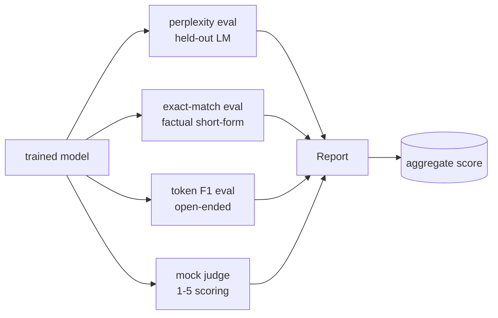
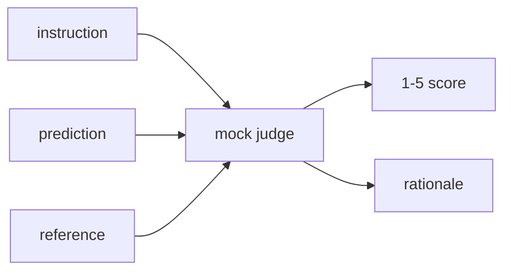
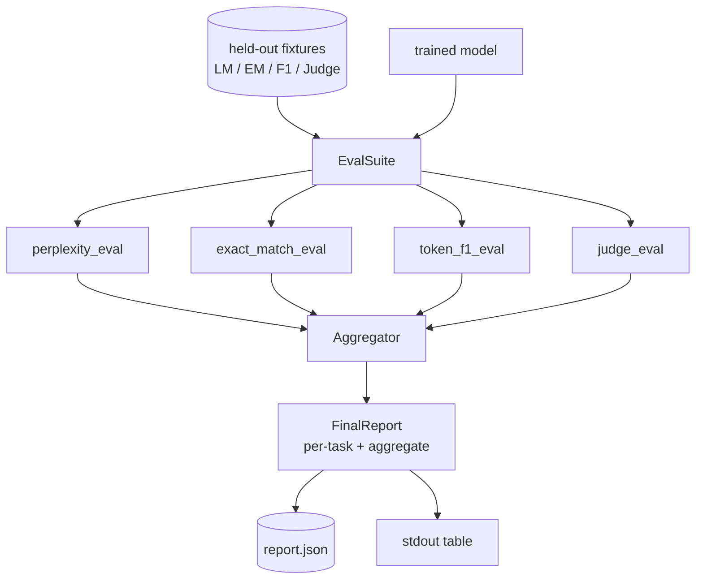

# Capstone Lección 41: 完整 Evaluación de la línea de conducto

> La capacitación es una parte de la supervisión de las curvas de pérdidas. La evaluación es una parte que debe diseñar. Este curso construirá un pipeline de evaluación unificado: recibirá un modelo de lenguaje bien entrenado, ejecutará cuatro evaluaciones diferentes, reunirá los resultados en un informe de descomposición de tareas, y proporcionará un simulacro LLM como juez, para que todo el ciclo 无需网络也能运行.

**Type:** Build
**Languages:** Python (torch, numpy)
**Prerequisites:** Phase 19 lessons 30-37 (NLP LLM track: tokenizer, embedding table, attention block, transformer body, pre-training loop, checkpointing, generation, perplexity)
**Time:** ~90 minutes

## Objetivos de aprendizaje

- En el pequeño transformador, con un símbolo enmascarado, se calcula la perplejidad.
- En breve hecho de las instrucciones de la evaluación exacta de la ejecución.
-                                                                                                                                                                                                                                                                                                                                                                                                                                                                                                                             
- Construir un LLM de simulación local como juez, con 1-5 分制给模型输出 打分──
- Cumplir cuatro evaluaciones y un informe de un solo aumento de las competencias, dividido por tareas.

## El problema

单一指标 永远无法描述一个语言模型――Perplexity 说明模型对语言分布的适应程度,但不说明它是否能回答问题――Exact-match 说明模型 是否产出金字符串,但会惩罚正确的改写――Token F1 会宽容抛词,但可能被错误内容中的词汇重叠 欺骗――LLM-as-judge 能捕捉定性维度,但成本高且随机性――

Tu verdadero pipeline que quieres al mismo tiempo posee estas cuatro capacidades. Cada eval  cubre otras eval                                                                                                                                                                                                                                                                                                                                                                                                                                                                                                      

Esta clase se desarrollará en un documento de extremo a extremo para construir este oleoducto.

## El concepto



Cada evaluación es una de las siguientes:`(model, dataset) -> EvalResult`Los resultados contienen un valor métrico, detalles por ejemplo de los controles, así como el nombre del agregado.

## Perplejidad, debidamente contada

La perplejidad es`exp(mean negative log-likelihood per token)`❖ Realizar uno de dos trampas:

- Se debe eliminar los tokens de empate del denominador, de lo contrario la confusión se verá mejor que en realidad.
- modelo 预测下一个 Token,所以位置 `i`预测位置                                                                                                                                                                                                                                                                                                                                                                                                                                                                                                                          `i+1`Los símbolos de esto son los errores de silencio: la pérdida sigue entrenando, pero la métrica se vuelve inútil.

La evaluación se realizará por lote  calcular las posiciones de los no-pads         `-log p(token)`总和与Token count,最后再相除──这比平均每批复杂性更数值安全(后者会低估短序列的权重),并且符合教科书的定义──

## Compatibilidad exacta con la normalización

El uso de la información en el mercado de la información

- 转为 letra pequeña。
- ¡Desde el primer espacio blanco!
- Se doblarán en un solo espacio.
- Si los dos lados sólo por la puntuación no son diferentes, entonces se pierde el final de la puntuación.`.`¿Qué es esto?`!`¿Qué es esto?`?`)。

La normalización 让 exacta coincidencia  在实践中有用.`"Paris"`Sí, sí, sí.`"Paris."`También es por; decir `"  paris  "`También es por lo que. Esta métrica todavía requiere normalización. La respuesta es la misma.

## Token F1, hacia el camino correcto

El token F1 se basa en la precisión de la calculación y el retiro de la media armónica de la bolsa de tokens.

1. Normalizar la predicción y la referencia con el juego exacto.
2. 将每个字符串分为代币列表(marcalización del espacio en blanco)
3. 统计 multiset intersección。
4. Precisión = `intersection_count / len(pred_tokens)`❖ Recuerdo = `intersection_count / len(ref_tokens)`◊ F1 = media armónica

Si la predicción y la referencia están en el espacio, F1 es un emparejamiento vacío. Si sólo hay un lado en el espacio, F1 es un 0. Este modelo se ajusta a la referencia de evaluación de SQuAD,并能在抛词上产生稳定数字.

## El Tribunal de Justicia local

El juez verdadero es el modelo de frontera de la API 后面的模型──本课中的法官 必须离线运行──mock judge es un punteador determinista, recibe instrucciones、modelo de predicción 和 referencia,并返回 `{1, 2, 3, 4, 5}`Una puntuación y una línea de razonamiento.

- Si la predicción normalizada es igual a la referencia normalizada, entonces es 5
- Si la predicción y el token de referencia entre F1 al menos es de 0,8, entonces es de 4 ⋅
- Si el símbolo F1 se encuentra`[0.5, 0.8)`, entonces por 3 .
- Si el símbolo F1 se encuentra`[0.2, 0.5)`, entonces por 2 .
- 其他情况为 1──

Esto no es un juez real, pero tiene una interfaz correcta. Después sólo hay que reemplazar una función que puede conectarse al modelo real.



## El número de empresas

El total es la media ponderada de las puntuaciones de evaluación normalizadas.`[0, 1]`Número medio:

- Perplejidad: normalización 为 `1 / (1 + log(perplexity))`◊perplejidad 为 1 映射到 1,infinity 映射到0──
- El partido exacto: ya está`[0, 1]`En el medio.
- F1: ya está`[0, 1]`En el medio.
- Juez: "Aparte de 5"...

Peso puede configurar. 默认组合是0.2 perplexity. ̊0.3 exact match. ̊0.3 token F1.̊0.2 judge. ̊.


```figure
cg-eval-quadrant
```

## Arquitectura



`EvalSuite`Es un orquestrador muy pobre. Cada evaluación independiente es una función libre, recepción.`(model, tokenizer, dataset, config)`Y regresó.`EvalResult`¿Qué es eso?`Aggregator`收集结果并生成最终报告──demo 会打印表格,并写入一个JSON copy,供下游CI ingest──

## Lo que construirás

                                                                                 `main.py`Además de pruebas.

1. `TinyGPT`:lecciones 38-40 En el curso de la misma arquitectura de decodificación sólo, en el curso de este curso para que se ejecute independientemente.
2. `InstructionTokenizer`:带 INST / RESP / PAD especiales de tokenizador de byte
3. Cuatro fijos: conjunto de LM corpus, conjunto de EM, conjunto de F1 y conjunto de jueces, cada grupo de 20 ejemplos, determinista,
4. `perplexity_eval`: regreso contiene el valor de perplejidad y el histograma de pérdida por token `EvalResult`¿Qué es eso?
5. `exact_match_eval`: regresar el promedio de EM 和 por ejemplo de registros.
6. `token_f1_eval`: Retorno medio de los registros de tokens F1 和 por ejemplo.
7. `mock_judge`Y `judge_eval`: por ejemplo, la puntuación con la racionalidad, así como la media del conjunto de valores
8. `Aggregator.normalise`La normalización por período:
9. `Aggregator.aggregate`: media ponderada y informe de la fase de composición
10. `run_demo`: Short Temporary Training un modelo pequeño,运行全部四种 eval, imprimir tabla de informe 并写入 JSON,成功时以零 退出。

## Lectura del informe

El informe tiene tres niveles. El nivel superior es el puntaje agregado. El siguiente es un conjunto de cuatro números por período. El siguiente es un conjunto de cuatro números por ejemplo para el diagnóstico.

JSON dump utiliza claves estables, permita que el panel de control de CI pueda trazar líneas de tendencia.

## Se extienden los objetivos

- 添加校准评估:model's softmax probabilidades ¿¿¿¿¿¿¿¿¿¿¿¿¿¿¿¿¿¿¿¿¿¿¿¿¿¿¿¿¿¿¿¿¿¿¿¿¿¿¿¿¿¿¿¿¿¿¿¿¿¿¿¿¿¿¿¿¿¿¿¿¿¿¿¿¿¿¿¿¿¿¿¿¿¿¿¿¿¿¿¿¿¿¿¿¿¿¿¿¿¿¿¿¿¿¿¿¿¿¿¿¿¿¿¿¿¿¿¿¿¿¿¿¿¿¿¿¿¿¿¿¿¿¿¿¿¿¿¿¿¿¿¿¿¿¿¿¿¿¿¿¿¿¿¿¿¿¿¿¿¿¿¿¿¿¿¿¿¿¿¿¿¿¿¿¿¿¿¿¿¿¿¿¿¿¿¿¿¿¿¿¿¿¿¿¿¿¿¿¿¿¿¿¿¿¿¿¿¿¿¿¿¿¿¿¿¿¿¿¿¿¿¿¿¿¿¿¿¿¿¿¿¿¿¿¿¿¿¿¿¿¿¿¿¿¿¿¿¿¿¿¿¿¿¿¿¿¿¿¿¿¿¿¿¿¿¿¿¿¿¿¿¿¿¿¿¿¿¿¿¿¿¿¿¿¿¿¿¿¿¿¿¿¿¿¿¿¿¿¿¿¿¿¿¿¿¿¿¿¿¿¿¿¿¿¿¿¿¿¿¿¿¿¿¿¿¿¿¿¿¿¿¿¿¿¿¿¿¿¿¿¿¿¿¿¿¿¿¿¿¿¿¿¿¿¿¿¿¿¿¿¿¿¿¿¿¿¿¿¿¿¿¿¿¿¿¿¿¿¿¿¿¿¿¿¿¿¿¿¿¿¿¿¿¿¿¿¿¿¿¿¿¿¿¿¿¿¿¿¿¿¿¿¿¿¿¿¿¿¿¿¿¿¿¿¿¿¿¿¿¿¿¿¿¿¿¿¿¿¿¿¿¿¿¿¿¿¿¿¿¿¿¿¿¿¿¿¿¿¿¿¿¿¿¿¿¿¿¿¿¿¿¿¿¿¿¿¿¿¿¿¿¿¿¿¿¿¿¿¿¿¿¿¿¿¿¿¿¿¿¿¿¿¿¿¿¿
- 添加强度评估:给每一个例子 标注 perturbation(typo、paraphrase、distractor),并报告每类 perturbation 的 метриca drop──
- Utiliza el modelo real de llamada HTTP 后面的真实模型 替换假判例──函数签名 不变──
- 添加 per-task weight learning: no utiliza pesas fijas, sino que según los modelos 拟合重量 上的目标偏好顺序 拟合重量。

Este logro te da cuatro tipos de evaluaciones agregadoras y informes.
