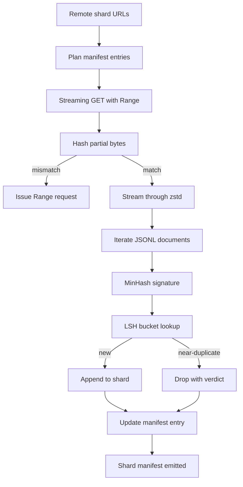

# Gran descargador de corpus

> 训练语言模型 早在第一次前进通过 之前就开始了──corpus 必须落到磁盘上,完成解压缩,除复制,并且可地址; 在网络 4% 处断掉之前, resume story 就已经要设计好──本课会构建一个流媒体下载器:它拉取压缩片,使用Zstandard 边下边解压缩,通过 MinHash加本地敏感哈希为近复制生成指纹,并写片表,让管道的剩余部分可以信任──

**Type:** Build
**Languages:** Python
**Prerequisites:** Phase 19 lessons 30-37
**Time:** ~90 minutes

## Objetivos de aprendizaje

- Uso `urllib`flujo de fragmentos remotos,并用 `zstandard`Descomprimir, evitar que el archivo entero buffer a la memoria.
-  para el byte verificado de compensación 发起 HTTP `Range`solicitudes, para reanudar las descargas parciales;;
- Para cada documento, construye la firma de MinHash, y use LSH, para que se produzcan colisiones.
- 输出包含 contenido hash、byte size、document count 和 dedup verdict de la sección de manifiesto

## El problema

La primera vez en el 200 GB de cuerpo durante el entrenamiento, la red en el 41% se rompió, el script se ejecutó.`urllib`La segunda vez que está en el 78 por ciento, está roto. Ha llegado al 99 por ciento, ya ha vuelto a escribir el ciclo tres veces. Desde el primer minuto, tienes que diseñar dos puntos de fracaso para hacer frente:`requests.get`Llamado

Resumen es un problema HTTP.`Range`, el cliente  debe basarse en el registro en disco , y el control de compensación verificada  debe poder ser mantenido en el proceso                                                                                                                                                                                                                                                                                                                                                                                                                                                                                                

La deduplicación es una firma 问题──Exact-hash dedup 会漏掉近副本: identico artículo de Wikipedia 带有三个不同的 boilerplate footers 出现, identico archivo de código 带有不同的许可标题, identico enlace de cada publicación de blog 都带跟踪参数──MinHash加 LSH 能以子线性成本 捕捉这些情况──成本是每文件一个签名,以及每一个签名 一次桶查找──

## El concepto



### En streaming con `urllib`

biblioteca estándar `urllib.request.urlopen` Retorno objeto de archivo-como──将将它包在 `zstandard.ZstdDecompressor().stream_reader`En el medio, los bytes se conectan desde la red 流经解压缩机, reingresar en el iterador de documentos, totalmente no necesita en la memoria materializar la fragmentación comprimida o la fragmentación descomprimida―. El único costo de memoria es el line buffer―la firma MinHash del documento actual, así como el índice LSH―.

### Resumen con `Range`

Descargador para cada fragmento escribe dos archivos:`.partial.json`Punto de control. Punto de control.`verified_bytes`¿Qué es esto?`expected_size`¿Qué es esto?`sha256_prefix`(basado en el anterior `verified_bytes`bytes 计算) y URL de origen.`sha256_prefix`, y sólo en el hash 匹配 匹配 时才恢复──如果哈希 错误,partial 会被丢弃,download从字节零重新开始──因为验证字节被检查而不是被假定,所以沉默腐败不可能发生──

### MinHash más LSH

MinHash utiliza el espacio fijo para calcular la similitud de dos conjuntos de Jaccard. Para el documento, este conjunto es el cuadro de texto de la misma.`k`个 mínimos valores de hash, cada uno proviene de una función de hash independiente.`s`Los documentos, en cualquier componente de la firma, son de acuerdo con la probabilidad de`s`¿Qué es eso?

 Luego LSH `k`个 componentes 分为 `b`个乐队, cada una tiene una`r`las filas, entre ellas `k = b * r`◊ Las probabilidades de colisión entre dos documentos en al menos una banda son `1 - (1 - s^r)^b`, que será para ti.`(b, r)`调优的 `s`值附近形成尖门──典型 corpus dedup                                                                                                                                                                                                                                                        `s = 0.8`, literatura de investigación de la LSH Used`k = 128`¿Qué es esto?`b = 32`¿Qué es esto?`r = 4` alcanzar este punto ∙

### Manifiesto de fragmentos como contrato

 downloader  única salida duradera es manifestar.  manifestar  según el fragmento  guardar URL                                                                                                                                                                                                                                                                                                                                                                                                                                                                                                      


```figure
cap-corpus-downloader
```

## Construye el mismo

`code/main.py` realización:

- `ShardPlanner`- 读取 URL de fragmentos 列表并生成 planes de entrada en el manifiesto。
- `StreamingDownloader`- ¿ Qué ?`Range`de la `urllib`flujo, escribir en archivo temporal, en cada pieza  actualización `.partial.json`punto de control, y en el resumen 时验证 sha256 prefijo
- `ZstdDocIterator`- Se va a hacer un flujo de archivo 包在 `zstandard.ZstdDecompressor`En el medio,并逐行 yield a un documento.
- `MinHasher`- Utiliza semillas de hash fijas familia para cadena de producción `k`- firma de un componente.
- `LSHIndex`- 按带对签名 分桶并报告碰撞──
- `Dedup`- 组合 hasher 和 index, se marcará cada documento para`keep`O `near_duplicate`,并附带相匹配的碎片ID──
- `ManifestWriter`- recoger estadísticas por parte y escribir`manifest.json`¿Qué es eso?

La demo de la base del archivo se encuentra en el disco para construir un pequeño cuerpo sintético, con`zstandard`                                                                                                                                                                                                                                                                                                                                                                                                                                                                                                                             `file://`URL abajo, ejecutar deduplicar,并打印 manifest。

¿Qué es eso ?

```bash
python3 code/main.py
```

escritura 以 cero 退出并印印 manifiesto resumen。

## Modelos de producción

Cuatro patrones pueden extenderse a corporaciones reales.

**Checkpoint before write.** `.partial.json` ten que ser completado en bytes  añadir hasta fragmentos  antes `fsync`△否则 power loss 会颠倒顺序:shard bytes 在磁盘上,checkpoint 中没有它们,下一次再起点 认为验证字节比实际更少,翻译后音字节 会损坏文件──先检查点,再写――这与写前日记是同样的纪律──

**Sharded LSH index.**En una escala de 200 GB, cubre todo el corpus de un solo índice LSH 放不进 RAM。 según el primer índice LSH hash de banda, las particiones existirán en el disco, y sólo se solicitará la nueva firma 会落入的分区── costo es cada documento una vez más lectura en el disco; beneficio es el índice LSH 不再是硬存储限──

**Tombstone, not delete.**Los duplicados abandonados serán juzgados .`near_duplicate`Y los documentos de colisión de los fragmentos de identificación  registros en el manifiesto  Eliminarlos perderán el duplicado  el vínculo entre el titular y el titular  El tombelar mantiene el rastro de auditoría, y no deja pasar el río abajo  después puede cambiar el umbral de la decisión 

**Per-shard sha256 in the manifest, plus a manifest sha256.**manifest 自身也会获得内容 hash──下流阶段 会在信任每分片入口 之前验证 manifest hash──没有这个机制,manifest 就是沉默攻击表面:能编辑单个文件的攻击者 可以破坏整个管道──

## Usalo

Modelos de producción:

- **Resume on every CI run.**Los ejecutores de CI son efímeros.`--cache-dir`Es una bandera de primera clase.
- **Dedup before tokenization.**La tokenización es muy cara. En el mismo documento, se ejecutó dos veces, para pagar dos veces el costo de la misma curva de pérdida.
- **Manifest as merge gate.**La formación se ejecuta desde el commit fijado 读取 manifest sha256― una nueva versión del conjunto de datos 需要新的 manifest commit― un nuevo código 与数据 之间的 vínculo es git, y no de la boca 相传―.

## Envío

`outputs/skill-corpus-downloader.md`En el proyecto real se describen qué URLs  proporcionar descargador  directorio de puntos de control  cómo se diseña  desdobla usar qué ancho de la telón y `(k, b, r)`triple, así como manifestar en la posición del control de versión.

## Los ejercicios

1. 添加                                                                                                                                                                                                                                                                                                                                                                                                                                                                                                                           `--shingle-width`bandera,并测量 dedup veredicto en amplitudes 3、5、9 下如何变化──为选择的默认值辩护──
2. 通过嗅探魔字,在 zstd 旁边添加 gzip 支持── downloader 不应要求调用者 指定代码──
3. 添加                                                                                                                                                                                                                                                                                                                                                                                                                                                                                                                           `--resume-only`modo: Si no se encuentra hasta el punto de control, entonces rechazar comenzar a descargar de nuevo.
4. Transferir el índice LSH a un archivo de estante o de cuadro,并测量吞吐量与内存变异的差异──
5. En el inicio añade el manifiesto sha256 verifique si el disco arriba del manifiesto con`manifest.lock`El manifiesto de la búsqueda de datos no coincide, el descargador debe cerrarse.

## Términos clave

| Term | What people say | What it actually means |
|------|-----------------|------------------------|
| Shard | “一个 file” | corpus 的一个自包含 slice，拥有自己的 sha256，并作为 resume 和 dedup 的单位 |
| MinHash signature | “Fingerprint” | 一个 set 的 `k`-component sketch，其中每个 component 是该 set 上一个 independent hash 的最小值 |
| LSH band | “Bucket” | 一组 `r` 个 signature components，用作 collision detection 的单个 bucket key |
| Verified bytes | “Resume offset” | disk 上 sha256 prefix 与 checkpoint 匹配的 bytes；唯一安全的 resume offset |
| Manifest | “The index” | downloader 产出的单一 durable record，包含 content hashes |

## Leer más

- [RFC 7233](https://datatracker.ietf.org/doc/html/rfc7233)- Requestas de rango HTTP, es decir, protocolo de resumen
- [Zstandard format specification](https://datatracker.ietf.org/doc/html/rfc8478)- 让流解压缩安全的框架格式
- [MinHash](https://en.wikipedia.org/wiki/MinHash)- 本课使用的 firma familia
- [Locality-sensitive hashing](https://en.wikipedia.org/wiki/Locality-sensitive_hashing)- límite de deducción 背后的带制
- Fase 19 · 43 - corpus tokenizado de HDF5 de descarga  suministro
- Fase 19 · 44 - En el cuerpo de entrenamiento de horario cosino
- Fase 19 · 45 - 消耗该时间的 AMP loop
