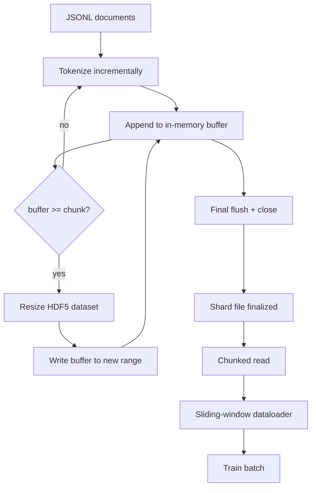

# HDF5 Tokenized 语料库

> El contenido de este libro debe ser un entrenador que pueda leer y leer con rapidez. El JSONL en el disco no tiene 16 trabajadores de cargador de datos.

**Type:** Build
**Languages:** Python
**Prerequisites:** Phase 19 lessons 30-37
**Time:** ~90 分钟

## Objetivos de aprendizaje

- 将文档流式写入一个带决定性分断的可调整大小 HDF5 conjunto de datos enteros.
- Escribirá fragmentos en varios archivos HDF5, dejará que el límite sea controlado y hará posible que el proceso se complete.
- 通过 HDF5 支的页面缓存 支的分块布局 读回代币,使数据加载器只在批次时间 复制到批次缓冲──
- 实现 un cargador de datos de ventana deslizante, con packing expreso 规则发发出固定长度训练序列──

## El problema

La prueba de formación de modelos de lenguaje moderno se ejecuta en decenas de trabajadores 上以每秒数十万样本的速度读取代币. JSONL en el disco en la primera falla de página de caché frío.$O(1)$Acceso aleatorio de la corriente de tokens.

HDF5                                                                                                                                                                                                                                                                                                                                                                                                                                                                                                                           `tokens[3_200_000 : 3_208_192]`El costo es para cada trabajador un manejo de archivo abierto, así como un pedazo de una gran huella de página en caché; en comparación con el costo de descifrar JSONL, esto puede ser ignorado.

Construir problemas está en hacer que la escritura sea realista.  Datos dimensionables  fácilmente se pueden usar erróneamente: una vez escribir un archivo, HDF5 文件会碎碎化到不可用.  Una vez dimensionar 写入所有文件,进程死亡会丢失整个片段.

## El concepto



### Solo se puede medir HDF5

conjunto de datos de token `maxshape=(None,)`Y fijo `chunks=(chunk_size,)`创建──写入时,将代币 缓存在长度为 `chunk_size`de la matriz NumPy 中──当缓冲 填满时,dataset 精确地按 `chunk_size`扩展,并把缓冲 写入新范围――在 shard 结束时, el residual缓冲 会写入最后一个部分范围――除了最后一次写入外, cada una de las escrituras es contiguosa 且分分排列; el lector se basará en los atributos HDF5 de la fragmentación 中记录的`token_count`截断最后一次写入──

### Escriba en fragmentos

单个 HDF5 文件是单点故障──管线 会并行写入片段:Fase 19 lesón 42 En medio de cada uno de los archivos de entrada se produce una HDF5 de salida shard──`shards.json`Index 会按分片 记录文件路径、代币计数、文件计数,以及代币的 sha256──trainer 读取 `shards.json`Para calcular las compensaciones globales y verificar los términos de la base.

### Leído en pedazos

En el entrenamiento, cada trabajador se reunirá`swmr=True`modo 打开自己负责的 HDF5 archivos,并请求 `tokens[start:stop]`△ una vez que el fragmento 变热, la disposición de fragmentos de HDF5 就将使这成为一次低成本的读:h5py 不会内存地图文件,而是通过 HDF5 fragment cache 和 OS page cache 读取整个块,再把请求的hyperslab 复制出来──worker 永远不会实现整个文件:slice将被复制到数据载机的批包,然后数据载机在批时间将其复制到固定记忆训练 tensor──热路在每次块转换时一次系统调用;其余是 RAM访问──

### Cargador de datos de ventanas deslizantes

Dataloader es el único que sabe la duración de la secuencia de entrenamiento.`window_size + 1`个 tokens, y luego regresar `(input, target) = (tokens[:-1], tokens[1:])` No es obligatorio cumplir con los límites de los archivos: una ventana puede atravesar dos archivos, en el medio hay un claro `boundary_token_id`,让模型学会使用分隔器──这是标准包装规则; también es una regla fácilmente olvidada por los principiantes, el último material que obtienen se convierte en 8% de tokens de límite de entrenamiento y 92% de texto natural──


```figure
cc-hdf5-corpus
```

## Construye el mismo

`code/main.py` realización:

- `Tokenizer`- Un tokenizer determinista de nivel de byte, para demo 足够好──接口是 `encode(text) -> list[int]`Y `vocab_size`¿Qué es eso?
- `HDF5ShardWriter`- Abre un conjunto de datos de números enteros de tamaño ajustable, puesta en buffer de tokens hasta el tamaño de la pieza, fija el tamaño de la pequeña etapa y escribe, en el momento de cerrar`token_count`Y `sha256`记录为 HDF5 atributos。
- `ShardedTokenizationPipeline`- recorrer los documentos de entrada, los viajará al escritor, y los exportará.`shards.json`índice
- `MmapTokenStore`- 打开 fragment files 进行碎片阅读(这个名字只是为了方便;h5py 读取是碎片,不是mmap 文件),计算全球抵消,暴露单个 `get_slice(start, stop)`API.
- `SlidingWindowDataloader`- de la corriente global 中 seleccionar ventanas aleatorias,并 yield `(input_ids, target_ids)`Arrays de número

La demo de la base del archivo se construirá un corpus de memoria muy pequeño, se tokenizará a dos fragmentos, se leerá en pedazos, se abrirá, se ejecutará un cargador de datos de 10 lotes, se imprimirá la forma y la cantidad de cheques de cada lote.

运行:

```bash
python3 code/main.py
```

脚本以 0 退出并印出批次检查量──

## Modelos de producción

Cuatro patrones pueden extenderse a la práctica de entrenamiento.

**Chunk size 等于典型读取大小。**Entrenador Cada muestra 读取 `window_size + 1`个 tokens──把 HDF5 pieza 设置为 `window_size`La cantidad de veces, la lectura de la página-cache de la reunión alineada.

**Token count 放在 attributes 中，而不是 dataset 中。**El último tramo del conjunto de datos puede no estar completamente lleno, ya que el tamaño del tramo no necesariamente elimina el límite del documento.`token_count`作为 HDF5属性 存在数据集 上,并让读者在该值处截断──否则读者 会越过真实末尾读到零填补的代币,模型也会学会预测零──

**带 parallel verification 的 sharded sha256。**Cada fragmento tiene sus propios bytes de token sha256―entrenador puede realizar pruebas de todos los fragmentos en el entrenamiento para comenzar.

**两侧都使用 `swmr=True`，writer 使用 `libver="latest"`。**Modo de escritora única-múltiple-lector  requisitos de escritora 以 `libver="latest"`打开, pre-crear cada conjunto de datos, y luego establecer `file.swmr_mode = True`后作家 必须在每次变大后调用 后调用 后调用 后调用 后调用 后调用 后调用 后调用 后调用 后调用 后调用 后调用 后调调调调调调调调调调调调调调调调调调调调调调调调调调调调调调调调调调调调调调调调调调调调调调调调调调调调调调调调调调调调调调调调调调调调调调调调调调调调调调调调调调调调调调调调调调调调调调调调调调调调调调调调调调调调调调调调调调调调调调调调调调调调调调调调调调调调调调调调调调调调调调调调调调调调调调调调调调调调调调调调调调调调调调调调调调调调调调调调调调调调调调调调调调调调调调调调调调调调调调调调调调调调调调调调调调调调调调调调调调`dataset.flush()`, así usándolo`swmr=True`打开的读者工人 才能看到一致数据──跳过 `libver="latest"`, o en la estructura de cambios después de reactivar SWMR, es "el archivo está bloqueado" 失败的常见源──

## Usalo

Modelos de producción:

- **每个 source shard 一个 HDF5。**Descargador(lección 42) cada URL 输出一个片段;tokenization(本课) cada fuente 输出一个 HDF5──1:1 mapping 让恢复 和部分故障恢复 变得简单──
- **Boundary token id。**El token límite es parte del vocabulario del tokenizer, es también el único token que el cargador de datos ingresa. Si el modelo debe ignorarlo, la pérdida de entrenamiento lo hará perder el token límite; de lo contrario, el modelo lo utilizará como separador de secuencias.
- **`shards.json` 是 source of truth。**Añadir un nuevo fragmento significa escribir en HDF5 計算它的 sha256,并添加一条入──trainer 在启动时读取该文件一次,之后永远不碰目录列表──

## Envío

En el proyecto real,`outputs/skill-hdf5-tokenized-corpus.md`¿Cuál es el tamaño del trenero?`shards.json`En el control de versiones, los trabajadores del cargador de datos se ponen en el control de versiones y se muestran en el control de archivos.

## Los ejercicios

1. 给HDF5 escritor 添加 `--compression gzip`bandera, y en el corpus de demostración 上测量吞吐成本──为所选默认做出辩护──
2. 给滑窗数据加定性种子,并验证相同种子的两次运行会产生相同批量──
3. 添加                                                                                                                                                                                                                                                                                                                                                                                                                                                                                                                           `--validate`modo, read取每个 shard, volver a calcular sus tokens de sha256,并与 `shards.json`Por lo tanto, el CI debe comenzar a entrenar antes de ejecutarlo.
4. En comparación con los tamaños de los fragmentos, igual al tamaño de la ventana, el tamaño de la ventana, dos veces el tamaño de la ventana, el cargador de datos se desvanece.
5. 添加                                                                                                                                                                                                                                                                                                                                                                                                                                                                                                                           `--max-document-tokens`En el caso de la leyenda, el texto de la leyenda se encuentra en el archivo de la leyenda.

## Términos clave

| Term | What people say | What it actually means |
|------|-----------------|------------------------|
| Resizable dataset | "Append-only" | 一个带 `maxshape=(None,)` 的 HDF5 dataset，通过按 chunk 大小 stride 调用 `resize` 增长 |
| Chunked layout | "How HDF5 stores it" | 固定大小的 on-disk blocks，HDF5 将其作为一个单元读取并缓存，因此 dataloader 能以低成本读取连续范围 |
| `swmr` mode | "Read-while-write" | Single-Writer-Multiple-Reader mode，使 dataloader workers 能安全共享文件 |
| Shard index | "shards.json" | 包含 offsets 和 content hashes 的所有 token shards 的 durable index |
| Sliding window | "Training sample" | global token stream 的固定长度 slice，trainer 会把它与 shift-by-one target 配对 |

## Leer más

- [HDF5 chunking documentation](https://docs.hdfgroup.org/hdf5/v1_14/)- El diseño de los conjuntos de datos dimensionables de las clases
- [h5py user guide](https://docs.h5py.org/en/stable/)- HDF5 de Python enlaces
- [h5py chunked storage](https://docs.h5py.org/en/stable/high/dataset.html#chunked-storage)- h5py  cómo leer conjuntos de datos en pedazos y cómo configurar un caché en pedazos
- Fase 19 · 42 - 输出由本课 Tokenize 的 downloader
- Fase 19 · 44 - 消费这个数据包的 cosino horario
- Fase 19 · 45 - 包裹 entrenamiento paso de la bucle de AMP
