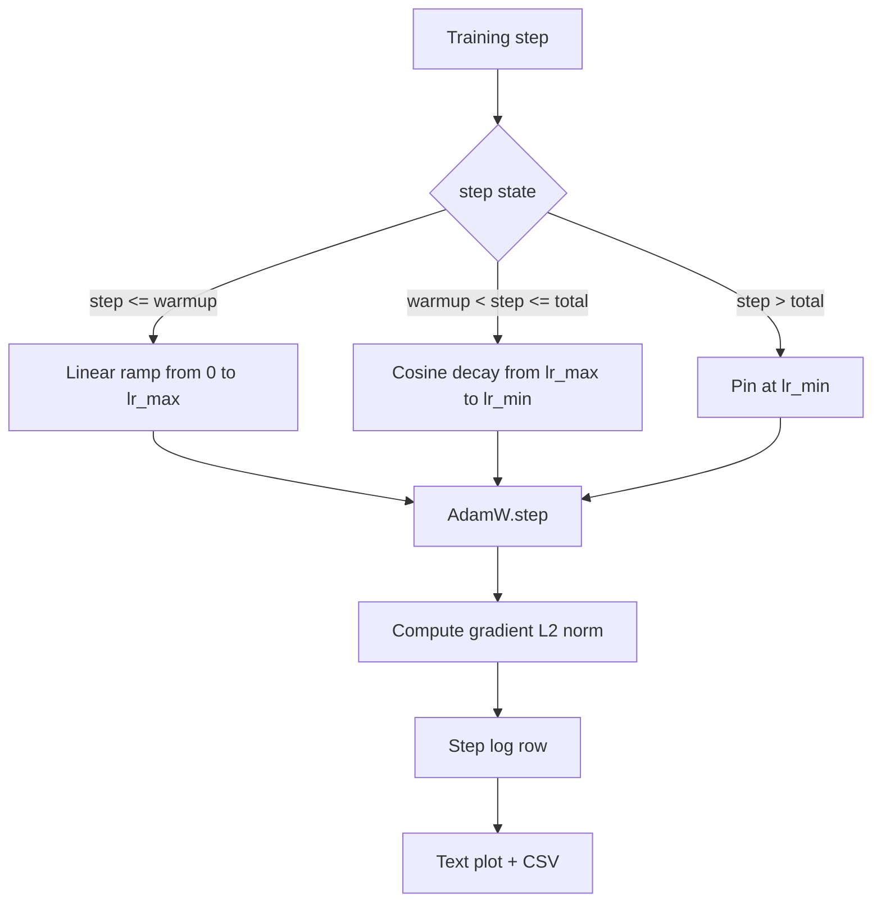

# 带 Linear Warmup 的 Cosino LR

> El programa de tasa de aprendizaje es sólo siguiente a la segunda decisión importante de la función de pérdida. AdamW es la opción estándar moderna de la formación del modelo de lenguaje, ya que permite que el modelo vea un tamaño de paso efectivo menor en las primeras mil actualizaciones de vulnerabilidad, aumente gradualmente hasta el pico de la configuración, luego se aplique la disminución hacia atrás cerca de zero.

**Type:** Build
**Languages:** Python
**Prerequisites:** Phase 19 lessons 30-37
**Time:** ~90 分钟

## Objetivos de aprendizaje

- 实现 un AdamW Optimizer,并接入带线性变暖的共性学习率时间表──
- En cualquier paso 精确计算时间表的值, evitar transcurridas de salida de drift de punto flotante。
- La norma de gradiente L2 se ajusta a la tasa de aprendizaje y se registra, haciendo que el estado de salud del entrenamiento pueda observarse.
- Se puede programar una gráfica de texto que pueda leerse a la vista humana, así como cualquier herramienta que pueda consumirse en CSV.

## El problema

Antes de la actualización del modelo, el modelo se encuentra en un punto de partida. La segunda etapa de la optimización de la velocidad de ejecución de la misma es aún inestable. La norma de gradiente es también alta y ruidosa. Si la tasa de aprendizaje entre estas actualizaciones está en un punto de pico, el modelo puede divergir directamente, o caer en un plato de pérdidas que no se escape para siempre. Dos métodos de recuperación de la ciencia son el recorte de gradientes, es decir, la lección 45 de la fase 19, y un programa de aprendizaje que se incrementa a paso a paso desde el inicio.

El calendario de cosinos con calentamiento tiene tres regiones.`warmup_steps`,la tasa de aprendizaje desde el zero lineal reducido hasta el pico de la configuración `lr_max` Desde`warmup_steps`¿ Qué ?`total_steps`,la tasa de aprendizaje sigue la curva cosina de la mitad superior, desde`lr_max` disminución hasta `lr_min`♪ en `total_steps`后,la tasa de aprendizaje 固定在 `lr_min`, un entrenador de configuración equivocada como este no va a salir de la agenda.

Construcción de problemas en los horarios  fácilmente aparecen fuera por uno ⋅ de forma individual ⋅ de forma individual ⋅ de forma individual ⋅ de forma individual ⋅ de forma individual ⋅ de forma individual ⋅ de forma individual ⋅ de forma individual ⋅ de forma individual ⋅ de forma individual ⋅ de forma individual ⋅ de forma individual ⋅ de forma individual ⋅ de forma individual ⋅ de forma individual ⋅ de forma individual ⋅ de forma individual ⋅ de forma individual ⋅ de forma individual ⋅ de forma individual ⋅ de forma individual ⋅ de forma individual ⋅ de forma individual ⋅ de forma individual ⋅ de forma individual ⋅ de forma individual ⋅ de forma individual ⋅ de forma individual ⋅ de forma individual ⋅ de forma individual ⋅ de forma individual ⋅ de forma individual ⋅ de forma individual ⋅ de forma individual ⋅ de forma individual ⋅ de forma individual ⋅ de forma individual ⋅ de forma individual ⋅ de forma que el nivel de aprendizaje en el modelo empiece a sobreajustar en un 1% ⋅ de forma que el límite del horario sea detallado en el límite del horario ⋅ de la hora de la prueba, o de lo contrario es imposible ⋅

## El concepto



### Formula de calentamiento

 para `warmup_steps > 0`时位于 `[0, warmup_steps]`de la `step`,la tasa de aprendizaje es `lr_max * step / warmup_steps` Descentralizado`warmup_steps = 0`caso visto como "no calentamiento":horario en el paso cero  directamente desde `lr_max`開始,并立即进入 cosino decaimiento.`warmup_steps = 0`, para el horario de inspección  todavía puede generar curvas disponibles―

### Formula de cosino

 para `(warmup_steps, total_steps]`En el centro`step`,la tasa de aprendizaje es `lr_min + 0.5 * (lr_max - lr_min) * (1 + cos(pi * progress))`, entre ellos `progress = (step - warmup_steps) / max(1, total_steps - warmup_steps)`♪ en `step = warmup_steps`,cosino 求值为 `cos(0) = 1`, lo conseguí`lr_max`, con el punto final de calentamiento                                                                                                                                                                                                                                                                                                                                                                                                                                                                                                                     `step = total_steps`,cosino 求值为 `cos(pi) = -1`, lo conseguí`lr_min`, con el punto final de descomposición  精确匹配──

La continuidad de los dos puntos finales no es casualidad. Por eso el calendario se ha convertido en una serie de eventos.`step`de una sola función, en lugar de tres diferentes funciones 拼接在一起──拼接的时间表 在第一次变化 `lr_max`Cuando perderemos una frontera.

### piso después de los pasos totales

 para `step > total_steps`,el ritmo de aprendizaje  mantener en `lr_min` el contrato es evidente: el horario no se informa, ni se extrapola; se fija en el piso, y deja que el entrenador registre la advertencia.`total_steps`, en lugar de modificación de bucle.

### La norma de graduación y la tasa se registran

El programa es el estado de salud de la formación de la mitad. La norma gradiente es la otra mitad. El ciclo de entrenamiento de cada paso.`step, lr, grad_l2_norm, loss` CSV es el único registro duradero


```figure
cap-cosine-warmup
```

## Construye el mismo

`code/main.py` realización:

- `CosineWithWarmup`- Una función sin estado, en forma basada en el calendario de configuración `lr(step) -> float`¿Qué es eso?
- `TrainState`- ¿Qué quieres?`AdamW`Optimizador y programa 封装成单一步函数──
- `TrainState.step`- 运行一次前进过度一次倒退过度,记录梯度 L2 norma,并把 `lr(step)`Aplicación al optimizador.
- `plot_schedule_ascii`- El programa de la grabación de texto para la lectura humana.
- `write_schedule_csv`- Para cada paso, la tasa de aprendizaje es de 1.

La demo de la base del archivo se construirá en un pequeño .`nn.Linear`模型, en el lote de entrada fija 上训练 20 pasos,并印每步的学习速度、渐进规范 和损失──时间表也会被染为文本图,用于视觉智能检查──

运行:

```bash
python3 code/main.py
```

脚本以 0 退出,并印每步训练日记 和时间表图.

## Modelos de producción

Cuatro patrones pueden aumentar el horario para el artefacto de producción.

**Schedule 放在 config 中，而不是 code 中。**Entrenador desde el envío a la entrega de configuración de YAML o JSON 读取 `warmup_steps`¿Qué es esto?`total_steps`¿Qué es esto?`lr_max`¿Qué es esto?`lr_min` el calendario es repensable, ya que la configuración es dirigida al contenido; el calendario es auditable, ya que la configuración es parte de la diferencia de relaciones públicas.

**Step counter 是 monotonic，并与 epochs 解耦。**Cuando el conjunto de datos se fragmenta o el cargador de datos se vuelve a iniciar, algunos marcos se mezclan paso y época.`global_step`, en lugar de partir del contador local 读取──reiniciar la ejecución 会在正确的时间表位置 继续,因为步计是持久轴──

**Schedule plot 放在 run directory 中。**Cada entrenamiento se lleva a cabo en la ciudad.`outputs/lr_schedule.png`(o en el gráfico de texto de la clase) Escribir en su directorio de ejecución.

**Log row schema 固定。** `step, lr, grad_l2_norm, loss`,顺序如此──下游 notebook o dashboard 会读取这个方案; no se vuelve a cambiar la versión en cuanto a la columna de renombrado, hará que todo el tablero existente se deshaga──

## Usalo

Modelos de producción:

- **先 sweep peak，再 sweep 其他任何东西。** `lr_max`Es el más sensible de los giros. Primero en el modelo pequeño, arriba, barrido.`lr_max`La escalabilidad es muy débil, por lo que el barrido de modelos pequeños es un fuerte prioridad.
- **Warmup 是 total steps 的 fraction，不是绝对 count。**Una carrera de 200 millones de pasos Si sólo 2000 pasos de calentamiento, casi alcanza el pico; una carrera de 20.000 pasos con el mismo número entonces se calentará un 10 por ciento.
- **`lr_min` 非零是有意的。**Una por `lr_max`El 10% del piso, permitirá que el optimizador continúe aprendiendo en el centro de la cola larga.`lr_min = 0`El programa de entrenamiento se verá en un gráfico de una curva de entrenamiento muy buena, así como un modelo de entrenamiento que en realidad no ha completado.

## Envío

En el proyecto real,`outputs/skill-cosine-warmup.md`¿Cuál es el programa de configuración de carga? ¿Cuál es el nivel de entrenamiento?`lr_max`Se ha producido un valor desplegado.

## Los ejercicios

1. ¿Cuál es la curva de la carrera de entrenamiento de 200 pasos? ¿Cuál es la curva de la carrera de entrenamiento de 200 pasos?
2. 添加                                                                                                                                                                                                                                                                                                                                                                                                                                                                                                                           `--restart`bandera, en`total_steps / 2`增加第二次加热――为热重启 在玩具运行 上是升级还是伤害做辩护――
3. Añadir una unidad de prueba de verificación el calendario es continuo: en`warmup_steps > 0`时, para `[0, total_steps]`En medio de cada paso,差值 `|lr(step+1) - lr(step)|`                                                                                                                                                                                                                                                                                                                                                                                                                                                                                                                             `lr_max / warmup_steps`Con el más alto cosino`pi * (lr_max - lr_min) / (2 * (total_steps - warmup_steps))`两者中较大者的约束──较短的阴段可能比升温 斜坡更,所以仅使用升温 斜率不是安全的上界──
4. ¿ Cuál es el calendario ?`torch.optim.lr_scheduler.LambdaLR`, que puede combinarse con el código marco.
5. 添加                                                                                                                                                                                                                                                                                                                                                                                                                                                                                                                           `--plot-png`bandera, a través de `matplotlib`写出真实图片──为本课的文本图片 和 PNG 哪个更适合合作为CI runs的默认做出辩护──

## Términos clave

| Term | What people say | What it actually means |
|------|-----------------|------------------------|
| Warmup | "Slow start" | 在前 `warmup_steps` 次 updates 中，从 zero 到 `lr_max` 的 linear ramp |
| Cosine decay | "Smooth drop" | 在剩余 steps 中，从 `lr_max` 到 `lr_min` 的上半段 cosine curve |
| Floor | "After training" | schedule 在超过 `total_steps` 后固定的 `lr_min` 值 |
| Gradient norm | "L2 of grads" | 拼接后的 gradient vector 的 Euclidean norm，每 step 记录 |
| Global step | "Schedule axis" | 一个能跨 restart 保留的 monotonic step counter，用于驱动 schedule |

## Leer más

- [Loshchilov and Hutter, SGDR: Stochastic Gradient Descent with Warm Restarts (arXiv 1608.03983)](https://arxiv.org/abs/1608.03983)- papel de referencia del calendario cosino
- [Loshchilov and Hutter, Decoupled Weight Decay Regularization (arXiv 1711.05101)](https://arxiv.org/abs/1711.05101)- Documento de referencia de AdamW
- [PyTorch torch.optim.lr_scheduler](https://docs.pytorch.org/docs/stable/optim.html#how-to-adjust-learning-rate)- las funciones de paso cómo combinarse con los calendarios marco 组合
- Fase 19 · 42 - 产出此表 所消费语料的下载器
- Fase 19 · 43 - Con el calendario  Desarrollo conjunto del cargador de datos
- Fase 19 · 45 - recorte de gradiente y AMP, es decir, la siguiente capa del bucle
