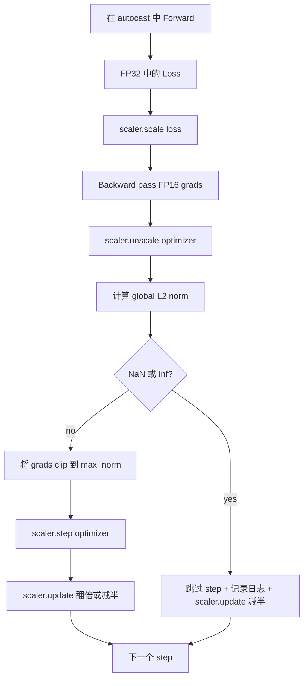

# El corte gradual y la precisión mixta

> En la primera clase, el programa de optimización y la formación se basa en la formación de la producción y se prevé que el grado de reducción sea normal. Normalmente no son normales. Un mal lote de formación puede hacer que la norma de gradiente aumente a tres niveles.

**Type:** Build
**Languages:** Python
**Prerequisites:** Phase 19 lessons 30-37
**Time:** ~90 minutes

## Objetivos de aprendizaje

- 计算所有参数梯度的全球 L2 norma, y exceder la configuración 值时原地剪
- Usar el lanzamiento automático, Gradscaler, envuelve el entrenamiento, haga que el FP16 pase hacia adelante y hacia atrás.
- 检测 Loss 或 Gradient 中的 NaN 和 Inf, saltó el paso de optimización,并记录 this skip──
- Cada paso  informe el factor de escala de GradScaler, permita que una gran cantidad de continuidad salte 能立刻可见──

## El problema

En el último día, el Optimizer ejecutará un paso, volverá a poner todo lo aprendido en el modelo, después de utilizar el L2 global de la norma 1.0, el mismo lote sólo contribuirá a la actualización de la norma-unidad; la pérdida se mantendrá en la línea de tendencia; el ejecutor sobrevivirá.

El entrenamiento de precisión mixta  a través de FP16  calcular el paso hacia adelante y la mayor parte del pase hacia atrás, se añadirá a la potencia de 2-3 倍. El precio es el rango exponencial de FP16 很窄. Un Gradient típico de sobrecarga en FP16 se convertirá en Inf, y luego se propagará en la siguiente capa en NaN, lo que conducirá al siguiente paso optimizador Colocar cada peso en NaN.

Construir el problema está en el correcto conectado. Previo clip de nuevo sin escalar, value de nuevo en efecto en gradientes escalados Primeiro unscale de nuevo clip, GradeScaler Scaler `scaler.scale(loss).backward()`, entonces`scaler.unscale_(optimizer)`, entonces`clip_grad_norm_`, entonces`scaler.step(optimizer)`, finalmente`scaler.update()`Cualquier otro orden producirá un ciclo de silencio dañado.

## El concepto



### Norma global de L2

La norma global de L2 es la norma euclidiana del vector de gradiente posterior, en lugar de la norma de parámetro por parámetro. PyTorch la implementará como`torch.nn.utils.clip_grad_norm_(parameters, max_norm)` Esta función vuelve a la norma pre-clip, por lo que esta clase puede registrar al mismo tiempo el valor natural y el valor recortado, esto es necesario para el diagnóstico de que cada paso que hacemos está recortando.

### autocast y GradScaler

`torch.amp.autocast(device_type)`Es un gestor de contexto, que seleccionará con el FP16 运行符合条件的操作 (la mayoría de las operaciones de tipo matmul) `torch.amp.GradScaler(device_type)`Es un ayudante, se encuentra en el paso de la pérdida de la escala anterior, y en el paso de la optimización de la escala anterior Gradiente inversa.

Este curso utiliza el autocast de la CPU, ya que es el contenido que puede funcionar en el CI; el mismo patrón puede ser pasado por`device_type="cpu"`改为     cambió por`device_type="cuda"`Originalmente se migró a CUDA──CPU Upgrade GradScaler es un estúbdo CPU autocast 默认 ya funciona con BF16 运行, no necesita pérdida de escala), pero este curso contiene estos sitios de llamadas, haga que el cableado con el circuito de GPU 完全一致──

### Detección de NaN e Inf

La prueba ocurre en dos posiciones. Primero, la pérdida de vida se produce en el retroceso.`torch.isfinite`检查;Inf o NaN Loss no producirá Gradiente útil, estará en el optimizador 前被跳过;;`scaler.unscale_(optimizer)`Después, el curso se usará.`has_non_finite_grad(...)`扫描未扩展梯度,并把任何inf或naN视为跳──这些检查一起覆盖前进通过和后进通过 两类失败模式──

### Diagnosticar el factor de escala

El factor de escala es el estado interno de GradScaler.`scaler.get_scale()`, y la coloca en relación con la tasa de aprendizaje y la norma de gradiente, un registro.`2^17`O `2^18`附近和── comportamiento anormal de ejecución 会显示因子在高值和低值之间振荡, esto explica que el Gradiente del modelo a veces está dentro del rango, a veces no hay.


```figure
grad-clip-monitor
```

## Construye el mismo

`code/main.py` realización:

- `clip_global_l2_norm`- ¿ Qué ?`torch.nn.utils.clip_grad_norm_`de envase, regresa a la norma pre-clip y post-clip.
- `has_non_finite_grad`- 扫描 Gradient 中 NaN 和 Inf de ayudante。
- `AmpTrainState`- Envuelve un modelo.`AdamW`Optimizador, un GradScaler, así como un dispositivo de autocast.`step(inputs, targets)`,运行完整的剪裁,扩展和跳-on-NaN de tubería
- `StepLog`Y `SkipLog`-                                                                                                                                                                                                                                                               
- Una demostración, entrenar un pequeño.`nn.Linear`modelo 20 个 个 paso, en el paso 5 hacia Gradiente 注入 Inf 以触发跳路,并印得到的日志──

运行:

```bash
python3 code/main.py
```

脚本以 0 退出,并印每步日记,每行标记为 `STEP`O `SKIP`Al menos una de ellas es `SKIP`¿Qué es eso?

## Modelos de producción

Cuatro patrones pueden transformar este ciclo en un paso de formación en producción.

**Skip counter 应该是 alert，而不是一行 log。**Cada etapa de entrenamiento 跳过少量步骤是健康的── cada etapa de entrenamiento 跳过少量步骤是健康的── cada etapa de entrenamiento 跳过少量步骤是健康的── cada etapa de entrenamiento 跳过少量步骤是健康的── cada etapa de entrenamiento 跳过少量步骤是健康的── cada etapa de entrenamiento 跳过少量步骤是健康的. cada etapa de entrenamiento 跳过少量步步步是硬警报: cada etapa de entrenamiento 跳过少量步步是健康的. cada etapa de entrenamiento 跳过少量步步是健康的. cada etapa de entrenamiento 跳过少量步是健康的. cada etapa de entrenamiento 跳过少量步是健康的. cada etapa de entrenamiento 跳过百次跳过百次跳过百次跳跳是硬警报: cada etapa de entrenamiento 跳过百次跳的步步步是的步步步步是的步步步步步; en producción, si la tasa 跳过百分之五,就应该排百分之五,就应该排百分之五.

**Clip threshold 放在 config 中。** `max_norm = 1.0`Es el valor de la formación moderna de modelos de idiomas. Se debe analizar el modelo de la lección 44 en el mismo programa de configuración YAML o JSON.

**Norm log 和 schedule 一起进入 CSV。**Columnas de CSV es `step, lr, grad_l2_pre_clip, grad_l2_post_clip, loss, skipped, skip_reason, scaler_scale` Revisor 打开文件后, puede ver en la misma línea el cronograma  Gradient 的故事、scaling factor, así como el resultado 含原因)  Tráver estas columnas 拆分多个文件, es la forma de elaborar err err err err err err err err err 位分析──

**`scaler.update()` 每个 step 都运行，即使 skip 也一样。**En el paso de limpieza, la escala 读取它的 no-inf counter,递增,并可能把因素 翻倍──在跳转阶段上,scaler 把因素 减半并重置 counter──忘记在跳转路上调用 `update()`, es producir un factor de escala de un error no modificado.

## Usalo

Modelos de producción:

- **Autocast device 匹配 optimizer device。**Entrenamiento de GPU `torch.amp.autocast(device_type="cuda")`• uso de la CPU`torch.amp.autocast(device_type="cpu")`◊ El dispositivo de uso combinado producirá un error de tipo silencioso, en la superficie es la curva de pérdida parece normal, pero el modelo no aprendió―
- **Backward 前检查 Loss。** `torch.isfinite(loss).all()`Es una reducción de tensor; el costo puede ser ignorado, mientras que en NaN Loss 上节省 es un paso completo de entrenamiento.
- **`zero_grad` 中使用 `set_to_none=True`。**将 Gradiente 设为 `None`En lugar de cero, permita que el optimizador salte de la cantidad de parámetros no afectados. Esta configuración es de alta potencia y puede reducir un poco la superficie de errores.

## Envío

`outputs/skill-clip-amp.md`En el proyecto real se describe el paso de entrenamiento Uso de un umbral de clip y un dispositivo de transmisión automática, por paso CSV en el control de versiones, así como el umbral de alerta de producción de salto de tasa es lo que.

## Los ejercicios

1. Usar un verdadero aumento de pérdidas  sustituir un proceso de infusión                                                                                                                                                                                                                                                                                                                                                                                                                                                                                                            
2. Añade uno.`--bf16`modo, se cortará automáticamente hasta BF16 en lugar de FP16;; BF16 rango exponente de FP16 más ancho que FP16, normalmente muy poco necesita la escala de pérdida;验证同一个demo 上跳率 降至零;;
3. Añadir una prueba de unidad, verificar en el caso de no cortar, en el caso de la envoltura de un clip gradiente, volverá correctamente a la norma previa y posterior a la cinta.
4. 添加滚动窗口跳速 计算,以及一个CLI旗: si la tasa 连续 100 个步 超过配置值,就让运行 失败──
5. Voy a hacer un ciclo de conexión con el CSV canónico .`step, lr, grad_l2_pre_clip, grad_l2_post_clip, loss, skipped, skip_reason, scaler_scale`) escribir, y pasar por cada línea después de la descarga  confirmación de los documentos puede ser reservado en Ctrl-C                                                                                                                                                                                                                                                                                                                                                                                                                                                                                                 

## Términos clave

| Term | What people say | What it actually means |
|------|-----------------|------------------------|
| Global L2 norm | "Clip target" | 所有可训练 parameter 的拼接 gradient vector 的 Euclidean norm |
| autocast | "Mixed precision" | 在 `with` block 内，对符合条件的 operation 选择性执行 FP16（或 BF16） |
| GradScaler | "Loss scaler" | 在 backward 前乘以 Loss，并在 optimizer step 前 inverse-scale Gradient 的 helper |
| Skip | "Bad step" | 因为 Gradient 或 Loss 是 non-finite 而拒绝执行的 optimizer step；scaler 会将 factor 减半 |
| Scaling factor | "Scaler state" | GradScaler 当前的 multiplier；干净区间后翻倍，每次 skip 时减半 |

## Leer más

- [Micikevicius et al., Mixed Precision Training (arXiv 1710.03740)](https://arxiv.org/abs/1710.03740)- La propuesta inicial de escala de pérdidas
- [Pascanu, Mikolov, Bengio, On the difficulty of training recurrent neural networks (arXiv 1211.5063)](https://arxiv.org/abs/1211.5063)- Clicado de gradiente  Referencias
- [PyTorch torch.amp.GradScaler](https://docs.pytorch.org/docs/stable/amp.html)- Encuentra la API de escalado
- [PyTorch torch.nn.utils.clip_grad_norm_](https://docs.pytorch.org/docs/stable/generated/torch.nn.utils.clip_grad_norm_.html)- 本课使用的 recortes primitivos
- Fase 19 · 42 - Por un bucle  proporcionar corpus de descargador
- Fase 19 · 43 - ciclo 消耗的数据 loader
- Fase 19 · 44 - Programa de la combinación de la misma
