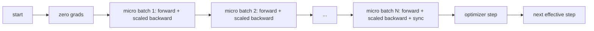
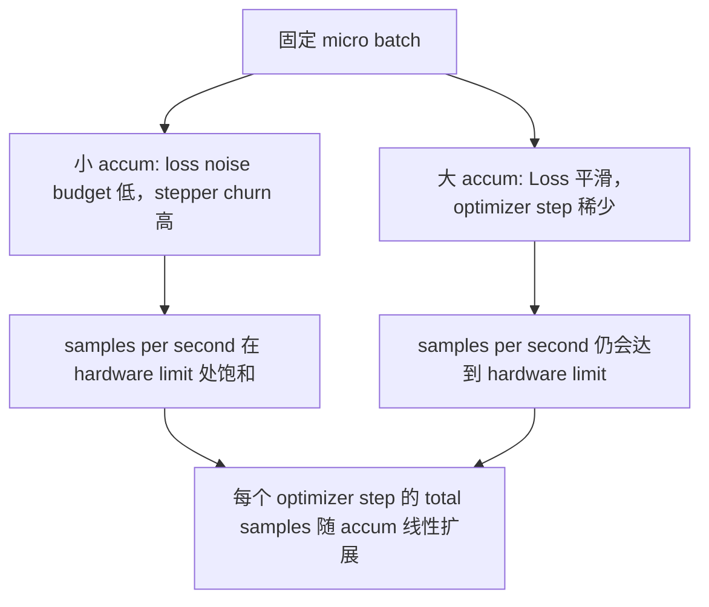

# Acumulación gradual

> Usando un micro-parce, entrenar para salir de su carga de carga no levantarse de lote efectivo.

**Type:** Build
**Languages:** Python
**Prerequisites:** Phase 19 lessons 42 to 45
**Time:** ~90 minutes

## Objetivos de aprendizaje

- 推导 lote efectivo 恒等式:`effective_batch = micro_batch * accum_steps`¿Qué es eso?
- ¢¢¢¢¢¢¢¢¢¢¢¢¢¢¢¢¢¢¢¢¢¢¢¢¢¢¢¢¢¢¢¢¢¢¢¢¢¢¢¢¢¢¢¢¢¢¢¢¢¢¢¢¢¢¢¢¢¢¢¢¢¢¢¢¢¢¢¢¢¢¢¢¢¢¢¢¢¢¢¢¢¢¢¢¢¢¢¢¢¢¢¢¢¢¢¢¢¢¢¢¢¢¢¢¢¢¢¢¢¢¢¢¢¢¢¢¢¢¢¢¢¢¢¢¢¢¢¢¢¢¢¢¢¢¢¢¢¢¢¢¢¢¢¢¢¢¢¢¢¢¢¢¢¢¢¢¢¢¢¢¢¢¢¢¢¢¢¢¢¢¢¢¢¢¢¢¢¢¢¢¢¢¢¢¢¢¢¢¢¢¢¢¢¢¢¢¢¢¢¢¢¢¢¢¢¢¢¢¢¢¢¢¢¢¢¢¢¢¢¢¢¢¢¢¢¢¢¢¢¢¢¢¢¢¢¢¢¢¢¢¢¢¢¢¢¢¢¢¢¢¢¢¢¢¢¢¢¢¢¢¢¢¢¢¢¢¢¢¢¢¢¢¢¢¢¢¢¢¢¢¢¢¢¢¢¢¢¢¢¢¢¢¢¢¢¢¢¢¢¢¢¢¢¢¢¢¢¢¢¢¢¢¢¢¢¢¢¢¢¢¢¢¢¢¢¢¢¢¢¢¢¢¢¢¢¢¢¢¢¢¢¢¢¢¢¢¢¢¢¢¢¢¢¢¢¢¢¢¢¢¢¢¢¢¢¢¢¢¢¢¢¢¢¢¢¢¢¢¢¢¢¢¢¢¢¢¢¢¢¢¢¢¢¢¢¢¢¢¢¢¢¢¢¢¢¢¢¢¢¢¢¢¢¢¢¢¢¢¢¢¢¢¢¢¢¢¢¢¢¢¢¢¢¢¢¢¢¢¢¢¢¢¢¢¢¢¢¢¢¢¢¢¢¢¢¢¢¢¢¢¢¢¢¢¢¢¢¢¢¢¢¢¢¢¢¢¢¢¢¢¢¢¢¢¢¢¢¢¢¢¢¢¢¢¢¢¢¢¢¢¢¢¢¢¢¢¢¢¢
- En el último micro-batch  antes saltó sincronización optimizador  sincronización en el último paso) 
- 读取 rendimiento contra la curva de lote efectiva,并解释 disminución del rendimiento。

## El problema

Usted quiere usar el lote 512  entrenar eficaz, porque la curva de pérdida 更平滑, Optimizer step en esta escala es más razonable. Acelerador de mesa en el agotamiento de memoria 前只能容纳 32 个例.

风险在于,Loss 不再是大批时的同数值──将将16 mini-batch的交叉进化 直接相加,将是一个全批输的16倍──没有扩展时,Gradiente 方向是正确的,但幅度是错误的,Optimizer step 会大16倍──修复方法只有一次除法──修复也很容易忘了──

## El concepto



Contrato 很短:

- Cada micro-parcela de pérdida en `backward()`Antes de la salida`accum_steps`✿PyTorch 默认会把 Gradient 累加到 ✿`param.grad`En el medio, esta ley de descomposición retorna la suma corriente a la medida correcta.
- Paso de optimización Cada lote efectivo 触发一次, en el último micro lote de retroceso 后──中途步 会扭曲后续整个运行所依赖的每个参数──
- El estado de optimización (momentum buffer, Adam moments) de cada paso efectivo, de forma progresiva, en lugar de cada micro lote, de forma progresiva, de una vez o de otra manera, las promedias móviles exponenciales verán la frecuencia de error, y el tiempo de tiempo se consumirá.
- En un solo dispositivo, esto es sólo contabilidad. En el grupo de varios rango, el mismo patrón no será el último micro lote.`no_sync`En el contexto, saltar Gradiente todo-reducir; el último micro-batch 会 una vez reducir  completa acumulada Gradiente, en lugar de pagar N 次网络成本──

### La prueba de equivalencia en código

```python
loss = criterion(model(x_full), y_full)
loss.backward()
opt.step()
```

Es decir,

```python
for x, y in chunks(x_full, y_full, n):
    scaled = criterion(model(x), y) / n
    scaled.backward()
opt.step()
```

Además de la diferencia de orden de sumación de puntos flotantes. El buffer de gradiente acumulado al final del ciclo se compara con el tensor de un lote completo hacia atrás.`equivalence_check`En el medio, la diferencia de max-abs de 1e-4 es menor.

### ¿Dónde va el costo?

Cada micro-parcela necesita una vez hacia adelante y una vez hacia atrás.`outputs/accum-curve.json`La curva de rendimiento medio muestra lo que ocurre en el micro-parto fijo abajo del lote efectivo:



没有免费的午餐──将 `accum_steps`翻倍,将让每个优化步的墙时间 翻倍――变化是渐进估计的变化:在相同的墙预算下,你执行的优化步更少,但每次都在更多样本上平均──文献把大批和小批视为不同的优化问题;本课关注的是机械,而不是统计──


```figure
cc-grad-accumulation
```

## Construye el mismo

`code/main.py`Es un artefacto que se puede transportar.

### Paso 1: Verificación de equivalencia

`equivalence_check()`Usar la misma semilla construir dos copias de la misma red ∙ Una en una pasada hacia adelante en el que se ve un lote de 16 muestras ∙ Otra en el que se ven cuatro muestras ∙ y se pierde ∙ en el paso de optimización ∙`max_abs_diff < 1e-4`¿Qué es eso?

### Paso 2: patrón de sincronización en el último paso

`train_one_optimizer_step`En todo el micro-parce... excepto en el último micro-parce, cada uno entra en el centro.`no_sync_context(model)`En el proceso único, este contexto es no-op; en el DDP, aquí se saltará Gradiente todo-reducir.`sync_counter`记录我们离开 no_sync scope 的次数; para N 个微批, el recuento es cada paso efectivo una vez, en lugar de N 次。

### Paso 3: la curva de rendimiento

`sweep_effective_batches`Utiliza fijo micro-parcela y un grupo de pasos de acumulación 运行同一个模型──每个设置都会记录:

- `samples_per_sec`: 看到的 total de muestras excepto en el tiempo de la pared
- `median_step_ms`: Cada paso efectivo del 50o percentil
- `sync_calls`: Los puntos colectivos
- `avg_loss`: barrido de los pasos de optimización 平均值

                                                                                                                                                                                                                                                                                                                                                                                                                                                                                                                             `outputs/accum-curve.json`,并可从笔记本 复用──

运行:

```bash
python3 code/main.py
```

脚本先打印等价差,再打印扫表,最后打印 JSON path──Code de salida cero──

## Usalo

En la formación de producción, la acumulación de gradientes 藏在一个扣 后面──PyTorch's pattern is `accumulation_steps = effective_batch // (micro_batch * world_size)`△ Aquí no se permite el uso de un marco 会包裹同一个循环, pero el paso es el mismo:

实践中三模式:

- Micro-parcela tamaño 被选为能满设备内存──更小会浪费加速器周期──更大会崩──
- Los grandes lotes eficaces requieren tasas de aprendizaje escaladas y calentamiento; esta es la regla de escalación lineal que se ha discutido desde 2017.
- El recuento de acumulación es el puente entre ambos, también es el único que puede en el tiempo de ejecución libertir la regla sin volver a escribir el botón del cargador de datos.

## Envío

`outputs/skill-gradient-accumulation.md`Captura esta receta, deja que el compañero pueda ponerla en un nuevo repuesto.`accum_steps`Perdida de escala, en micros no finales 上跳过优化器同步, cada lote efectivo Sólo paso Optimizer una vez,把吞吐量对有效批 以 JSON 记录,让交易可见──

## Los ejercicios

1. ¿ Qué ?`--num-steps 100`重新运行扫描,并绘制样本每秒对有效批量――曲线在哪里变平? ¿Qué es lo que se dice en el artículo?
2. 添加一个错误扩展变异 (不做除法),并展示步骤 1 时相对参考的参数差──
3. Cambiar SGD a AdamW, y confirmar el estado de optimización Cada paso efectivo avanzar una vez, en lugar de cada micro-parcela avanzar una vez.
4. 引入真实   introducción verdadera`DistributedDataParallel`envuelto,并把 `no_sync_context`路由到它的方法── confirmar las llamadas de sincronización  Reducir N-1── cada lote efectivo
5. 修改等效检查,对比两种不同的微分分 ((2 x 8 vs 4 x 4),并解释你需要放宽任何宽容的──

## Términos clave

| Term | What people say | What it actually means |
|------|-----------------|------------------------|
| Micro batch | 你 forward 的 batch | 单次 forward pass 中能放进 memory 的 slice |
| Accum steps | 每个 step 的 backward pass 数 | 在一次 optimizer step 前累加的 backward 数量 |
| Effective batch | 这个 batch | Micro batch 乘以 accum steps，再乘以 data parallel world size |
| Loss scaling | 除以 N | Per-micro-batch division，使 summed gradients 匹配 full batch |
| Sync on last | 跳过其余部分 | 只在 window 中最后一次 backward 上运行 Gradient collective |

## Leer más

- Documents PyTorch 中关于 `DistributedDataParallel.no_sync`技巧的制作 版本── 介绍 Sincronización en el último paso
- Goyal et al., 2017, acerca de la escalación lineal de la formación de grandes lotes, es una de las principales razones para la eficacia del lote.
- PyTorch problema de seguimiento 中关于 Gradient Accumulation con mezcla de precisión no escalar de la interacción.
- Fase 19 Lecciones 42 a 45 覆盖本课所假设的模型、数据 loader、优化器 和教练架构──
- Fase 19 lección 47 覆盖检查点 和恢复,让长时间积累运行 能在墙钟顶下存活──
