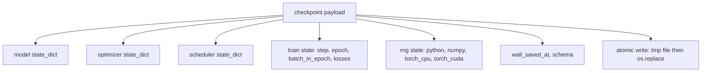
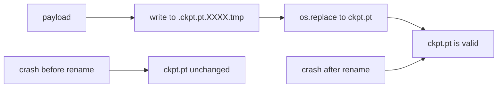
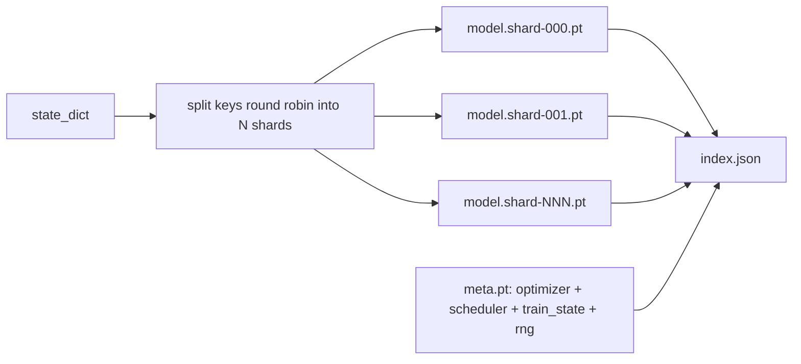

# Punto de control  conservación y recuperación

> 训练中断会杀死运行;checkpoint 让它们可以继续;; 原子化保存模型、优化、调度器、Loss history、step counter 和 RNG state, así que cualquier momento que se termine, todo el disco dejará un archivo válido。

**Type:** Build
**Languages:** Python
**Prerequisites:** Phase 19 lessons 42 to 45
**Time:** ~90 minutes

## Objetivos de aprendizaje

- Capturar el estado completo de entrenamiento en una sola carga útil, para que pueda ser recargado en un nuevo proceso.
- Usar el método de renombrar el tiempo antes de escribir para lograr el rescate atómico, asegurarse de que el accidente nunca se quede escrito hasta la mitad del archivo.
- Recuperar el estado de RNG de Python、NumPy 和 PyTorch, para que reanude 后的 Loss 匹配未中断的基线──
- Para dejar de poder colocar en un modelo de un solo archivo, construye un diseño de punto de control fragmentado, que contiene fragmentos de hash verificación y un índice JSON.

##  problemas

Usted ha establecido una tarea de entrenamiento, previsto para funcionar 18 horas. El reloj de pared sufre 4 horas. El reloj de pared se reinicia, porque alguien de más alto nivel de su salario ha aprobado la actualización del núcleo.

El artefacto correcto es un único documento, en el que se conserva todo lo necesario para continuar entrenando:parámetros de modelo, estado de optimización, estado de cronograma, para dibujar el historial de pérdida, paso actual y época, así como contadores de batch-in-epoch, y cada aleatoriedad de origen del estado de RNG.

Atomic save es la otra mitad de este contrato. Direct write into final file name significa que el error ocurrió en el proceso de escribir; resume se leerá a la basura. Escribir un archivo temporal en el mismo catálogo, y luego renombrar, significa que el error ocurrió en el proceso de escribir.

## 概念



### 五个 estado baldes

| Bucket | 为什么重要 |
|--------|------------|
| Model | Weights 和 buffers；也就是 model 本身。 |
| Optimizer | Momentum 和 adaptive moments；没有它们，下一步就是另一个 Optimization 问题。 |
| Scheduler | Learning rate 在 curve 上的位置；cosine schedules 尤其在意这一点。 |
| Train counters | Step、epoch、batch-in-epoch，以及绘制 dashboard 的 Loss history。 |
| RNG state | 为 dropout、data shuffling，以及 model 内部的任何 sampling 提供 determinism。 |

### Salvamiento atómico



两条规则──第一, el archivo temporal debe estar en el mismo directorio del objetivo, así el renombre sólo permanecerá en el mismo sistema de archivos; transversal renombre del dispositivo no es atómico.

### Puntos de control en fragmentos

Cuando el modelo 变大时, la carga útil de un solo archivo se vuelve demasiado grande, la carga no es rápida, la inspección no es fácil, y en el intercambio de red 读取中途动时非常痛苦── la solución es separar los parámetros en fragmentos, y escribir en un pequeño índice, conectándolos juntos──



Indice  registro de la cantidad de fragmentos ⋅ cada fragmento de la forma 256, así como la forma 256 del archivo meta― Cuando cualquier hash no coincide, el cargador irá claramente fracasando― Las fragmentos pueden caer en diferentes discos físicos; meta 很小,会先读取―

### Resumen de la época

Para empezar, perderá de unos minutos a un día de tiempo diferente.`(epoch, batch_in_epoch)`Además del estado de RNG. Después de la carga, el ciclo de entrenamiento generará números aleatorios.`batch_in_epoch`Continuar.  Este código de clase ha completado con precisión este punto; afirma que la trayectoria de pérdida posterior de la continuación se encontrará en el rango 1e-4 para coincidir con la línea de base de la interrupción.


```figure
cc-atomic-checkpoint
```

## Construye el mismo

`code/main.py`Proporcionar cuatro primitivos y un controlador de demostración.

### Paso 1: 捕获并恢复 RNG estado

`capture_rng_state`返回一个字句,包含Python 的 `random.getstate`、NumPy de `np.random.get_state`, así como PyTorch CPU y CUDA RNG bytes`restore_rng_state`El tensor de la CPU es un buffer de 8 bytes, el RNG de PyTorch sabe cómo consumirlo.

### Paso 2: rescate atómico

`atomic_save`Localización de archivo temporal en el directorio objetivo, y luego usarlo.`os.replace`Se cambiará a su nombre final.`atomic_write_json`Para el índice fragmentado  ejecutar la misma operación 

### Paso 3: 完整 checkpoint ida y vuelta

`save_checkpoint`¿Qué tipo de modelo es el modelo? ¿Qué tipo de modelo?`load_checkpoint`En cambio, regresa a la misma.`TrainState`◊ campo de esquema es gancho de actualización: futurformatschanger会递增版本字符串, mientras que el cargador 会进行发送──

`load_checkpoint`调用                                                                                                                                                                                                                                                                                                                                                                                                                                                                                                                           `torch.load(..., weights_only=True)`¿Qué es eso?`.pt`文件是一个,用 `weights_only=False`Contrarregla un archivo de incrédulo, ejecutará cualquier código determinado en el archivo. Solo aceptará los tensores y el recipiente básico, rechazará todo lo demás.`ValueError`En vez de usar`assert`, porque `python -O`¿Cómo se puede hacer esto?`weights_only=True`Se ha creado una brecha conocida en el medio de la CVE-2025-32434), por lo que la garantía de esta clase depende de sólo desde 2.6 .

### Paso 4: variante en fragmentos

`save_sharded_checkpoint`Es decir, en forma de round-robin, distribuir las claves de parámetro en N 个 shards, con su propio archivo atómico, escribir en cada shard, escribir en un meta archivo que contiene el optimizador, cronista y estado del tren, y escribir en el índice JSON de Sha256 de shard.`load_sharded_checkpoint`Me voy a fusionar.

### Paso 5: Demostración de resumen

`run_resume_demo`会将一个小模型 训练  entrenamiento`total_steps`, en el`interrupt_at`保存点检查,然后继续运行――第二个过程 会恢复点检查并运行剩余步骤――该函数 返回断点 之后两条损失轨迹的最大绝对差――有RNG恢复,差异为零或浮点噪声――

¿Qué es eso ?

```bash
python3 code/main.py
```

单文件和碎片的演示 都断言最大差小于1e-4──摘要会写入 `outputs/resume-demo.json`¿Qué es eso?

## Usalo

El proceso de control de los puntos de control se realiza en forma uniforme: modelo + optimizador + programador + contadores + RNG, en forma atómica, y se denomina de forma gradual, facilitándose la búsqueda de los últimos documentos.`index.json`Es parte de hacer que esto se haga realidad.

Para obligar a ejecutar cuatro modelos:

- **用 `weights_only=True` 加载。**El punto de control obtenido de la bolsa compartida o descargada es un inexplicable.
- **Schema 是 payload 中的一个 string。**Migraciones de acuerdo con su división. Sin ella, no puedes desarrollarte en condiciones que no destruyan el viejo funcionamiento.
- **对每个 shard 计算 Sha256。**静默截断的下载是最糟糕的 bug; cargador 么快速失败,要么晚些失败──
- **让 checkpoint cadence 保持诚实。**Cada paso salvar una vez, y cada varios minutos salvar una vez, tomar más corto. Si no, el accidente ocurre en un largo paso.

## Envío

`outputs/skill-checkpoint-save-resume.md`Es un nuevo script de entrenamiento: forma de carga de pago, escritura atómica, captura de RNG, índice reducido.`save_checkpoint`, en el inicio          `load_checkpoint`, ¿cómo se puede matar?

## Los ejercicios

1. Used según el grupo de parámetros 分片 sustituir la fragmentación redonda de la robina`.weight`结尾的层 vs `.bias`¿Cuándo cada diseño mejor se ajusta?
2. Extensión de la bucle de ahorro, conserva los últimos puntos de control K 个, y limpia los más viejos.
3. Añade uno.`--ckpt-every-seconds`bandera, según el intervalo del reloj de la pared 触发保存, no sólo según el recuento de pasos.
4. Añadir un camino de verificación de la suma de checksum, en inicio 运行, cada punto de control en el catálogo de barrido,并报告哪些已经腐败──
5.                                                                                                                                                                                                                                                                                                                                                                                                                                                                                                                              `migrate_v1_to_v2`Función, hacia carga útil  Añadir un nuevo campo,并递增 esquema cadena──让载 同时兼容两个版本──

## Términos clave

| Term | 人们常说 | 实际含义 |
|------|----------|----------|
| Atomic save | “写入然后祈祷” | 写入同一目录中的 temp file，然后用 os.replace 放入 target name |
| State dict | “Weights” | Model parameters 和 buffers，按 parameter name 作为 key |
| Sharded checkpoint | “大 model file” | 多个文件，每个 shard 一个，加上一个 meta file 和一个包含 sha256 的 JSON index |
| RNG state | “Random seed” | python random、numpy、torch CPU、torch CUDA 的捕获状态；不只是 seed |
| Mid-epoch resume | “Restart” | 快进 RNG，并从同一 epoch 中的下一个 batch 继续 |

## Leer más

- POSIX `rename`semántica, para la`os.replace`Reclamo de atomización de la dependencia
- PyTorch  acerca `torch.save`Y `torch.load`                                                                                                                                                                                                                                                                                                                                                                                                                                                                                                                             `map_location`¿Qué es eso?
- La lección 46 de la fase 19 abarca la carga útil de este punto de control que se puede almacenar a través de la acumulación de gradientes.
- La fase 19 de la lección 48 abarca el formato de dictado de estado que este programa puede cumplir para los envase distribuidos de los productos.
- Núcleo de Linux `fsync`Documentación para explicar el cambio de nombre atómico 背后的耐久性保障──
