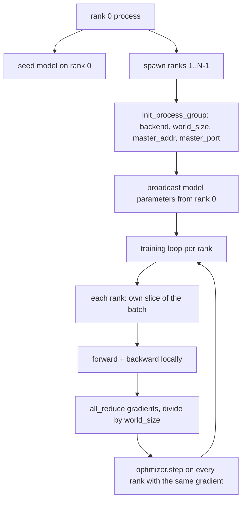
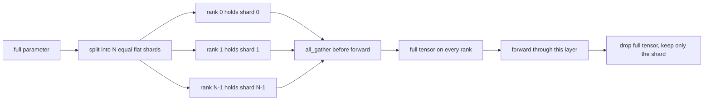

# Desde零 construcción de datos paralelas distribuidas y FSDP

> El entrenamiento multi-ranqueado es dos reglas colectivas y una regla.

**Type:** Build
**Languages:** Python
**Prerequisites:** Phase 19 lessons 42 to 45
**Time:** ~90 minutes

## Objetivos de aprendizaje

- Uso `gloo`backend  iniciación a través de N 个 rango de grupo de procesos, no necesita hardware especial―
- 实现 un mínimo de envoltura DDP, en la construcción 时播放参数, y hacia atrás 后 todo-reducir gradientes。
- prova por gradientes de rango de todos los reducen 匹配 de entrada concatena arriba de un solo proceso gradiente。
- 勾勒 FSDP parámetro fragmentación: cada rango 持有一个片, adelante pase 时收集全 tensor,后落──

##  problemas

模型能放进一个设备── Dataset 放不下── 优化预算 要求你在每秒钟内看N 倍样本──第一个杆是数据平行:每个级别在批次不同片上运行同一个模型,然后在优化步骤前的平均梯度──第二个杆是FSDP:模型本身也放不进一个设备,所以每个级别都持有每个参数的一部分,并通过 期间逐层重建全子──

痛点在会计管理──如果参数在排列之间漂移,这次运行会静默损坏──如果你 es un gradiente promedio pero no hay pérdida promedio, el tablero 就会撒谎──如果集体后端 无法达成拓学,运行 会永远挂──修复方法是亲手写一次集体,然后永远不要信任你无法复现的包装──

Este curso está en la CPU.`gloo`Backend  Con cada PyTorch construir  一起提供,并接受 `torch.multiprocessing`trabajadores; la misma parte del código cambiado a múltiples nodos de GPU `nccl`时, la estructura no necesita cambiar.

## 概念



###  Dos colectivos importantes

| Collective | 做什么 | 何时使用 |
|------------|--------------|------|
| `broadcast` | 将一个 tensor 从一个 rank 复制到所有其他 rank | Parameter init、scheduler state、任何 one-to-all sync |
| `all_reduce` | 在所有 rank 间对一个 tensor 求和（或 mean、或 max），每个 rank 都得到结果 | Backward 后的 Gradient averaging |
| `all_gather` | 每个 rank 贡献一个 tensor，每个 rank 都得到 concatenation | Logits collection、FSDP parameter unshard |

Contrato de DDP 时`broadcast`, hacia atrás 后 `all_reduce`❖ Esbozo de FSDP en cada uno de los pases anteriores 前加入 `all_gather`¿Qué es eso?

### Medios de gradientes 匹配 gradiente de un solo proceso

En N 个级 上使用B 个样本的批量 训练的模型,必须产生与单个过程在N*B的批量 上训练相同的梯度──是对每级梯度 求和并除以N,将得到平均损失梯度,这正是中减的中减的交叉 Entropia 在全批量 上会产生的结果──Lesson code 会在手动中全部降梯和参考单进程梯度之间断定`max-abs-diff < 1e-3`¿Qué es eso?

### Esbozo del FSDP



La memoria ganadora es precisa: por rango de parámetro de memoria  disminuye a 1/N。 el precio es recoger, cada paso adelante tiene que pagar。 La producción FSDP 会 se reunirá con superposición de computación de la primera capa, por lo que el costo del reloj de la parámetro es menor que el precio del cálculo nuclear.

### CPU y fondo de fondo

CUDA es el objetivo de producción, pero la CPU arriba también existe el mismo código de caminos.`gloo`Es el backend colectivo de la CPU.`nccl`ltimos niveles cuantitativos, pero la superficie de la API l igual l grupo de procesos de la clase `backend="gloo"`Inició,并用 `torch.multiprocessing`las filas de desove, en lugar de `torchrun`Los dos finalmente se usan de la misma manera.`torch.distributed` En el nodo multi-GPU arriba, la única variación es `backend="nccl"`、 tensor de dispositivo, así como uso `torchrun`Inicio de la acción.


```figure
cg-allreduce-ring
```

## Construye el mismo

`code/main.py`Es un artefacto que se puede transportar.

### Paso 1: Grupo de proceso de inicio

```python
os.environ["MASTER_ADDR"] = "127.0.0.1"
os.environ["MASTER_PORT"] = str(port)
dist.init_process_group(backend="gloo", rank=rank, world_size=world_size)
```

`MASTER_ADDR`Y `MASTER_PORT`Es un encuentro: cada rango se asigna al mismo host.

### Paso 2: Construcción 时 transmisión

`MinimalDDP.__init__`遍历每个参数 和缓冲,并调用 `dist.broadcast(tensor, src=0)`◊El valor del rango 0 se convierte en un principio canónico. ◊No hay este paso, cada rango utilizará su propia semilla inicial, rango desde el primer paso comienza a divergir.

### Paso 3: retroceso 后 todo-reducir los gradientes

```python
def all_reduce_grads_(module, world_size):
    for p in module.parameters():
        if p.grad is None:
            p.grad = torch.zeros_like(p.data)
        dist.all_reduce(p.grad.data, op=dist.ReduceOp.SUM)
        p.grad.data.div_(world_size)
```

Cada rango finalmente obtiene el mismo gradiente promedio. El paso de optimización ahora está en cada rango basado en la misma entrada de función, eso es la razón por la que los parámetros se mantienen sincronizados en toda la ejecución.

### Paso 4: Prueba de la igualdad de precios

`manual_all_reduce_matches_single_process`En la clasificación 0 arriba construir con el mismo modelo,并将 post-todo-reducir gradiente con un solo proceso en la entrada concatenación 上会计算出的 gradiente 进行比较──max-abs-diff 约为 1e-8──

### Paso 5:Viaje de ida y vuelta del FSDP

`fsdp_round_trip_sketch`Aplanar cada parámetro, en el pad hasta`world_size`La reconstrucción de cada rango es igual a la original. Es un paso incrustado. Su inverso.

运行:

```bash
python3 code/main.py
```

默认 tamaño mundial es 2── dos procesos de CPU, por `gloo`互通信,并以零 退出──输出 `outputs/ddp-demo.json` capturar las sumas de parámetros de cada rango ∞ todo-reducir ∞ ∞ ∞ ∞ ∞ ∞ ∞ ∞ ∞ ∞ ∞ ∞ ∞ ∞ ∞ ∞ ∞ ∞ ∞ ∞ ∞ ∞ ∞ ∞ ∞ ∞ ∞ ∞ ∞ ∞ ∞ ∞ ∞ ∞ ∞ ∞ ∞ ∞ ∞ ∞ ∞ ∞ ∞ ∞ ∞ ∞ ∞ ∞ ∞ ∞ ∞ ∞ ∞ ∞ ∞ ∞ ∞ ∞ ∞ ∞ ∞ ∞ ∞ ∞ ∞ ∞ ∞ ∞ ∞ ∞ ∞ ∞ ∞ ∞ ∞ ∞ ∞ ∞ ∞ ∞ ∞ ∞ ∞ ∞ ∞ ∞ ∞ ∞ ∞ ∞ ∞ ∞ ∞ ∞ ∞ ∞ ∞ ∞ ∞ ∞ ∞ ∞ ∞ ∞ ∞ ∞ ∞ ∞ ∞ ∞ ∞ ∞ ∞ ∞ ∞ ∞ ∞ ∞ ∞ ∞ ∞ ∞ ∞ ∞ ∞ ∞ ∞ ∞ ∞ ∞ ∞ ∞ ∞ ∞ ∞ ∞ ∞ ∞ ∞ ∞ ∞ ∞ ∞ ∞ ∞ ∞ ∞ ∞ ∞ ∞ ∞ ∞ ∞ ∞ ∞ ∞ ∞ ∞ ∞ ∞ ∞ ∞ ∞ ∞ ∞ ∞ ∞ ∞ ∞ ∞ ∞ ∞ ∞ ∞ ∞ ∞ ∞ ∞ ∞ ∞ ∞ ∞ ∞ ∞ ∞ ∞ ∞ ∞ ∞ ∞ ∞ ∞ ∞ ∞ ∞ ∞ ∞ ∞ ∞ ∞ ∞ ∞ ∞ ∞ ∞ ∞ ∞ ∞ ∞ ∞ ∞ ∞ ∞ ∞ ∞ ∞ ∞ ∞                                                     

## Usalo

Las estacas de formación de producción 调用相同原始人──PyTorch 的 `DistributedDataParallel`增加了:post-backward gradient hooks, para utilizar todo-reducir con recubrimiento hacia atrás;bucketed todo-reducir,将多个小梯梯 合并为一次集体;以及教案 46 使用过的 `no_sync`contexto

PyTorch FSDP  aumentó: cada nivel una vista de parámetros planos, que cada rango  posee un amortiguador contiguo; abajo unshard con la superposición de la computación de nivel actual; así como descarga de CPU de fragmentos seleccionables。

形状保持不变: iniciación en la transmisión, retrocesión 后降低, parámetros 放不下时进行碎片──

## Envío

`outputs/skill-distributed-fsdp-ddp.md`携带新训练脚本 的食谱:用 `gloo`Initiar el grupo de procesos de la CPU, us `nccl`Initiar el grupo de procesos de la GPU, el modelo 包 dentro de la cáscara de DDP, en la construcción 播放并在后退 后减少,按需使用FSDPsketch 中的全_gather pattern对参数 分片──

## Los ejercicios

1. Uso `--world-size 4`运行,并确认整个运行 中参散 保持在 1e-3 以下。
2. 将 promedio manual 替换为 `dist.all_reduce(op=dist.ReduceOp.AVG)`No hay diferencias de tiempo.
3. Dejad al envoltorio DDP  añadir gancho post-retractuales, permítan que todo se redujera con el resto del retroceso; mide el reloj de pared  mejora。
4. 实现 FSDP re-shard paso: adelante pasar 后, nuevamente con local shard  sustituir el tensor completo。 confirmar memoria por rango 下降。
5. En CUDA 机器上将后端 切换为 `nccl` registrar qué variables ambientales cambian, qué no cambian.

## Términos clave

| Term | 人们的说法 | 实际含义 |
|------|-----------------|------------------------|
| Backend | "gloo or nccl" | 实现 collective ops 的 library；gloo 是 CPU，nccl 是 GPU |
| World size | "Total ranks" | group 中的 process 数量；group 是 collectives 操作的 unit |
| Rank | "Worker id" | group 内的 process identifier，从零开始索引 |
| All-reduce | "Sum the grads" | 在所有 rank 间对一个 tensor 求和，每个 rank 最终得到相同结果 |
| Unshard | "Gather the params" | 通过 all_gather 从 per-rank slices 重建 full tensor |

## Leer más

- PyTorch `torch.distributed`Documentación, conocimiento de la semántica colectiva de la enseñanza.
- `gloo`Lista colectiva de la biblioteca, su forma y respaldado por la CUDA `nccl`Primitivos similares.
- Fase 19 lección 46, entender el DDP todo-reducir 包在 `no_sync`Modelo de acumulación de gradientes en medio
- Fase 19 lección 47, conocer el diseño del puesto de control en vivo en DDP y FSDP ejecutado en el Centro.
- PyTorch FSDP documentación, conocer aquí esquema de parámetros de fragmentación de la implementación de producción.
