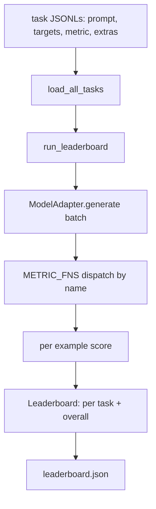
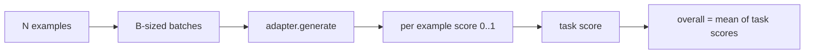

# 语言模型评测 Arneses

> Si un modelo se desempeña bien en tareas que no puedes definir, entonces es sólo un accidente que se desempeña bien.

**Type:** Build
**Languages:** Python
**Prerequisites:** Phase 19 lessons 42 to 45
**Time:** ~90 minutes

## Objetivos de aprendizaje

- Para definir una tarea como JSONL 文件, cada ejemplo 包含 `prompt`¿Qué es esto?`targets`¿Qué es esto?`metric`, y las opciones`extras`¿Qué es eso?
- 实现五个指标:exact match、rouge-l F1、executable check、multiple choice 和 substring contiene。
- Construir un ejecutor, por tarea  ejemplos de procesamiento en lote,并分发给可替换的模型适配器──
- 输出 leaderboard JSON, contiene la puntuación de cada tarea, la latencia y el promedio general de la capacidad de repetición.

##  problemas

Cada semana surge un nuevo modelo lingüístico. El marketing y el marketing dicen que funciona bien. La pregunta es: ¿en qué aspectos funciona bien?

Si tu repo 里 no tiene arnés, sólo puedes comparar dos modelos. Si tienes arnés, puedes compararlas en un conjunto de tareas fijas, métricas fijas, y obtener un resultado JSON diferente.

陷是让harness 过适合到单个模型──修复方式是反过来使用同一个陷:harness 小到十五分钟能读完,任务小到可以随随随 发布, métricas desde cero编写以便同事审计,而适配器是唯一放置模型特定代码的地方──替代适配器,leaderboard 会变;替代任务,leaderboard 会变――其他一切不应该变──

## 概念



### Específico de tarea

Cada ejemplo es una línea JSONL:

```json
{"id": "arith-00", "prompt": "compute: 2 + 2", "targets": ["4"], "metric": "exact_match"}
```

对于需要得分助手的指标,`extras`携带旁路 carga útil:

```json
{
  "id": "code-00",
  "prompt": "python: write a function f that doubles its input",
  "targets": ["ok"],
  "metric": "code_exec",
  "extras": {"io_pairs": [[1, 2], [3, 6]]}
}
```

Una tarea es`outputs/tasks/`Una de las siguientes`.jsonl`文件──文件名就是任务名称── 一文件中的所有例子 共享同一个指标──

### 五个 fijación de tareas

| Task | Metric | 测试内容 |
|------|--------|---------------|
| arithmetic | exact_match | 对确定性答案的 Token 级正确性 |
| summary | rouge_l | 针对单行 reference summary 的 longest common subsequence F1 |
| code-exec | code_exec | 可执行测试：预测出的 function 必须满足一组 input-output pairs |
| multiple-choice | multiple_choice | prediction 的首字母必须匹配允许的 letter |
| generation | substring_contains | Free-form text 必须包含至少一个 target substring |

### Contrato métrico

Cada métrica es una función:`(prediction, targets, extras) -> float in [0.0, 1.0]`❖ Aprovechar los resultados por ejemplo 取平均得到任务评分,再对任务评分 取平均得到总体──Funcciones métricas 都很小:

- `exact_match`:转小写、折叠白空、判断平等──
- `substring_contains`: la misma normalización, hacer substring test。
- `multiple_choice`:Tenga el primer personaje y no se convierta en gran escritura.
- `rouge_l`: longitud de LCS Excepto para predicción y longitud de referencia, precisión de cálculo y recuerdo de F1。
- `code_exec`: en el espacio de nombres limitado ejecutar predicción, para cada par de entrada-salida 调用 `f(x)`, estadísticas coinciden.

code_exec metric 会在精简后的内置名空间 中运行预测──本课的测试 断言 `import os`会失败, porque `os`No está en el espacio de nombres; no puedes acceder al sistema de archivos desde la predicción de código.

### Adaptador modelo

```python
class ModelAdapter(Protocol):
    def generate(self, prompts: Sequence[str]) -> List[str]: ...
    @property
    def name(self) -> str: ...
```

Adaptador es el punto de contacto.`ToyAdapter`, es un matador de patrones de determinación, se dividirá en cinco tareas fijas entre cada prompt 返回正确答案──真实适配器 会调用模型并返回输出──Harness 不关乎是哪一个──

### Corredor

`run_task`Cada lote de tratamiento`batch_size`个 prompts,并分发给 métrica función。`run_leaderboard`穿越每一个任务并求平均──`write_leaderboard`输出带 schema string 的 JSON, así futur formato 变化不会静默破坏仪表板──




```figure
eval-harness-matrix
```

## Construye el mismo

`code/main.py`Es un artefacto que se puede transportar.

### Paso 1: tareas de fijación de semillas

`seed_fixture_tasks(target_dir)`¿ Qué pasa ?`.jsonl`文件──第一次运行 `main.py`Si el catálogo está vacío, se sembrará estos documentos.

### Paso 2: tareas de carga

`load_all_tasks(task_dir)`读取每个 `.jsonl`,并返回 de nombre de la tarea hasta `Example`Registros de la lista de dictados.`#`Las líneas de comentarios y líneas en blanco se saltarán, por lo que los contribuyentes pueden comentar estos archivos.

### Paso 3:implementación de las métricas

Cada métrica es una pequeña función, y tiene un test unitario. El conjunto de pruebas de esta clase contiene 13 casos, que cubren la normalización, la superposición parcial, la ejecución de código y el rechazo de código inseguro.

### Paso 4: Escriba el corredor

`run_task`代 lotes,并生成一个 `TaskResult`, que contienen puntaje, cuenta correcta, cuenta total y latencia.`run_leaderboard`遍历 todas las tareas,并生成带总体平均的 `Leaderboard`¿Qué es eso?

### Paso 5: Emite JSON

`write_leaderboard`Consejo de la organización.`--include-per-example`Las señales de registro por ejemplo se exportan, así que cuando las puntuaciones cambian, puedes hacer diferencias en las predicciones con las anteriores.

¿Qué es eso ?

```bash
python3 code/main.py
```

脚本第一次运行时会种子装置, con adaptador de juguete((se contestará a cada fijo)打分,并写入 `outputs/leaderboard.json` Uso de adaptador de juguetes 时 puntuación general es 1.0;`test_main.py`En el medio de la prueba de un adaptador de estampado se muestra que el adaptador no puede responder, con un mismo arnés se producirá 0.0──

## Usalo

Para conectarse a un modelo real, escribe un adaptador.

```python
class HttpAdapter:
    name = "vendor.v1"

    def __init__(self, endpoint, api_key):
        self.endpoint = endpoint
        self.api_key = api_key

    def generate(self, prompts):
        out = []
        for prompt in prompts:
            response = http_post(self.endpoint, prompt, self.api_key)
            out.append(response["text"])
        return out
```

En el`main()`¿Qué es eso?`ToyAdapter`替换成   cambió`HttpAdapter`❖ El arnés, las tareas, las métricas y el tablero de clasificación se mantienen inalterados.

En el proyecto real, se requiere la ejecución obligatoria de tres modelos:

- **Pin task files。**leaderboard.json Necesita llevar contenido de tarea pinado por hash, Necesita llevar JSONLs 一并携带; de lo contrario, el archivo de tarea un cambio de puntaje cambia, y no puedes juzgar cuál ha cambiado.
- **Diff predictions，不只是 diff scores。** `--include-per-example`bandera te deja ver el resultado abajo el modelo del día que dice lo que...
- **限制 batch size。**Los adaptadores de verdad tienen límites de tarifas.

## Envío

`outputs/skill-lm-eval-harness.md`携带食谱:JSONL tarea especificación 五个指标 可替换适配器 批发运行器 带方案字符串的排行榜 JSON。`outputs/tasks/`Los archivos de tareas internos son fijos; los copie en el proyecto real como punto de partida.

##  ejercicios

1. Añadir la sexta tarea, y utilizar las métricas personalizadas que usted escribe desde cero, similares a las superposiciones de BLEU, similares a las puntuaciones de referencia de BLEURT, o cualquier contrato 清晰的东西)
2. 扩展 `code_exec`, captura de la falta de información,并 acepta un grupo de dificultades esperadas 作为目标──
3. Añadir un comando de clasificación diferente: Give Determined Two `leaderboard.json`文件, imprimir qué tareas han cambiado y qué magnitud de cambio ha ocurrido.
4. limitando cada ejemplo de latencia―utilizar tiempoout  empaquetado de la llamada de adaptador; exponer un único `timeouts`Columna:
5. En el tablero de clasificación, el contenido de tareas con pin sha256 se utiliza para que los lectores del futuro puedan verificar que evalúan las mismas tareas.

## 关键术语: "El hombre es un hombre"

| Term | 人们的说法 | 实际含义 |
|------|-----------------|------------------------|
| Task spec | “eval format” | JSONL 文件，每个 example 包含 prompt、targets、metric 和可选 extras |
| Metric | “你怎么打分” | 从 (prediction, targets, extras) 到 [0, 1] 内 float 的函数 |
| Adapter | “model client” | 带有 generate(prompts) -> list[str] method 的对象；唯一的模型特定代码 |
| Leaderboard | “scoreboard” | 包含 per-task scores、total counts、latency 和 overall average 的 JSON |
| Code exec metric | “运行它并检查” | 在受限 namespace 中执行 prediction，并与 input-output pairs 比较 |

## 延伸阅读

- El uso de la evaluación original puede ser utilizado como referencia de producción, de gran tamaño, pero de la misma forma.
- La luz de HuggingFace es otra forma de cumplir el mismo contrato.
- Fase 19 lección 46                                                                                                                                                                                                                                                                                                                                                                                                                                                                                                                        
- La fase 19 lección 47 covered your evaluation center targeted checkpoint format; en el tablero de clasificación pin en el hash de checkpoint.
- La fase 19 de la lección 48 cubre la generación de una pila de entrenamiento distribuido de modelos probados.
