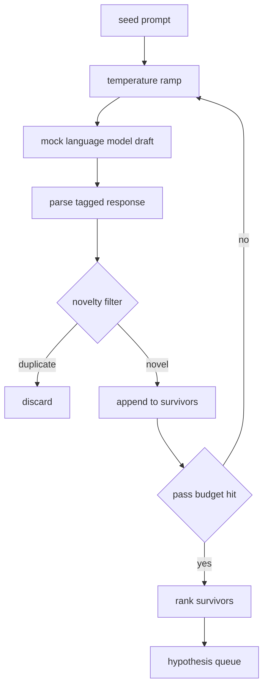

# Generador de hipótesis

> Si un agente de investigación pregunta dos veces el mismo problema, es un desperdicio. La clave es forzar a cada proyecto a una nueva posición.

**Type:** Build
**Languages:** Python
**Prerequisites:** Phase 19 Track A lessons 20-29
**Time:** ~90 分钟

## Objetivos de aprendizaje
- Desde el muestreo de semillas, el eje ejecutor de muestras, transformará su producción en un registro de hipótesis de tipo 带.
- En cada paso, eleva la temperatura de la muestra, haga que el siguiente borrador se mueva más lejos que el anterior.
- Usando un modelo de incrustación pequeño y el umbral de distancia cosina 过近似重复项。
- Utiliza la función de puntuación de mezcla de novedad, especificidad y verificabilidad para la clasificación de los proyectos de sobrevivencia.
- Que cada paso mantenga la certeza, haciendo que la misma semilla  siempre genere la misma cola

## ¿Por qué el señor se vuelve?

Un planificador  convoca un modelo Una vez, sólo conseguirá una hipótesis. Este es un ejemplo trabajado para decir que no hay problema. Pero para el ciclo de investigación para decir que la forma no es correcta. El ciclo necesita una cola clasificada con profundidad, de modo que cuando la primera hipótesis  fracasa, el corredor  ya está listo para el siguiente, sin tener que pagar una vez más el costo del pase de muestreo completo.

两个 ideas se unen para generar esta cola. La primera es el aumento de la temperatura: cada vez que pasa el muestreo 时都把温度 提高一点,让后草更愿意游走.

Este curso ofrece un modelo de lenguaje simulado, que se dirige a un prompt fijo  devolver secuencia de tokens de escritura ⋅ este simulado 足以跑完整条路径:seed prompt 输入, aplicación de temperatura rampa, resolver candidato,运行新品过器,输出排列列──

## Hipótesis 形状

```text
Hypothesis
  id             : int           (monotonic within a run)
  text           : str           (the claim)
  variables      : list[str]     (what changes between conditions)
  metric         : str           (what the runner will measure)
  baseline_ref   : str | None    (which paper or run the comparison cites)
  draft_pass     : int           (which sampler pass produced this)
  temperature    : float         (the sampler setting at draft time)
  novelty_score  : float         (distance from prior survivors, 0..1)
  rank_score     : float         (weighted sum used for ordering)
```

`variables`Y `metric`No es un texto libre. El cursor de la clase 502 en la configuración de un experimento construye estos fragmentos.

`baseline_ref`Es opcional, pero se recomienda proporcionar. En la clase 503 el evaluador necesita una línea de base para hacer una comparación. Si la hipótesis se olvida, el evaluador volverá a la misma métrica en la última vez que se ejecuta.


```figure
cg-novelty-ramp
```

## 架构



Este ciclo es muy directo. Es decir, cada caja tiene un contrato estricto.

## Rampilla de temperatura

Desde`t_min`开始, hasta `t_max`结束, paso 为 `(t_max - t_min) / (n_passes - 1)` Cada paso se utiliza la temperatura actual                                                                                                                                                                                                                                                                                                                                                                                                                                                                                                                     `GeneratorConfig.schedule()` producirse `n_passes`个均间隔的值──mock model 通过在一小组按 `(prompt, temp_bucket)`索引的脚本化反应 之间切换来遵守温度──桶是开区间, por lo tanto, las pequeñas variaciones de temperatura seleccionarán diferentes baldes, y generarán diferentes proyectos──En la producción, el muestreo será un modelo real,并传入`temperature=t`¿Qué es eso?

默认 horario es de `0.2`¿ Qué ?`1.2`Se trata de un proyecto de investigación que se ha desarrollado en el sector de la salud y de la salud.`0.2`时,model 会复述 seed──高于 `1.2`时,respuesta 往往偏离主题并导致 parser 失败──

## Filtro de novedades

Cada borrador se resuelve, el generador se incrusta en texto,并与每个已接受的假设比较──embedding es una pequeña bolsa de tokens de palabras,并正常化到单位长度──两个 unidad vector 之间的 cosín distancia `1 - dot(a, b)`Si el proyecto alcanza a cualquier sobreviviente anterior, la distancia mínima es superior a`novelty_threshold`, lo pasa por ahí.`0.25`¿Qué es eso?

Embedado hashed no es alto. Es definitivo, depende de lo que es, y es capaz de capturar las situaciones de forma evidente: dos proyectos.

## Punto de clasificación

```text
rank_score = w_novelty * novelty_score
           + w_specificity * specificity_score
           + w_testability * testability_score
```

Tres subpuntuaciones.`novelty_score`Es la distancia mínima de incrustación del sobreviviente anterior.`specificity_score`Es la hipótesis de que la cantidad de variables concretas en el caso de la cantidad de objetivos.`testability_score`En la hipótesis, con el tiempo especificado métrica y línea de base 时为一, sólo especificado métrica 时为二分之一, en caso contrario为零──

默认权重是                                                                                                                                                                                                                                                                                                                                                                                                                                                                                                                        `0.4`¿Qué es esto?`0.3`¿Qué es esto?`0.3` El peso se encuentra en la configuración del generador, por lo que el programa puede ajustarlos, sin necesidad de forjar el código.

## Modelo de lenguaje simulado

```python
class MockLLM:
    def sample(self, prompt: str, temperature: float, seed: int) -> str:
        ...
```

                                                                                                                                                                                                                                                                                                                                                                                                                                                                                                                             `(prompt, temperature, seed)`triple 时, muestreo es de certeza.`(prompt_signature, temperature_bucket)`索引的脚本化响应表――如果表没有某个键的输入,样本会返回一个会让解析器失败的倒退――其中一个测试将覆盖这个倒退路――

La semilla se mezclará en la respuesta, por lo tanto, con uno `(prompt, temperature)`En el caso de los sistemas de control de la semilla, el sistema de control de la semilla se puede utilizar para determinar el número de semillas.

## Cuadra de salida

输出是按 `rank_score`降序排序 de `Hypothesis`registro 列表──第五十二课中的跑者 弹出头,运行实验,第五十三课中的评价者 写回判决──如果判决说假设 错了,跑者就弹出下一个──

La cola es limitada. Cuando esté en el aire, el orquestrador puede ampliar el gerador de semillas y volver a funcionar, o dejar de reportar el presupuesto agotado.

## ¿Cómo leer el código?

`code/main.py` definición `Hypothesis`¿Qué es esto?`MockLLM`¿Qué es esto?`HypothesisGenerator`Y una demostración de certeza. Generador de exposición.`run(seed_prompt)`método, regresar a la cola después de la orden; pasar el recuento de`GeneratorConfig.n_passes`读取,而不是 como argumento 传入──embedding es una bolsa de tokens hachada──novelty filter es una función única──ranqueo puntuación es una función única──no hay nada que dependa `numpy`La incorporación de matemáticas es un simple problema, por lo que la enseñanza se mantiene portátil.

`code/tests/test_generator.py`覆盖 linear path、duplicate rejection path、parser failure path、temperatura límite de rampa 和 ordenamiento de rango。

## Se conecta a dónde

Se trata de un proceso de investigación que se desarrolla en el campo de la investigación y que se desarrolla en el campo de la investigación. Se trata de un proceso de investigación que se desarrolla en el campo de la investigación y que se desarrolla en el campo de la investigación.
