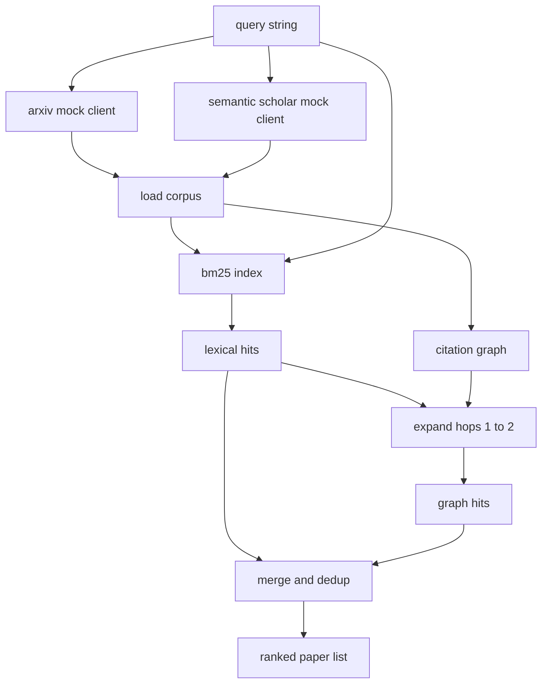

# 文献检索 文献检索 文献检索

> Una hipótesis es muy barata. Saber si alguien ya lo ha demostrado es parte muy costosa. Construir una capa de recuperación, antes de que el corredor inicie la caja de arena, responder a esta pregunta.

**Type:** Build
**Languages:** Python
**Prerequisites:** Phase 19 Track A lessons 20-29
**Time:** ~90 分钟

## Objetivos de aprendizaje
- Usando el bucle, se le ocurrió un pequeño registro de papel.
- Sólo utilizar la estructura de datos de la base de datos, en los resúmenes, en la construcción de índice BM25.
- 遍历 citación gráfico,浮现 lexical search 遗漏的论文──
- 通过稳定的纸 id,对词典和图 两轮命中结果去重──
- Para usar las dos APIs externas falsas, empaquetadas en un solo cliente, así que los puntos finales reales se conectan a la página web.

## ¿Por qué necesita dos vueltas de recuperación?

Para los resúmenes hacer búsqueda de palabras clave, volverá con la consulta compartir palabras de los papeles. Esto cubre la mayor parte de la situación de la superficie. Pero se perderá dos tipos de casos.

Este curso se desarrollará en dos rondas. Los resúmenes de la BM25 de arriba capturarán los éxitos léxicos.

## Papel 形状

```text
Paper
  id          : str           (稳定 identifier，mock corpus 中为 "p001")
  title       : str
  abstract    : str
  year        : int
  authors     : list[str]
  references  : list[str]     (这篇 paper 引用的 paper ids)
  citations   : list[str]     (引用这篇 paper 的 paper ids)
  source      : str           (提供它的 mock api，"arxiv" 或 "s2")
```

Referencias y citas 字段形成有向引用图── dos FAKE APIs 返回的字段有重叠但不完全相同,因此 corpus loader 会按 `id`Para ellos se han reunido.


```figure
cg-citation-hops
```

## Arquitectura



Recuperación cliente 拥有这两轮和 merge──caller 传入一个查询,并拿回一个排名列表; cada uno de ellos 条目都携带每纸分分 字段(`bm25_score`¿Qué es esto?`graph_distance`¿Qué es esto?`recency_score`¿Qué es esto?`final_score`), para la explicación de la secuencia.

## Desde la realidad de BM25

实现使用标准 Okapi BM25,默认参数为 `k1=1.5`¿Qué es esto?`b=0.75`index es dos diccionarios:`term -> doc_frequency`Y `term -> list of (doc_id, term_count)`△ document length is abstract of Token numbers──medio de la longitud del documento en el índice 构建时计算一次──对查询 打分时,会对查询术语 求和:`idf * tf_norm`, entre ellos `tf_norm`Es el estándar BM25 长度归一化术语频率──

El tokeniser es primero.`lower`, repuestas en letras digitales no escritas, se dividen en letras digitales.

```math
\begin{aligned}
\text{idf}(t) &= \log\!\left(\frac{N - \text{df} + 0.5}{\text{df} + 0.5} + 1.0\right) \\
\text{tf\_norm}(t) &= \frac{f \cdot (k_1 + 1)}{f + k_1 \cdot \left(1 - b + b \cdot \text{dl} / \text{avgdl}\right)} \\
\text{score}(d, q) &= \sum_{t \in q} \text{idf}(t) \cdot \text{tf\_norm}(t)
\end{aligned}
```

## Transcurso de gráfico de citas

Gráfico 会从 corpus 构建一次──前边 从一篇论文指向它的引用──后边 从一篇论文指向它的引用──过渡是宽度首次搜索,以顶部BM25 hits为种子,最多两跳──

两跳是刻意设置的上限──一跳太浅;agent 常常需要直接祖先或后裔──三跳会让连接图的结果规模膨胀,并且很容易偏离主题──本课把跳限 暴露为一个配置键,这样下游循环可以收紧它──

## Dedup y clasificación

两轮会回重叠集合――merge 两轮会回重叠集合――merge 两轮会重叠集合――merge 两轮会回重叠集合――merge 两轮会重叠集合――merge 两轮会重重叠集合――merge 两轮会重叠集合――merge 两轮会重叠集合――merge 两轮会重叠集合――merge 两轮会重叠集合――merge 两轮会重叠集合――merge 两轮会重叠集合――merge 两轮会重叠集合――merge 两轮会重叠集合――merge 两轮会重叠集合――merge 两轮会重叠集合――merge 两轮会重叠集合――merge 两轮的结合 两轮的结合 两轮的结合 两轮的结合 两轮的结合 两轮的结合 两轮的结合 两轮的结合 两轮的结合 两轮的结合 两轮的结合 两轮的结合 两轮的结合 结合 结合

```text
final_score = w_bm25 * bm25_score_norm
            + w_graph * graph_score
            + w_recency * recency_score
```

`bm25_score_norm`Es la puntuación BM25 más grande del conjunto combinado de la puntuación BM25 más grande del conjunto combinado.`graph_score`Para hits directos de léxico`0.6`, dos saltos por `0.3`,否则为零──`recency_score`Es la rampa de la línea entre el corpus de los últimos años y los últimos años.

默认 pesas es `0.5`¿Qué es esto?`0.3`¿Qué es esto?`0.2`◊ los pesos son config; el tema viejo puede reducir la actualidad, mientras que el tema que cambia rápidamente lo mejora.

## Fomento de cuerpo

Corpus tiene cien artículos, de`build_corpus()`生成──每篇篇都有一篇手写标题和摘要,主题来自五类之一: Atención escarsity、retrieval augmentation、low rank adapters、dataset distillation 和 evaluation harnesses──Referencias y citas 已连线, deja que cada tema formen un subgrafo conectado,并带有少量跨主题边缘──

两个 clientes de API falsos(`ArxivMockClient`¿Qué es esto?`SemanticScholarMockClient`)读取同一个 corpus,但暴露不同字段──Arxiv 返回标题、摘要、年、作者──Semantic Scholar 增加引用和引用──retrieval client 按 id 取并集;cross client field disagreement handling 留到后续课程──

## Lecciones 52 y 53 ¿Qué leerán?

Lección 52 El corredor medio se encuentra en el centro de la escuela.`paper.id`¿Qué es esto?`paper.title`, así como las tres primeras frases del abstracto, como contexto del experimento.`paper.year`Y `paper.references`, será la línea de base 归因到某篇具体文件──

cliente de recuperación  regresar a uno `RetrievalResult`, que también contiene una lista clasificada y por métricas de consulta: recuento de hits, puntaje promedio, puntaje superior, tiempo total de pared, para que el corredor pueda registrar estos contenidos, así que el pase de observabilidad puede ser trazado a medida que el tiempo cambie de calidad.

## ¿Cómo leer el código?

`code/main.py`Definido .`Paper`¿Qué es esto?`ArxivMockClient`¿Qué es esto?`SemanticScholarMockClient`¿Qué es esto?`BM25Index`¿Qué es esto?`CitationGraph`¿Qué es esto?`RetrievalClient`Y una demostración determinista, y los clientes y el cuerpo se colocan en el mismo archivo, así el curso se mantiene transplantable, y la realización de una clase, sienta y cinco.

`code/tests/test_retrieval.py`覆盖 лексический path、graph path、merge、dedup 和 encuesta vacía。

## ¿Qué posición tiene?

Lección cincuenta  generar una hipótesis。Lección cincuenta y una  buscar literatura, juzgar esa hipótesis si no ya tiene un determinado teorema。 si no, Lección cincuenta y dos  ejecutar experimento。Lección cincuenta y tres 读取 extracción resultado 和 experiment metrics, escribir un veredicto。 el cliente de extracción es uno de los cuatro fases más convenientes, y se ejecutará primero en el orquesta­tor‖
