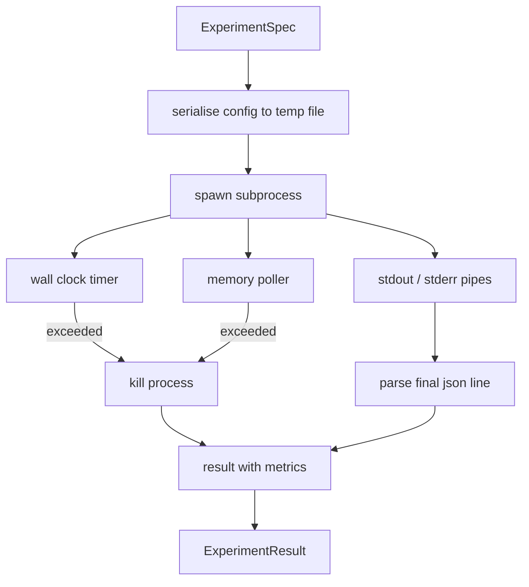

# El corredor de experimento

> El grado de sinceridad del loop depende de sus mediciones.

**Type:** Build
**Languages:** Python
**Prerequisites:** Phase 19 Track A lessons 20-29
**Time:** ~90 分钟

## Objetivos de aprendizaje
- El experimento se codifica en una especificación tipográfica, el ejecutor puede sererizarlo a un subproceso.
- Iniciar un subproceso con tiempo de tiempo de reloj de pared duro y tapa de memoria blando, y expondrá a los demás a condiciones terminales.
- Para obtener un registro de resultados, se debe utilizar un sistema de datos de datos de datos de datos de datos de datos de datos de datos de datos de datos de datos de datos de datos de datos de datos de datos de datos de datos de datos de datos de datos de datos de datos de datos de datos de datos de datos de datos de datos de datos de datos de datos de datos de datos de datos de datos de datos de datos de datos de datos de datos de datos de datos de datos de datos de datos de datos de datos de datos de datos de datos de datos de datos de datos de datos de datos de datos de datos de datos de datos de datos de datos de datos de datos de datos de datos de datos de datos de datos de datos de datos de datos de datos de datos de datos de datos de datos de datos de datos de datos de datos de datos de datos de datos de datos de datos de datos de datos de datos de datos de datos de datos de datos de datos de datos de datos de datos de datos de datos de datos de datos de datos de datos de datos de datos de datos de datos de datos de datos de datos de datos de datos de datos de datos de datos de datos de datos de datos de datos de datos de datos de datos de datos de datos de datos de datos de datos de datos de datos de datos de datos de datos de datos de datos de datos de datos de datos de datos de datos de datos de datos de datos de datos de datos de datos de datos de datos de datos de datos de datos de datos de datos de datos de datos de datos de datos de datos de datos de datos de datos de datos de datos de datos de datos de datos de datos de datos de datos de datos de datos de datos de datos de datos de datos de datos de datos de datos de datos de datos de datos de datos de datos de datos de datos de datos de datos de datos de datos de datos de datos de datos de datos de datos de datos de datos de datos de datos de datos de datos de datos de datos de datos de datos de datos de datos de datos de datos de datos de datos de datos de datos de datos de datos de datos de cuyo de cuyo de cuyo de datos de cuyo de datos de datos de cuyo de datos de datos de cuyo de datos de datos de cuyo de cuyo de datos de datos de cuyo cuyo cuyo cuyo cuyo cuyo cuyo cuyo cuyo cuyo cuyo cuyo cuyo cu
- Construir la tabla de ablación, en la especificación de base fija 上一次扫一配置按──
-  Cuando se da la semilla determinada, que cada resultado se mantenga determinista, de modo que el evaluador en varias veces de la operación vea el mismo número

## ¿Por qué usar subproceso

El ciclo de investigación 会运行不信赖代码――hypothesis de muestreo, script experimental también proviene del mismo camino;把任一任任任一当作安全的过程中的代码,都在等待一次会拖管弦仪的崩──Subprocesos es el aislamiento más simple de la lenguaje propia: un proceso independiente、 un espacio de direcciones independiente, así como el manejo de señal del lado parental ⋅

Aquí el corredor  no ha logrado el sandboxing completo. No hay cgroup, no hay filtro de secuencia, tampoco hay remaping de espacio de nombres. Tiene un tiempo límite de reloj de pared, para examinar el crecimiento de la memoria, así como un camino de eliminación del proceso de terminación en el límite superior.

## ExperimentoEspec 形状

```text
ExperimentSpec
  spec_id        : str            (stable id，"exp_001")
  hypothesis_id  : int            (链接回 lesson 50 中的 queue)
  script_path    : str            (要运行的 python script 路径)
  config         : dict           (作为一个 json arg 传给 script)
  seed           : int            (experiment 的 deterministic seed)
  wall_timeout_s : float          (hard timeout，超出则 kill)
  memory_cap_mb  : int            (soft cap，轮询；超出则 kill)
  metric_keys    : list[str]      (evaluator 会读取的字段)
```

script existe en el disco; runner 会把 config 写入一个临时文件路径,script 再读取它──script 应该在 stdout 上打印单个 json line,其键是`metric_keys`El superconjunto de los estudios se captará, pero el paresista de métricas los ignorará.


```figure
cg-runner-limits
```

## Arquitectura



runner es una clase, con un método principal. poller es un pequeño hilo, cada intervalo de encuestas separado.`psutil`equivalente; cuando la plataforma no la expone, se retira por opción alguna

## ¿Por qué es la tapa de memoria suave

Capas de memoria dura 需要 `resource.setrlimit`, y sólo en POSIX 上工作──本课提供一种便携式方法: desde el tamaño del conjunto residente de las consultas de la plataforma, si supera el límite, se mata el subproceso──cap es suave, porque el encuestador tiene un intervalo de no cero; el proceso puede aumentar hasta el límite entre las dos consultas, luego bajar de nuevo──runner 会记录 observado máximo RSS, así el evaluador puede ver que la ejecución 离限 tiene más cerca──

En el sistema de apoyo a la inspección de procesos, el sondeador registrará una advertencia única y no se bloqueará.

##  Capture stdout y stderr

corredor 会在完成时读取并排空两条管──Stdout 会逐行扫描; el último capaz de resolver para el json 且包含所有必需的`metric_keys`Las líneas de json serán vistas como un blob de métricas.`intermediate_metrics`El evaluador puede utilizarlas para trazar curvas de aprendizaje.

El corredor nunca se elevará por el código de salida de la parte inferior; se registrará el código en el resultado de la parte inferior.`"crash"`, incluso si el script imprime métricas, por lo tanto el evaluador de forma en común ejecuta parcialmente los fallos.

## Tabla de ablación

```python
def ablate(base: ExperimentSpec, knob: str, values: list[Any]) -> list[ExperimentSpec]:
    ...
```

给定基标和按名称,该辅助会返回每值对应的一个标,并覆盖 `config[knob]` Cada espec. ciudad obtendrá una expedición `spec_id`(El artículo`f"{base.spec_id}_{knob}_{value}"`)―runner 提供一个 `AblationRunner`, según el orden de las especificaciones, y regresar a un valor de botón como clave de `AblationTable`¿Qué es eso?

¿Por qué una vez sólo cambiar un botón? Todo factorizado barrido de la lista de inflación, no produce evaluador  inexplicables resultados.

## El determinismo

Cada especificación lleva una semilla. El corredor pasará por el dictamen de configuración.`config["__seed"] = spec.seed`)。`code/experiments/`Los guiones de experimentación simulada de la clase media se basan en la misma medida. Sin determinismo, la llamada "regressión" puede ser simplemente una inicialización aleatoria diferente.

## Escrito de experimento falso

Este curso ofrece un guión experimental:`code/experiments/sparsity_experiment.py`△ Es un script real, leerá su propio archivo de configuración, utilizará un pase aleatorio numérico 模拟一个小型训练运行,并打印一个json metrics blob──script 支持 `sleep_s`botón Usado para el tiempo de prueba, también apoyo `allocate_mb`botón Usándolo para probar el poller de memoria

La simulación no ha entrenado realmente nada. Es un cálculo numérico, que se parece a un ciclo de entrenamiento.

## Resultado 形状

```text
ExperimentResult
  spec_id              : str
  hypothesis_id        : int
  exit_code            : int
  terminal             : "ok" | "timeout" | "oom" | "crash"
  wall_time_s          : float
  peak_rss_mb          : float | None
  metrics              : dict
  intermediate_metrics : list[dict]
  stdout_tail          : str
  stderr_tail          : str
```

evaluador 会先读取 `metrics`Y `terminal`Si el terminal no es`"ok"`, experimento cuentas por fallo de ejecución, veredicto del evaluador se genera automáticamente.

## ¿Cómo leer el código?

`code/main.py`Definido .`ExperimentSpec`¿Qué es esto?`ExperimentResult`¿Qué es esto?`ExperimentRunner`¿Qué es esto?`AblationRunner`Y una demostración determinista. La gestión de subprocesos es una clase.

`code/experiments/sparsity_experiment.py`Es un experimento simulado. Se utiliza para leer el camino del archivo de configuración y, al finalizar, se escribe una sola línea de métricas de json.

`code/tests/test_runner.py`覆盖成功路径、timeout路径、crash path、ablation table, así como el control de determinismo de las dos carreras transversales―

## ¿Qué posición tiene?

Lección cincuenta 生成假设──Lesión cincuenta y una 过掉文献 已解决的内容──Lesión cincuenta y dos 针对剩余部分运行实验──Lesión cincuenta y tres 读取结果,运行意义测试,并写出管弦仪 存储到假设 id 上的判决──
