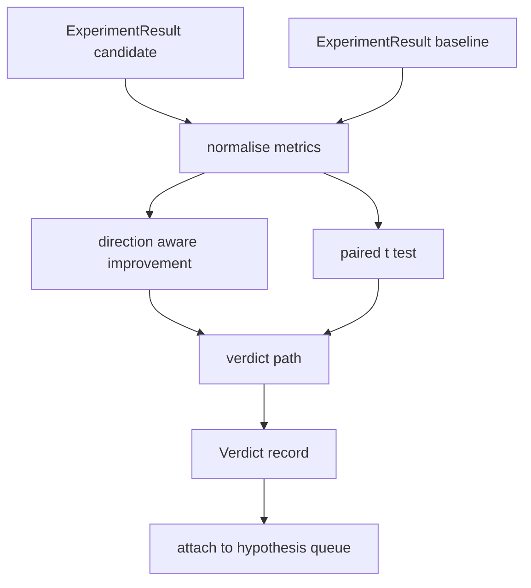

# 结果评估器 结果评估器 结果评估器 结果评估器 结果评估器 结果评估器 结果评估器 结果评估器 结果评估器 结果评估器 结果评估器 结果评估器 结果评估器 结果评估器

> corredor 产出数字──evaluator 判断这些数字代表改进,退缩,还是噪声──构建一条判决 路径,把尺度 转换成一句结论──

**Type:** Build
**Languages:** Python
**Prerequisites:** Phase 19 Track A lessons 20-29
**Time:** ~90 minutes

## Objetivos de aprendizaje
- Utiliza la dirección de mejora y el umbral fijo, el candidato se ejecutará con el baseline  realizar comparación 
- Desde el primer punto de cada semilla de métricas de la prueba de par de t,并读取得到的 p值──
- Para los registros de métricas a escala normal, permítanme que los informes de abajo pueden mezclarse con las métricas lineales.
- 输出每一个假设的判决,让乐队长可以将其添加到第五十课的队列.
- Que cada paso se mantenga puro, que la misma entrada siempre produzca el mismo veredicto.

## ¿Por qué una prueba en pareja?

El corredor  dado un solo número no puede explicar si el cambio es real. La misma configuración en cambio de una semilla obtendrá una complejidad diferente. El cambio puede ser sólo ruido. El método de comparación correcto es emparejado: las mismas semillas, los mismos datos, una vez con el candidato, una vez con la línea de base 运行.

Este curso es un examen de la realización de la prueba.`scipy.stats`◊ Matemáticas es bastante pequeña, una pantalla está listo para leer.

```text
diffs    = [a_i - b_i for i in seeds]
mean     = sum(diffs) / n
variance = sum((d - mean) ** 2 for d in diffs) / (n - 1)
t_stat   = mean / sqrt(variance / n)
df       = n - 1
p_value  = two_sided_p(t_stat, df)
```

Dos lados de p valor Utiliza regularizada función beta incompleta.

## Mejora de la conciencia de la dirección

Algunas métricas 变大时表示改进(precisión, rendimiento) ・・・ otras 变小时表示改进(pérdida, perplejidad, tiempo de pared) ・・・evaluador en cada métrica 带一个 `direction`¿Qué es eso?

```text
if direction == "higher_is_better":
    improvement = (candidate - baseline) / abs(baseline)
elif direction == "lower_is_better":
    improvement = (baseline - candidate) / abs(baseline)
```

Mejoramiento es un símbolo de. Para más alto es mejor métrica, mejoramiento negativo es un símbolo de mejoras.

Un umbral fijo`improvement_threshold=0.02`, %s de 2) decide si el cambio es lo suficientemente grande, se puede dar un juicio.


```figure
cg-paired-verdict
```

## Arquitectura



evaluador 运行三个独立计算, y en el veredicto 路径中把它们合并──每个计算都是没有共享状态的纯函数──

## Normalización del registro

La perplejidad en comparación con la pérdida es una relación de índice. La pérdida disminuye 0.1 y la perplejidad se produce mucho más.

Este curso se va a`scale`字段为 `"log"`Cualquier métrica en el cálculo mejora de la anterior toma log. el umbral natural.`log(28) - log(32) = -0.133`, lejos de los dos por ciento del umbral.

```text
if scale == "log":
    a = log(candidate)
    b = log(baseline)
else:
    a = candidate
    b = baseline
```

`scale="linear"`(默认) de las métricas se saltará esta transformación.

## Prueba de paridad por semilla

El corredor de la segunda clase se reunirá para cada carrera. Para el examen de pares, el evaluador necesita candidato. Cada semilla, una semilla, una línea de base. Cada semilla, una semilla.`ExperimentResult`los registros 交给评价员──

evaluador 按种子 配对 种子 位于 `result.metrics["seed"]`), luego recorrer la métrica de la solicitud. Si las semillas de los dos grupos de la lista no coinciden, el evaluador se lanzará.`PairingError`◊Orquesta 应重新运行──

## La forma del veredicto

```text
Verdict
  hypothesis_id          : int
  metric                 : str
  direction              : "higher_is_better" | "lower_is_better"
  scale                  : "linear" | "log"
  candidate_mean         : float
  baseline_mean          : float
  improvement            : float       (signed, fraction; see direction rules)
  p_value                : float | None  (None if n < 2)
  significance_threshold : float
  improvement_threshold  : float
  verdict                : "improved" | "regressed" | "noise" | "failed"
  rationale              : str
```

Veredicto 路径 es una pequeña tabla de decisiones:

```text
1. If any candidate result has terminal != "ok": verdict = "failed"
2. else if |improvement| < improvement_threshold:  verdict = "noise"
3. else if p_value is None or p_value > significance: verdict = "noise"
4. else if improvement > 0:                          verdict = "improved"
5. else:                                             verdict = "regressed"
```

La razón es una frase legible para el hombre, el orquesta puede hacerla según la hipótesis.

## Cómo leer el código

`code/main.py`Definido .`MetricSpec`¿Qué es esto?`Verdict`¿Qué es esto?`Evaluator`、t estadística 和 incompleta beta helpers, así como una demostración determinista. ⋅t prueba con matemáticas puras ⋅ ⋅ ⋅ ⋅ ⋅ ⋅ ⋅ numpy sólo para leer la lista de métricas 并计算 mean 和 variances──

`code/tests/test_evaluator.py`覆盖 mejorada 路径、regressed 路径、ruido 路径(small improvement) 噪音 路径(低 n) ‧fallido terminal 路径、log normalizado 路径、con un valor de referencia conocido para la prueba de comparación t, así como el error de emparejamiento。

## Donde esta ranura en

Se ha publicado una lista de hipótesis. Se ha publicado un artículo sobre la literatura. Se ha publicado un artículo sobre la teoría de la teoría de la teoría de la teoría de la teoría de la teoría de la teoría de la teoría de la teoría de la teoría de la teoría de la teoría de la teoría de la teoría de la teoría de la teoría de la teoría de la teoría de la teoría de la teoría de la teoría de la teoría de la teoría de la teoría de la teoría de la teoría de la teoría de la teoría de la teoría de la teoría de la teoría de la teoría de la teoría de la teoría de la teoría de la teoría de la teoría de la teoría de la teoría de la teoría de la teoría de la teoría de la teoría de la teoría de la teoría de la teoría de la teoría de la teoría de la teoría de la teoría de la teoría de la teoría de la teoría de la teoría de la teoría de la teoría de la teoría de la teoría de la teoría de la teoría de la teoría de la teoría de la teoría de la teoría de la teoría de la teoría de la teoría de la teoría de la teoría de la teoría de la teoría de la teoría de la teoría de la teoría de la teoría de la teoría de la teoría de la teoría de la teoría de la teoría de la teoría de la teoría.

```text
for hypothesis in queue:
    literature = retrieval.search(hypothesis.text)
    if literature_settles(hypothesis, literature):
        attach(hypothesis, verdict="settled")
        continue
    candidates = runner.run_all(specs_for(hypothesis))
    baselines  = runner.run_all(baseline_specs_for(hypothesis))
    metric_spec = MetricSpec("perplexity", direction=LOWER, scale=LOG)
    verdict = evaluator.evaluate(hypothesis.id, metric_spec, candidates, baselines)
    attach(hypothesis, verdict)
```

Este orquestrador no está en esta clase; esta clase pasa por clases de datos definidas por sí mismas 组合进去, no necesita ningún pegamento adicional.
