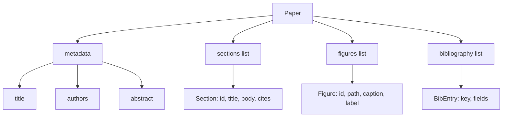
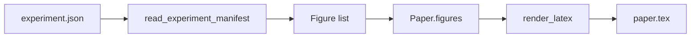
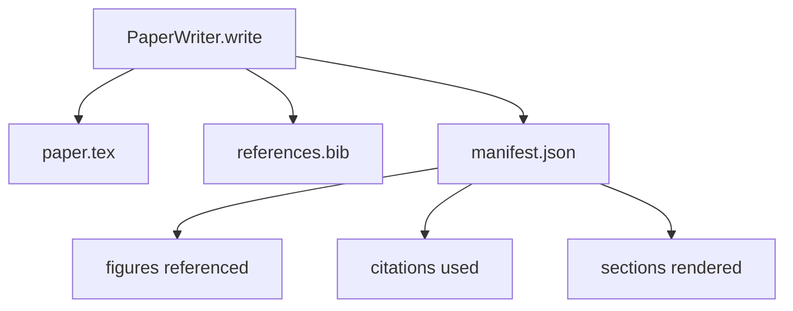

# 论文写作器 论文 escribiendo y escribiendo

> El esqueleto de LaTeX es el contrato entre el investigador y el tipógrafo. Si el contrato es destruido, el documento no puede ser compilado, y el fracaso será evidente.

**Type:** Build
**Languages:** Python
**Prerequisites:** Phase 19 lessons 50-53
**Time:** ~90 minutes

## Objetivos de aprendizaje

- El documento de investigación se considerará un artefacto estructurado de un gráfico de sección conocido, en lugar de un documento de forma libre.
- Antes de escribir cualquier prosa, genera una declaración abstracta, secciones, ranuras de figuras y claves de bibliografía de esqueleto de la Tex.
- A través del mecanismo de ranura determinista, los resultados del experimento  figuras en los caminos y subtítulos  ingresarán al esqueleto
-  Conectar un generador de prosa burlado, que se realiza desde el esquema estructurado  llena cada sección, hacer que el arnés puede ser probado en caso de no tener un modelo
- 输出单个                                                                                                                                                                                                                                                                                                                                                                                                                                                                                                                         `paper.tex`¿Qué es esto?`references.bib`, reañadir una lista de cada figura referida y cada cita utilizada del manifiesto.


```figure
ch-paper-skeleton
```

## ¿Por qué un esqueleto primero?

Desde el comienzo del proyecto de la prosa, la deuda estructural se acumula. La introducción, el aumento de los tres segmentos que deben ser puestos en el contenido de los trabajos relacionados.

Esqueleto 会反转这一点──estructura 先以数据 形式声明──Secciones 带名和序的插槽──Figures 带 id 和字幕的插槽──Bibliografía llaves 在顶部声明,并带有它们指向的输入──Prose 会一次一个插槽 地生成进去──harness 可以在写任何散文 之前验证: cada figura 带名和序的插槽, cada citación 都有输入, cada sección 都出现在表中中──

Esto se aplica a los planes, a las llamadas de herramientas y a las huellas de la disciplina superior.

## La forma del papel



Cada campo es un conjunto de datos de Python.`Paper`Hasta la función pura de la cadena LaTeX. Harness puede ser en renderizado en el papel anterior de introspección:`\cite{key}`Todos los tipos están en juego.`BibEntry`¿Qué es eso?

## El contrato de rendimiento

El renderizador asegura tres propiedades. Primero, cada ranura de cada figura en el esqueleto,`\begin{figure}`bloque,并带有稳定标签,格式为 `fig:<id>`△ Segundo, cada sección tiene una salida `\section{}`,并带有稳定标签,格式为 `sec:<id>`, así las referencias cruzados pueden trabajar.`\bibliography`bloque,其 `references.bib`精确包含纸上声明的报名,不多也不少──

违反任何一条都是 render error, no advertencia. 骨架就是合同.

## Inyección de figuras de experimentos

Este es el primer libro de la serie de libros de texto en la que se escribe el libro de texto de la revista JSON.`Figure`registros



Injección es determinista de──Figura de identificación del nombre del experimento 加上 monótono contador 派生──Capitulaciones de manifestar──Paths 会相对纸的输出目录做正常化,因此即使实验输出位于磁盘其他位置,LaTeX也能编译──

## El generador de prosa burlado

Este curso no se adaptará a los modelos.`MockProseGenerator`读取 bosquejo de formas,并 deterministic 地输出散文── bosquejo de formas es cada sección 一条短字符串──generator 会将该字符串扩展成两个短段落,并把部分标题 编织进去──生成的散文 只会在概要 声明时名字滴数字 和引用──

Esto es lo que hace que el generador de prosa declare el valor de la llamada: el test se sustituye por el generador determinista, la producción se sustituye por el modelo, la versión, la tubería y el resto del proceso se mantienen en la misma.

## La salida manifiesta

escritor 会向输出目录 输出三个文件──



manifest es un evaluador o un ciclo crítico 读取的内容──它不解析 LaTeX;它读取 manifest──下一课批判循环将将这个 manifest 作为输入,并产生反列表──这就是为什么 manifest 是合同的一部分,而 LaTeX 不是──

## Puertas de validación

El escritor está escribiendo cualquier archivo antes de que se ejecuten cuatro puertas.

1. El papel dentro de cada figura ID es único.
2. Cada sección de`cites`字段引用的图书馆关键都已在纸上声明──
3. Abstract 非空──
4. título 非空──

La puerta del fracaso se lanzará .`PaperValidationError`,并给出精确原因──harness将该原因作为失败模式 暴露出来──没有部分写:要么输出全部三个文件,要么一个也没有输出──

## Cómo leer el código

`code/main.py`Definido .`Paper`¿Qué es esto?`Section`¿Qué es esto?`Figure`¿Qué es esto?`BibEntry`¿Qué es esto?`PaperValidationError`¿Qué es esto?`MockProseGenerator`¿Qué es esto?`PaperWriter`, y uno .`render_latex`Función`write`método 接收 directorio de salida,并输出 `paper.tex`¿Qué es esto?`references.bib`Y `manifest.json`¿Qué es eso?`read_experiment_manifest`asistente 会将 experimentar manifiesta lista 转换为 `Figure`registros

`code/tests/test_paper_writer.py`覆盖: no secciones 时的骨格 render、带两个部分和两个数字的完整 render、missing-citation gate、duplicate-figure-id gate、manifest content,以及 LaTeX-string contract(cada sección 输出一个 输出一个`\section{}`, cada cifra      `\begin{figure}`)。

## Ir más allá

Realmente realizará necesitar dos extensiones. Primero, multi-formato renderizado:`Paper`forma puede compilarse para los artículos de blogs, así como para la vista previa de HTML.`Paper`La estrategia de arriba, enriquecimiento de citas: given determin本地 DOI cache,writer from citation key  obtain BibTeX entries── ambos tienen valor, también pueden ser añadidos en caso de no tocar el contrato esqueleto──

Esqueleto es esta siguiente nota. Secciones, cifras y citas, datos y declaraciones, prosa, vida y vida en los espacios, manifiesto con LaTeX, una salida y una salida.
