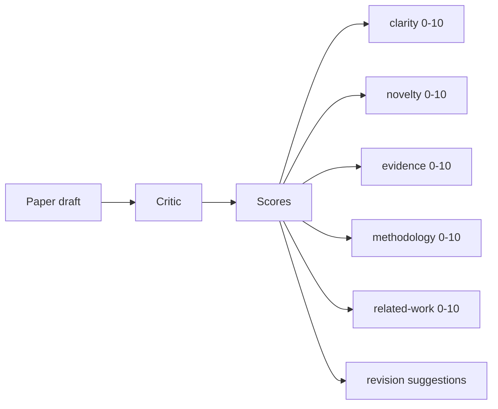
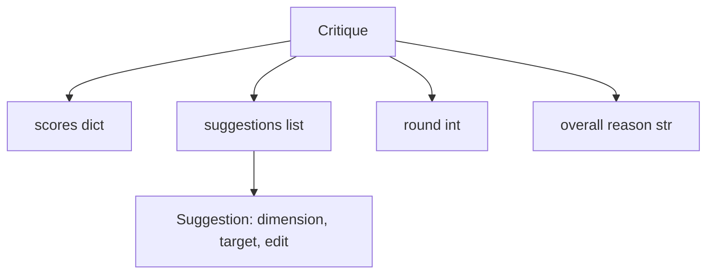
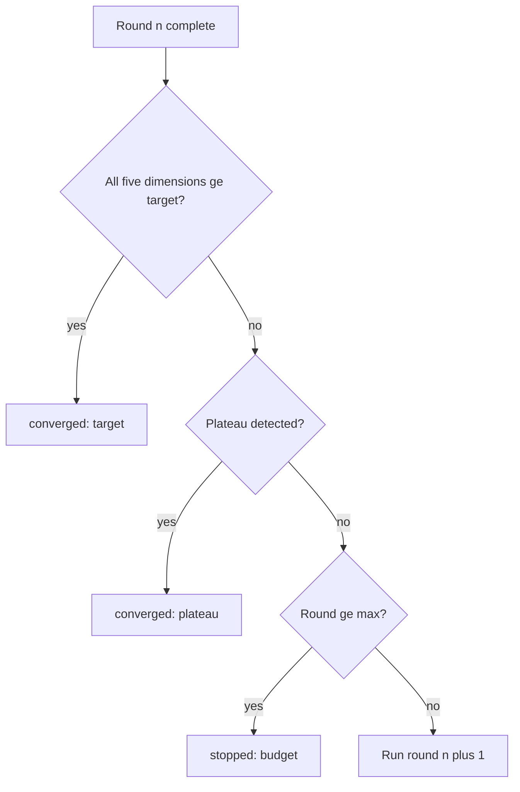
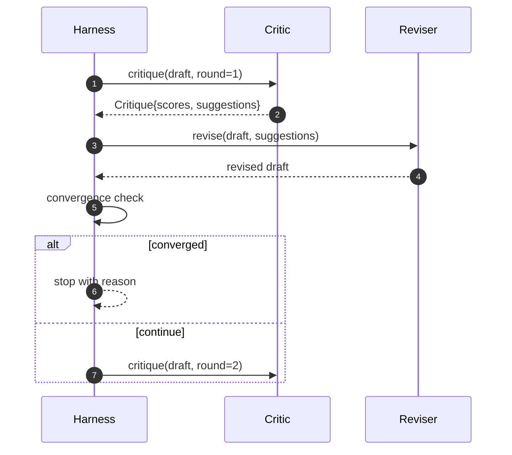

# El círculo crítico

> La primera vez que regresa el crítico de "parece bien" es malvado. Siempre regresa al crítico de "necesita trabajo". También es malvado.

**Type:** Build
**Languages:** Python
**Prerequisites:** Phase 19 lessons 50-53
**Time:** ~90 minutes

## Objetivos de aprendizaje


```figure
ch-critic-converge
```

- 按五个固定维度为论文草稿打分:clairity、novelty、evidence、methodology、related-work──
- La crítica se aplica a la revisión estructural diferente, en lugar de la redacción de forma libre.
-                                                                                                                                                                                                                                                               
- Usar la máxima iteración  presupuesto limitar el número de turnos, evitar no recibir críticos 永远运行。
- 输出轮回追踪,让仪表板或下一阶段可以染分数轨迹──

## ¿Por qué usar cinco dimensiones fijas?

El critico de forma libre es un modelo de regreso de la sugerencia de un pasaje. La siguiente revisión, se trata de un pasaje que se considera un medio ambiente.

5 dimensiones para el arnés un trato



El número es un vector. Harness observará cada dimensión en el cambio de las rotas. Un aumento de la claridad, pero deja que la evidencia de la revisión de la gran disminución, es la evidencia de la regresión superior, la verificación de la convergencia lo verá. Sólo en base al modelo crítico no puede proporcionar esta garantía.

## La crítica 结构



Cada sugerencia lleva una sección de dimensiones y objetivos mejorados, así como un revisor que se puede aplicar.`edit`instrucción. revisor también es un revisable. Este curso proporciona un revisor de determinación, que edita instrucción para explicar la operación de apéndice a sección.

## Reglas de convergencia, según orden de ejecución

El ciclo crítico se terminará en cualquiera de las tres condiciones.



El objetivo es el más estricto: cada uno de los cinco dimensiones de claridad, novedad, evidencia, metodología y trabajo relacionado) debe alcanzarse.`>= target_score`(默认 `8.0`),loop 才会回归成功──平均值很高但有一个弱度不够──板块检测会比较当前轮平均值和上轮平均值──如果连续两轮的改善 低于`plateau_epsilon`(默认 `0.1`), en el ciclo de reuniones`plateau`退出── presupuesto es el límite de la cantidad de turnos `5`),并以 `budget`- ¿Qué pasa?

顺序很重要──目标 优先于高原,高原 优先于预算──如果第三轮在同一时间代中既达到目标,也将触发高原,结果是`target`¿ Qué es ?`plateau`¿Qué es eso?

## ¿Por qué la detección de la meseta 跨两轮运行

Plataforma de una sola rueda es ruido  Real crítico incluso en el frente de un proyecto fijo, cada generación también regresará con un porcentaje ligeramente diferente, porque la puntuación de la determinación  todavía depende de qué sugerencias se aplican y el orden de aplicación  Requiere un plan de dos ruedas continuas se puede superar este ruido  Si se aprovecha   informe de un proyecto                                                                                                                                                                                                                                                                                                                                                                                                                      

## El critico de la certeza del curso

El libro de estudios es un libro de estudios de la Universidad de California, San Francisco, que se basa en tres signos:`originality_tag`字段(novedad) ⋅revisor 知道如何把每个分数向上推──

```text
clarity      在平均 section 正文长度增加时增长
novelty      在 originality_tag 设置为 "high" 时增长
evidence     在某个 section 的 figure_refs 非空时增长
methodology  在存在标题为 "Method" 且有正文的 section 时增长
related-work 在存在标题为 "Related Work" 且有正文的 section 时增长
```

Revisor 会把每条建议 解释为定向增加. Después de la primera ronda, el aprovechamiento puede observarse en el aumento de la cantidad de porcentajes.

## 完整循环 契约



El control de la convergencia es un control de la convergencia.

## Trace 输出

Cada ronda producirá un evento de seguimiento, que incluye el número redondo, el número de puntuación, el número de vectores, el número de sugerencias y el veredicto de convergencia, el seguimiento completo, el borrador final, el primer y el segundo, el tablero de control, el siguiente, puede ser el calendario de la iteración de cada ronda, el siguiente, el programa de lectura, el que decide si esta rama vale la pena conservarse.

##  prevenir mal crítico                                                                                                                                                                                                                                                              

Un crítico que genera sugerencias que nunca pueden aumentar el número de puntos, pondrá el ciclo en la máxima iteración.`budget` El usuario lo interpretará como un error crítico, no como un error de proyecto. El método alternativo es sólo exponer el borrador final, pero esto oculta el diagnóstico.

## ¿Cómo leer el código?

`code/main.py`Definido .`Critique`¿Qué es esto?`Suggestion`¿Qué es esto?`Critic`protocolo`Reviser`protocolo`CriticLoop`, y uno .`make_deterministic_critic_pair`fábrica, que regresará a la determinación del crítico y el revisor de la correspondencia. También contiene un mínimo.`Paper`结构, hacer que este curso pueda funcionar independientemente.

`code/tests/test_critic_loop.py`覆盖: primera ronda de cambios en el presupuesto, proyecto de ajuste de la convergencia de objetivos, dos rondas de la detección de la meseta, no hay sugerencias de mejora de la agotamiento presupuestario, revisor de la aplicación de las sugerencias y de la estructura de los rastros.

##  explorar más

La verdadera realización necesitará dos expansiones. En primer lugar, los pesos de dimensión: taller 论文会更重视新品而不是方法; periódico 则相反──Convergencia check 会变成加权平均值── en segundo lugar, los críticos parejos: un crítico 负责打分, otro crítico 在修改者 看到建议 之前对它们做出裁决── ambas tienen valor, y pueden ser combinadas en una misma`Critique`结构之上──

关键注是分数向量── una vez que la crítica se estructura, todas las demás mejoras, reglas de convergencia, tablero de control, críticos emparejados, pueden entrar en un ciclo inalterable──
