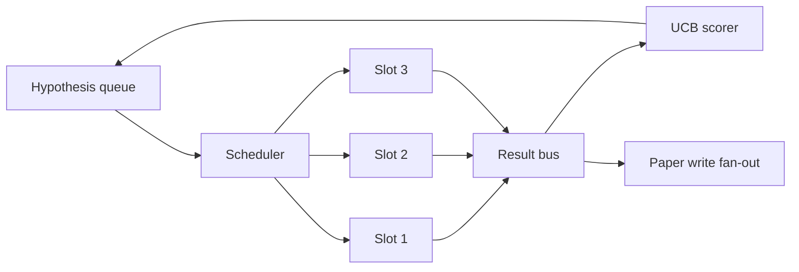
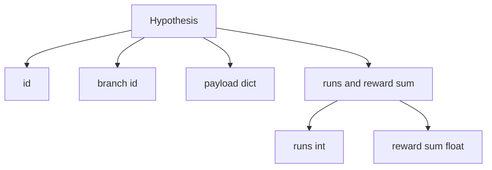
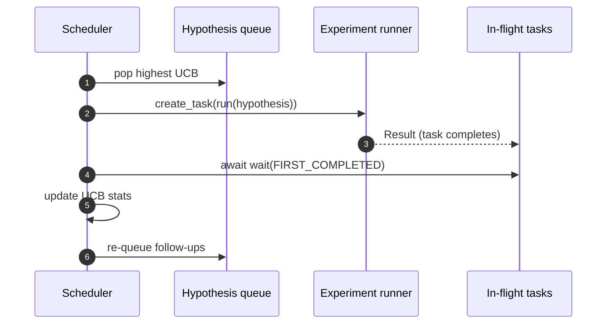

# Programación de iteraciones

>  sin cronista, es una cola de investigación con fantasía                                                                                                                                                                                                                                                        

**Type:** Build
**Languages:** Python
**Prerequisites:** Phase 19 lessons 50-53
**Time:** ~90 minutes

## Objetivos de aprendizaje


```figure
ch-ucb-scheduler
```

- Para que el flujo de trabajo de investigación se forme en una cola de hipótesis, se le darán espacios para realizar experimentos y el resultado volverá a ser un fanático.
- Usando el mismo tiempo no se desarrollan múltiples experimentos, para que el programador pueda mantener todos los espacios ocupados.
- Utilizando UCB para cada rama de la hipótesis 打分, permita que el programador pueda en la situación de no abandonar la exploración de poda 低产出 ramas。
- Los resultados completados se extenderán hasta la fase de escritura en papel y la fase de re-cuota, haciendo que se produzcan hipótesis de seguimiento.
- 暴露逐代代代代代代代代代代代代代代代代代代代代代代代代代代代代代代代代代代代代代代代代代代代代代代代代代代代代代代代代代代代代代代代代代代代代代代代代代代代代代代代代代代代代代代代代代代代代代代代代代代代代代代代代代代代代代代代代代代代代代代代代代代代代代代代代代代代代代代代代代代代代代代代代代代代代代代代代代代代代代代代代代代代代代代代代代代代代代代代代代代代代代代代代代代代代代代代代代代代代代代代代代代代代代代代代代代代代代代代代代代代代代代代代代代代代代代代代代代代代代代代代代代代代代代代代代代代代代代代代代代代代代代代代代代代代代代代代代代代代代代代代代代代代代代代代代代代代代代代代代代代代代代代代代代代代代代代代代代代代代代代代代代代代代代代代代代代代代代代代代代代代代代代代代代代代代代代代代代代代代代代代代代代代代代代代代代代代代代代代代代代代代代代代代代代代代代代代代代代代代代代代代代代代代代代代代代代代代代代代代代代代代代代代代代代代代代代代代代代代代代代代代代代代代代代代代代代代代代代代代代代代代代代代代代代代代代代代代代代代代代代代代代代代代代代代代代代代代代代代代代代代代代代代代代代

## ¿Por qué es un cronista, y no una lista de trabajo?

平工作清单 会按提交顺序运行工作──当每一个工作都独立时,这没有问题──研究不是独立的:实验三的发现 会改变实验四和五的优先级──一个会读取结果粉丝-in 并重排排队列的时间表,可以在单位计算内完成更有用的工作──

Tiene un significado de diseño selectivo es la regla de puntuación. Gustar de puntuación.

## 系统结构



fila  guarda hipótesis―programador en la ranura  liberación  seleccionar la UCB máxima hipótesis― cada ranura                                                                                                                                                                                                                                                                                                                                                                                                                                                                                                  

## Hipótesis 结构



`branch`Es la clave de las estadísticas de la UCB. Hay muchas hipótesis que pueden compartir una rama.`runs`Es el número de experimentos completados en esta rama,`reward_sum`Es una recompensa acumulada.

## Punto de puntuación de la UCB

本课使用的 UCB 公式是经典 UCB1──

```math
\text{ucb}(\text{branch}) = \text{mean\_reward}(\text{branch}) + c \sqrt{ \frac{\ln(\text{total\_runs})}{\text{runs}(\text{branch})} }
```

`total_runs`Es el total de todos los ramas de los experimentos completados.`c`Es el peso de la exploración;`sqrt(2)`◊Runs 为零的 rango 会得到 `+inf`, por lo que las ramas no tentadas 总是先调调调. . . . . . . . . . . . . . . . . . . . . . . . . . . . . . . . . . . . . . . . . . . . . . . . . . . . . . . . . . . . . . . . . . . . . . . . . . . . . . . . . . . . . . . . . . . . . . . . . . . . . . . . . . . . . . . . . . . . . . . . . . . . . . . . . . . . . . . . . . . . . . . . . . . . . . . . . . . . . . . . . . . . . . . . . . . . . . . . . . . . . . . . . . . . . . . . . . . . . . . . . . . . . . . . . . . . . . . . . . . . . . . . . . . . . . . . . . . . . . . . . . . . . . . . . . . . . . . . . . . . . . . . . . . . . . . . . . . . . . . . . . . . . . . . . . . . . . . . . . . . . . . . . . . . . . . . . . . . . . . . . . . . . . . . . . . . . . . . . . . . . . . . . . . . . . . . . . . . . . . . . . . . . . . . . . . . . . . . . . . . . . . . . . . . . . . . . . . . . . . . . . . . . . . . . . . . . . . . . . . . . . . . . . . . . . . . . . . . . . . . . . . . . . . . . . . . . . . . . . . . . . . . . . . . . . . . . . . . . . . . . . . . . . . . . . . . .

Puerta de poda con picador separado. En una rama en el mínimo.`prune_after_runs`Las siguientes pruebas`3`) Después de la recompensa media 低于绝对 floor`0.2`) , el corte se moverá la rama de la programación futura en la cola de mantener un límite.

## Utiliza las ranuras de asyncio

programación `asyncio.create_task`驱动 experimentos。 cada tarea 运行 experiment runner(一个 `async def`llamadas),并返回一个 `Result`△ Localización principal `asyncio.wait(..., return_when=asyncio.FIRST_COMPLETED)`Espera en el vuelo tareas 集合, y en cada vez completado cuando se actualice la puntuación.



Tres ranuras y lanzar a funcionar. El bucle principal nunca se bloqueará en un solo experimento.

## Despliegue: desencadenantes de papel

Cuando una rama de la recompensa media                                                                                                                                                                                                                                                                                                                                                                                                                                                                                                                       `paper_threshold`(默认 `0.7`), y en este caso                                                                                                                                                                                                                                                                                                                                                                                                                                                                                                                        `paper.trigger`En esta clase, el activador será capturado en la lista, facilitando las pruebas.

## Propagación: hipótesis de seguimiento

Cuando el resultado de alta producción llegue, el programador puede recurrir a la oferta del usuario.`expander`, en la misma rama para generar una o varias hipótesis de seguimiento.`Result`¿ Qué ?`list[Hypothesis]`La función pura de la clase proporciona un ampliador de determinación, que se recompensará por cualquier resultado que exceda el umbral de papel.

## Presupuestos

Los presupuestos protegerán a los programadores, evitarán los bucles fugaces.

```text
max_experiments    : 跨所有 branches 运行的 experiments 总数
max_seconds        : wall-clock cap (asyncio time)
```

Cuando cualquier uno se incide, el programador se detiene a regular las nuevas tareas, espera las tareas en vuelo, termina, y regresa a la pista final.`stop_reason`¿Qué es eso?

## Traza y informe final

Cada decisión de programación (pick, dispatch, result, prune, fan-out) emitirá un evento.

## ¿Cómo leer el código?

`code/main.py`Definido .`Hypothesis`¿Qué es esto?`Result`¿Qué es esto?`BranchStats`¿Qué es esto?`IterationScheduler`, y uno .`make_deterministic_runner`fábrica, que regresará con una recompensa previsible de los experimentos de corredor asíncio. Corredor dormirá fijo.`delay_ms`(默认 `5ms`), hacer concurrencia 可观察──

`code/tests/test_scheduler.py`覆盖:UCB 优先选择未尝试分支,平行槽占用,跨越门时的纸质触发器,低产出试验, 后的分支剪裁, fan-out follow-up hypotheses,以及预算出口,实验计和墙钟 两者)

##  explorar más

Real realización necesitará tres expansiones. Primero, la permanencia de las sesiones de UCB estadísticas: actual estadísticas exist内存里; verdadero programador 会检查点 它们,让重启保留已经花掉的探索预算. Segundo, puntuación multi-objetivos: cada resultado no volverá a producir una recompensa escalar, sino a producir un vector, UCB se convertirá en un picker estilo Pareto.

El programador es el lugar de investigación 超越工作清单的地方── una vez que UCB 接好、slots并行运行, todas las demás mejoras pueden superponerse sobre ella──
