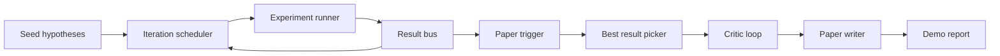
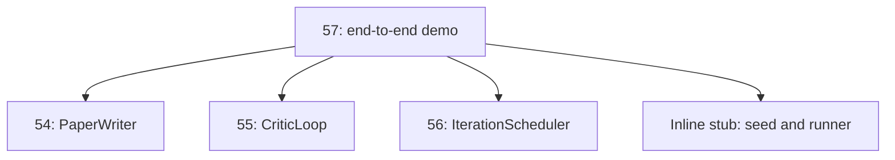
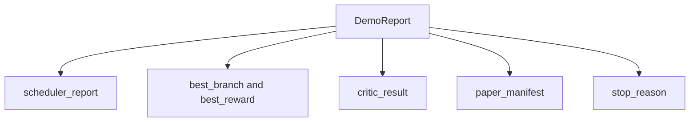

# Demo de estudio de extremo a extremo

> Demo es donde cada contrato que hayas escrito antes debe reunirse... siempre que uno de ellos se rompa, Demo es el que lo coge.

**Type:** Build
**Languages:** Python
**Prerequisites:** Phase 19 lessons 50-53
**Time:** ~90 minutes

## Objetivos de aprendizaje


```figure
ch-research-pipeline
```

- La investigación automática de un ciclo de investigación de un grupo de grupos de grupos de grupos de grupos de grupos de grupos de grupos de grupos de grupos de grupos de grupos de grupos de grupos de grupos de grupos de grupos de grupos de grupos de grupos de grupos de grupos de grupos de grupos de grupos de grupos de grupos de grupos de grupos de grupos de grupos de grupos de grupos de grupos de grupos de grupos de grupos de grupos de grupos de grupos de grupos de grupos de grupos de grupos de grupos de grupos de grupos de grupos de grupos de grupos de grupos de grupos de grupos de grupos de grupos de grupos de grupos de grupos de grupos de grupos de grupos de grupos de grupos de grupos de grupos de grupos de grupos de grupos de grupos de grupos de grupos de grupos de grupos de grupos de grupos de grupos de grupos de grupos de grupos de grupos de grupos de grupos de grupos de grupos de grupos de grupos de grupos de grupos de grupos de grupos de grupos de grupos de grupos de grupos de grupos de grupos de grupos de grupos de grupos de grupos de grupos de grupos de grupos de grupos de grupos de grupos de grupos de grupos de grupos de grupos de grupos de grupos de grupos de grupos de grupos de grupos de grupos de grupos de grupos de grupos de grupos de grupos de grupos de grupos de grupos de grupos de grupos de grupos de grupos de grupos de grupos de grupos de grupos de grupos de grupos de grupos de grupos de grupos de grupos de grupos de grupos de grupos de grupos de grupos de grupos de grupos de grupos de grupos de grupos de grupos de grupos de grupos de grupos de grupos de grupos de grupos de grupos de grupos de grupos de grupos de grupos de grupos de grupos de grupos de grupos de grupos de grupos de grupos de grupos de grupos de grupos de grupos de grupos de grupos de grupos de grupos de grupos de grupos de grupos de grupos de grupos de grupos de grupos de grupos de grupos de grupos de grupos de grupos de grupos de grupos de grupos de grupos de grupos de grupos de grupos de grupos de grupos de grupos de grupos de grupos de grupos de grupos de grupos de grupos de grupos de grupos de grupos de grupos de grupos de grupos de grupos de grupos de grupos de grupos de grupos de grupos de grupos de grupos de grupos de grupos de grupos de grupos de grupos de grupos de grupos de grupos de grupos de grupos de grupos de grupos de grupos de grupos de grupos de grupos de grupos de grupos de grupos de grupos de grupos de grupos de grupos de grupos de grupos de grupos de grupos de grupos de grupos de grupos de grupos de grupos
- 通过普通 Python importa 组合前四节 Rastrear D 课程中的原始, en lugar de pasar por el marco。
- 运行循环 hasta que se termine automáticamente,并输出一个列出每一个阶段 输出单一 Demo report──
-  mantener la determinación demográfica, hacer que la suite de pruebas pueda determinar la forma final.
- Cuando cualquier etapa de contrato se rompe, exponer el modo de falla clara, evitar la siguiente etapa Utiliza la entrada de ruptura  continúa funcionando

## ¿Qué está en el equipo?



五个阶段──seed 是三条假设的列表──scheduler Using three parallel slots 在它们之间运行六个实验──bus 报告一个或多个纸质触发器──picker 选择单个最佳结果──critical loop 基于该结果 构建的草案 进行代──纸质作家 输出最终的 LaTeX、BibTeX 和 manifest──

## ¿Por qué importar, en lugar de copiar?

Cada sección de la clase se entregará con una clase de datos y funciones públicas.`main.py`✿Demo 通过调整 `sys.path`Hasta el directorio de padres de cada sección de clases para importar ..................................................................................................................................................................................



En línea, el estúblo  representa la 50a hasta la 53a clase: un generador de hipótesis de semillas pequeñas y una función de recompensa sincrónica, el usuario puede modificar dos importaciones, sustituir el estúblo en línea por los primitivos reales de la clase.

## Determinismo 保证

Demo en la construcción es determinista. Experimento runner utiliza la semilla de NumPy. La revisión de un ciclo crítico en orden fijo a través de dimensiones fijas.

给定相同种子,Demo 会输出相同报告――测试 通过运行Demo 两次并比较 manifest 来断这一属性――

## Formación del informe de demostración



Cada campo viene de la etapa de arriba. La demostración no transforma ninguna salida.

## Modo de falla 处理

Cada etapa tiene que tener éxito, tiene que subir un error de tipografía.

```text
Scheduler ........ returns SchedulerReport with stop_reason
                   in {queue_empty, max_experiments, deadline}
Best-result pick . raises NoTriggerError if no paper trigger fired
Critic loop ...... returns LoopResult with status converged or stopped
Paper writer ..... raises PaperValidationError on contract break
```

任意阶段的失败 都会使用输入的例外短路演示.`test_no_triggers_raises_typed_error`Y `test_best_picker_raises_when_no_triggers`Cuando no hay rama, el picador se eleva.`NoTriggerError`- ¿ Qué ?`BestResultError`, y el escritor nunca será utilizado.

## Selector de mejor resultado

programador 会按分支 输出纸引引引──picker 选择所有引引中中中中中中中中中中中中中中中中中中中中中中中中中中中中中中中中中中中中中中中中中中中中中中中中中中中中中中中中中中中中中中中中中中中中中中中中中中中中中中中中中中中中中中中中中中中中中中中中中中中中中中中中中中中中中中中中中中中中中中中中中中中中中中中中中中中中中中中中中中中中中中中中中中中中中中中中中中中中中中中中中中中中中中中中中中中中中中中中中中中中中中中中中中中中中中中中中中中中中中中中中中中中中中中中中中中中中中中中中中中中中中中中中中中中中中中中中中中中中中中中中中中中中中中中中中中中中中中中中中中中中中中中中中中中中中中中中中中中中中中中中中中中中中中中中中中中中中中中中中中中中中中中中中中中中中中中中中中中中中中中中中中中中中中中中中中中中中中中中中中中中中中中中中中中中中中中中中中中中中中中中中中中中中中中中中中中中中中中中中中中中中中中中中中中中中中中中中中中中中中中中中中中中中中中中中中中中中中中中中中中中中中中中中中中中中中中中中中中中中中中中中中中中中中中中中中中中中中中中中中中中中中中中中中中中中中中中中中中中中中中中中中中中中中中中

## 串接 círculo crítico

La sección 55 del ciclo crítico se aplica a`MiniPaper`◊ Demo                                                                                                                                                                                                                                                                                                                                                                                                                                                                                                                           `MiniPaper`: Use ID de rama  relleno resumen, semilla  dos secciones  Introducción 和 Resultados),并根据 rama 设置 `originality_tag`(si `>= 0.8`Por alto, si`>= 0.6`Por medio, por bajo)

Luego el revisor redactará el proyecto 代到融合──output 会进入 el escritor de papel──

## 串接 escritor de papel

Artículo 54                                                                                                                                                                                                                                                                                                                                                                                                                                                                                                                           `Paper`forma―Demo 通过 `mini_to_full_paper`升级 convergido `MiniPaper`, se añadirá una figura para la rama seleccionada, y según la recomendación del crítico, se incorporará una pequeña bibliografía sintética.

## ¿Cómo leer el código?

`code/main.py`Definido .`BestResultError`¿Qué es esto?`NoTriggerError`¿Qué es esto?`DemoReport`¿Qué es esto?`pick_best_branch`¿Qué es esto?`build_mini_paper`¿Qué es esto?`mini_to_full_paper`Y `run_demo`◊ Las importaciones de la parte superior se ajustarán una vez `sys.path`, y se retiran de sus propios cursos.`PaperWriter`¿Qué es esto?`CriticLoop`Y `IterationScheduler`¿Qué es eso?

`code/tests/test_e2e.py`覆盖:Demo 端到端运行并输出一个五个字段 全部填充的报告;两次运行之间的确定性;没有分支 过了门时的 NoTriggerError;作者合同 破坏时的 PaperValidationError;纸质表 包含选定的分支的数字;以及安排器停止原因是预期值之一――

## continuar a expandirse

Cuando la demo 变绿后, hay tres valores de串连的扩展──第一,persistent state: cada etapa de resultado 写入一个小型 JSON store,使重启可以不再运行便宜的阶段就恢复──第二,dashboard:scheduler 和 critic loop 染为单一时间线──第三,真实模型调用:将嘲笑散文生成器 和决定主义评论员 替换为模型驱动的版本;线程不需要改变──

La tarea de la demostración es demostrar la composición, es decir, la arquitectura, cuatro importaciones, un informe, una línea de cableado.
