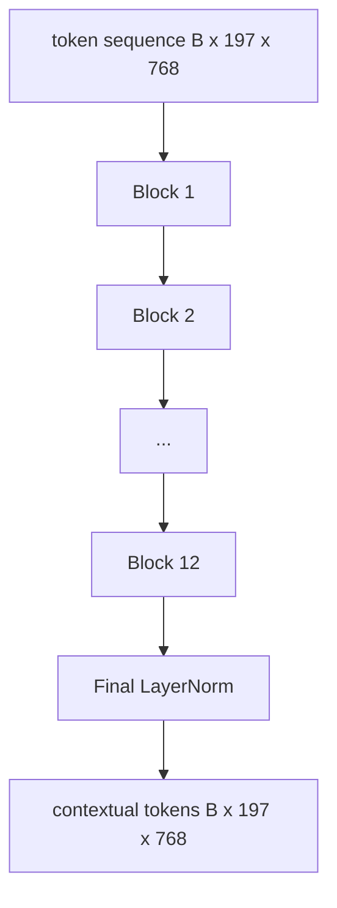

# 视觉 Transformer 编码器

> 补丁单独看不到──具有 12 个注意头的 12 层预 LN Transformer convertirá el secuencia de fichas de fichas en una secuencia de fichas de fichas de fichas de fichas, en la que el token CLS en su estado oculto final se acumula en todo el rasgo de la imagen── este curso es el cuarto de motor de cada modelo de lenguaje visual moderno──

**Type:** Build
**Languages:** Python
**Prerequisites:** 第19期第30-37课（B轨基础）
**Time:** ~90 分钟

## El objetivo del aprendizaje

- 实现 un bloque de transformador de LN previo de múltiples niveles de auto-atención y de pre子层.
- 堆叠 12 个具有 12 个头的块, formar ViT-Base编码器──
- Se puede utilizar para el uso de la red de corrección de la sección 58 .
- Verifique si el token CLS ha reunido la información de cada rectificación.

##  problemas

补丁嵌生成一系列197 个代币, cada token es un 量, no sabe ningún otro补丁.                                                                                                                                                                                                                                                  

El formato estándar es de 12 bloques de profundidad, 12 de ancho, con una capa previa. El formato es de CLIP ViT-L, SigLIP, DINOv2 y Qwen-VL, así como de todos los demás componentes de los editores de vídeo abiertos de derechos de gravedad de 2025-2026 y es bastante estable.

## 概念




### LN 前与 LN 后

El primer transformador se coloca en una línea de la vía anterior, con una profundidad de 12+ puntos de escala entre la noche y el día.

### Mucho de atención

Cada cabeza se proyectará en su propia dimensión.`head_dim = hidden / num_heads`de la `(query, key, value)`Tres grupos.`hidden = 768`Y`heads = 12`, cada uno tiene`dim = 64` 12 cabezas se conectan, y luego su salida se conecta con 768 维并通过输出投影── El punto de importancia de las cabezas múltiples es que una puede aprender a prestar atención a los ojos del gato, mientras que otra puede aprender a prestar atención a la escala del contexto sin ser perturbada.

### ¿Por qué se debe realizar 4 veces la expansión?

FFN por`hidden -> 4 * hidden -> hidden`,GELU 位于中间──因子 4 es experimental, desde 2017 ha estado aplicado a la lengua y la visiónTransformer──较小 (2x) 缺合;过度适合固定数据预算下较大 (8x) MLP es el lugar donde el modelo almacena la mayor parte de los hechos aprendidos, mientras que la parte más amplia del medio es donde se encuentran.

|组件| ViT-Base 规模的参数 |
|-----------|------------------------------|
|每个块的 qkv 投影 | `3 * 768 * 768 = 1.77M` |
|每个块的输出投影| `768 * 768 = 590K` |
|每块 FFN（4 倍扩展）| `2 * 768 * 4 * 768 = 4.72M` |
|每块的 LayerNorm | `4 * 768 = 3K` |
|每块总计 |约 710 万 |
| 12 块 |约85M |
|加前端|总计约86M |

ViT-Base es un codificador de 86M 参数. Según el estándar de 2026, este valor es muy pequeño. SigLIP-So400M es de 400M, Qwen-VL ViT es de 675M, pero la estructura en anchura y profundidad es la misma.

### ¿Por qué no?

Vision Transformer  sólo contiene codificador y es doble:token `i`Puede participar en cualquier token .`j` No se utiliza máscara.  Se utiliza el factor de ocultamiento de la atención en el texto del código de codificación.

### CLS token ha aprendido lo que

El token CLS comienza con los parámetros de aprendizaje, sin su propio contenido de corrección, y pasa por la atención de cada bloque para acumular información. Hasta la última capa, el token CLS es el resumen de los vectores de la imagen en su totalidad.


```figure
ch-cls-funnel
```

## Construirlo

`code/main.py` realización:

- `MultiHeadSelfAttention`, con`qkv`Y la salida de proyecciones, reducción de puntos de concentración y de forma de las conclusiones matemáticas.
- `FeedForward`,4 倍扩展 GELU MLP。
- `Block`, un bloque pre-LN, formado por la atención y la primera subclase de la carga residual.
- `ViT`,12 bloques de la pila, con la última capaNorm.
- `VisionEncoder`, que va a ser`VisionFrontEnd`Desde la 58a clase`ViT`堆,并公开返回上下文序列和池化 CLS hacia la cantidad `forward()`¿Qué es eso?
- Una demostración, a través de un codificador completo 运行合成的 224x224 fixture 图像,并每隔一层打印输入形状、输出形状、参数计数和 CLS 范数──

¿Qué es eso ?

```bash
python3 code/main.py
```

输出: fijación 编码为`(1, 197, 768)`张量──CLS 范数 con la combinación de las capas deslizar hacia arriba, luego estabilizarse en la LayerNorm final──总参数报告约为86M──

## Usalo

El codificador definido en la anchura y profundidad es el mismo que el bloque de montaje de VLM de cada peso abierto de 2025-2026:

- **宽度和深度。**ViT-Large `hidden=1024, depth=24, heads=16`; SigLIP So400M es `hidden=1152, depth=27, heads=16`✿ La misma pieza ✿
- **池化头。**CLS池(本课) 与平均池(SigLIP) 与注意力池(后来的VLM)
- **位置处理。**固定正弦曲线 (第 58 课) 与学习的 1D、ALiBi与 2D RoPE──块数学没有改变──
- **注册token。**DINOv2 前置 4 个额外学习的代码.

El bloque se ha acumulado en el primer plano.

## 测试

`code/test_main.py`Cobre:

- 单个块保留形状并且对输入批量大小不变
-  Con el eje clave de la concentración de la concentración total y de 1  softmax 理智)
- 剩余路径已连接(零输入 todavía a través de los tokens CLS generar非零输出)
- 4 niveles de acumulación de los pasos hacia el paso para producir la forma correcta
- 梯度 de CLS 输出流向面片投影 梯度 de CLS 输出流向面片投影 梯度 de CLS 输出流向面片投影 梯度 de CLS 输出流向面片投影 梯度从 CLS 输出流向面片投影 梯度从 CLS 输出流向面片投影 梯度从 CLS 输出流向面片投影 梯度从 CLS 输出流向面片投影 梯度从 CLS 输出流向面片投影

¿Qué es eso?

```bash
python3 -m unittest code/test_main.py
```

##  ejercicios

1. 添加寄存器token(CLS 后添加 4 学习向量)并重新运行──通过最后层的软max 分布的来比较注意力图的平滑度──

2. Para que el LN se sustituya por el LN, se debe entrenar en el módulo de forma conjunta una época.

3. El efecto de la protección se realizará a`attn_mask`参数, para que el mismo bloque pueda ser reutilizado como bloque de descifrador.`(seq, seq)`,下三角形──

4. Uso `torch.profiler`分析批量大小为 1、8、64的前向传递── MLP Layer se basa en el tiempo de la pared, no en la atención──

5. Usando el módulo de la baja etapa de LoRA  Adaptador para reemplazar una proyección de la cabeza de atención, 结剩部分,并验证梯度仅在您的期望位置流动──

## 关键术语: "El hombre es un hombre"

|术语 |这意味着什么 |
|------|---------------|
|预 LN | LayerNorm 应用在每个子层之前而不是之后 |
|自我关注 |每个token都以相同的顺序关注其他所有token |
|多头|隐藏的dim分布在 `H` 独立注意头中 |
| FFN 扩展 |前馈层在收缩之前加宽至 `4 * hidden` |
| CLS 池 |使用第一个token 的最终隐藏状态作为图像摘要 |

##  más阅读

- 对于编码器配方,一张图像值16x16 个单词(ViT,2021)。
- DINOv2 (2023) Utilizándole para registrar y auto-supervisar el objetivo del entrenamiento previo.
- SigLIP (2023), para el uso en la sección 62                                                                                                                                                                                                                                                                                                                                                                                                                                                                                                                 
