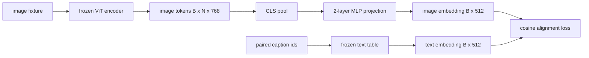

# Usando la proyección de la capa de modelo

> Un pequeño MLP de dos niveles proyecta el token de imagen en el espacio de texto, y en contraposición a los otros cuerpos de los títulos a la pérdida de unidad hace que los dos espacios se mantengan en armonía. Esta proyección es la parte más pequeña del modelo de lenguaje visual, también la parte más importante para la migración.

**Type:** Build
**Languages:** Python
**Prerequisites:** 第19期第30-37课（B轨基础）
**Time:** ~90 分钟

## El objetivo del aprendizaje

- Construir una MLP de dos niveles proyección, será la imagen característica de la maquetación en el texto emplazado en el espacio.
- 构建一个模拟文本嵌入表(没有预训练的分词器,没有真正语料库) ⋅
- 计算投影图像代币和配对标题嵌入之间的余弦对齐损失──
- Uso de un programa de vídeo y de proyección de texto.

##  problemas

 tienes un video codificador  第 58-59 课),可生成维度 `vision_hidden = 768`Tienes un descifrador de textos, quieres que el tamaño esté fijo en`text_hidden = 512`Los símbolos de imágenes no son de forma textual: existen en la base del codificador durante el entrenamiento previo de la visión, no tienen relación con el volumen de palabras del decodificador.

两层 MLP 投影(线性、GELU、线性) ha compensado esta brecha―.`768 * 1024 + 1024 * 512 = 1.3M`参数), puede ser entrenado en un solo GPU en unos minutos, y es la única parte que necesita estar en el mismo nivel de aprendizaje.

## 概念



### 投影前池化 投影前池化 投影前池化 投影前池化 投影前池化 投影前池化 投影前池化 投影前池化 投影前池化 投影前池化 投影前池化 投影前池化 投影前池化 投影前池化 投影前池化

El código visual emite 197 tokens. El lado del texto tiene un solo tipo de etiqueta. Para poder integrarlos, cada muestra requiere un tipo de imagen. La configuración de CLS es la más simple: obtener el primer token del código y proyectarlo.

### ¿Por qué es de dos capas y no de una?

 La proyección de un solo tipo puede girar y volver a agruparse, pero si las dos curvas espaciales no coinciden, entonces no puede fijarse.  GELU entre dos capas lineares proporciona una curva no lineal para la proyección, lo que en la experiencia es suficiente para integrar las características del estilo CLIP y el modelo de lenguaje en la misma.  Más profundo de la proyección  LVA-NeXT usando GLU; Qwen-VL usando una pila de capas de atención) es ampliada; las dos capas MLP son la línea de reglamentación, también el contenido de la Q-Former  proyección                                                                                                                                                                                    

|层|形状|参数|
|-------|-------|------------|
| FC1 | `(vision_hidden, projection_hidden)` | `768 * 1024 + 1024` |
|激活|格鲁| 0 |
| FC2 | `(projection_hidden, text_hidden)` | `1024 * 512 + 512` |

Una de ellas .`768 -> 1024 -> 512`Hay aproximadamente 1,3 millones de parámetros.

### 余弦对齐损失 (cuando el eje eje ejecuta)

No significa que`image_emb == text_emb`对齐 significa`image_emb`En el espacio`text_emb`Indicando la misma dirección.`1 - cos_sim(image, text)`, el rango de 0(totalmente en conjunto) hasta 2 ((相反) ;; el entrenamiento lo propondrá hacia cada par para cero.

### 结编码器是门 结编码器是门

El programa de vídeo tiene 86M parámetros. Hay varios millones de parámetros. El programa de texto tiene varios millones de parámetros.


```figure
ch-projection-bridge
```

## Construirlo

`code/main.py` realización:

- `MLPProjector(in_dim, hidden_dim, out_dim)`, tiene GELU  activa de dos niveles de MLP lineal.
- `MockTextEmbedding(vocab_size, dim)`, una tabla de inserción, con una determinación inicial de la semilla.
- `make_pair(seed, vocab_size)`, sintetizando un par de imágenes y títulos) muestras.
- `cosine_alignment_loss(image_emb, text_emb)`, por cada uno`1 - cos_sim`Espejo.
- Un ciclo de entrenamiento, en 32 pasos de sintesis contra un ciclo de ejecución de 200 pasos de proyección, programación visual y texto, y imprimir una pérdida por cada 25 pasos.

¿Qué es eso ?

```bash
python3 code/main.py
```

输出: el informe de entrenamiento en 200 pasos desde la pérdida inicial de aproximadamente 1.07 hasta aproximadamente 0.80, indica que sólo con proyección se puede hacer que el token de imagen se arrastre hacia el espacio textual.

## Usalo

Cada VLM de derechos abiertos aparece el mismo modelo:

- **LLaVA 1.5.**Desde CLIP-ViT-L                                                                                                                                                                                                                                                                                                                                                                                                                                                                                                                      
- **BLIP-2.**Q-Former 通过针对图像代币的交叉关注获取32 学习查询代币,然后投投到LLM 嵌入dim;; Q-Former 最后投投头类似于本课的MLP;;
- **MiniGPT-4.**Desde BLIP-2 Q-Former 输出到Vicuna 嵌入dim的单线性投影──
- **Qwen-VL.** tiene varios niveles de adaptación de la atención de intersección, pero el último bloque sigue siendo hasta LM  嵌入dim de proyección

La forma es diferente, pero el papel es el mismo:

## 测试

`code/test_main.py`Cobre:

-  proyector de forma y configuración de salida `out_dim`匹配
- 结文本嵌入表的 `requires_grad`参数为零
- Los residuos de cuerda se suman a 0 en el mismo eje, 2 en el eje contrario a la línea de eje.
- Unas veces hacia atrás trasmitido tras proyección
-  El ciclo de entrenamiento redujo las pérdidas entre los pasos 0 y los pasos 200 

¿Qué es eso?

```bash
python3 -m unittest code/test_main.py
```

##  ejercicios

1. La acumulación de CLS se sustituye por 196 tokens de parche, y se compara con la pérdida final de 200 pasos después. La acumulación de CLS se ejerce más rápidamente en datos sintéticos; la CLS en imágenes naturales es más eficiente en muestras.

2. El tiempo de la temperatura de la norma adjunto a los residuos de cuerda (`cos / tau`) 中,并观察当 `tau`太小梯度噪音) o demasiado grande损失稳定高) cuando ocurra qué?

3. La sustitución de dos niveles de MLP por una sola capa lineal y la reducción de la pérdida de la distancia.

4. En el proyector se agrega un pequeño L2 惩罚, y observa cómo se interactúa con el yústros en la medida constante, por lo que el castigo principal se reduce a la dirección no utilizada)

5. 保存投影仪权重, luego volver a cargarlos junto con el codificador de imágenes de la consola, y ejecutar sin la posibilidad de contra-propagación. 验证投影仪是你唯一需要交付的新文物;

## 关键术语: "El hombre es un hombre"

|术语 |这意味着什么 |
|------|---------------|
|模态对齐 |使图像和文本嵌入在一个共享空间中具有可比性的行为 |
|投影头|将一个空间映射到另一个空间的小模块，通常是 2 层 MLP |
|余弦相似度 |点积除以 L2 范数的乘积 |
|冻结编码器|视觉（或文本）模型的所有参数均带有 `requires_grad=False` |
|模拟语料库|使用合成对，因此训练不依赖于数据集下载 |

##  más阅读

- Utilizando dos fases de entrenamiento de LLaVA 论文(proyecto, luego descifrar LM)
- El proyecto de investigación de la Universidad de San Francisco, en el Reino Unido, se desarrolló en el año 2000.
- El informe de la Comisión de Investigación y Tecnología de la Unión Europea (CIT) sobre la aplicación de la tecnología de la información en el sector de la información (CIT)
