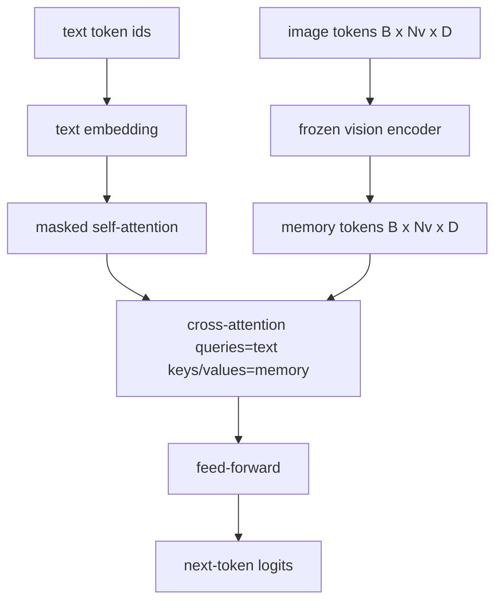
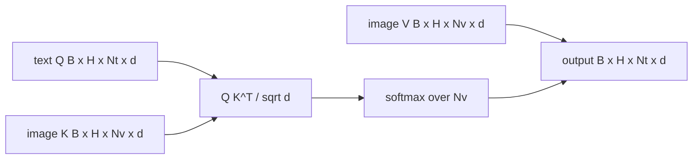

# 交叉注意力融合 交叉注意力融合 交叉

> La capa de proyección se basará en un eje de imagen y un eje de título. El verdadero descifrador de lenguaje visual necesita que cada texto participe en cada fichaje, por lo que el modelo puede colocar cada palabra en una región. La atención de intersección es la forma en que ocurre esta intersección. La consulta de texto; la visión clave y los valores dan la respuesta.

**Type:** Build
**Languages:** Python
**Prerequisites:** 第19期第30-37课（B轨基础）
**Time:** ~90 分钟

## El objetivo del aprendizaje

- 实现 múltiples intercambios de atención, entre los cuales la consulta es texto, clave/valor es visión.
- 组成解码器块:因果自注意力+交叉注意力+前──
- 获得正确的掩模形: para el uso de la forma de ocultar la causa de la atención propia, para el uso de la forma de ocultar la atención transversal.
- Utilize lotes de textos tokens y fijos de imágenes tokens池运行前向传递。

##  problemas

La conexión de los tokens de texto y los tokens de imagen en una serie es un proceso de integración ([[Fugción inicial]], [[Chameleon]] y [[Emu]]                                                                                                                                                                                                                                                                                                                                                                                                                                                                                   

后期融合有两个优点――首先,文本流保持干净,模型保留纯文本功能――第二,图像流对每图像计算一次,并在每个解码步骤中重复使用,因此即使对于长标题,生成也很便宜――成本是每块一个额外的注意层――

## 概念





### 面具形状 (forma de la tela)

解码器块内两个注意力需要不同的掩码:

|注意|查询长度 |密钥长度|面膜|为什么 |
|-----------|--------------|------------|------|-----|
|自我关注 | `Nt`（文本）| `Nt`（文本）|因果：下三角 `(Nt, Nt)` |自回归期间文本token可能不会向前看 |
|交叉注意力| `Nt`（文本）| `Nv`（愿景）|没有口罩|整个图像对每个文本位置都是可见的 |

Este curso incluye una función de verificación de forma, por lo que se mezclarán como `ValueError`El error, no el silencio destruye la pérdida de la curva.

### ¿Por qué la atención no es oculta?

Antes de crear cualquier texto, primero observe el símbolo de la imagen.`t`Puede observar cualquier rectificación de la imagen; los bloques de imágenes no tienen orden de tiempo. Algunos flamingos añaden el patrón de ocultación de cada muestra cuando se encuentran varias imágenes y fragmentos de texto, pero para una sola imagen y un título, la atención de intercambio puede ver todo.

### 键/值缓存

图像键和值在解码开始时计算一次并存存储中──每一个新文本代币都使用缓存而无需重新计算──这就是推理时字幕快速运行的原因:重型ViT运行一次;交叉注意在每一步中重复使用其键和值──本课程公开缓存并测试缓存中路径──

### 块组成

解码器块运行:预 LN -> 自注意力 -> 残差 -> 预 LN -> 交叉注意力 -> 残差 -> 预 LN -> 前 -> 残差──三个子层, cada子层 tiene su propia LayerNorm。 Flamingo 论文添加一个关于交叉注意的学习门,因此模型可以在训练时稳定性为代价选择退出图像路径;规范基线(这里使用)没有门──

```python
class DecoderBlock:
  def forward(self, text_tokens, image_tokens, text_mask, cross_mask):
      text_tokens = text_tokens + self.self_attn(self.ln1(text_tokens),
                                                 mask=text_mask)
      text_tokens = text_tokens + self.cross_attn(self.ln2(text_tokens),
                                                  image_tokens,
                                                  mask=cross_mask)
      text_tokens = text_tokens + self.ffn(self.ln3(text_tokens))
      return text_tokens
```


```figure
ch-crossattn-fan
```

## Construirlo

`code/main.py` realización:

- `CrossAttention(hidden, heads)`, con un carácter individual`q`Y `kv`投影的多头交叉注意力──
- `CausalSelfAttention(hidden, heads)`, de la protección de la atención propia de los estándares de resolución de códigos.
- `DecoderBlock`, con pre-LN residual que se compone de tres subniveles.
- `VisionLanguageDecoder`, de cuatro niveles de descifrador proporcionado por el modelo de vídeo de edición de salida y el pequeño texto de la tabla de emplazamiento.
- `causal_mask(length)` regresar `(length, length)`¿Qué es eso?
- Una demostración, proporciona dos secuencias de texto de 10 de longitud a una serie de 197 de longitud en la memoria de imágenes, e imprime la forma de salida, la forma de ocultamiento de la atención y el número de salida de la atención de la intersección de cada posición.

¿Qué es eso ?

```bash
python3 code/main.py
```

输出:解码器产生 `(2, 10, text_vocab)`logits 张量──面罩形为`(10, 10)`◊ KV 缓存重用检查确认缓存和未缓存路径之间的 misma lógica。

## Usalo

交叉注意力 aparece en dos series de producción:

- **Flamingo 和 IDEFICS。**Cada K 个语言模型块插入一个交叉注意力子层,并使用结的 LM──视觉语言适配器是交叉注意力块及其门──
- **BLIP-2.**Q-Former utiliza de un grupo fijo de 32 tokens de consulta para transferir la atención a las características de la imagen, luego proyecta la consulta a LM 嵌入空间中──

La forma de los bloques de este curso se refleja directamente en los dos.

## 测试

`code/test_main.py`Cobre:

- El factor de ocultación es el de la parte inferior y se ajusta a la forma del bul esperado
- No importa la longitud de la clave, la forma de salida de la atención es de la misma forma.`(B, Nt, hidden)`
- Casiones de almacenamiento de KV y no almacenamiento de datos
- La falta de forma entre el texto y el flujo de imágenes provocó una clara disparidad.`ValueError`
- Descripción completa del descifrador anterior hacia el transmisor para generar la forma correcta de la serie y el lote

¿Qué es eso?

```bash
python3 -m unittest code/test_main.py
```

##  ejercicios

1. Se puede aprender en el formato de un libro de texto, pero no en el formato de un libro de texto.

2. 实现交错注意力, en el que el mismo decodificador consume varias imágenes y varios fragmentos de texto.

3. En el`Nt=64, Nv=576`(más alta resolución de 24x24 网格) sobre análisis de la concentración de la concentración de la concentración de la concentración de la concentración de la concentración de la concentración de la concentración de la concentración de la concentración de la concentración de la concentración de la concentración de la concentración de la concentración de la concentración de la concentración de la concentración de la concentración de la concentración de la concentración de la concentración de la concentración de la concentración de la concentración de la concentración de la concentración de la concentración de la concentración de la concentración de la concentración de la concentración de la concentración de la concentración de la concentración de la concentración de la concentración de la concentración de la concentración de la concentración de la concentración de la concentración de la concentración de la concentración de la concentración de la concentración de la concentración de la concentración de la concentración de la concentración de la concentración de la concentración de la concentración de la concentración de la concentración de la concentración de la concentración de la concentración de la concentración de la concentración de la concentración de la concentración de la concentración de la concentración de la concentración de la concentración de la concentración de la concentración de la concentración de la concentración de la concentración de la concentración de la concentración de la concentración de la concentración de la concentración de la concentración de la concentración de la concentración de la concentración de la concentración de la concentración de la concentración de la concentración de la concentración de la concentración de la concentración de la concentración de la concentración de la concentración de la concentración de la concentración de la concentración de la concentración de la concentración de la concentración de la concentración de la concentración de la concentración de la concentración de la concentración de la concentración de la concentración de la concentración de la concentración de la concentración de la concentración de la concentración de la concentración de la concentración de la concentración de la concentración de la concentración de la concentración de la concentración de la concentración de la concentración de la concentración de la concentración de la concentración de la concentración de la concentración de la concentración de la concentración de la concentración de la concentración de la concentración de la concentración de la`Nt * Nv`, y ocupa un lugar dominante en la alta resolución de imágenes.

4. En el gráfico de atención de la intersección añadir la interrogación de la terminación de la desfallecedor,并测量演示中的标题多样性(标题样本方差随着交叉图中的的增加而增加)

5. Se sustituye el nivel de atención de la intersección por el bloque de atención de estilo Q-Former, de los cuales se fijan 32 puntos de referencia de la interrogación de la intersección de la intersección de datos de cada uno de los niveles de atención de la intersección de la intersección de datos.

## 关键术语: "El hombre es un hombre"

|术语 |这意味着什么 |
|------|---------------|
|后期融合|文本和视觉位于不同的流中；交叉注意力在每个区块上架起了桥梁|
|交叉注意力| Q 来自一个流，K 和 V 来自另一个流 |
|因果面具|下三角布尔掩码，可防止在自回归过程中向前看 |
| KV缓存|图像键和值存储一次并在每个解码步骤中重复使用 |
|记忆token|解码器进入的冻结图像token |

##  más阅读

- Flamingo (2022) utiliza para tener un control de la atención de la puerta.
- El BLIP-2 de Q-Former (2023), es un bloque de atención de intercambio en el conjunto de preguntas de aprendizaje.
- IDEFICS (2023) Utilizado en la fabricación de copias de peso abierto de Flamingo.
