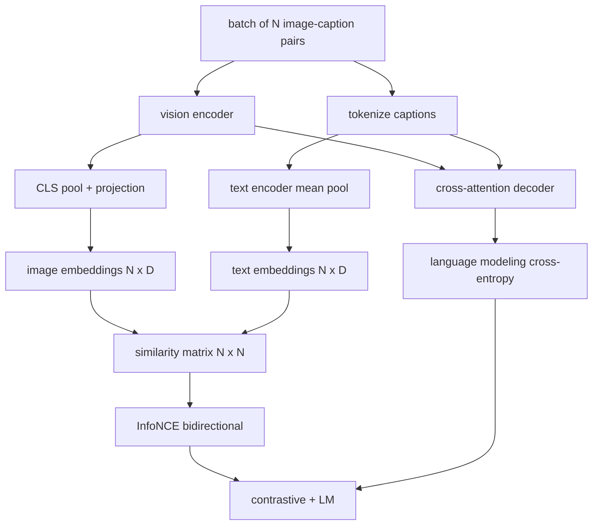

# 视觉语言预训练 (en inglés)

> 编码器、投影和码器已接线──现在一起训练他们──两个目标驱动学习:对比图像文本损失(InfoNCE), se adaptará a la combinación de los emplazamientos en un espacio unificado, así como a la lenguaje construcción de los emplazamientos, requiere que el desencodificador para cada imagen añada un título── juntos, ellos enseñan a la red encontrar imágenes adecuadas como título y para la redacción de imágenes un título──

**Type:** Build
**Languages:** Python
**Prerequisites:** 第19期第30-37课（B轨基础）
**Time:** ~90 分钟

## El objetivo del aprendizaje

- En un grupo de imágenes, los títulos se ejecutaron en el medio de la información sobre la información sobre la pérdida de datos.
- Se comparará la pérdida con la pérdida de auto-regreso.
- 合成 200 para la biblioteca de textos de imágenes, sin necesidad de descargar un conjunto de datos real.
- 运行 50 步演示训练循环并观察损失的减少──

##  problemas

视觉语言模型需要两项技能――它必须排名:给定题,在众多图像中找到正确图像――它必须生成:给定图像,写一题――只针对一个技能对模型进行预训就可以得到半系统―― CLIP 确定排名,但无法提供字幕―― GPT-4V 可以添加字幕,但使用单独检索头进行排名――多目标预训一次即可实现这两个目标――

InfoNCE  responsable de la clasificación de la mitad. Para un grupo de N, el modelo se adaptará a los casos de la normalización, se`N^2 - N`No coincide con el caso negativo, luego con el generado.`(N, N)`La mitad de la producción de procesamiento de LM                                                                                                                                                                                                                                                                                                                                                                                                                                                                                                                   

## 概念



### InfoNCE 在一段话中

Para el cálculo, el cálculo de la composición de las imágenes se realiza en un conjunto de dos partes.`N x N`矩阵   en el que se encuentra`S = I T^T / tau`, entre ellos `tau`Es el tiempo de aprendizaje.`argmax`沿对角线运行:行 `i` debería estar en la lista `i`En la línea de los números, el número total es el valor medio de ambos.

### La temperatura es importante

 temperatura `tau`Control de la máxima de la temperatura.`tau = 0.01`) y la gradiencia sólo proviene del valor negativo más difícil, entrenamiento con ruido.`tau`Como parámetro, la demostración de aquí también hizo lo mismo.

### 语言建模损失 语言建模损失 语言建模损失

解码器通过交叉注意力消耗图像内存代币,并预测每位置的下一个文本代币――损失是与下一个位置目标的标准交叉──填充位置被隐藏在损失之外──

### 合并损失 合并损失 合并损失 合并损失 合并损失

`total = contrastive + lm_weight * lm`, entre ellos `lm_weight`Es la forma de combinación de múltiples tareas utilizada en CoCa y BLIP, con diferentes pesos. SigLIP sólo conserva los contrastes, y no utiliza la pérdida de pares sigmoides en lugar de la suavidad.

|组件|损失面|影响|
|-----------|--------------|---------|
|信息NCE |联合空间中的配对排名 |编码器+投影+文字头|
| LM |以图像为条件的 token预测 |编码器+投影+解码器 |
|合并|多任务 |全栈|

### ¿Por qué 50 pasos para la demostración son suficientes?

模拟语料库 es un conjunto de 200 conjuntos, que contienen imágenes y títulos de secuencia. Después de 50 pasos SGD de un lote de 16 de tamaño, incluso si el valor absoluto se mantiene en el nivel que el modelo de datos real puede alcanzar, las dos pérdidas también disminuirán de forma significativa.


```figure
ch-infonce-diagonal
```

## Construirlo

`code/main.py` realización:

- `MultimodalModel`, unido a un pequeño ViT 编码器、MLP 投影仪、 un pequeño texto lado编码器(嵌入式 id 上的平均值池) y el交叉注意解码器 (en el curso 61)
- `info_nce_loss(image_emb, text_emb, temperature)`, doble dirección CLIP 式对比损失──
- `lm_loss(logits, target_ids, padding_id)`,屏蔽的下一个代币交叉──
- `make_mock_corpus(seed, n_pairs)`, regresar 200 个确定性 (图像,caption_ids)
-                                                                                                                                                                                                                                                               

¿Qué es eso ?

```bash
python3 code/main.py
```

输出: por lo que se refiere a la pérdida de aproximadamente `ln(16) = 2.77`Bajo a 2.4; LM  pérdida de`ln(512) ≈ 6.24`La media de base de la línea de vuelo descendió a aproximadamente 4.7,6 veces, dos veces, demostrando que la escala de conexión es correcta.6

## Usalo

Es la misma pérdida de la combinación:

- **CLIP (2021)。**仅图像-文本对比,具有单独结结编码器字幕探针──
- **CoCa (2022).**El texto de imagen en un modelo se compara con el título de imagen LM 损失──
- **BLIP (2022) 和 BLIP-2.**En comparación con el LM, el juego se ha ido haciendo más difícil.
- **SigLIP (2023).**Cambio de información en sigmoide por pérdida; el mismo efecto en comparación, diferentes funciones de forma:
- **LLaVA 系列。**两个阶段训练,其中第一阶段是对齐 (结 LM 上的余弦),第二阶段使用未结的 LM 添加 LM 损失――第60课对应第一阶段;本课对应第二阶段――

## 测试

`code/test_main.py`Cobre:

- InfoNCE  Losses en imágenes / texto entre las páginas es de
- Cuando la matriz de similitud es la perfecta de un gran número positivo en la línea de la esquina, la información  Perdida regresa a 0
- LM perdida está oculta en su lugar de carga
- 模型前向传递 producen dos tipos de pérdidas y no hay errores
- El ciclo de entrenamiento de 5 pasos redujo la pérdida de la combinación

¿Qué es eso?

```bash
python3 -m unittest code/test_main.py
```

##  ejercicios

1. La información de la NCE se sustituye por sigmoides de estilo SigLIP para pérdidas y se compara con la receptividad en la base de datos de la NCE.

2. Añadir pasos de extracción de la carga: cada lote, seleccionar de los anteriores los más difíciles de no contrarrestar a la carga que se añadirá.

3. En conjunto, los datos de los datos de la configuración de los bloques de imágenes se pueden ver en el archivo de la configuración de los bloques de imágenes.

4. Se sustituirá la base de texto de la imagen por un secuencia de ID de título extraído de la cadena de Marco, que se sustituirá por una matriz de cambio de la cadena de Marco en función de la imagen de la secuencia de hash.

5. Uso `lm_weight = 0`Entrenar el mismo modelo, y luego usarlo.`lm_weight = 1`Reacción de la formación:                                                                                                                                                                                                                                                            

## 关键术语: "El hombre es un hombre"

|术语 |这意味着什么 |
|------|---------------|
|信息NCE |噪声对比估计：相似度矩阵上的交叉熵 |
|温度|控制对比 softmax 的峰值程度的标量 |
|硬阴性|模型发现的非对角线对令人困惑，但对于采样很有用 |
| LM 损失 |字幕侧的标准下一个token交叉熵 |
|联合嵌入空间|投影后图像和文本向量所在的共享空间 |

##  más阅读

- Usado en papel original en comparación con la preparación.
- papel de cocoa, utilizado en un modelo para hacer comparaciones con el subtítulo.
- SigLIP 论文, introdujo sigmoide a las mejores causas de la pérdida de variación y su expansión.
