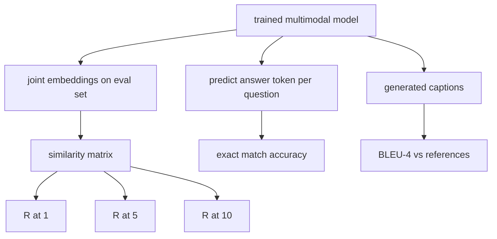

# Más información

> 培训是循环的一半――另一半是测量――本课程从基元构建三个评估表面:图像标题检索报告为R@1、R@5、R@10;视觉问答报告为精确匹配准确度;图像字幕报告为BLEU-4── cada indicador es una función de salida del modelo y un conjunto de evaluación que se ejecuta en pocos segundos──

**Type:** Build
**Languages:** Python
**Prerequisites:** 第19期第58-62课（Track E基础：编码器、Transformer、投影、交叉注意力融合、预训练）
**Time:** ~90 分钟

## El objetivo del aprendizaje

- 根据图像和标题嵌入之间的相似性矩阵计算 Recall@K。
- 根据将(图像、问题) calcula la exactitud de la VQA 准确性 de la correspondencia de los modelos de la maquetación hasta la respuesta fija.
- Desde la secuencia de generos y referencias de tokens calculado BLEU-4, sin necesidad de ninguna reserva externa.
-  la ejecución de los tres evaluaciones de los conjuntos integrados basados en el modelo de entrenamiento de las clases n° 62.

##  problemas

Cuando la pérdida de entrenamiento tiende a estabilizarse, es muy probable que declamemos que el modelo multimodelo ha sido completado. La medida de pérdida de entrenamiento se adapta a la distribución del entrenamiento; no puede medir si el modelo puede clasificar a los grupos reservados, responder a las preguntas o redactar los títulos aceptados por la humanidad.

- **检索（R@1，R@5，R@10）。**Para la búsqueda de los títulos de construcción de un conjunto de inserciones; por el resto de la evaluación de cada imagen en el grupo de evaluación; el informe de la clasificación de la imagen se encuentra en el primer 1 、 primer 5 、 primer 10 名──对称(图像到文本) forma de funcionamiento es la misma──
- **视觉问答（完全匹配）。**给定(图像,问题),模型输出一个答案token──精确匹配是每个样本一个: ¿Es la respuesta de la predicción igual a la respuesta de referencia?
- **字幕 (BLEU-4)。**Se calcula el valor medio de la geometría de la precisión de 1 克 a 4 克, y se sacrifica la simplicidad.

Cada medida es una función fina. Este curso las construirá todas con código, por lo que la matemática es específica, y la superficie sigue bajo su control.

## 概念



### Desde la similitud de la matriz en el

 Construir imágenes y títulos entre los emplazamientos `(N, N)`余弦相似度矩阵── para cada línea, se ordena según la similaridad de la línea de abajo. Recall@K es el número de líneas en las que se encuentra el índice de la línea de referencia de la línea anterior a la posición de K. Recall@K (título a imagen) se calcula en la matriz de reubicación. Estos dos números han sido reportados.

### VQA 精确匹配

 Para cada imagen, pregunta, respuesta), para la imagen para codificar, embebedir la pregunta, a través de un descifrador de fusión, y leer el siguiente token.  Comparar la identificación de token de la predicción con la identificación de referencia. Si la comparación es correcta, el valor medio del conjunto de evaluación.  El conjunto de datos de VQA real de cada pregunta incluye una respuesta de varios usuarios, y utiliza una fórmula de precisión.

### BLEEU-4

```math
\text{BLEU-4} = \text{BP} \cdot \exp\big(\text{mean}(\log p_1, \log p_2, \log p_3, \log p_4)\big)
```

Entre ellos `p_n`es la precisión de n 元语法 después de la modificación ((en cualquier referencia aparece el número de cortes de n 元语法 generados en cualquier referencia, excepto el número total de n 元语法 generados en cualquier referencia),`BP`Es una simple castigo.

```math
\text{BP} = \begin{cases} 1 & \text{当生成长度} > \text{参考长度} \\ \exp(1 - r/g) & \text{否则，其中 } r \text{ 为参考长度，} g \text{ 为生成长度} \end{cases}
```

 Para algunos `p_n`Para el pequeño muestreo de 0, se necesita realizar el planeamiento. Para lograrlo, se debe utilizar el método de Chen 和 Cherry.

### 综合评估套件 综合评估套件 综合评估套件 综合评估套件 综合评估套件 综合评估套件 综合评估套件 综合评估套件 综合评估套件 综合评估套件 综合评估套件 综合评估套件 综合评估套件 综合评估套件 综合评估套件 综合评估套件 综合评估套件 综合评估套件 综合评估套件 综合评估套件 综合评估套件 综合评估套件 综合评估套件 综合评估套件 综合评估套件 综合评估套件 综合评估套件 综合评估套件 综合评估套件 综合评估套件 综合评估套件 综合评估套件 综合评估套件 综合评估套件

Un conjunto de evaluación de 50 muestras se basa en el mismo modelo de base de material de la biblioteca de palabras utilizado en la sección 62 y está construido en memoria con semillas reservadas.

- `pairs`:50 个图像、caption_ids) para la investigación
- `vqa`:50 个(imagen、problema ID、respuesta ID)
- `caps`:50 个(图像, referencias_caption_ids,...]) 条目, cada imagen más de 3 个引用。

El conjunto se determina entre las semillas y se conserva en la base de datos de entrenamiento, por lo que el indicador se basa en datos calculados nunca antes vistos en el modelo.

|指标|范围 |随机基线 (N=50) |
|--------|-------|------------------------|
| R@1 | 0 到 1 | 0.02（1/N）|
| R@5 | 0 到 1 | 0.10 |
| R@10 | 0 到 1 | 0.20 |
| VQA EM | 0 到 1 | 1 / 词汇 |
| BLEU-4 | 0 到 1 |小但非零 |

 Para los entrenamientos de 50 pasos que se ejecutan en datos sintéticos, los indicadores de previsión no son muy altos; se prevé que sean altos en la línea de base arbitraria, es el contenido de los exámenes de demostración


```figure
ch-recall-window
```

## Construirlo

`code/main.py` realización:

- `recall_at_k(sim_matrix, k)`, en dos direcciones regresar `[0, 1]`Número de puntos de vuelo
- `vqa_exact_match(predictions, references)`, regresar `int`Valor medio de las cosas similares.
- `bleu4(generated, references, smoothing=True)`, tiene muchos referentes.
- `build_eval_suite(seed, n_samples, vocab_size, max_len)`, regresar a la lista de evaluaciones de la determinación.
- `evaluate(model, suite)`, que funciona todos los tres indicadores y regresa .`dict`¿Qué es eso?
- Una demostración, cargar un modelo multimoda de nueva iniciación en la clase 62, evaluarlo, luego realizar un entrenamiento de 50 pasos y volver a evaluarlo, imprimir indicadores antes/después.

¿Qué es eso ?

```bash
python3 code/main.py
```

输出: antes/ después de la tabla de medidas muestra la búsqueda de la mejora de la medida de la medida de la medida de la medida, VQA  mejora de la medida de la medida de la medida de la medida de la medida de la medida de la medida de la medida de la medida de la medida de la medida de la medida de la medida de la medida de la medida de la medida de la medida de la medida de la medida de la medida de la medida de la medida de la medida de la medida de la medida de la medida de la medida de la medida de la medida de la medida de la medida de la medida de la medida de la medida de la medida de la medida de la medida de la medida de la medida de la medida de la medida de la medida de la medida de la medida de la medida de la medida de la medida de la medida de la medida de la medida de la medida de la medida de la medida de la medida de la medida de la medida de la medida de la medida de la medida de la medida de la medida de la medida de la medida de la medida de la medida de la medida de la medida de la medida de la medida de la medida de la medida de la medida de la medida de la medida de la medida de la medida de la medida de la medida de la medida de la medida de la medida de la medida de la medida de la medida de la medida de la medida de la medida de la medida de la medida de la medida de la medida de la medida de la medida de la medida de la medida de la medida de la medida de la medida de la medida de la medida de la medida de la medida de la medida de la medida de la medida de la medida de la medida de la medida de la medida de la medida de la medida de la medida de la medida de la medida de la medida de la medida de la medida de la medida de la medida de la medida de la medida de la medida de la medida de la medida de la medida de la medida de la medida de la medida de la medida de la medida de la medida de la medida de la medida de la medida de la medida de la medida de la medida de la medida de la medida de la medida de la medida de la medida de la medida de la medida de la medida de la medida de la medida de la medida de la medida de la medida de la medida de la medida de la medida de la medida de la medida de la medida de la

## Usalo

Cada indicador se proyecta directamente en la base de producción:

- **检索。**MS-COCO 5K val、Flickr30K、ImageNet 零样本都是相同相似性矩阵上的 R@K 问题──将合成 eval 替换为真实文件,函数签名保持不变──
- **VQA。**VQA v2、GQA、OK-VQA utiliza el mismo formato de correspondencia exacta(utiliza soft-acc y no EM de la única respuesta de VQA v2) ⋅
- **BLEU-4.**MS-COCO 字幕、NoCaps、Flickr30K 字幕均使用BLEU-4加 CIDER 和 METEOR──添加 CIDER 是另一项功能──

Para el verdadero examen de base, por favor.`build_eval_suite`替换为真正加载程序并保留函数体──数学与基准无关──

## 测试

`code/test_main.py`Cobre:

-recall@k en perfect status similarity matrix regresa 1.0, en reversed matrix regresa 0.0 ((k < N)
-recall@k 尊重 `k <= N`Por encima
- Cuando se genera bleu4  totalmente igual a uno de los citares, regresa 1.0
- bleu4 在不相交词汇上 regresar 0.0
- vqa  exacto coincidencia igual a la proporción de equivalencia
- Construir_eval_suite  regresar el número de parentesco esperado vqa 项和标题条目数

¿Qué es eso?

```bash
python3 -m unittest code/test_main.py
```

##  ejercicios

1. CIDEr en n-grams utiliza TF-IDF en el aumento de derechos, lo que le otorgará un token de información abundante.

2. Implementar la VQA de precisión: cada pregunta tiene varias respuestas personales, si hay coincidencias, la precisión es`min(human_count / 3, 1)`❖ Copia VQA v2──

3. 添加                                                                                                                                                                                                                                                                                                                                                                                                                                                                                                                           `bleu4`La secuencia de generación de NaN de seguridad, procesable en el espacio, no se derrumbará.

4. R@K una de las primeras clasificaciones de la media de la caída (MRR) ⋅ MRR es muy sensible a la posición de los proyectos que están en la cima de K ⋅ fuera de K ⋅ R@K es muy sensible a si están en la parte delantera de K ⋅

5. Durante el entrenamiento, seis puntos de control evaluaron el funcionamiento del modelo, y trazaron una curva de aprendizaje.

## 关键术语: "El hombre es un hombre"

|术语 |这意味着什么 |
|------|---------------|
| R@K |正确匹配出现在前 K 个结果中的查询比例 |
|精确匹配 |最简单的VQA评分：预测答案等于参考|
| BLEU-4 | 1 到 4 克精度的几何平均值，带有简洁性代价 |
|多参考|字幕指标接受每个图像的多个参考字幕 |
|保留 |评估集是从与训练语料库不相交的种子中采样的 |

##  más阅读

- Utilizado en el trabajo de la fórmula de precisión y de datos de la estadística de VQA v2.
- Utilizado en TF-IDF加权 n-gram 字幕的 CIDEr 论文──
- BLEU original version ([[Papineni  et al. (2002) ]]) para el uso en la distribución de cambios.
- Utilizando el guión de evaluación de la norma en referencia a la realización de MS-COCO.
