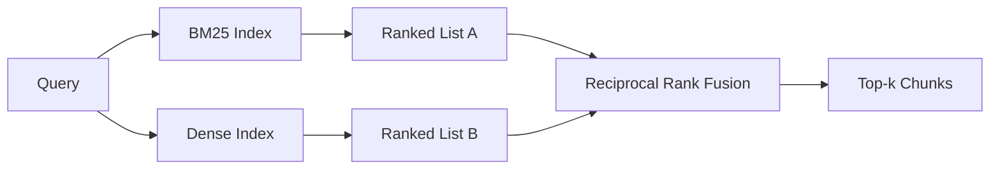

# BM25 y la búsqueda de la mezcla de integrados densos

> 词汇和语义检索 en la distribución de preguntas de la oposición fracasa.

**Type:** Build
**Languages:** Python
**Prerequisites:** 第 11 阶段课程 04（嵌入）、06（RAG）；第 19 阶段 Track B 基础（第 20-29 课）；第 19 阶段第 64 课（分块策略）
**Time:** ~90 分钟

## El objetivo del aprendizaje
- Según Robertson y Spark Jones, la fórmula de BM25 se ha implementado desde el principio, con un grado de aumento de la capacidad de documentación y la estandarización de la longitud de archivo y la adaptabilidad de los datos.
- En la determinación de la configuración de los emplazamientos construido un inspector de la densidad, para que el ciclo fuera de línea de funcionamiento.
- 完全按照 Cormack、Clarke 和 Buettcher, como se publicó en 2009, realiza la integración de los niveles de descifrado, y explica por qué ocupa el lugar dominante en el valor de descifrado de los valores de descifrado.
- 调整 RRF k 常数和每种模态权重, y en fijo pequeño 语料库上读取权衡──

##  problemas

Cuando la consulta lleva un libro de palabras que contiene un símbolo de palabras, el texto busca a la vez.`AbortMultipartOnFail`La misma consulta se encuentra en el límite de tres similitudes, y el buscador de densidad hará que el archivo erróneo se encuentre en el primer lugar.

Cuando la consulta se explica como un texto de la biblioteca de palabras, la búsqueda intensiva se gana. Los usuarios preguntan cómo manejar la eliminación de un texto en el que nunca ingresó un texto o un texto en el que se ha introducido un texto. BM25  Retorno                                                                                                                                                                                                                                

La elección entre ambos no es una constante. La distribución de la consulta es una variación. Produce un sistema RAG que procesa estos dos tipos desde el mismo punto de partida. Por lo tanto, la consulta debe tratar estos dos tipos simultáneamente.

## 概念



### BM25 一段话

BM25                                                                                                                                                                                                                                                                                                                                                                                                                                                                                                                            `k1`控制词频和度;默认值 1.5 是已发布的建议, usted no debe moverlo en caso de no tener un fundamento.`b` control de la longitud del archivo; valores de 0.75 indican que los archivos más largos serán castigados, pero no lineal.

IDF 公式使用平滑的 Robertson 和 Spark Jones 定义,即 `log((N - df + 0.5) / (df + 0.5) + 1)`Cuando un término aparece en más de la mitad de las librerías de lenguaje, el aumento en el diario hace que la IDF mantenga un valor correcto. Esto es importante para las librerías de lenguaje pequeñas, ya que desde el punto de vista técnico, el uso de palabras de suspensión es muy poco común.

字段加权可让你告诉 BM25, la coincidencia en el nombre de los símbolos es más importante que la coincidencia en el texto real. Implementar es multiplicar el número de términos en el proceso de indicación, en lugar de evaluar el número de términos en el proceso de evaluación. Así se puede mantener la matemática igual, y evitar que cada área tenga un número de números separados.

### Un segmento de la investigación

Utiliza un modelo de emplazamiento para que cada bloque esté emplazado en un flujo de dimensión fija. En la consulta, la consulta de emplazamiento realiza una clasificación de cuerdas en función de la similitud de cada bloque, y regresa a la anterior k 个. El modelo es la variación de la calidad que determina.

Este curso utiliza una integración basada en la determinación de hash, por lo que no necesita una red de manipulación de la combinación matemática.

### 倒数秩融合, ya publicado de la fórmula

两个排名榜――对于任一列表中出现的每一位候选人,将其倒数排名贡献相加―― 2009论文使用`1 / (k + rank)`,k es igual a 60 como valor predeterminado.

Cuando k = 60 时, la contribución de la clasificación 1 es 1/61, la contribución de la clasificación 10 es 1/70 ⋅ contribución disminuye lentamente, por lo que los candidatos de profundidad siguen votando ⋅ menor k ⋅ resultados de la cima del ranking dominan ⋅ k ⋅ mayor, la curva de contribución es cada vez más plana ⋅

Entre nuestras realizaciones hay dos que se pueden ajustar.`k`常数── un peso de cada tipo de modelo, de modo que cuando usted tiene pruebas previas de que uno de ellos es mejor en su base de texto, usted puede aumentar la BM25 o la densidad── contribuirá a la clasificación multiplicada por el peso es el principio más simple de lograr; se conserva la forma de degradación de grado y se mantiene sin etiqueta──

### ¿Por qué la fusión es mejor que la fracción más el valor de inserción?

BM25 no está limitado y depende de la base de palabras. La similitud de los yústros está limitada entre -1 y 1 .`alpha * bm25 + (1 - alpha) * cosine`需要每语料库 alpha 调整,并且每次重新索引都会中断.                                                                                                                                                                                                                                                    

Esto es lo mismo que lo que se oye en los documentos de Vespa y Weaviate sobre RankFusion y RRF. Ellos llegaron a la misma conclusión: a menos que tengas pruebas muy fuertes para insertar el valor, o bien mantenerse basado en la clasificación.

```figure
rrf-fusion
```

## Construirlo

`code/main.py` realización:

- `tokenize(text)`- 快速正则表达式代币器──
- `BM25Index`- ¡Creo que tienes un buen tiempo!`add`Y `search`Y también puede ser modificado.
- `mock_embed`¿Qué es esto?`DenseIndex`- la misma determinación que la de la sección 64, por lo que el bloque tiene una comparabilidad:
- `rrf(rankings, k, weights)`- 多模态权重融合的发布
- `HybridRetriever`- 结合了BM25 y密集──
- Una demostración .`main()`,cargar una pequeña fijación 语料库, ejecutar tres en particular para mostrar las ventajas de cada buscador, e imprimir la clasificación de cada modelo generado y la lista de integración

¿Qué es eso ?

```bash
python3 code/main.py
```

并排读演示输出──文字标识符查询位于 BM25 排名 1、密集排名 4、RRF 排名 1──释义查询位于 BM25 排名 6、密集排名 1、RRF 排名 1──模糊查询位于 BM25 排名 3、密集排名 3、RRF 排名 1── se encuentra en cada una de las categorías de búsqueda en el sistema de victorias──

## 调整旋

|旋钮|默认|何时调高|何时调低|
|------|---------|----------------|------------------|
| BM25 k1 | 1.5 |文档中的术语会重复，且你希望频率更重要 |文档很短，术语重复主要是噪音 |
| BM25 b | 0.75 |长文档确实每个词携带的信息更少 |文档长度与主题无关 |
| RRF k | 60 |较深排名的候选仍应投票 |Top-1 应该占主导 |
| BM25 weight | 1.0 |语料库包含字面标识符，查询也按字面匹配 |查询多为用户改写 |
| Dense weight | 1.0 |查询多为改写或语义表达 |查询多为字面表达 |

 Reimplementar el instrumento de evaluación del curso 68 en el conjunto de consultas reservadas para realizar ajustes, en lugar de hacerlo de forma directa.

## 演示将隐藏的故障模式

**词汇外token。**BM25 IDF es calculado en base a la base de contenido, por lo que sólo la contribución de términos en la consulta es de cero. En la búsqueda de datos, los integrados densos producen la misma cantidad de imágenes. Para los identificadores externos a la base de datos, los modelos densos regresan a los vecinos razonables pero equivocados.

**停止token统治。**BM25 针对单词the在语料库中产生统一的排名──过索引器中停止token或接受高 IDF 术语自然占主导地位──

**跨模态的内容相同。**Si su base de palabras es lo suficientemente pequeña como para que el top-1 de BM25 sea el top-1 de la densidad, entonces RRF le proporcionará el top-1 del mismo vecino. Esto es un comportamiento correcto, no un fracaso, pero hace que la integración parezca invisible.

## Usalo

Modelo de producción:

- 索引 BM25 正在处理中;瓶是词频字典,而不是向量──
- En este curso utilizamos la lista plana; en la producción utilizarás HNSW)
- Y se ejecuta dos consultas; la fusión es la constante de tiempo de la fusión.
- Mantenga cada reporte en su destino, para que los reordenadores puedan ver qué tipo de votación lo apoyan.

## 发货

Sección 66                                                                                                                                                                                                                                                                                                                                                                                                                                                                                                                           

##  ejercicios

1. ¿ Qué ?`mock_embed`替换为供应商提供的真实模型──重新运行演示并报告 只有密集排名在释义查询上的变化──
2. 添加第三种模式:单独索引的块摘要并融合为第三排名列表──测量增益──
3. Para el análisis de la RRF, se debe analizar el valor de la línea de recall en el curso 68.
4. Para lograr la BM25F (con normalización de cada segmento de longitud en lugar de técnicas multiplicadas) y para hacer comparaciones en la base de textos más importante para la correspondencia de símbolos.

## 关键术语: "El hombre es un hombre"

|术语 |人们怎么说|它实际上意味着什么 |
|------|-----------------|------------------------|
| BM25 | “词汇搜索” | idf x 饱和 tf x 长度归一化的概率排名 |
|参考文献 | “等级融合”|各个排名列表的 1 / (k + 排名) 之和； k = 60 默认 |
| k1 | “TF 饱和度” |控制重复术语停止添加更多分数的速度 |
|乙| “长度惩罚” | 0 表示忽略文档长度，1 表示完全标准化 |
|场加权 | “符号提升”|在索引期间重复token以增强该字段中的匹配|
|基于排名与基于分数的融合 | “为什么 RRF 优于线性”|不同模式下的排名具有可比性；分数不|

##  más阅读

- Cormack、Clarke、Buettcher, 倒数排名融合优于孔多塞和个人排名学习方法,SIGIR 2009
- Robertson、Walker、Beaulieu、Gatford、Payne,Okapi en TREC-3(原始 BM25 论文)
- [Vespa：使用 BM25 和 Embeddings](https://docs.vespa.ai/en/tutorials/hybrid-search.html) realizar un examen mixto
- [Weaviate：混合搜索](https://weaviate.io/developers/weaviate/search/hybrid)
- 第 11 阶段 第 06 课 - RAG 基础知识
- Sección 19 阶段 Sección 64 课 - 分块器的输出在此编制索引
- 19o grado 66o grado - 消耗融合的顶-k 的交叉编码器重排序器
