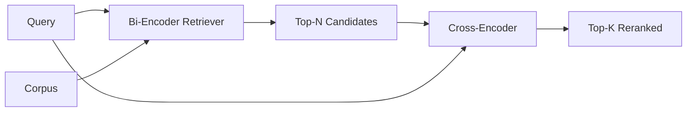

# 交叉编码器重排序 交叉编码器

> El código de doble es el más inteligente de los lectores, también el más lento. Utiliza el código de doble en la segunda clase de top-k, que en sí mismo tiene un valor.

**Type:** Build
**Languages:** Python
**Prerequisites:** 第11期第06课（RAG）、第11期第07课（高级RAG）；第 19 阶段 Track B 基础（第 20-29 课）；第 19 阶段第 65 课（混合检索喂养此阶段）
**Time:** ~90 分钟

## El objetivo del aprendizaje
-  Por medio de la forma de entrada                                                                                                                                                                                                                                                           
- Desde el principio, implementó un pequeño código de intercambio como un bloque transformador, que consumió un paquete de preguntas y archivos y emitió un solo número de etiquetas relacionadas.
- 连接两阶段检索然后重新排序管道: utilizar baratos检索器检索前 N, usar交叉编码器将 N 重新排序为前 K,返回 K。
- En el pequeño material de texto fijo, se mide la demora y el peso de la calidad, y se dirige a un presupuesto de demora determinado seleccionar N.

##  problemas

El doble codificador mapeará las consultas y archivos en el mismo espacio de vectores y en la misma clasificación de cuerdas. Estas dos clases de codificación nunca se verán entre sí. El modelo debe comprimir todo el contenido útil en el archivo en un solo vector, sin considerar las consultas. Es una rápida búsqueda de datos para cada archivo una vez embebido, una vez que se hace una consulta, una vez que se hace una consulta y es la única manera de clasificar a escala de la base de texto.

代价就是精度── dos archivos con el mismo tema general pueden tener casi las mismas embebidas, incluso si uno responde a una consulta y el otro no responde── dos codificadores no pueden distinguirlos──

交叉编码器通过一起阅读查询和文件来解决这个问题――该模型接收 `[query] [SEP] [document]`Como una secuencia única, se ejecuta la atención plena en toda la conexión, y se genera una cantidad de símbolos relacionados. Cada símbolo del archivo puede participar en cada símbolo de la consulta. El modelo se basa en el texto completo.

Por lo que se refiere a la base de datos de archivo de un millón de archivos, cada consulta requiere un millón de veces de transmisión.

La solución es la siguiente: la solución es la siguiente: la solución es la siguiente: la solución es la siguiente: la solución es la siguiente: la solución es la siguiente: la solución es la siguiente: la solución es la siguiente: la solución es la siguiente: la solución es la siguiente: la solución es la siguiente: la solución es la siguiente: la solución es la siguiente: la solución es la siguiente: la solución es la siguiente: la solución es la siguiente: la solución es la siguiente: la solución es la siguiente: la solución es la siguiente: la solución es la siguiente: la solución es la siguiente: la solución es la siguiente: la solución es la siguiente: la solución es la siguiente: la solución es la siguiente: la solución es la siguiente: la solución es la siguiente: la solución es la siguiente: la solución es la siguiente: la solución es la siguiente: la solución es la siguiente: la solución es la siguiente: la solución es la siguiente: la solución es la siguiente: la solución es la siguiente: la solución es la siguiente: la solución es la siguiente: la solución es la siguiente: la solución es la siguiente: la solución es la siguiente: la solución es la siguiente: la solución es la siguiente: la solución es la siguiente: la siguiente: la opción es la siguiente: la opción es la siguiente: la opción es la siguiente: la opción es la siguiente: la opción es la siguiente: la opción es la siguiente:

## 概念



### Forma de entrada de un código de intercambio

标准包装为`[CLS] query_tokens [SEP] document_tokens [SEP]`◊ CLS  posición de salida se envían a la salida de los símbolos relacionados ◊ algunos logran utilizar un grupo de valores medios en lugar de CLS; la diferencia es muy pequeña ◊ el punto es que el modelo genera un número por cada uno ◊

22M parametros交叉编码器(ha sido publicado`ms-marco-MiniLM-L-6-v2`权重等级) es un punto de producción típico. Un modelo menor pierde la calidad a una velocidad más rápida que el de un modelo más grande.`bge-reranker-v2-m3`) se conservan para su reubicación en línea o para su reubicación en la página inicial de K 较小的首页.

### ¿Por qué esta clase de entrenamiento es niño?

El verdadero codificador de cruce es un codificador de micro-modificación Transformer. En la producción, cargas un punto de control y lo ejecutas. En este curso, nuestro objetivo es mostrarle la forma del modelo y la forma de la curva de calidad tardía, en lugar de entrenar el ordenador más avanzado. Por lo tanto, construimos un pequeño.`nn.Module`, que contiene un bloque de transformador, un grupo de cabezas de atención, y un grupo de cabezas de regreso, por lo que la demostración puede reproducirse sin necesidad de peso en el disco.

 Modelo de juguete aprender de la biblioteca de lenguaje fijo forma correcta: Related query-documentos versus unrelated versus having higher prediction points── para reordenar la salida de dos codificadores de tubos de extremo a extremo, y reordenar el top-k de la etiqueta de oro 

### 延迟与质量 延迟与质量

两阶段管道有一个可调节参数:N. En el conjunto de consultas reservadas, N. será de 5 扫描到100,即可得到曲线.

|N |第 2 阶段的 recall@1 |每个查询的交叉编码器前向传递 |延迟 |
|---|--------------------|---------------------------------------|---------|
| 5 | 0.62 | 0.62 5 |低|
| 20 | 0.81 | 0.81 20 |中等|
| 50 | 50 0.86 | 0.86 50 | 50高|
| 100 | 100 0.86 | 0.86 100 | 100非常高|

Los números anteriores son sólo una descripción de la forma, no el valor de la medida de la fijación. La forma es real.

Desde la curva de evaluación, la selección de N a la adición de un presupuesto de retraso. Los codificadores de intercambio no pueden aumentar la tasa de retraso de N a una tasa de retraso más alta que la de los codificadores dobles, por lo que N baja limita la calidad, no sólo la retraso.


```figure
rerank-funnel
```

## Construirlo

`code/main.py` realización:

- `CrossEncoder`- Un pequeño .`torch.nn.Module`:token embedded, un bloque de transformador con múltiples cabezas de atención y anterior, generando una cantidad de puntos de valor promedio.
- `tokenize_pair(query, document)`- Envuelve dos caracteres en una serie de identidad, su tipo de identidad límite de token, determinación y etc.
- `train_tiny(pairs)`- para la manipulación de los tokens de trabajo (encuesta, archivo, relación) las tres listas se realizan una vez de control de la formación, por lo que el modelo puede generar un número razonable en el fijo:
- `rerank(query, candidates, top_k)`- Productos y contactos.
- `pipeline(query, retriever, top_n, top_k)`- Dos clases de flujo.
- 演示 `main()`, desde la sección 65 de la clase de modo cargar en la biblioteca de palabras, recoger N 个, re-renombrar hasta la sección K 个,并排 imprimir dos listas,并报告每阶段的延迟──

¿Qué es eso ?

```bash
python3 code/main.py
```

输出显示双编码器的顶-N、交叉编码器的顶-K以及时间序摘要──交叉编码器的调用需要更长时间,但不会运行在完整的语料库──当选择双编码器排名第二或第三的答案时,两阶段总数保持在请求预算范围内──

## 演示将隐藏的故障模式

**交叉编码器不对称。** `rerank(q, d)`Y `rerank(d, q)`Siempre primero ofrecemos preguntas. Si no cambias de memoria, el recuerdo se derrumbará.

**N 太低，无法暴露该 bug。**Si la configuración N = K, el encuadrante de intercambio puede reordenar a K 个候选人, pero no puede llevar nuevos candidatos a la parte superior de K. Recuerda que K no cambiará, por lo que el aumento parece ser de cero.

**训练数据泄漏到评估中。**Si el entrenamiento de los tokens de mano incluye una consulta de evaluación, entonces el re-rango parece maravilloso.

**生产权重很密集。**22M parámetro de código de intersección en float32 时为 88MB── en compromiso inferior a 100 milímetros de p95 之前规划模型服务器的内存──

**批处理很重要。**El programa de programación de la serie de programas de programación de programas de programación de programas de programación de programas de programación de programas de programación de programas de programación de programas de programación de programación de programas de programación de programación de programación de programas de programación de programación de programación de programación de programación de programación de programación de programación de programación de programación de programación de programación de programación de programación de programación de programación de programación de programación de programación de programación de programación de programación de programación de programación de programación de programación de programación de programación de programación de programación de programación de programación de programación de programación de programación de programación de programación de programación de programación de programación de programación de programación de programación de programación de programación de programación de programación de programación de programación de programación de programación de programación de programación de programación de programación de programación de programación de programación de programación de programación de programación de programación de programación de programación de programación de programación de programación de programación de programación de programación de programación de programación de programación de programación de programación de programación de programación de programación de programación de programación de programación de programación de programación de programación de programación de programación de programación de programación de programación de programación de programación de programación de programación de programación de programación de programación de programación de programación de programación de programación de programación de programación de programación de programación de programación de programación de programación de programación de programación de programación de programación de programación de programación de programación de programación de programación de programación de programación de programación de programación de programación de programación de programación de programación de programación de programación de programación de programación de programación de programación de programación de programación de programación de programación de programación de programación de programación de programación de programación de programación de programación de programación de programación de programación de programación de programación de programación de programación de programación de programación de`_batch_encode`En ejecutar este operativo, lo utiliza.`torch.tensor(...)`构建批量 id 和类型-id 张量并运行一次前向传递──跳过批处理,延迟会乘以 N──

## Usalo

Modelo de producción:

- El uso de dos codificadores, de un codificador de intercambio y de N                                                                                                                                                                                                                                                                                                                                                                                                                                                                                                           
- 通過 (query, document_id) 哈希缓存重排器的输出──稳定语料库上的相同查询会重排成相同顺序;缓存命中可以免费降低延迟──
- 记录排名第 1 的交叉编码器分数──top-1 分数低于语料库特定值的查询是域外命中;让LLM表达我不确定──

## 发货

Sección 68   Evaluación de dos fases del tubo de la clase 68   Evaluación de dos fases del tubo de la clase 69   Evaluación de dos fases del tubo de la clase 65   Evaluación de la clase 65  Evaluación de la clase 65  Evaluación de la clase 65  Evaluación de la clase 65  Evaluación de la clase 65  Evaluación de la clase 65  Evaluación de la clase 65  Evaluación de la clase 65  Evaluación de la clase 65  Evaluación de la clase 65  Evaluación de la clase 6  Evaluación de la clase 6  Evaluación de la clase 6  Evaluación de la clase 6  Evaluación de la clase 6  Evaluación de la clase 6  Evaluación de la clase 6  Evaluación de la clase 6  Evaluación de la clase 6  Evaluación de la clase 6  Evaluación de la clase 6  Evaluación de la clase 6  Evaluación de la clase 6  Evaluación de la clase 6  Evaluación de la clase 6  Evaluación de la clase 6  Evaluación de la clase 6  Evaluación de la clase 6  Evaluación

##  ejercicios

1. N de 5 扫到 50,并绘制重排输出回忆@1──找到该 fixture 上的拐点──
2. Se puede medir la diferencia entre los números positivos y negativos en cada período.
3. Utiliza el token CLS para cambiar el valor medio de la fijación.
4. Añadir un segundo cabezal de codificador de intercambio, para predecir si la respuesta en el archivo es así 标签── utilizar dos cabezas para hacer una reflexión; una para clasificar, una para abrir ──
5. Se sustituirá la determinación de la configuración de un doble codificador por el doble codificador de la clase 65, y se conectarán dos fases.

## 关键术语: "El hombre es un hombre"

|术语 |人们怎么说|它实际上意味着什么 |
|------|-----------------|------------------------|
|双编码器 | “矢量检索器” |独立编码查询和文档；余弦对它们进行排名 |
|交叉编码器 | “重排” |联合编码(query, doc)；输出一个相关标量 |
|两级管道 | “检索并重排” |便宜的检索器返回 N，昂贵的重排器保留 K |
| N（候选预算）| “重新排列池” |每个查询交叉编码器得分的候选者数量 |
|平均池头 | “最后隐藏的平均值” |将编码器的最后一层输出平均为一个向量 |

##  más阅读

- Nogueira, Cho,Passage Re-ranking con BERT,2019 年 - 规范的交叉编码器排名论文
- Reimers, Gurevych,Sentence-BERT: usar siamese BERT 网络的句子嵌入,2019 年 - 关于双编码器与交叉编码器
- [SentenceTransformers 交叉编码器文档](https://www.sbert.net/examples/applications/cross-encoder/README.html)
- [BGE Reranker v2 模型卡](https://huggingface.co/BAAI/bge-reranker-v2-m3)
- Sección 19 Sección 65 - 混合检索器 养养此重新排序阶段
- 19 阶段 第 68 课 - 衡量重新排名带来的提升的评估
