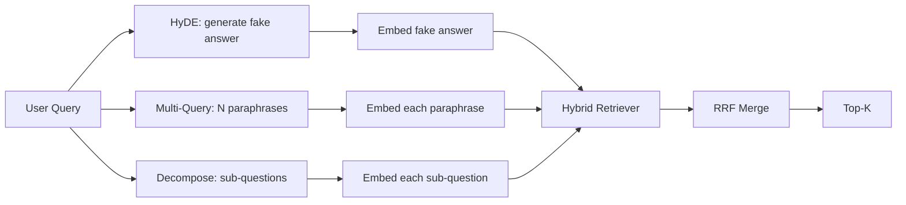

# 查询重写:HyDE、多查询和分解

> Las consultas de usuario no son las que el buscador desea. La reescritura compensa la brecha anterior a la búsqueda, por lo que el contenido de la indicación se acerca más a la respuesta.

**Type:** Build
**Languages:** Python
**Prerequisites:** 第 11 阶段课程 04（嵌入）、06（RAG）；第 19 阶段 Track B 基础（第 20-29 课）；第 19 阶段第 64 和 65 课
**Time:** ~90 分钟

## El objetivo del aprendizaje
- 实现假设文档嵌入 (HyDE): genera una falsa respuesta, enchufa en ella, en función de este vector en lugar de realizar una búsqueda de un vector de consulta.
- 实现多查询扩展: volver a escribir una consulta en N个释义, cada uno en su propia consulta, a través de la convergencia de la cantidad de niveles de la combinación y la combinación de los mismos.
- 实现查询分解:将复杂问题分为子问题,按子问题检索,合并──
- Compare tres autores en un concurso,并 explicar cada estrategia cuándo ganar.
-                                                                                                                                                                                                                                                               

##  problemas

Cuando el usuario ingresa cuando la transmisión es fallida y el presupuesto se agota, ¿qué hará nuestro equipo?── Un documento en el arquivo de contenido dice:AbortMultipartOnFail se suspenderá el S3 segmentado en curso, y cuando la transmisión es fallida se reducirá el presupuesto de re-ensayo de cada cubo──cuestionamiento y archivo sin nombre compartido short语──BM25 no está destinado──dual codificador clasifica el archivo en el tercer o cuarto lugar, ya que la dirección de la consulta se encuentra más orientada a eliminar la tarea en el espacio de inserción, en lugar de la región del archivo──cuestionamiento de la transmisión de documentos──cuando la respuesta ya ha entrado en el N, las dos fases de la clase 66 pueden volver a ser re-ensambladas; pero si no hay una re-ensamblada N, el nomencoder está siempre en el lugar de verlo.──

修复方法在查询触及检查器之前重写查询. 2023年论文 Precise Zero-Shot Dense Retrieval without Relevance Labels(Gao 等人) introdujo HyDE: Require LLM 编写一个能够回答查询的文档,嵌入这个假设文档,并将其嵌入用于检查向量.

两种近亲技术与HyDE相结合――多查询扩展(Utiliza Microsoft's GraphRAG 术语) generar consultas de N 个释义并检索每个释义,然后合并――分解(en 2024 Stanford DSPy 工作中流行为子查询分解) ¿Qué hará nuestro equipo cuando la transmisión fracase y el presupuesto se agota  dividirá en dos preguntas:  sobre la transmisión fracasa  y  sobre el presupuesto de reanálisis  cuando el presupuesto se agota ── dos veces se verifican, una vez se agota, dos partes de la respuesta están disponibles.

Este curso llevará a cabo estos tres proyectos y los ejecutará en la misma base de texto fija.

## 概念



### HyDE 详细信息

HyDE utiliza LLM 编写的假设文档向量替换用户的查询向量──提示很短:

```
You are a domain expert. Write a one-paragraph passage that answers the question
below. Use the same vocabulary and phrasing the documentation in this domain would
use. Do not refuse. Do not say you do not know.

Question: {user_query}

Passage:
```

La respuesta de LLM como respuesta de hecho es errónea, porque LLM no sabe tu material de texto. Eso es bueno.

En la producción, el archivo de las hipótesis se limita a dos o tres frases. Las hipótesis más largas recogen más ruido. Las palabras más cortas pierden el vocabulario necesario para HyDE.

### Más información

N 个释义---- de las preguntas de los usuarios más simples:

```
Rewrite the following question in {N} different ways. Each rewrite must preserve
the original intent. Number them 1 to {N}. Do not add explanations.
```

检索每个释义的顶级k――将 N个排名列表与RRF 合并((与第65 课中的算法相同) ∼廉价、并行、确定性──

Cuando la frase del usuario es una de las muchas formas igualmente eficaces de plantear preguntas, muchas consultas ganan, y cualquier reescritura lo plantea mejor.

### 详细分解

单一检索不能满足多方面的问题――分解要求 LLM 将问题拆成子问题,系统再检索每个子问题――提示:

```
The following question may require information from multiple distinct topics.
Decompose it into a list of sub-questions. Each sub-question must be answerable
independently. If the question is already atomic, return it unchanged.

Question: {user_query}
```

检索每个子问题――合并―― Para el problema de contención de un palabra 连词 多 从句比较或两个 temas no relacionados, la descomposición es un instrumento correcto―― el problema del átomo es un instrumento erróneo; el trabajo del descomposición es devolver un problema individual, no el problema de la invención falsa――

### ¿Por qué existen estas tres cosas?

Tres es el complementar. HyDE 弥补查询代币与语料库代币之间的差距多查询覆盖释义方差.

## 模拟 LLM

El curso se lleva a cabo de forma offline. El modelo LLM es una pequeña lista de búsqueda de preguntas clave para los usuarios, así como la preparación de preguntas no vistas.

- 对于每一个固定 查询:书面假设段落、三个释义和分解结果──
- 对于未知查询:确定性转换: obtener el contenido de la consulta, mediante la misma palabra mapucha su expansión, y luego devolver el resultado.

La forma de la simulación es importante, no los datos. En la producción, usted va a sustituir la simulación por el modelo real.


```figure
cd-hyde-vector
```

## Construirlo

`code/main.py` realización:

- `MockLLM`- La determinación de la situación se sustituye.
- `HyDERewriter`- 调用LLM编写假设文档,将重写机输出返回为`RewriteResult`, que contienen textos y ensayos de suposiciones de que los investigadores deberían utilizarse.
- `MultiQueryRewriter`- 调用LLM进行N个释义, volver a la lista de consultas
- `DecomposeRewriter`- 调用LLM para descomposición, devolver el problema.
- `retrieve_with_rewriter`- 采用重写机和检索机,运行重写,融合结果──
- Una demostración, en fijación se ejecuta tres redirectores y se imprime la estrategia primero devuelve el archivo de la respuesta oro.

重复使用第 65 课中的检索器形状(混合 BM25 + dense) ・・・融合 sigue siendo el mismo RRF。 única nueva forma es el interfaz de la máquina de escribir, es muy pequeño。

¿Qué es eso ?

```bash
python3 code/main.py
```

输出是每个策略的排名和最终摘要―― HyDE gana en una consulta que no coincide en términos.

## 演示将隐藏的故障模式

**HyDE 对语料库特定标识符的幻觉是错误的。**El modelo inventó un nombre de función. La hipótesis de la parte derecha del archivo de la BM25 se ha derrumbado, ya que el nombre de la invención es ahora un alto peso-token, no aparece en la indicación.

**多查询重写全部收敛。**弱模型 produce tres casi idénticas interpretaciones. N 次检索返回相同的顶-k. RRF 合并并不是比单个检索好.

**分解过度分割。**El desmantelador transformará el problema atómico en una lista. La búsqueda completa regresará al mismo archivo, pero el rango disminuirá.

**延迟成倍增加。**HyDE 需要花费一次LLM 通话费用──多查询花费一次LLM 调用生成 N 次重写,然后生成 N 次检索──分解需要一次LLM 调用分解,然后进行M 次检索──检索并行进行;LLM 电话是发言权──

## Usalo

Modelo de producción:

- 按查询长度选择每一个查询策略: Atom短查询得到多查询,复杂多子句查询得到分解,行话重查询得到HyDE──
- 通过查询哈希缓存重写器输出──许多查询重复──
- Y se ejecutó todos los tres conjuntos de resultados, y se utilizó RRF para fusionar los tres conjuntos de resultados en uno.

## 发货

Se trata de un proceso de evaluación de la información que se realiza en el curso de la escuela.

##  ejercicios

1. 实现 RAG-Fusion (多查询的 2024年变体), en el que el redactor tiene la intención de diversificar su significado, luego volver a ordenar los pasos (第 66 课) seleccionar la lista final:
2. 添加第四种策略:step-back prompting(向LLM 问问更一般问题,检索该问题,然后再缩小范围)
3. 通过添加问题是原子的头来训练分解器识别原子查询――测量前后的过分率――
4. Utilizando el modelo real para cambiar el modelo LLM.
5. Para cada reescritura, se añade la cantidad de confianza en la memoria.

## 关键术语: "El hombre es un hombre"

|术语 |人们怎么说|它实际上意味着什么 |
|------|-----------------|------------------------|
|海德 | “伪造文件检索”| LLM写出答案；嵌入并检索它而不是查询 |
|多查询 | “释义扩展”| N次重写查询；检索N次，按RRF合并|
|分解 | “子查询分割” |多主题查询拆分为子问题，单独检索 |
|原子查询 | “单一主题” |如果不发明假子问题就无法分解 |
|后退一步| “抽象查询”|提出更一般性的问题，检索，然后缩小范围 |

##  más阅读

-                                                                                                                                                                                                                                                               
- 微软研究院, 检索的多查询扩展
- 斯坦福大学 DSPy, 多跳 QA 的子查询分解
- [LlamaIndex 查询转换文档](https://docs.llamaindex.ai/en/stable/optimizing/advanced_retrieval/query_transformations/)
- 第11 阶段 第07 课 - 高级 RAG 模式
- 第19 阶段 第65 课 - 重写器 proporcionado
- 19 阶段 第 68 课 - 测重写器提升的评估
