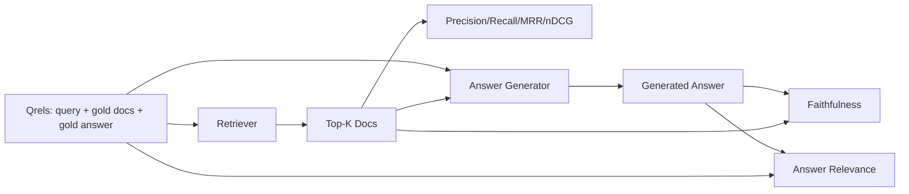

# RAG  evaluación: precisión, reclamo, MRR, NDCG, fidelidad, respuesta

> Si no puedes evaluar simultáneamente la búsqueda y la respuesta, entonces no puedes enviar sistemas.

**Type:** Build
**Languages:** Python
**Prerequisites:** 第11期第06课（RAG）、10（评估）；第 19 阶段 Track B 基础（第 20-29 课）；第 19 阶段课程 64, 65, 66, 67
**Time:** ~90 分钟

## El objetivo del aprendizaje
- Según el qrel de oro 计算四个检索指标: precision@k、recall@k、MRR(平均倒数排名) y nDCG@k。
- 计算两个答案等级指标:忠诚度 (capacidad de respuesta)  答案相关性 (capacidad de respuesta)  答案解决问题 (capacidad de respuesta) 
- Construir un documento de evaluación 端到端读取的固定 qrels 文件(查询、黄金文档 ID、黄金答案文本) 
- 读取 Indicador de valor de la situación de fallas en el tubo de diagnóstico: examen, clasificación, generación o recepción.

##  problemas

RAG  sistema tiene al menos cuatro partes de actividad: separador, revisor, reordenador, generador. Cualquiera de ellas puede causar errores de respuesta.

¿Es porque el separador bloqueó la respuesta en el transcurso? ¿Es porque el buscador no puso el fragmento en el top-k? ¿Es porque el pescador lanzó el fragmento correcto al primer lugar? ¿Es porque el generador ignoró el fragmento y creó el contenido? ¿Es sólo por la respuesta que no se puede juzgar?

- Indicador de búsqueda, utilizado para evaluar los resultados de los buscadores.
- Se clasifica el indicador para evaluar la posición de los bloques correctos en la secuencia.
- 忠实地对生成器是否停留在检查到的上下文进行评分──
- ¿Se ha resuelto completamente la correlación entre la respuesta y la calificación?

Este curso se basa en fijación de documentos sobre la construcción de todos los seis indicadores. La evaluación es de línea y de certeza; en la producción, usted va a poner un juez de LLM simulado para convertirse en un juez real.

## 概念



### 精度@k

En los archivos anteriores que el buscador devuelve, ¿cuál es la proporción del concentrado de oro? Si el oro tiene 3 archivos, y el top-3 devuelve dos de ellos y un archivo erróneo, entonces precisión@3 es 2 / 3。 Cuando el costo de los bloques de buscador no relacionados es muy alto, el generador en él desperdicia tokens, o el bloque destruyó la respuesta), por favor use precisión。

### recuerdo@k

En el archivo de oro, ¿cuánto parte ocupa el top-k? Si el oro tiene 3 archivos, y el top-5 contiene todos estos tres archivos, entonces recuerda@5 para 1.0。 Cuando el costo de la respuesta es muy alto, por favor use el recuento(

En la producción de RAG, el indicador que se suele citar es recall@k. La generación puede eliminar fácilmente los bloques no relacionados; no puede generar respuestas de los bloques que nunca ha visto.

### MRR(平均倒数排名)

 Para cada consulta, encontrar la primera posición de los documentos relacionados en la lista de clasificación― el número de resultados de la clasificación es de 1/ posición― el valor medio de todo el conjunto de consultas― MRR es el buscador que dará la mejor respuesta a un resumen de números únicos de la parte superior―.

MRR tiene un gran peso en la posición 1 ⋅ ⋅ ⋅ ⋅ ⋅ ⋅ ⋅ ⋅ ⋅ ⋅ ⋅ ⋅ ⋅ ⋅ ⋅ ⋅ ⋅ ⋅ ⋅ ⋅ ⋅ ⋅ ⋅ ⋅ ⋅ ⋅ ⋅ ⋅ ⋅ ⋅ ⋅ ⋅ ⋅ ⋅ ⋅ ⋅ ⋅ ⋅ ⋅ ⋅ ⋅ ⋅ ⋅ ⋅ ⋅ ⋅ ⋅ ⋅ ⋅ ⋅ ⋅ ⋅ ⋅ ⋅ ⋅ ⋅ ⋅ ⋅ ⋅ ⋅ ⋅ ⋅ ⋅ ⋅ ⋅ ⋅ ⋅ ⋅ ⋅ ⋅ ⋅ ⋅ ⋅ ⋅ ⋅ ⋅ ⋅ ⋅ ⋅ ⋅ ⋅ ⋅ ⋅ ⋅ ⋅ ⋅ ⋅ ⋅ ⋅ ⋅ ⋅ ⋅ ⋅ ⋅ ⋅ ⋅ ⋅ ⋅ ⋅ ⋅ ⋅ ⋅ ⋅ ⋅ ⋅ ⋅ ⋅ ⋅ ⋅ ⋅ ⋅ ⋅ ⋅ ⋅ ⋅ ⋅ ⋅ ⋅ ⋅ ⋅ ⋅ ⋅ ⋅ ⋅ ⋅ ⋅ ⋅ ⋅ ⋅ ⋅ ⋅                                                                                                                                                                                                                                              

### nDCG@k

標準化贴现累累收收益──完整公式为每查询到文件分配增益──通常为1表示相关,0表示不相关), en función del número de opciones de posición, realizar un descuento, solicitar y luego subtraer el DCG ideal.

nDCG 适应分级相关性:黄金可以说文档 A 是 3,文档 B 是 2,文档 C 是 1──MRR 和recall@k 将所有内容平化为二进制──当语料库每查询有多部分相关文档时,请使用 nDCG──

### 忠诚

Para cada declaración de la respuesta generada, el examen de la siguiente siguiente siguiente se basa en el uso de la LLM como consejo judicial, el consejo acepta la declaración, y devuelve la declaración o no. La proporción de la declaración aprobada es la de la siguiente siguiente siguiente siguiente siguiente siguiente siguiente siguiente siguiente:

La fidelidad captura el error de los generadores del modelo que ha creado el contenido. Incluso si el buscador devuelve el bloque correcto, el generador de la ilusión también se dañará.

Este curso, a través de un juicio de determinación simulada para lograr la fidelidad, debe examinar si el token de cada declaración es igual al valor superpuesto de la siguiente declaración.

### 答案相关性 答案 相关性 答案 相关性

¿Es realmente la respuesta que resuelve el problema? ¿La respuesta es basada en lo que se lee arriba?──Respuesta de la relación de preguntas ¿Es la respuesta basada en el problema?──Respuesta de un tema fiel pero desviado tiene un puntaje más alto en lo que se refiere a la fidelidad, con un puntaje más bajo en lo que se refiere a la relación.

## cuadro de fijación

```python
{
  "qid": "q1",
  "query": "what is the abort threshold for multipart uploads",
  "gold_doc_ids": ["d1", "d3"],
  "gold_answer_substring": "three failed parts",
  "graded_relevance": {"d1": 3, "d3": 2},
}
```

Cada consulta lleva:
- ¿Qué es eso?
- Una serie de documentos de identificación de oro (ID) se utilizan para la precisión/callback rate/MRR,
- Por ejemplo, el número de personas que han sido víctimas de la violencia de género en el país.
- 黄金答案字串(como referencia de cada qrel de datos de conservación; la fidelidad en este curso es a través de la base de la siguiente en la búsqueda y no en este de las fieras para juzgar la extracción de declaraciones para calcular) ⋅

En la producción, puedes realizar estos eventos. Este curso ofrece una fijación de construcción manual, por lo que la evaluación puede ser abierta de inmediato.


```figure
ci-rag-metric-ladder
```

## Construirlo

`code/main.py` realización:

- `precision_at_k(retrieved, gold, k)`- 字面定义──
- `recall_at_k(retrieved, gold, k)`- 字面定义──
- `mean_reciprocal_rank(retrieved_list_of_lists, gold_list)`-  Valor medio de la consulta
- `ndcg_at_k(retrieved, graded_relevance, k)`- DCG/IDCG                                                                                                                                                                                                                                                                                                                                                                                                                                                                                                                        
- `extract_claims(answer)`- La respuesta se divide en la forma de la frase de la frase de la frase.
- `faithfulness(claims, context_texts, judge)`- parte de las reclamaciones que se han determinado respaldadas.
- `answer_relevance(question, answer, judge)`- ¿Hacemos un trabajo de trabajo?
- `MockJudge`- 确定性token重叠判断, para evaluar la ejecución de la operación.
- `evaluate_pipeline(pipeline_fn, qrels, ks)`- 运行每个指标的协调器──
- 针对 qrel 运行三种管道变体(分块基线、混合检索、混合 + 重新排名)并印标签的演示──

¿Qué es eso ?

```bash
python3 code/main.py
```

输出显示单指标中每个变体的精度@k、recall@k、MRR、nDCG@k、忠诚度和答案相关性──混合检索行在召回方面击败分块器基线;重新排序在MRR上击败混合行──

## 读取标志来诊断故障

|症状|可能的原因 |修复什么问题 |
|---------|-------------|-------------|
|低召回率@k，低精度@k |分块剪切答案或检索器找不到它 |分块边界（第 64 课）或检索器模态（第 65 课） |
|不错的召回率@k，低 MRR |右块位于 top-k 中但不在位置 1 |重新排序（第 66 课）|
|高MRR，低忠诚度|尽管上下文正确，生成器仍然发明内容 |生成提示；强制引用或拒绝 |
|忠诚度高，相关性低 |答案有根据但偏离主题 |查询重写器（第 67 课）或生成提示 |
|均四高，用户仍抱怨|评估集不具有代表性 |使用真实用户查询扩展 qrels |

## 演示将隐藏的故障模式

**LLM-as-judge 偏差。**Cuando el modelo juzga su propia salida, a menudo se cree que es más fiel que la situación real.

**Qrel 腐烂。**Con el cambio de la base de palabras, la respuesta de oro también cambiará.                                                                                                                                                                                                                                                      

**忠诚度微观检查错过了宏观声明。**La fidelidad de cada frase puede ser aprobada, mientras que la estructura de la respuesta general generará errores.

**Recall@k 掩盖了每个查询的失败。**El 90% de la tasa de retorno promedio puede ocultar una clase de consulta siempre en caso de pérdida.

## Usalo

Modelo de producción:

- Para cada examinador o generador de cambios de funcionamiento evaluación.
- Mantenga un indicador de cada consulta, cuando el usuario se queja, busque los artículos correspondientes, vea si se capturará.
- Para el Qrel  realizarse en la siguiente forma: 20 grupos de fumos de consultas que se realizan en el CI; 200 grupos de regreso que se realizan por noche; 2000 grupos de consultas que se realizan por semana.

## 发货

Sección 69                                                                                                                                                                                                                                                                                                                                                                                                                                                                                                                           

##  ejercicios

1. Añadir la 5a sección de la sección de la sección de información:
2. 实行分级忠诚度:0(不支持) 、1(部分支持) 、2(完全支持) ∼相应地更新标标──
3. Usar modelos reales para usar los modelos de juzgamiento.
4. 添加查询类片(字面、释义、多主题) 报告──每片标点──
5. Añadir  respuesta longitud  indicación  y estar relacionado con la fidelidad  dibujo curvas 

## 关键术语: "El hombre es un hombre"

|术语 |人们怎么说|它实际上意味着什么 |
|------|-----------------|------------------------|
|精度@k | “命中率超过检索” | top-k 中黄金的比例 |
|recall@k | “命中了 gold 吗”| top-k 中包含 gold chunk 的比例 |
| MRR | “第一击位置”| 1 的平均值/第一个相关文档的排名 |
| nDCG@k | “分级排名质量”| top-k 上的 DCG 除以理想 DCG |
|诚信| “接地气” |检索到的上下文支持的答案声明的比例 |
|答案相关性 | “它解决了这个问题吗？” |答案是否符合问题的意图 |
|问题 | “金标”|带标签的查询集及其黄金文档和答案 |

##  más阅读

- Buckley, Voorhees, evaluación evaluación de la estabilidad de la clasificación ,SIGIR 2000 - 关于排名指标的规范论文
- Jarvelin、Kekalainen,IR 技术的基于累积增益的评估 - nDCG 论文
- [Ragas：RAG 管道的自动评估](https://docs.ragas.io)
- [人择，评估 RAG](https://www.anthropic.com/news/evaluating-rag)
- 第 11 阶段 第 10 课 - 评估框架基础
- Sección 19 de la fase del curso 64-67 - Evaluación de los componentes
- Sección 69 - Evaluación de la evaluación de los canales de extremo a extremo
