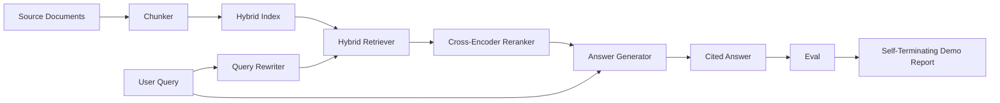

# 端到端 RAG 系统

> 组件的六课――一根管道――一评估循环――一自动终止的演示――这是您交付的系统――

**Type:** Build
**Languages:** Python
**Prerequisites:** 第11期第06课（RAG）、10（评估）；第 19 阶段 Track B 基础（第 20-29 课）；第 19 阶段课程 64, 65, 66, 67, 68
**Time:** ~90 分钟

## El objetivo del aprendizaje
- Se puede utilizar un sistema de análisis de datos de datos de datos de datos de datos de datos de datos de datos de datos de datos de datos de datos de datos de datos de datos de datos de datos de datos de datos de datos de datos de datos de datos de datos de datos de datos de datos de datos de datos de datos de datos de datos de datos de datos de datos de datos de datos de datos de datos de datos de datos de datos de datos de datos de datos de datos de datos de datos de datos de datos de datos de datos de datos de datos de datos de datos de datos de datos de datos de datos de datos de datos de datos de datos de datos de datos de datos de datos de datos de datos de datos de datos de datos de datos de datos de datos de datos de datos de datos de datos de datos de datos de datos de datos de datos de datos de datos de datos de datos de datos de datos de datos de datos de datos de datos de datos de datos de datos de datos de datos de datos de datos de datos de datos de datos de datos de datos de datos de datos de datos de datos de datos de datos de datos de datos de datos de datos de datos de datos de datos de datos de datos de datos de datos de datos de datos de datos de datos de datos de datos de datos de datos de datos de datos de datos de datos de datos de datos de datos de datos de datos de datos de datos de datos de datos de datos de datos de datos de datos de datos de datos de datos de datos de datos de datos de datos de datos de datos de datos de datos de datos de datos de datos de datos de datos de datos de datos de datos de datos de datos de datos de datos de datos de datos de datos de datos de datos de datos de datos de cuyo de cuyo cuyo cuyo cuyo cuyo cuyo cuyo cuyo cuyo cuyo cuyo cuyo cuyo cuyo cuyo cuyo cuyo cuyo cuyo cuyo cuyo cuyo cuyo cuyo cuyo cuyo cuyo cuyo cuyo cuyo cuyo cuyo cuyo cuyo cuya cuya cuya cuya cuya cuya cuya cuya cuya cuya cuya cuya cuya cuya cuya cuya cuya cuya cuya cuya cuya cuya cuya cuya cuya cuya cuya cuya cuya cuya cuya cuya cuya cuya cuya cuya cu
- 实现 un generador de respuesta, mediante el bloque 点引用其声明,并具有低信任拒绝回退功能──
-  evaluar la ejecución de los tubos de buen montaje en el curso 68 y demostrar que las fases construidas en cada indicador son mejores que las de los mismos componentes individuales.
- Construir una demostración de CLI de terminación automática, que recoge una base de textos fija, ejecuta un conjunto de consultas fijas y retorna un informe de resumen a cero.

##  problemas

Los seis componentes aislados no pueden demostrar nada. Los reprogramadores pueden ser capaces de clasificar en recall@5 pero no pueden hacerlo en recall@5 del sistema. Los reprogramadores pueden mejorar el MRR en el grupo de candidatos, pero no pueden tratar a los candidatos de los dos codificadores reales, ya que el presupuesto de reorganización de los dos codificadores es muy bajo. Los reprogramadores pueden elevar el archivo de oro en una sola consulta y interrumpir en la siguiente consulta, ya que el LLM se parece a la hipótesis de regreso de recomposición.

 Integral test es el conjunto de tubos dirigidos a la misma instalación que se ejecuta de extremo a extremo, con el mismo indicador, y utiliza un archivo de ordenador que conectará todo el contenido juntos.

## 概念



### 接线选择

El tubo es un pequeño dibujo. Cada etapa es una función con una firma clara.

|舞台|输入|输出|
|-------|-------|--------|
|块块|文档正文 |块记录列表 |
|检索器 |查询字符串 | Top-N chunk 记录 |
|重写器（可选）|查询字符串 |重写列表+假设|
|重新排序 |查询，候选人 |带有交叉分数的 Top-K 块记录 |
|发电机|查询，top-K Chunk 记录 |带有引文的答案字符串 |

Cuando cada firma está estable, el conjunto es muy simple.`Pipeline`类包含五阶段和按顺序运行它们的 `query`方法── cada etapa es intercambiable: entre diferentes bloques, buscadores, reescribores, re-requiere o generadores, el tubo todavía puede funcionar──

### 带引文的答案生成器 带引文的答案生成器 带引文的答案生成器 带引文的答案生成器 带引文的答案生成器 带引文的答案生成器

发电机 es el último grado, también el más fácil de romper.

1. 取出前 K 个重新排序的块──
2. La máxima selección de dos textos contiene el mayor grado de contenido de los bloques de los tokens de la consulta.
3. Emite una respuesta, la respuesta es la cadena de una frase de cada bloque seleccionado, cada frase después de una.`[doc_id:chunk_index]`¿Qué es eso?
4. Si no hay un bloque sobrepuesto por encima de rechazar, entonces emite 我不知道且不带引用。

En la producción, se puede utilizar la tip模板 que se simula sustituir por un verdadero LLM 调用:

```text
You are answering a question using only the snippets below.
Cite every claim with the anchor in parentheses.
If the snippets do not answer the question, say "I do not know".

Question: {query}

Snippets:
{enumerated chunks with anchors}

Answer:
```

低信度拒绝路径是记录跨编码器排名 1 分数的全部原因──如果它低于语料库值,则生成器会拒绝──这是防止幻觉答案的安全──

### Desde el final de la exposición

La demostración de un extremo a otro ejecuta todo el contenido. Imprime un detalle de cada etapa de la consulta, a cuatro puntos fijos de evaluación de la ejecución, imprime un índice, si todos los indicadores de la sección 68 cumplen con el valor establecido en la demostración, entonces se retira en estado de cero. Si cualquier indice es inferior al valor de cero, la demostración se retira y muestra un estado de cero, y muestra una noticia, señalando los indicadores de fracaso.

Esta es la forma de CI 冒烟测试. La forma de CI 冒烟测试.


```figure
rag-pipeline-flow
```

## Construirlo

`code/main.py` realización:

- `Chunk`- 穿穿所有阶段的记录 (se utiliza un índice de partes y un documento de origen) 扩展第 64 课的形状)
- `Chunker`- Desde la sección 64 课中选择策略 (默认递归分割)
- `HybridIndex`- 捆绑 BM25 + 密集 + RRF desde la sección 65 课――
- `Rewriter`(可选) - Basado en la longitud y la existencia de la palabra de consulta seleccionar HyDE,多查询,分解之一, de la sección 67 课中
- `Reranker`- 第66 课中训练过交叉编码器, utilizar un conjunto de entrenamiento más pequeño, por lo que se puede recibir en unos segundos.
- `Generator`-                                                                                                                                                                                                                                                               
- `Pipeline`- Usar de nuevo`Result(answer, top_k, latency_ms_per_stage)`de la `query(question)`方法组成五个阶段──
- `run_demo()`- 摄取语料库,运行三个 fijo 查询,运行评估,印印结果,并按值设置退出代码──

¿Qué es eso ?

```bash
python3 code/main.py
```

输出是一个段打印的查询跟踪、完整评估表和最终通过/失败状态──在默认 fixture上返回退出代码 0──

## 演示将隐藏的故障模式

**分块器边界漂移。**Si usted cambia entre el proceso de evaluación de los tokens y la demostración de estrategias de bloques, el ID de archivo de oro no se reubica. La demostración de los bloques se ubica en los archivos de la demostración.

**Reranker 训练集泄漏到 eval 中。**En el capítulo 66 de la clase 14 de los tres grupos de entrenamiento incluyen una consulta similar a la de la evaluación. En la producción, se mantiene la evaluación en la investigación.

**模拟生成器隐藏了幻觉风险。**La simulación no puede producir ilusión, ya que sólo emite texto de los bloques de la investigación hasta que se encuentre.

**无流式传输。**El tubo regresa a la respuesta completa al final de cada etapa. El sistema de producción transmitirá la salida de los motores y de los motores.

**延迟是离线的。**模拟LLM 调用是恒定时间──真正LLM电话占主导地位──在请求范围内规划延迟预算;本课程的每阶段计时时仅测CPU工作──

## Usalo

Modelo de producción:

- Enviar los archivos de tubos a un ordenador con una interfaz de fase definida.
- En cada fase involucrada, se ejecuta la evaluación antes de la combinación. Si la evaluación baja, la combinación no se cae.
- Mantenga un seguimiento de los indicadores de cada operación de CI, para que pueda regresar a la fase de intercambio.
- Añadir 20 consultas de fumos de los grupos de regresión, tiempo de ejecución no excede de 30 segundos; recorrido completo de regresión cada noche.

## 发货

El documento de tubería de este curso es la forma adoptada por el resto del curso en la etapa 19 de la pista F. El curso posterior añadirá la automatización de la captura, el aumento de la reindexación, el remete y la capa de servicio superior.

##  ejercicios

1. En el redescribidor añadir cada consulta estrategia seleccionador: 第 67 课的启发式 (长度,连词,行话比例) seleccionar HyDE,多查询,分解,
2. Env 标志后面添加对生成器的真正 LLM 调用──默认为模拟──测量延迟增量──
3. Expandir la exposición para obtener cargas de la verdadera biblioteca de material`--corpus path`标志──重新运行评估和值检查──
4. Para la sección de la sección de la sección de la sección de la sección de la sección de la sección de la sección de la sección de la sección de la sección de la sección de la sección de la sección de la sección de la sección de la sección de la sección de la sección de la sección de la sección de la sección de la sección de la sección de la sección de la sección de la sección de la sección de la sección de la sección de la sección de la sección de la sección de la sección de la sección de la sección de la sección de la sección de la sección de la sección de la sección de la sección de la sección de la sección de la sección de la sección de la sección de la sección de la sección de la sección de la sección de la sección de la sección de la sección de la sección de la sección de la sección de la sección de la sección de la sección de la sección de la sección de la sección de la sección de la sección de la sección de la sección de la sección de la sección de la sección de la sección de la sección de la sección de la sección de la sección de la sección de la sección de la sección de la sección de la sección de la sección de la sección de la sección de la sección de la sección de la sección de la sección de la sección de la sección de la sección de la sección de la sección de la sección de la sección de la sección de la sección de la sección de la sección de la sección de la sección de la sección de la sección de la sección de la sección de la sección de la sección de la sección de la sección de la sección de la sección de la sección de la sección de la sección de la sección de la sección de la sección de la sección de la sección de la sección de la sección de la sección de la sección de la sección de la sección de la sección de la sección de la sección de la sección de la sección de la sección de la sección`--strategy`标志── medir la contribución de cada estrategia a la recuperación de la terminal hasta la terminal──
5. Añadir la interfaz del generador de flujos y introducirla en el eval.

## 关键术语: "El hombre es un hombre"

|术语 |人们怎么说|它实际上意味着什么 |
|------|-----------------|------------------------|
|管道| “RAG 管道”|从摄取到引用答案的撰写阶段|
|引文锚| “来源链接” |每个声明附加的 (doc_id, chunk_index) 引用 |
|低置信度拒答| “我不知道” |当重排器 top-1 分数低于阈值时，生成器不返回答案 |
|smoke set | “CI 评估”|每次 PR 检查中运行的最小 qrels 子集 |
|阶段接口| “函数签名”|各个管道阶段的稳定输入输出类型 |

##  más阅读

- [人择、建筑搜索与检索](https://www.anthropic.com/news/contextual-retrieval)
- [Pinterest，MCP 内部搜索](https://medium.com/pinterest-engineering)- 参考生产架构
- [Ragas：RAG 管道的自动评估](https://docs.ragas.io)
- 第 11 阶段 第 06 课 - RAG 基础知识
- Sección 19 de la fase 64-68 - Componentes de la formación
