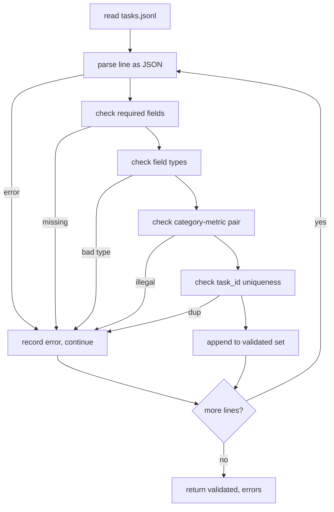

# 任务规范格式 任务规范格式 任务规范格式 任务规范格式 任务规范格式 任务规范格式 任务规范格式 任务规范格式 任务规范

> 评估安全带的好坏取决于其任务执行的合同── 在编写单个评分函数之前,请结 JSONL 形状和量词汇──

**Type:** Build
**Languages:** Python
**Prerequisites:** 19期B轨地基
**Time:** ~90 分钟

## El objetivo del aprendizaje


```figure
ci-task-spec-gate
```

- definición de un JSONL  Modo de registro de tareas, en una forma que incluye el cálculo, múltiples opciones, código de ejecución, categorías y resumen de texto libre.
- 固定量名称的封闭词汇表, de modo que el curso de la clase (71-73) pueda ser dividido en un solo capítulo.
- La pequeña cantidad de ejemplos y reglas de procesamiento posteriores se determinan como parte de la tarea, en lugar de parte del ejecutor, por lo que la misma sugerencia generará el mismo objetivo entre los modelos.
-  implementar un verificador estricto, rechazará el registro de errores de formato antes de que llegue al operador.
- Publicar un conjunto fijo que contiene 10 tareas, para utilizar cada rama de la normativa de prueba, para que el verificador tenga algo real que pueda hacer.

## ¿Por qué se debe concluir la normativa?

Estudiar el código de la biblioteca acumula eval 脚本的速度还要快比积累测试的速度. Después de seis meses, cada cuaderno tiene su propia forma JSON, cada indicador se reimplementa dos veces, y no se puede hacer comparación entre las funciones.

Esta forma toma de la idea de BIG-bench、HELM 和 lm-eval 风格线束, pero el nombre de cada un de ellos es nuestro.

## 记录形状 记录形状 记录形状 记录形状 记录形状 记录形状 记录形状 记录形状 记录形状 记录形状 记录形状 记录形状 记录形状 记录形状 记录 记录    记录        记录                                                                                                                                                                                                                                                                                                                                                                                                                                                    

任务是单行上的 JSON对象──线束读取 `tasks.jsonl`Y la prueba independiente cada línea.

```json
{
  "task_id": "arith_001",
  "category": "arithmetic",
  "prompt": "Compute the result. Question: 17 + 24\nAnswer:",
  "targets": ["41"],
  "metric_name": "exact_match",
  "few_shot_examples": [
    {"prompt": "Question: 2 + 2\nAnswer:", "completion": "4"}
  ],
  "post_process": "strip_whitespace",
  "metadata": {"difficulty": "easy"}
}
```

¡ ¡ ¡ ¡ ¡ ¡ ¡ ¡ ¡ ¡ ¡ ¡ ¡ ¡ ¡ ¡ ¡ ¡ ¡ ¡ ¡ ¡ ¡ ¡ ¡ ¡ ¡ ¡ ¡ ¡ ¡ ¡ ¡ ¡ ¡ ¡ ¡ ¡ ¡ ¡ ¡ ¡ ¡ ¡ ¡ ¡ ¡ ¡ ¡ ¡ ¡ ¡ ¡ ¡ ¡ ¡ ¡ ¡ ¡ ¡ ¡ ¡ ¡ ¡ ¡ ¡ ¡ ¡ ¡ ¡ ¡ ¡ ¡ ¡ ¡ ¡ ¡ ¡ ¡ ¡ ¡ ¡ ¡ ¡ ¡ ¡ ¡ ¡ ¡ ¡ ¡ ¡ ¡ ¡ ¡ ¡ ¡ ¡ ¡ ¡ ¡ ¡ ¡ ¡ ¡ ¡ ¡ ¡ ¡ ¡ ¡ ¡ ¡ ¡ ¡ ¡ ¡ ¡ ¡ ¡ ¡ ¡ ¡ ¡ ¡ ¡ ¡ ¡ ¡ ¡ ¡ ¡ ¡ ¡ ¡ ¡ ¡ ¡ ¡ ¡ ¡ ¡ ¡ ¡ ¡ ¡ ¡ ¡ ¡ ¡ ¡ ¡ ¡ ¡ ¡ ¡ ¡ ¡ ¡ ¡ ¡ ¡ ¡ ¡ ¡ ¡ ¡ ¡ ¡ ¡ ¡ ¡ ¡ ¡ ¡ ¡ ¡ ¡ ¡ ¡ ¡ ¡ ¡ ¡ ¡ ¡ ¡ ¡ ¡ ¡ ¡ ¡ ¡ ¡ ¡ ¡ ¡ ¡ ¡ ¡ ¡ ¡ ¡ ¡ ¡ ¡ ¡ ¡ ¡ ¡ ¡ ¡ ¡ ¡ ¡ ¡ ¡ ¡ ¡ ¡ ¡ ¡ ¡ ¡ ¡ ¡ ¡ ¡ ¡ ¡ ¡ ¡ ¡ ¡ ¡ ¡ ¡ ¡ ¡ ¡ ¡ ¡ ¡ ¡ ¡ ¡ ¡ ¡ ¡ ¡ ¡ ¡ ¡ ¡ ¡ ¡ ¡ ¡ ¡ ¡ ¡ ¡ ¡ ¡ ¡ ¡ ¡ ¡ ¡ ¡ ¡ ¡ ¡ ¡ ¡ ¡ ¡ ¡ ¡ ¡ ¡ ¡ ¡ ¡ ¡ ¡ ¡ ¡ ¡ ¡ ¡ ¡ ¡ ¡ ¡ ¡ ¡ ¡ ¡ ¡ ¡ ¡ ¡ ¡ ¡ ¡ ¡ ¡ ¡ ¡ ¡ ¡ ¡ ¡ ¡ ¡ ¡ ¡ ¡ ¡ ¡ ¡ ¡ ¡ ¡ ¡ ¡ ¡ ¡ ¡ ¡ ¡ ¡ ¡ ¡ ¡ ¡ ¡ ¡ ¡ ¡ ¡ ¡ ¡ ¡ ¡ ¡ ¡ ¡ ¡ ¡ ¡ ¡ ¡ ¡ ¡ ¡ ¡ ¡ ¡ ¡ ¡ ¡ ¡ ¡ ¡ ¡ ¡ ¡ ¡ ¡ ¡ ¡ ¡ ¡ ¡ ¡ ¡ ¡ ¡ ¡ ¡ ¡ ¡ ¡ ¡ ¡ ¡ ¡ ¡ ¡ ¡ ¡ ¡ ¡ ¡ ¡ ¡ ¡ ¡ ¡ ¡ ¡ ¡ ¡ ¡ ¡ ¡ ¡ ¡ ¡ ¡ ¡ ¡ ¡ ¡ ¡ ¡ ¡ ¡ ¡ ¡ ¡ ¡ ¡ ¡ ¡ ¡ ¡ ¡ ¡ ¡ ¡ ¡ ¡ ¡ ¡ ¡ ¡ ¡ ¡ ¡ ¡ ¡ ¡ ¡ ¡ ¡ ¡ ¡ ¡ ¡ ¡ ¡ ¡ ¡ ¡ ¡ ¡ ¡ ¡ ¡ ¡ ¡ ¡ ¡ ¡ ¡ ¡ ¡ ¡ ¡ ¡ ¡ ¡ ¡ ¡ ¡ ¡ ¡ ¡ ¡ ¡ ¡ ¡ ¡ ¡ ¡ ¡ ¡ ¡ ¡ ¡ ¡ ¡ ¡ ¡ ¡ ¡ ¡ ¡ ¡ ¡ ¡ ¡ ¡ ¡ ¡ ¡ ¡`task_id`¿Qué es esto?`category`¿Qué es esto?`prompt`¿Qué es esto?`targets`¿Qué es esto?`metric_name`¿Qué es esto?`post_process`¿Qué es eso?`few_shot_examples`Y `metadata`Es posible que haya un error en el proceso de selección.

## 字段规则

`task_id`Es una cadena sin espacio. El verificador obliga a la única naturaleza de todo el archivo.

`category`Sí `arithmetic`¿Qué es esto?`mcq`¿Qué es esto?`code_exec`¿Qué es esto?`classification`¿Qué es esto?`summary`之一── esta categoría limita qué medida y posterior tratamiento es legal── para el objetivo de una sola letra,`code_exec`任务必须使用 `metric_name = code_exec`¿ Qué ?`mcq`任务必须使用 `metric_name = exact_match`¿Qué es eso?

`prompt`Es un código no vacío. El verificador prohíbe que el usuario se quede en el espacio y rechace que el usuario se encuentre en el espacio.

`targets`Es una lista de caracteres no vacíos.`exact_match`, cualquier elemento de coincidencia se cuenta en la entrada.`f1`Y`rouge_l`, el máximo de gol de la victoria.`mcq`, la lista sólo contiene un elemento.

`metric_name`Sí `exact_match`¿Qué es esto?`f1`¿Qué es esto?`bleu_4`¿Qué es esto?`rouge_l`¿Qué es esto?`accuracy`¿Qué es esto?`code_exec`Uno. 词汇是封闭的.  New indicator needs new instruction and new条目. 

`few_shot_examples`Sí `{prompt, completion}`Para la lista de los verificadores, la lista se limitará a ocho artículos, para limitar la sugerencia.

`post_process`Sí `none`¿Qué es esto?`strip_whitespace`¿Qué es esto?`lower`¿Qué es esto?`extract_letter`¿Qué es esto?`extract_code_block`¿Qué es esto?`extract_first_line`Una de las reglas tiene un comportamiento de determinación.

## 验证器 comportamiento



验证器 regresa a dos listas: ya verificado registros y errores registros, que contienen violaciones de la normativa ▌, violaciones de las reglas y errores ▌.`--allow-bad-tasks`标志──

## ¡Cuál es el problema!

El corredor le indicará que los ejemplos anteriores se conectan con los segmentos de espacio en vuelo. Cada modelo funciona con el mismo código, por lo que la única diferencia es que el modelo mismo.

```python
def render(task):
    parts = []
    for ex in task.get("few_shot_examples", []):
        parts.append(ex["prompt"] + " " + ex["completion"])
    parts.append(task["prompt"])
    return "\n\n".join(parts)
```

## 后处理规则 后处理规则 后处理规则

后处理步骤在生成后、指标之前运行── es de certeza y sin estado──

- `none`返回字符串不变──
- `strip_whitespace`De aquí y de aquí.
- `lower`¿Cómo es que no lo sabes?
- `extract_letter`返回与                                        `[A-E]`匹配的第一个字符, para MCQ.
- `extract_code_block`返回第一个三重反引号隔离块主体, para ejecutar el código
- `extract_first_line`返回第1非空行, para el uso de la clase 汇总分类──

需要本列表之外的规则的任务属于新课程──

## 本课不做什么

Tiene que saber. No utiliza modelos. No funciona en código. Estos contenidos aparecen en las lecciones 71 y 72 y 75.

10 个任务 fixture 覆盖两个算术项,两个 MCQ项,两个代码执行项,两个分类项和两个摘要项,验证器通过所有10条规则,一个单独的 fixture (`tasks_bad.jsonl`) se aplicará cada regla, y el número de errores que el verificador devuelve es exactamente el mismo que estos errores.

## ¿Cómo leer el código?

`main.py`Definido .`TaskSpec`¿Qué es esto?`validate_task`¿Qué es esto?`validate_file`Y CLI punto de entrada.`load_fixtures`染和后处理辅助员 位于验证逻辑旁边, por lo tanto el corredor de la 75a clase sólo necesita importar un módulo único

Desde arriba hasta abajo`main.py`Entonces leeré.`code/tests/test_spec.py` El ensayo fijará cada regla de ensayo y cada comportamiento posterior.`main.py`底部的演示会验证捆绑的固定并印摘要──

## Más adelante

El verdadero conjunto de evaluación se basa en el modelo de crecimiento de la columna de crecimiento de la clase. La acción de la mente es rechazar la adición de la clase sin añadir un indicador. Las reglas de procesamiento posterior y al menos una tarea fija.
