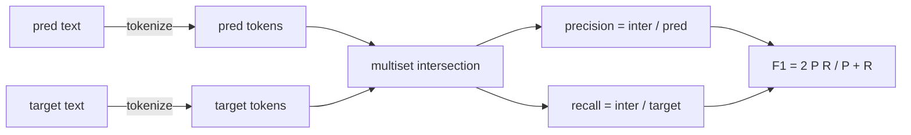
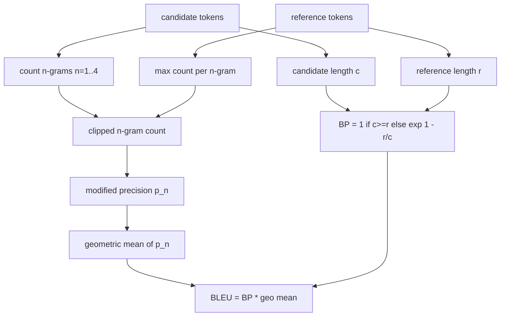

# 经典指标

> BLEU、ROUGE-L、F1、 Precisamente la coincidencia、 Precisión de la tasaƒƒ Cinco indicadores todavía ocupan la mayoría de los números de evaluación de LLM publicadosƒ Desde el principio de la primera naturaleza para implementar cada indicador, así que sólo sabes el significado de los númerosƒ

**Type:** Build
**Languages:** Python
**Prerequisites:** 第 19 期 Track B 基础，第 70 课
**Time:** ~90 分钟

## El objetivo del aprendizaje


```figure
cd-bleu-overlap
```

- 通过明确的代币化规则实现代币级精确匹配、F1 和准确性──
- Desde el principio  Implementar BLEU-4: Modificar n 元语法精度, n de la geometría media es igual a 1 a 4,简洁性损失──
- Utiliza la mayor secuencia pública y la combinación F-beta de precisión y receta para lograr ROUGE-L.
- 调度第70 课中的 metric_name 字段, para que el corredor mantenga su estado de indicación
- Utilizando los modelos de trabajo en lugar de los datos de referencia extraídos de la biblioteca de terceros para fijar el comportamiento.

## ¿Por qué re-realizar?

 Usted leerá el informe BLEU 28.3 y otro informe BLEU 0.283  Usted encontrará una diferencia de 10 por ciento entre los dos libros de texto ROUGE-L, porque una biblioteca se interrumpe para escribir, mientras que otra biblioteca no se interrumpe El método más rápido de parar la mezcla es escribir un indicador por sí mismo, y luego dirigirse a la línea de la línea de la señal de decisión y la aplicación de la línea de la aplicación.

La red es el conjunto de los tokens. La parte más difícil es seleccionar los tokens y esforzarse en ello.

## simbólico

¿Cómo es eso ?`re.findall(r"\w+", text.lower())`◊小写,保留连续的单词字符(字母、数字和下划线), eliminar todos los demás caracteres。 cada indicador de este curso utiliza este exacto分词器。 el corredor no tiene derecho a elegir。 si usted cambia分词器, usted realizará diferentes pruebas基准。

```python
TOKEN_RE = re.compile(r"\w+", re.UNICODE)
def tokenize(text):
    return TOKEN_RE.findall(text.lower())
```

Esto es una simplificación intencional. La configuración de producción se centrará en CJK, abreviatura y identificador de código. El punto de este curso es que el generador de tokens es un conjunto, no un giro.

##  精确匹配

```python
def exact_match(pred, targets):
    return float(any(pred.strip() == t.strip() for t in targets))
```

Cada tarea regresa a 1.0 o 0.0;; la acumulación de los conjuntos de datos es el valor medio;; es la fuerza principal de la tarea aritmética, MCQ y Short Classification;;

## Clasificación de tokensF1

 Configuración para predicción y objetivo de los tokens múltiples conjuntos。 la precisión es el conjunto de conjuntos múltiples dividido por conjuntos múltiples de predicción。 la tasa de retorno es el mismo conjunto de conjuntos distintos por conjuntos múltiples de objetivos。 F1 es la regla y el valor medio。 debe realizarse el tratamiento de la situación de la margen de los objetivos y de la predicción en el aire。



 Para las tareas multiobjetivos, seleccionamos la mejor F1 de la lista de objetivos. Esto es compatible con el comportamiento de SQuAD –como se ha informado ampliamente en la literatura.

## BLEEU-4

BLEU es un indicador de traducción automática de la normativa, que todavía se encuentra en el trabajo de resumen. La fórmula que utilizamos es BLEU-4, de la categoría de la frase, para cada predicción y referencia a la diferenciación, con un estándar de sencillez y una simplificación de la cantidad de n 元语法计数 de las modificaciones posteriores, por lo que los 4 元语法 que faltan por individuo no llevarán la porcentaje a cero.

 Para cada candidato-referencia, se calcula la precisión de la gramática n igual a 1 ̊2 ̊3 ̊4 horas de modificación.  La precisión de la modificación se calcula a través de cualquier referencia en la gramática n máxima cantidad de la gramática n, por lo que el candidato no puede repetir una frase para expansión. La media geométrica de cuatro precisiones es influenciada por la punción de la simplicidad.



La regla de la tasa es el método que dice Lin y Och: antes de tomar el número, cada n elemento de precisión de molécula y de la matriz se agrega a 1― cuando se cita un 4 gramos no coincidentes y se mantiene cerca del valor desequilibrado del candidato, esto se puede evitar.`log 0`¿Qué es eso?

## 脂-L

ROUGE-L compara la secuencia de tokens de candidato y la secuencia de tokens de referencia de la secuencia pública más larga. LCS  captura de palabras sin forzar continuidad, por eso es el resumen de la cantidad de tiempo por defecto.`lcs / reference length`, por la precisión`lcs / candidate length`,并与F-beta 结合, entre ellos se denomina F1 形式的β等于1──

```python
def lcs_length(a, b):
    n, m = len(a), len(b)
    dp = numpy.zeros((n + 1, m + 1), dtype=int)
    for i in range(n):
        for j in range(m):
            if a[i] == b[j]:
                dp[i+1, j+1] = dp[i, j] + 1
            else:
                dp[i+1, j+1] = max(dp[i+1, j], dp[i, j+1])
    return int(dp[n, m])
```

Numpy 表使实现清晰易读; Pure Python 列表也可以工作──选择 ROUGE-L 的任务为每个任务支付 $O(n m)$成本──对于保持在毫秒以下的典型摘要长度──

## 准确度

 Para las tareas de clasificación, la precisión se reduce a la coincidencia precisa: si la predicción coincide con el objetivo de estandarización de la lista, se obtiene 1 分.`metric_name`Por lo tanto, no hay necesidad de hacer una comparación de caracteres en el corredor.

## 派遣合同 (enviar contrato)

单一入口点是 `score(metric_name, prediction, targets)`¡La vuelvo!`[0, 1]`El número de puntos de flotación medio. El corredor no se dividirá según el nombre de la indicación. Se convertirá en llamada y se escribirá el resultado.

```python
def score(metric_name, pred, targets):
    if metric_name == "exact_match":
        return exact_match(pred, targets)
    if metric_name == "f1":
        return max(f1_score(pred, t) for t in targets)
    if metric_name == "bleu_4":
        return max(bleu4(pred, t) for t in targets)
    if metric_name == "rouge_l":
        return max(rouge_l(pred, t) for t in targets)
    if metric_name == "accuracy":
        return accuracy(pred, targets)
    raise ValueError(f"unknown metric_name: {metric_name}")
```

`code_exec`En la sección 72 del curso se trata y se inserta en el programa de regulación.

## 本课不做什么

No hace uso de modelos. No hace que la estandarización exceda el alcance de las reglas de tratamiento posterior de la sección 70 que ya se han hecho. No hace uso de la base de datos. No ejecuta un BLEURT o BERTScore.

## ¿Cómo leer el código?

`main.py`Definir cada indicador como una función libre más un programa de regulación.`_reference_examples`块中── Esta demostración se dirige a ocho ejemplos de programas de programación y se imprime el número de indicadores de cada uno.`code/tests/test_metrics.py`En el medio de los testes se fija la referencia de la velocidad y se enfatiza en cada extremo de la situación.

Desde arriba hasta abajo`main.py` Estas funciones se ordenan por complejidad. La exactitud y exactitud de cada línea.

## Más adelante

                                                                                                                                                                                                                                                              
