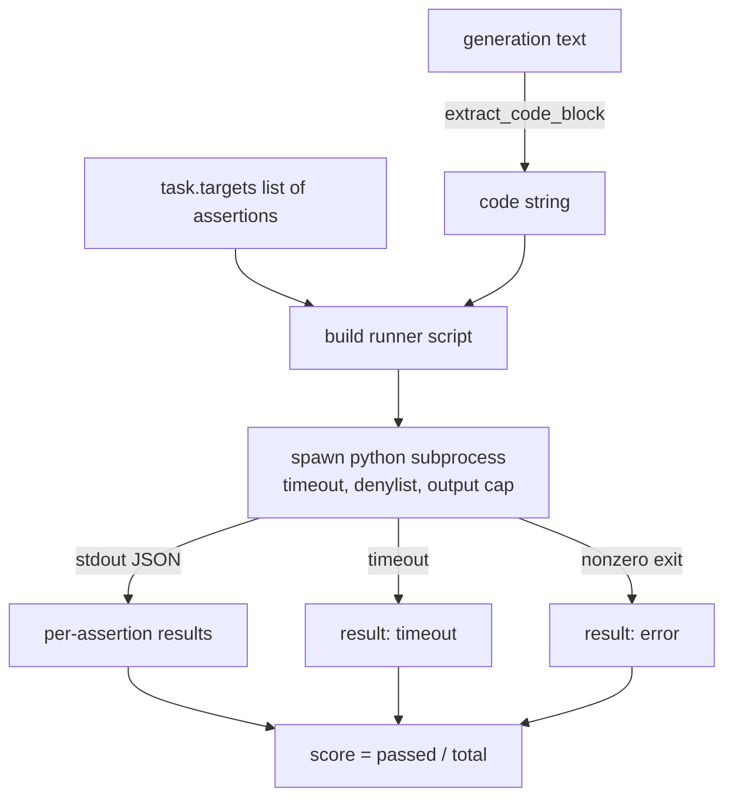
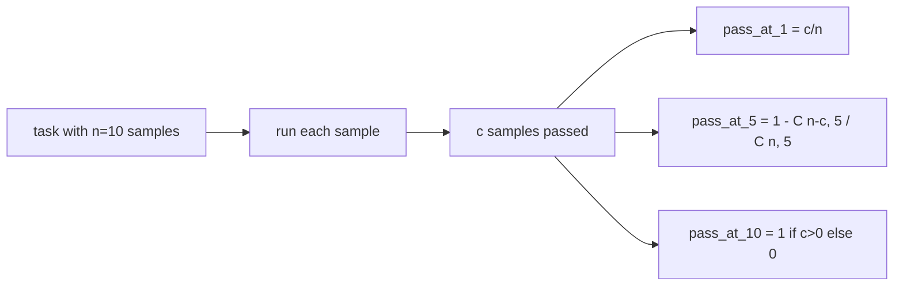

# 代码 ejecutar indicado

> El código de producción después de la prueba es correcto. El instrumento de evaluación debe extraer el código, ejecutarlo en caso de que no haga colapsar la máquina principal.

**Type:** Build
**Languages:** Python
**Prerequisites:** 第 19 期 Track B 基础，第 70 和 71 课
**Time:** ~90 分钟

## El objetivo del aprendizaje


```figure
sandbox-runner
```

- Es un método de adaptación de las reglas de tratamiento posterior de la sección 70 de la Ley de Codificación de los bloques de código de la generación de los bloques de código de forma libre.
- En el proceso de aislamiento de la lista de la salida y la entrada de la lista de rechazo de la lista de suspensión de tiempo, ejecutar el código de candidato.
-  Evaluación de las tareas en función del número de candidatos que se encuentren entre los ficheros.
- 计算从一个模型进行多代采用任务的通过-at-k――
- La situación de la caída de la caja, los errores de lenguaje y los errores de supertiempo se consideran como un modelo de fracaso de primera línea, y el corredor tiene diferentes códigos de salida que se pueden registrar.

## ¿Por qué necesita un proceso aislado?

En el interior`exec` existencia de seguridad y estabilidad                                                                                                                                                                                                                                                                                                                                                                                                                                                                                                                      `while True: pass`Para siempre detener la evaluación.`import shutil; shutil.rmtree('/')`确实像听起来如灾难性──解决方法是为每位候选人生成一个新的 Python 解释器,在 stdin 上传递代码,将断言结果写入 stdout,并在溢出时终止该进程──主机 eval 进程继续运行──

HumanEval、MBPP、BigCodeBench 和 LiveCodeBench etc. El verdadero análisis utiliza los procesos de los niños en la caja. Algunas capas de Docker se encuentran en la parte superior.

## 代码 ejecutar tarea de forma

`code_exec`任务携带   tareas que llevar`targets`El operador de la generación de la extracción de bloque de código separado, alrededor de la construcción de la prueba de herramientas, y luego ejecutar el resultado.



¿ Qué es ?`[0, 1]`El eje ejecutivo de la tarea tiene tres afirmaciones, dos veces con un puntaje de 0.667.

##  rechazar lista

 Rechazar la lista se basa en la introducción                                                                                                                                                                                                                                                                                                                                                                                                                                                                                                                  `ImportError("denied")`De hecho, el nombre de la familia de los niños no se puede encontrar en la lista.`os.system`¿Qué es esto?`subprocess`¿Qué es esto?`socket`¿Qué es esto?`requests`¿Qué es esto?`urllib`¿Qué es esto?`urllib.request`¿Qué es esto?`urllib.error`¿Qué es esto?`urllib.parse`¿Qué es esto?`ctypes`¿Qué es esto?`shutil`¿Qué es esto?`http.client`¿Qué es esto?`asyncio.subprocess`¿Qué es eso?

Nosotros no vamos a hacer como si fuera un arma de fuego. El código de resistencia definido puede escapar de cualquier proceso en Python.

```python
DENIED = {
    "os.system": True,
    "subprocess": True,
    "socket": True,
    "shutil": True,
    "requests": True,
    "urllib": True,
    "ctypes": True,
}
```

Nosotros pasamos por el frente añadido`import sys`Y una por la ley`os.system`El candidato de la guardia de la embajada.`main.py`En el medio.

## 挂钟超时

Cada proceso tiene un presupuesto predeterminado de tres horas de segundo.`subprocess.run(..., timeout=t)`Si superas, el corredor será capturado.`TimeoutExpired`, Terminó el proceso, y registró las tareas `timeout`退出原因──该任务分数为零──corridor continúa adelante──

Cada tarea puede pasar por encima del tiempo .`task.metadata.timeout_s`进行配置──长时间运行的单元测试可能会要求更多; el verificador de la sección 70 将限制该值为30秒,以保持套件的边界──

##  输出上限

El proceso puede estar inundado de datos, consumir todo el almacenamiento de datos. El ejecutor puede estar en un proceso de transferencia de datos en un área de almacenamiento y el total de operaciones puede ser superior a 256 KB.`exit_code = error`, detalle de información`"output overflow"`Cuando una generación no se preocupaba por escribir un ciclo sin límites de impresión, esto se presentaba en la práctica.

##                                                                                                                                                                                                                                                                                                                                                                                                                                                                                                                              

El paso-a-k es un calculador humano y amigo de uso imparcial.`n`独立样本和其中的 `c`                                                                                                                                                                                                                                                                                                                                                                                                                                                                                                                             `n`De la gran tamaño por`k`El modelo contiene al menos una probabilidad de que la solución sea aprobada:

```
pass_at_k(n, c, k) = 1 - C(n - c, k) / C(n, k)
```

Cuando`n - c < k`时, molécula no definida, valor为 `1`◊ Que se realice el tratamiento directo de la situación marginal¬¬¬¬¬¬¬¬¬¬¬¬¬¬¬¬¬¬¬¬¬¬¬¬¬¬¬¬¬¬¬¬¬¬¬¬¬¬¬¬¬¬¬¬¬¬¬¬¬¬¬¬¬¬¬¬¬¬¬¬¬¬¬¬¬¬¬¬¬¬¬¬¬¬¬¬¬¬¬¬¬¬¬¬¬¬¬¬¬¬¬¬¬¬¬¬¬¬¬¬¬¬¬¬¬¬¬¬¬¬¬¬¬¬¬¬¬¬¬¬¬¬¬¬¬¬¬¬¬¬¬¬¬¬¬¬¬¬¬¬¬¬¬¬¬¬¬¬¬¬¬¬¬¬¬¬¬¬¬¬¬¬¬¬¬¬¬¬¬¬¬¬¬¬¬¬¬¬¬¬¬¬¬¬¬¬¬¬¬¬¬¬¬¬¬¬¬¬¬¬¬¬¬¬¬¬¬¬¬¬¬¬¬¬¬¬¬¬¬¬¬¬¬¬¬¬¬¬¬¬¬¬¬¬¬¬¬¬¬¬¬¬¬¬¬¬¬¬¬¬¬¬¬¬¬¬¬¬¬¬¬¬¬¬¬¬¬¬¬¬¬¬¬¬¬¬¬¬¬¬¬¬¬¬¬¬¬¬¬¬¬¬¬¬¬¬¬¬¬¬¬¬¬¬¬¬¬¬¬¬¬¬¬¬¬¬¬¬¬¬¬¬¬¬¬¬¬¬¬¬¬¬¬¬¬¬¬¬¬¬¬¬¬¬¬¬¬¬¬¬¬¬¬¬¬¬¬¬¬¬¬¬¬¬¬¬¬¬¬¬¬¬¬¬¬¬¬¬¬¬¬¬¬¬¬¬¬¬¬¬¬¬¬¬¬¬¬¬¬¬¬¬¬¬¬¬¬¬¬¬¬¬¬¬¬¬¬¬¬¬¬¬¬¬¬¬¬¬¬¬¬¬¬¬¬¬¬¬¬¬¬¬¬¬¬¬¬¬¬¬¬¬¬¬¬¬¬¬¬¬¬¬¬¬¬¬¬¬¬¬¬¬¬¬¬¬¬¬¬¬¬¬¬¬¬¬¬¬¬¬¬¬¬¬¬¬`pass_at_k(n, c, k)`供排行榜层使用──



## 退出代码

El corredor regresa a cada misión uno de los cinco resultados:

- Cuando cada afirmación pasa por el tiempo`pass`¿Qué es eso?
- `assertion_fail`Cuando el código funciona pero al menos hay una afirmación que falla.
- `syntax_error`Cuando el código no se introdujo o hay un error de lenguaje.
- `timeout`Cuando se espera el tiempo.
- `error`Para cualquier otro fracaso, incluyendo rechazar la lista de destinos y salidas con información detallada.`"output overflow"`De la superficie de la superficie)

El número de divisores sigue siendo de cero. El código de salida es de datos.

## 本课不做什么

No se trata de tareas en estado, por ejemplo, archivos de I/O o de red de uso. Estos necesitan un contenedor o microVM. El enfoque de esta clase es el contrato: un subproceso independiente, rechazar la lista, superhora, salida de límite, salida de código.

## ¿Cómo leer el código?

`main.py`Definido .`extract_code`¿Qué es esto?`run_candidate`¿Qué es esto?`score_code_exec`Y `pass_at_k`△子进程runner脚本构建为字符串,并作为 `-c`传递给新的 Python 解释器──`code/tests/test_exec.py`El test de medio ha sido dirigido a cuatro ejemplos de trabajo de HumanEval 风格中提取, así como a un paso a paso.

Desde arriba hasta abajo`main.py`△流道模板是承重件──着断言循环, hasta que puedas predecir que escribe el proceso JSON 信封──

## Más adelante

Una vez que la forma del proceso funciona, el siguiente problema es la transportabilidad. Diferentes versiones de Python en Windows tratan de manera diferente a SIGKILL. La solución más limpia es colocar el operador en el Docker 镜像.
