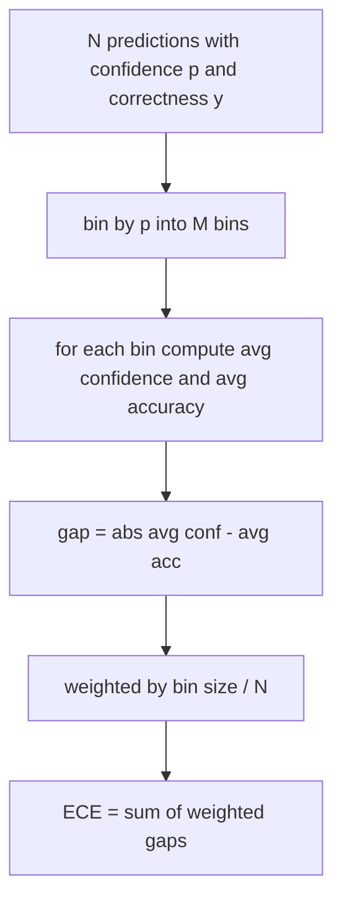
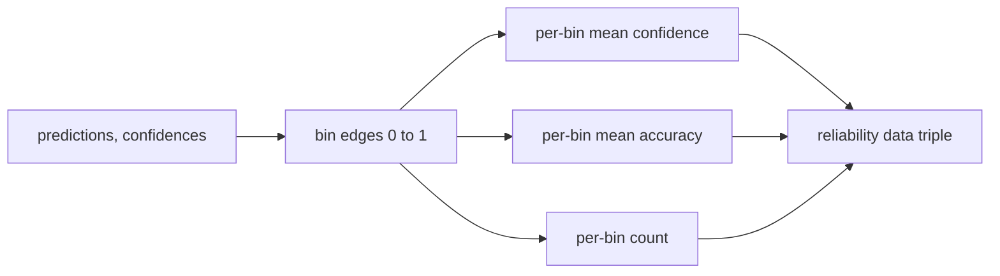

# 困惑度和校准 (confusión y evaluación)

> Si tu modelo muestra un 90% de confianza en 1000 respuestas y responde correctamente a 600, entonces muestra que no ha pasado por una buena calificación. La calificación es la mitad de la evaluación confiable. La otra mitad es confusión, te dice si el modelo considera que el texto reservado es creíble.

**Type:** Build
**Languages:** Python
**Prerequisites:** 第 19 期 Track B 基础，第 70 和 71 课
**Time:** ~90 分钟

## El objetivo del aprendizaje


```figure
cd-reliability-diagram
```

- Según el modelo adaptador proporcionado, la probabilidad de los tokens negativos contra los números se calcula para mantener la confusión de los tokens de la base de datos.
- 根据分箱预测概率计算分类器或多项选择评估的预期校准误差 (ECE) ⋅
- 計算 Brier 分数 (en inglés) (en inglés) (en inglés) (en inglés) (en inglés) (en inglés)
- Construir los datos de fiabilidad de los gráficos necesarios para la curva de confianza y precisión de los gráficos 
- Los tres se conectarán a la línea de evaluación para que el corredor pueda ser`perplexity`¿Qué es esto?`ece`Y `brier`编号附加到模型报告中──

## 困惑 te diga qué

困惑度是每个代币的指数平均负对数似然──越低越好──困惑度为 1 significa modelo para cada token real distribución probabilidad 1──词汇量大小的困惑 significa que el modelo es unificado y no ha aprendido nada── real números entre ambos:

La herramienta en sí misma no calcula la probabilidad numérica. Estas son de los modelos adaptadores. La herramienta se aglutina: obtiene la lista de probabilidades numéricas de cada token, la lista de cuentas de token de cada secuencia, y regresa a la confusión de la base de palabras.

```python
def perplexity(neg_log_probs, token_counts):
    total_nll = sum(neg_log_probs)
    total_tokens = sum(token_counts)
    return math.exp(total_nll / total_tokens)
```

El logro de tratar los tokens en el extremo de la situación y afirma que la probabilidad de números es negativa.`log p`En vez de`-log p`La confusión de un adaptador se produce en un nivel inferior a 1, es imposible.

## ¿Qué medidas de la CE?

                                                                                                                                                                                                                                                                                                                                                                                                                                                                                                                             



标准公式在 `[0, 1]`Usar 10 cuadros de ancho.`bins`参数, para que el operador pueda elegir entre publicar un determinado (10) y comparar un determinado (15)

El ECE tiene una gran cantidad de cajas y muestras y existe una diferencia. Utilizando 10 cajas y 100 predicciones, no se puede distinguir entre 0.02 ECE y ruido de tiempo.

## Brier 分数是ECE 没有的

La ECE sólo se preocupa por la diferencia media. Si el modelo tiene demasiada confianza en la mitad de las cajas de datos y la confianza en la otra mitad es insuficiente, entonces su ECE puede ser menor, y la calificación local también es muy mala.

Para el resultado de la segunda, Brier es`mean((p_i - y_i)^2)` Se descompone en fiabilidad, resolución e incertidumbre.  Se calcula la cantidad y la descomposición.

```python
def brier(p, y):
    return float(np.mean((p - y) ** 2))
```

## Datos de seguridad

La función de la confianza se basa en la precisión de cada caja. La función de la precisión de cada caja se basa en la precisión de cada caja.



返回的元组是调用层绘图或计算自定义 ECE 变体(自适应 ECE、扫描 ECE等) 返回的元组──我们返回 numpy 数组,因此下游代码不必进行转换──

## 置信来源                                                                                                                                                                                                                                                                                                                                                                                                                                                                                                                          

La seguridad del instrumento no se supone que proviene de la máxima suavidad.`[0, 1]`Para muchas tareas de selección, la confianza natural es `softmax over option log-likelihoods` Para el libre texto, la confianza natural es la probabilidad de auto-reporte del modelo o el índice medio de similitud numérica.

##                                                                                                                                                                                                                                                                                                                                                                                                                                                                                                                              

- Todas las predicciones son erróneas: la ECE es la confianza media, la Brier es el valor alto, la confusión es la visión del modelo sobre el texto.
- Las previsiones de la UE se mantienen en el mercado de la UE.
- P=0.5 时完全不确定的预测因子:ECE为0.5 减去准确度,Brier为0.25 减去校正项──
- Airport: ECE, Brier y fiabilidad de la devolución`0.0`(O 0 llenar el número) ◊ Para la situación de 0 tokens, Perplejidad  retorno `NaN` Estos caminos no emitirán advertencias; el corredor revisará estos valores y decidirá si se reportará o se saltará.

Estos casos fueron incluidos en los ensayos. Los modelos reales de los ensayos reales de base no los golpearán, pero los adaptadores o pequeños ejemplos defectuosos los golpearán, y los operadores no deberían colapsar.

## 调度

校准不像F1 那样是针对每个任务的指标――这是每个模型的报告――llegador acumulado durante todo el proceso de evaluación`(confidence, correct)`Para,并计算一次 ECE、Brier 和可靠性数据──困惑性在保留的文本语料库计算,与个别任务的评分分分开开――

La interfaz es:

```python
report = CalibrationReport.from_predictions(confidences, correct)
report.ece          # float
report.brier        # float
report.reliability  # tuple of three numpy arrays
report.populated_bins  # int
```

`PerplexityResult.from_token_nll(neg_log_probs, token_counts)`返回 困惑度和平均负对数似然的每个代币的困惑度和平均负对数似然的复数

## 本课不做什么

No utiliza modelos. No realiza softmax. No calcula la confianza de los resultados. Es el trabajo de un adaptador. No realiza una reducción de temperatura o una reducción de plátanos.

## ¿Cómo leer el código?

`main.py` definición `perplexity`¿Qué es esto?`expected_calibration_error`¿Qué es esto?`brier_score`¿Qué es esto?`reliability_diagram`Y `CalibrationReport`- ¿ Qué ?`PerplexityResult`Los datos de la clase. La demostración se ejecuta en un conjunto de predicciones de hechos básicos conocidos: un modelo bien calificado, un modelo demasiado confiado y un modelo poco confiado.`code/tests/test_calibration.py`El medio de prueba fija la situación de cada borde y el valor de referencia de la variación de previsión integral.

Desde arriba hasta abajo`main.py` La clasificación de las funciones de la escala a la escala para realizar informes. Cada función tiene una cadena de documentos breve, que contiene matemáticas y contratos.

## Más adelante

La calificación es el eje más fácil de ignorar en las evaluaciones publicadas. La mayoría de las clasificaciones reportan un número de precisión y lo califican como completado. Un modelo que gana con precisión y falla en Brier es un modelo que tiene un puntaje bajo en precisión pero que informa con confianza sobre su modelo de incertidumbre en un despliegue de producción peor. Una vez que el tubo de calificación está en su lugar, se añade una reducción de temperatura en los fichas de verificación reservadas, se recalcula el ECE, y se observan las brechas reducidas.
