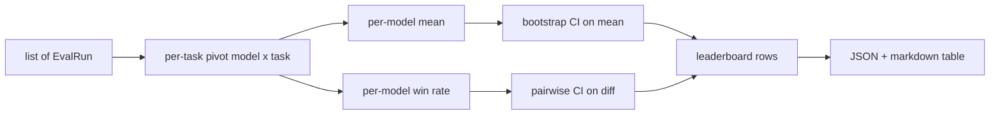
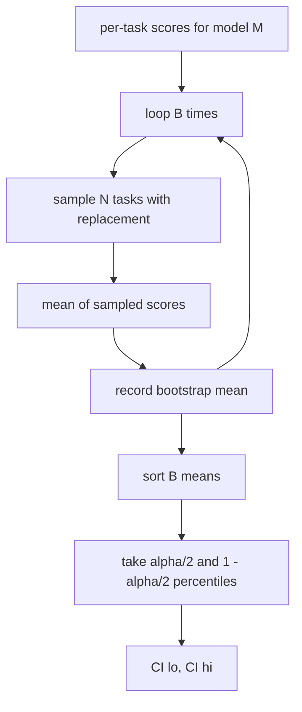

# 排行榜聚合

> Cada tarea es fácil de calcular. Cada modelo de tarea es más difícil de clasificar. La estadística de la lista de predicción de miles de personas es que todos saltan por encima de ella.

**Type:** Build
**Languages:** Python
**Prerequisites:** 第19期B轨基础，第70、71、73课
**Time:** ~90 分钟

## El objetivo del aprendizaje


```figure
ci-leaderboard-ci
```

- Reunir varios modelos y cada uno de los objetivos de cada uno de los objetivos en un conjunto de cada uno de los modelos.
-                                                                                                                                                                                                                                                               
- 按平均值和胜率进行模型排名,并解释每模型何时是正确的总结──
- 计算每个模型的平均分和成对差异的引导置信区间──
- Se puede colocar en el CI  comentarios ⋅

## 输入的形状

聚合器使用 `EvalRun`记录列表:

```python
@dataclass
class EvalRun:
    model_id: str
    task_id: str
    metric_name: str
    score: float          # in [0, 1]
    category: str
```

第 75 课中的跑者为每一个`(model, task)`Para emitir un registro. El agregador no se preocupa por cómo se produce el número de puntos.`[0, 1]`En el medio.

## 输出

出来三张表:



排行榜行包含:`model_id`¿Qué es esto?`mean_score`¿Qué es esto?`mean_ci_lo`¿Qué es esto?`mean_ci_hi`¿Qué es esto?`win_rate`¿Qué es esto?`tasks_completed`y para cada categoría de valores medios de opción.`categories`Mapa de la ciudad.

##  Estandarización

Si un objetivo es un resultado`[0, 1]`, otro objetivo para el resultado .`[0, 100]`, entonces la segunda tarea es el valor medio de la dirección de la dirección.`[0, 1]`En el caso de la aplicación de la norma, el índice de desempleo debe haber sido devuelto a un porcentaje.

## 平均值和胜率

Estos dos programas de clasificación sirven a objetivos diferentes.

El índice medio es un modelo de valor medio de cada número de tareas. Este es el informe de clasificación numérica de los títulos. Es muy sensible a los valores anormales y a la desequilibrio de las tareas.

胜率计算模型在同一任务上击败所有其他模型的频率──对于每项任务,得分最高的模型获胜(平局时,每个并列模型都算完整一次获胜)──胜率等于获胜次数除了模型得分的任务数──它对异常值和尺寸差异不太敏感,但会丢失信息──

```python
def win_rate(model_id, runs_by_task, all_models):
    wins, total = 0, 0
    for task_id, runs in runs_by_task.items():
        scores = {r.model_id: r.score for r in runs if r.model_id in all_models}
        if model_id not in scores:
            continue
        total += 1
        best = max(scores.values())
        if scores[model_id] >= best:
            wins += 1
    return wins / total if total else 0.0
```

El corredor de la clase 75 ̊ 默认按平均排名排序; el marcado abajo de la tasa de victorias 列也保留在那里,以便用户偏好这种视角时使用──

## Autopsia

Cada modelo tiene un valor promedio de la tarea de recolección de datos.`B`En el siguiente, y en el siguiente.`alpha`级别获取百分位间隔──



Para la comparación, guiamos las diferencias de cada tarea.`score_A - score_B`, obtendrá el porcentaje de intervalos y lo reportará.

低级助手 (señor de la escuela)`bootstrap_mean_ci`¿Qué es esto?`bootstrap_pairwise_diff`) se considera`B=1000`; public聚合器`aggregate`¿Qué es esto?`pairwise_diffs`) se cree que`b=500`, por lo tanto, la demostración y el ensayo mantienen un rápido ≠ ≠ ∞.

## 类别:

Si se ha establecido `EvalRun.category`, el agregador también informará el valor medio de cada categoría.`math`¿Qué es esto?`reasoning`¿Qué es esto?`code`¿Qué es esto?`safety` Puede hacer que el corredor descubra si el modelo en su conjunto es bueno pero el código es débil, es la información oculta del título 

## Marcado abajo

排行榜呈现为 Markdown 表:

```text
| Rank | Model | Mean | 95% CI | Win rate | Tasks |
|------|-------|------|--------|----------|-------|
| 1    | gpt   | 0.78 | 0.74-0.82 | 0.62 | 50 |
| 2    | claude| 0.75 | 0.71-0.79 | 0.34 | 50 |
| 3    | random| 0.10 | 0.07-0.13 | 0.04 | 50 |
```

El cuadro se clasifica en la siguiente siguiente clasificación: CI: 2 bits.

## 本课不做什么

No se ejecuta el modelo. No se utiliza la dimensión. No se realiza la adaptación automática de la ECE o de otros cambios de calificación.`weight`字段将该子保持开放状态, pero ignorarlo en el aglutinador. Si es necesario, puede añadir peso en el curso posterior.

## ¿Cómo leer el código?

`main.py`Definido .`EvalRun`¿Qué es esto?`LeaderboardRow`¿Qué es esto?`aggregate`¿Qué es esto?`bootstrap_mean_ci`¿Qué es esto?`bootstrap_pairwise_diff`Y `render_markdown` La exposición constituye un conjunto de tres modelos y doce tareas, un conjunto de clasificaciones de trabajo, así como una lista de diferencias.`code/tests/test_leaderboard.py`El medio de prueba fijó el bootstrap, el marcado de resultados, la situación de la margen de la tasa de ganancia y el comportamiento de entrada en el aire.

Desde arriba hasta abajo`main.py` Datos de la información`EvalRun`¿Qué es esto?`LeaderboardRow`) primero aparece, después es el aglomerador, tercero es el arranque, último es la colocación.

## Más adelante

Cada modelo tiene un espacio sin parentesco, pero la comparación entre los modelos debe ser parentesco. Si los modelos A y B ejecutan las mismas cien tareas, entonces el examen apropiado es dirigido a la diferencia de tareas por programa de parentesco.`bootstrap_pairwise_diff`已实现了. Además, también necesitas un programa de guía de nivel de serie de tareas de respeto. Los problemas matemáticos no son independientes entre sí. El método de errores de cálculo afecta a diez de ellos.
