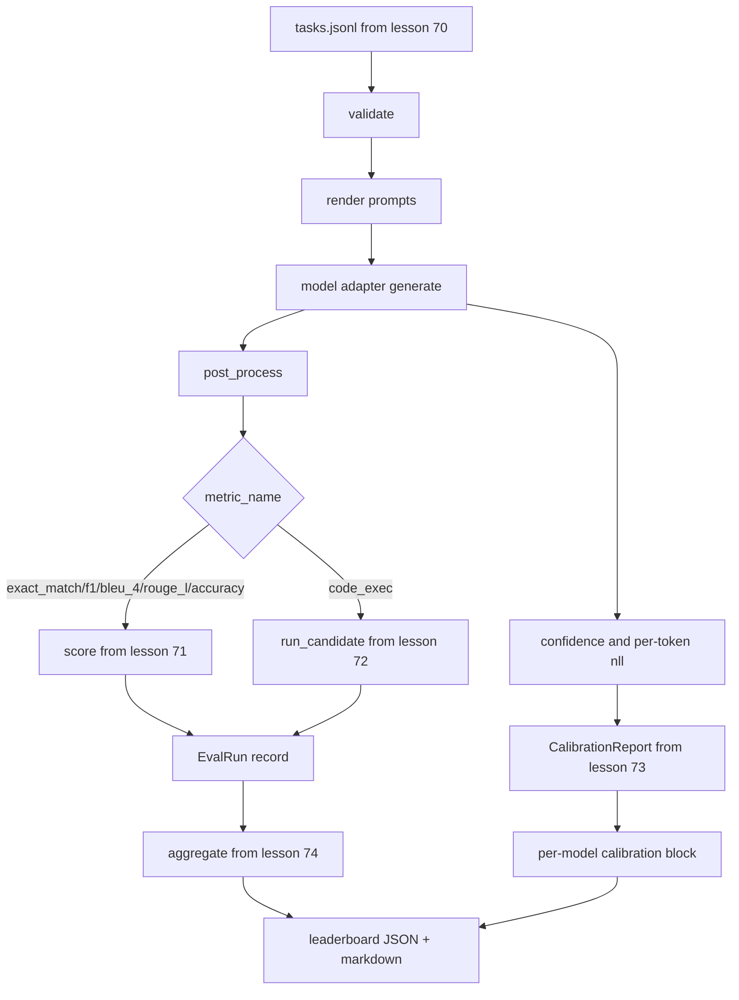

# 端到端评估运行器 端到端评估运行器 端到端

> 五堂管道安装课,一堂水课, runner读取第70课中的任务规范,通过适配器调用模型,对第71课和第72课进行评分,附加第73课中的校准报告,并发出第74课中的排行列――演示自闭终止──

**Type:** Build
**Languages:** Python
**Prerequisites:** 第 19 期 Track B 基础，第 70 至 74 课
**Time:** ~90 分钟

## El objetivo del aprendizaje


```figure
eval-grid
```

- 定义任何模型(模拟、本地、API) puede ser realizado a través de pequeños métodos de superficie satisfactoria `ModelAdapter`¿Qué pasa?
- En fijar JSONL 文件上运行评估, y en el trabajo池并行执行任务──
- Una vez se ha combinado la capa de medición (exact_match、F1、BLEU-4、ROUGE-L、code_exec) con la capa de clasificación.
- 发发出 cada modelo `EvalRun`记录并将其直接输入排行榜聚合器──
- Concomitante a la salida de informes JSON y de marcas; salida de cero en el tiempo de ejecución en el tiempo de ejecución en el tiempo de prueba o en el tiempo de ejecución en el tiempo de fracaso en la prueba o en el tiempo de ejecución en el tiempo de ejecución en el tiempo de ejecución en el tiempo de ejecución en el tiempo de ejecución en el tiempo de ejecución en el tiempo de ejecución en el tiempo de ejecución en el tiempo de ejecución en el tiempo de ejecución en el tiempo de ejecución en el tiempo de ejecución en el tiempo de ejecución en el tiempo de ejecución en el tiempo de ejecución en el tiempo de ejecución en el tiempo de ejecución en el tiempo de ejecución en el tiempo de ejecución en el tiempo de ejecución en el tiempo de ejecución en el tiempo de ejecución en el tiempo de ejecución en el tiempo de ejecución en el tiempo de ejecución en el tiempo de ejecución en el tiempo de ejecución en el tiempo de ejecución en el tiempo de ejecución en el tiempo de ejecución en el tiempo de ejecución en el tiempo de ejecución en el tiempo de ejecución en que no cero en cero en la fecha de ejecución en el tiempo de ejecución en el tiempo de ejecución en el tiempo de ejecución en el tiempo de ejecución en el tiempo de ejecución en el tiempo de ejecución en el tiempo de ejecución en que no de ejecución en la ejecución en la ejecución en la ejecución en la ejecución en el tiempo de ejecución en la ejecución en la cual se realiza en la ejecución en la ejecución en la ejecución en la ejecución en la ejecución en la ejecución en la cual se realiza en la ejecución en la ejecución en la cual se realiza en la ejecución en la ejecución en la ejecución en la cual se realiza en la ejecución en la cual se realiza en la ejecución en la ejecución en la cual se realiza en la ejecución en la cual se realiza en la ejecución en la cual se realiza en la cual.

## 管道



runner es un punto de integración. En cada clase de 70 a 74 clases hay un módulo escrito por el runner. El runner no copiará ninguna lógica de estos módulos: los introducirá.

## 适配器接口

适配器是跑步机和任何模型之间的接口. 接口故意很小.

```python
class ModelAdapter:
    model_id: str

    def generate(self, prompt: str, task: TaskSpec) -> Generation: ...
```

`Generation`Es una clase de datos, con:

- `text`Modelo de libre formato
- `confidence`¿Qué es esto ?`[0, 1]`Número de puntos de referencia, que representa la probabilidad de respuesta del modelo auto-reporte
- `token_nll`: generadotoken de la opción negativa a la cantidad de similares y el total
- `token_count`: generartoken de la cantidad de opciones

Los modelos de los operadores de transporte de vehículos ofrecen tres tipos de modelos:`RuleBasedAdapter`(determinación, casi perfecta),`NoisyAdapter`(ÜÜÜÜÜÜÜÜÜÜÜÜÜÜÜÜÜÜÜÜÜÜÜÜÜÜÜÜÜÜÜÜÜÜÜÜÜÜÜÜÜÜÜÜÜÜÜÜÜÜÜÜÜÜÜÜÜÜÜÜÜÜÜÜÜÜÜÜÜÜÜÜÜÜÜÜÜÜÜÜÜÜÜÜÜÜÜÜÜÜÜÜÜÜÜÜÜÜÜÜÜÜÜÜÜÜÜÜÜÜÜÜÜÜÜÜÜÜÜÜÜÜÜÜÜÜÜÜÜÜÜÜÜÜÜÜÜÜÜÜÜÜÜÜÜÜÜÜÜÜÜÜÜÜÜÜÜÜÜÜÜÜÜÜÜÜÜÜÜÜÜÜÜÜÜÜÜÜÜÜÜÜÜÜÜÜÜÜÜÜÜÜÜÜÜÜÜÜÜÜÜÜÜÜÜÜÜÜÜÜÜÜÜÜÜÜÜÜÜÜÜÜÜÜÜÜÜÜÜÜÜÜÜÜÜÜÜÜÜÜÜÜÜÜÜÜÜÜÜÜÜÜÜÜÜÜÜÜÜÜÜÜÜÜÜÜÜÜÜÜÜÜÜÜÜÜÜÜÜÜÜÜÜÜÜÜÜÜÜÜÜÜÜÜÜÜÜÜÜÜÜÜÜÜÜÜÜÜÜÜÜÜÜÜÜÜÜÜÜÜÜÜÜÜÜÜÜÜÜÜÜÜÜÜÜÜÜÜÜÜÜÜÜÜÜÜÜÜÜÜÜÜÜÜÜÜÜÜÜÜÜÜÜÜÜÜÜÜÜÜÜÜÜÜÜÜÜÜÜÜÜÜÜÜÜÜÜÜÜÜÜÜÜÜÜÜÜÜÜÜÜÜÜÜÜÜÜÜÜÜÜÜÜÜÜÜÜÜÜÜÜÜÜÜÜÜÜÜÜÜÜÜÜÜÜÜÜÜÜÜÜÜÜÜÜÜÜÜÜÜÜÜÜÜÜÜÜÜÜÜÜÜÜÜÜÜÜÜÜÜÜÜÜÜÜÜÜÜÜÜÜÜÜÜÜÜÜÜÜÜÜÜÜÜÜÜÜÜÜÜÜÜÜÜÜÜÜÜÜ`BiasedAdapter`(擅长一类,糟糕于另类) . Este espectáculo en el fijo de la 70 课程 en funcionó todos los tres .

## Y no se ejecuta

ejecutor `concurrent.futures.ThreadPoolExecutor`按模型并行运行任务──工作线程数默认为8 和任务数中较小的人──线程就足够了,因为 el modelo actual que se utiliza en el proceso de ejecución es el I/O de la red.

Para el examen de certeza, el corredor está abierto `run_eval(adapters, tasks, parallel=False)`, para que el test pueda determinar la secuencia de ejecución.

## 单遍评分循环

 Para cada tarea:

1. 染提示(pocas fotos 前加上提示正文)
2. 呼叫适配器并为呼叫计时──
3.  La producción y el procesamiento se realizan de acuerdo con las reglas de la tarea.
4. 调度到度量层── y el nivel de la medida es el nivel de la medida.
5. Utiliza la cantidad y el indicador de datos de construcción `EvalRun`¿Qué es eso?
6. ¿ Qué ?`(confidence, correct)`Para la incorporación a la formación en la escuela.

对于精确匹配样式标标 (en inglés)`exact_match`¿Qué es esto?`accuracy`¿Qué es esto?`code_exec`),`correct` señal es `score >= 1.0`, para los indicadores de clasificación,`score >= 0.5` señal es `score >= 0.5`△ value se encuentra `_correct_from_score`En el medio, y el operador no será de cobertura pública pública.

##                                                                                                                                                                                                                                                                                                                                                                                                                                                                                                                              

Después de cada tarea, el corredor se reclutará en la clase 74.`aggregate`Y `pairwise_diffs`Y en el curso 73 .`CalibrationReport.from_predictions`△输出 es un JSON 信封:

```json
{
  "leaderboard": [...],
  "pairwise": [...],
  "calibration": {
    "model_id_a": {"ece": 0.04, "brier": 0.10, "populated_bins": 8, ...},
    ...
  },
  "summary": {
    "tasks": 10,
    "models": 3,
    "wall_seconds": 1.2
  }
}
```

El corredor también marcará el marcador de la página de entrada y salida, para que el usuario pueda pegar los resultados en el PR 评论中。

## Desde el final de la exposición

La demostración se realizará en 10 fijos de la clase 70                                                                                                                                                                                                                                                                                                                                                                                                                                                                                                                

清洁运行标准是:

- Sección 70 中验证 de cada uno de los trabajos
- Sector de trabajo de la escuela de la escuela de la escuela de la escuela de la escuela de la escuela de la escuela de la escuela de la escuela de la escuela de la escuela de la escuela de la escuela de la escuela de la escuela de la escuela de la escuela de la escuela de la escuela de la escuela de la escuela de la escuela de la escuela de la escuela de la escuela de la escuela de la escuela de la escuela de la escuela de la escuela de la escuela de la escuela de la escuela de la escuela de la escuela de la escuela de la escuela de la escuela de la escuela de la escuela de la escuela de la escuela de la escuela de la escuela de la escuela de la escuela de la escuela de la escuela de la escuela de la escuela de la escuela de la escuela de la escuela de la escuela de la escuela de la escuela de la escuela de la escuela de la escuela de la escuela de la escuela de la escuela de la escuela de la escuela de la escuela de la escuela de la escuela de la escuela de la escuela de la escuela de la escuela de la escuela de la escuela de la escuela de la escuela de la escuela de la escuela de la escuela de la escuela de la escuela de la escuela de la escuela de la escuela de la escuela de la escuela de la escuela de la escuela de la escuela de la escuela de la escuela de la escuela de la escuela de la escuela de la escuela de la escuela de la escuela de la escuela de la escuela de la escuela de la escuela de la escuela de la escuela de la escuela de la escuela de la escuela de la escuela de la escuela de la escuela de la escuela de la escuela de la escuela de la escuela de la escuela de la escuela de la escuela de la escuela de la escuela de la escuela de la escuela de la escuela de la escuela de la escuela de la escuela de la escuela de la escuela de la escuela de la escuela de la escuela de la escuela de la escuela de la escuela de la escuela de la escuela de la escuela de la escuela de la escuela de la escuela de la escuela de la escuela de la escuela de la escuela de la escuela de la escuela de la escuela de la escuela de la escuela de la escuela de la escuela de la escuela de la escuela de la escuela de la escuela de la escuela de la escuela de la escuela de la escuela de la escuela de la escuela de la escuela de la escuela de la escuela de la escuela de la escuela de la escuela de la escuela de la escuela de la escuela de la escuela de la
- Sección 73                                                                                                                                                                                                                                                                                                                                                                                                                                                                                                                           
- La clasificación se basará en las reglas de los adaptadores estrictamente en los adaptadores de las reglas.

Si uno de ellos se interrumpe, el corredor se retrocederá en valor no-zero y aparecerá un error estructural en el JSON.

## 本课不做什么

No realiza el proceso de generación o la generación parcial; el adaptador cada vez que se utiliza regresa a una generación. No realiza el re-probado o el caché. Estos problemas existen en la capa del adaptador; el ejecutor no está relacionado con los indicadores y el proveedor.

## ¿Cómo leer el código?

`main.py`Es un grupo.`_load_sibling` Importar el programa de ayuda de otros cinco módulos de cursos, el programa de ayuda a través de un camino relativo para resolverlos `Generation`¿Qué es esto?`EvalReport`Y `ModelAdapter`Es un adaptador de la base del archivo.

Desde arriba hasta abajo`main.py`◊ Browse import, luego chequear `run_eval`, y luego es`_score_one`, entonces es el adaptador. La última presentación es el punto de entrada.

`code/tests/test_runner.py`En el medio de los ensayos se encuentran las conexiones de un ajuste fijo, un solo ciclo de conducción, una línea de paso con el orden y la misma eficacia, un área de clasificación y un formato de red de JSON.

## Más adelante

Este ejecutor es el terreno.`(task_id, model_id, model_version)`Los resultados de los controles clave se almacenan, se siguen los costos de los dólares y tokens de cada operación, se mantienen en el cuadro de los costos de cada operación, se mantienen las estrategias de selección de las tareas de la capa de prueba de la velocidad de regreso y se mantienen en el formato de salida de los paquetes de largo plazo. Cada uno de ellos es un punto de interés único, incluye el operador, sin necesidad de cambiar el indicador o la capa de aglutinamiento.

模拟工作后,为真正提供程序添加适配器──选择一个免费级别,写三十行水,看排列清亮起──然后添加第二个提供程序并让线束完成工作──
