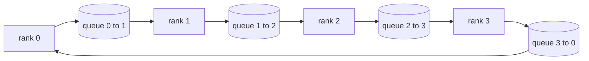

# Desde el 0 de la realización de operaciones colectivas

> Los cuatro grupos de operaciones de un entrenamiento distribuido se combinan en todos los campos de la reducción, la difusión, la recolección y la reducción de la dispersión.`multiprocessing.Queue`La construcción de las redes una vez que se realizan, según los referentes de verificación, el resto del trayecto se convierte en tuberías.

**Type:** Build
**Languages:** Python
**Prerequisites:** 第 19 阶段 Track C 课程 42-49
**Time:** ~90 分钟

## El objetivo del aprendizaje

- En dos veces de transmisión se realiza un ciclo de reducción de todo (precedente reducción de dispersión y luego recolección) y se prueba la cantidad de comunicaciones de cada uno de los elementos 2 (N-1) / N 字节。
- En el`multiprocessing.Queue`Sobre el punto de envío sobre el punto de construcción de la transmisión, todo se reúne y reduce_scatter.
- Según la misma entrada.`torch.distributed`GLOO 参考验证每个原语──
- En el ámbito de la forma de grupo, la diferencia entre el tiempo de espera y el tiempo de espera, la protección de los árboles y el círculo de la elección.

##  problemas

N 级上的简单 allreduce 将张量 N 次发送到根并广播 N 次。 cada rango de la banda ancha se acumulará para$O(N)$, la raíz se convierte en un botelón, y el nivel de la cadena es el más lento multiplicado por N.$T/N$de la$2(N-1)$块, por lo tanto cada rango 字节下降到$2T(N-1)/N$El árbol todo se reduce en el pequeño N y el alto tiempo de retraso en la cadena de la victoria, porque la profundidad es$\log_2(N)$跳 en lugar de $2(N-1)$◊ Para la configuración de grupo seleccionar errores de superficie, la GPU más lenta decide los pasos de tiempo.

 Cada marco de entrenamiento distribuido que leerás en este manual depende de estos cuatro idiomas originales。 PyTorch DDP va a reducir la gradiente con cada barril de parámetros en un allreduce 同步。 ZeRO                                                                                                                                                                                                                                    

## 概念



### 分两次进行 allreduce

Se puede dividir la cantidad en N 个相等块, enlaces 0..N-1── cada rango 拥有与其级别相等块索引──第 1遍,reduce_scatter,运行 N-1 步骤──在步骤 s,rango r 发送块 (r - s) mod N 到rank (r + 1) mod N,并从rank (r - 1) mod N 接收块 (r - s - 1) mod N, recibirá el bloque 积累到本地副本中──经过 N-1 步骤后,全部 r 拥有块 r总和和──第二,全部收集,运行 N-1 个步骤,并绕绕旋转完成块,直到每个块等级都保存了全部总和总和──

|原语|每 rank 字节 |步骤|何时使用 |
|-----------|---------------|-------|-------------|
|Ring allreduce| 2T(N-1)/N | 2(N-1) |大 T、fat-pipe 同构集群 |
|Tree allreduce | T log2(N) | 2 log2(N) |小 T 或高延迟链路 |
|广播| T | log2(N) 树 |参数初始化，标量配置|
|allgather| T(N-1)/N | N-1 |分片转发，ZeRO 取消分片 |
|reduce_scatter | T(N-1)/N | N-1 | ZeRO 梯度分片 |

### 队列网格 como sustituto de la NCCL

NCCL en PCIe y NVLink, se ejecuta, y se reduce el hardware descargado.`multiprocessing.Queue`Para que usted pueda ofrecer un pedido de un productor individual y un consumidor individual punto a punto de entrega. La reducción ocurre en el espacio de usuario, por lo que necesita pagar Python, pero el modelo de conexión con el NCCL se reduce todo lo mismo.

### 针对 gloo  realizar pruebas

Cada idioma original se realizará un ensayo de unidad, y su salida se iniciará en el mismo tiempo que el uso de la misma cantidad de la misma lengua.`torch.distributed` realizar comparaciones. Si el anillo de la mano reduce la diferencia de la mano de la mano de la mano de la mano de la mano de la mano de la mano de la mano de la mano de la mano de la mano de la mano de la mano de la mano de la mano de la mano de la mano de la mano de la mano de la mano de la mano de la mano de la mano de la mano de la mano de la mano de la mano de la mano de la mano de la mano de la mano de la mano de la mano de la mano de la mano de la mano de la mano de la mano de la mano de la mano de la mano de la mano de la mano de la mano de la mano de la mano de la mano de la mano de la mano de la mano de la mano de la mano de la mano de la mano de la mano de la mano de la mano de la mano de la mano de la mano de la mano de la mano de la mano de la mano de la mano de la mano de la mano de la mano de la mano de la mano de la mano de la mano de la mano de la mano de la mano de la mano de la mano de la mano de la mano de la mano de la mano de la mano de la mano de la mano de la mano de la mano de la mano de la mano de la mano de la mano de la mano de la mano de la mano de la mano de la mano de la mano de la mano de la mano de la mano de la mano de la mano de la mano de la mano de la mano de la mano de la mano de la mano de la mano de la mano de la mano de la mano de la mano de la mano de la mano de la mano de la mano de la mano de la mano de la mano de la mano de la mano de la mano de la mano de la mano de la mano de la mano de la mano de la mano de la mano de la mano de la mano de la mano de la mano de la mano de la mano de la mano de la mano de la mano de la mano de la mano de la mano de la mano de la mano de la mano de la mano de la mano de la mano de la mano de la mano de la mano de la mano de la mano de la mano de la mano de la mano de la mano de la mano de la mano de la mano de la mano de la mano de la mano de la mano de la mano de la mano


```figure
ci-ring-allreduce
```

## Construirlo

`code/main.py` realización:

- `Mesh`类,将 N 个 `multiprocessing.Queue` ejemplos conectados a la red,并按等级公开 `send(dst, tensor)`Y `recv(src)`¿Qué es eso?
- `ring_allreduce(mesh, rank, world_size, tensor)`¿Qué es esto?
- En el árbol`broadcast(mesh, rank, world_size, tensor, src)`¿Qué es eso?
- `allgather(mesh, rank, world_size, tensor)`Utiliza N-1 轮换。
- `reduce_scatter(mesh, rank, world_size, tensor)`Como la primera mitad de todo.
- `_gloo_reference(op, world_size, tensor)` Por el `torch.distributed`运行相同输入,并使用 gloo 进行字节相等比较──

¿Qué es eso ?

```bash
python3 code/main.py
```

输出: Compare la línea de cuentas 输出 输出 输出 输出 输出 输出 输出 输出 输出 输出 输出 输出 输出 输出 输出 输出 输出 输出 输出 输出 输出 输出 输出 输出 输出 输出 输出 输出 输出 输出 输出 输出 输出 输出 输出 输出 输出 输出 输出 输出 输出 输出 输出 输出 输出 输出 输出 输出 输出 输出 输出 输出 输出 输出 输出 输出 输出 输出 输出 输出 输出 输出 输出 输出 输出 输出 输出 输出 输出 输出 输出 输出 输出 输出 输出 输出 输出 输出 输出 输 输 输 输 输 输 输 输 输 输 输 输 输 输 输 输 输 输 输 输 输 输 输 输 输 输 输 输 输 输 输 输 输 输 输 输 输 输 输 输 输 输 输 输 输 输 输 输 输 输 输 输 输 输 输 输 输 输 输 输 输 输 输 输 输 输 输 输 输 输 输 输 输 输 输 输 输 输 输 输 输 输 输 输 输 输 输 输 输 输 输 输 输 输 输 输 输 输 输 输 输 输 输 输 输 输 输 输   输 输 输                                      

## 野外生产模式 野外生产模式 野外生产模式 野外生产模式

Tres modos hacen que el base sea lo suficientemente firme, puede entregarse.

**在 allreduce 之前对梯度进行分桶。**El modelo 1B 参数 tiene varios millones de gradientes 张量―― cada gradiente se realiza una vez reducción total de pagos N 倍的延迟下限―― DDP va a almacenar la gradiente en un bloque de aproximadamente 25 MB, y emitir un allreduce para cada barril de almacenamiento; 小张量骑大张量的后面―― si no se divide en un barril, la demora de la venta ocupará el lugar dominante―

**通信与计算重叠。**En el caso de la red, la red de red se encuentra en la red de red, y la red de red se encuentra en la red.

**根据消息大小而不是宗教来选择环或树。**NCCL  proporcionó un detector de datos de datos de un área de mayor tamaño, que puede ser superior a ~ 1 MB, inferior a 1 MB, y que puede ser inferior a 1 MB.

## Usalo

Modelo de producción:

- **PyTorch DDP。**En el sentido posterior de la regla de la cuchara`dist.all_reduce`◊斗大小可调; para 100Gbit 以太网, por defecto 25 MB es razonable♦
- **DeepSpeed ZeRO。**发出减_scatter para hacer un segmento de la escala y antes de hacer un cambio, hacer una reunión para reconstruir los parámetros completos.
- **FSDP.**Antes de todo, empieza a eliminar las partes de la capa, calcula y luego reduce_scatter.

## 发货

Se trata de un programa de investigación que se desarrolla en el ámbito de la salud y de la salud en el mundo.

##  ejercicios

1. Añadir árbol todo reduce los cambios, y según la información, el tamaño de los círculos y los árboles se cambia.
2. 添加                                                                                                                                                                                                                                                                                                                                                                                                                                                                                                                           `recv_timeout_ms`, para que el ranking en paro se produzca un error de fecha límite, en lugar de colgar para siempre.
3. ¿Qué es eso?`multiprocessing.Queue`替换为 TCP 套接字──相同的测试,真线──
4. Añadir la banda ancha de la prueba de la conexión, para que cada línea de la contagemera se registre en JSONL.
5. Comparado con el tiempo de colga de los círculos y los árboles en 4 grados de 1KB,1MB,16.

## 关键术语: "El hombre es un hombre"

|术语 |人们怎么说|它实际上意味着什么 |
|------|----------------|------------------------|
|allreduce| “跨等级总和”|调用后，每个等级都保留相同的简化张量 |
|戒指| “快速拓扑”| N-1 个大小为 T/N 的块绕周期流动两次 |
|树| “日志拓扑”|归约遵循二叉树；深度为 log2(N) 跳 |
|allgather| “连接碎片”|每个等级都以其他等级的碎片结束 |
|reduce_scatter | “平分总和”|每个排名仅以一个块的总和结束 |
|桶| “融合小张量”|将N个小的全部合并为一个大的|

##  más阅读

- [PyTorch 分布式：NCCL 集体](https://pytorch.org/docs/stable/distributed.html#collective-functions)
- [Horovod环全减纸](https://arxiv.org/abs/1802.05799)
- NCCL拓和算法选择](https://docs.nvidia.com/deeplearning/nccl/user-guide/docs/index.html(en inglés)
- [Patarasuk 和 Yuan，带宽最优 allreduce 算法](https://www.cs.fsu.edu/~xyuan/paper/09jpdc.pdf)
- Sección 10 阶段 Sección 05 课 - 分布式训练概述
- 第19 阶段 第77 课 - DDP 连接在这些原语之上
