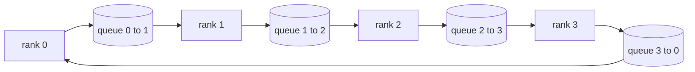

# Desde el 0 de la realización de operaciones colectivas

> 支分布式训练的四种集体通信(collective)操作是allreduce、broadcast、allgather 和 reduce_scatter──en otros idiomas de la formación se ofrece casi todo el paquete de estos cuatro.`multiprocessing.Queue`En la red, una vez más, una vez más, en la red, en la red, en la red, en la red, en la red, en la red, en la red, en la red, en la red, en la red, en la red, en la red, en la red, en la red, en la red, en la red, en la red, en la red, en la red, en la red, en la red, en la red, en la red, en la red, en la red, en la red, en la red, en la red, en la red, en la red, en la red, en la red, en la red, en la red, en la red, en la red, en la red, en la red, en la red, en la red, en la red, en la red, en la red, en la red, en la red, en la red, en la red, en la red, en la red, en la red, en la red, en la red, en la red, en la red, en la red, en la red, en la red, en la red, en la red, en la red, en la red, en la red, en el red, en el red, en red, en red, en red, en red, en red, en red, en red, en red, en red, en red, en red, en red, en red, en red, en red, en red, en red, en red, en red, en red, en red, en red, en red, en red.

**Type:** Build
**Languages:** Python
**Prerequisites:** Phase 19 Track C lessons 42-49
**Time:** ~90 分钟

## El objetivo del aprendizaje

- Utilizando dos veces algoritmos para lograr anillo todoreduce, primero reduce-dispersar, re-reunir), y demostrar que cada rango de la comunicación es cada elemento.$2(N-1)/N$¿Qué es eso?
- En el`multiprocessing.Queue`Por lo tanto, el programa de televisión de la televisión de la televisión de la televisión de la televisión de la televisión de la televisión de la televisión de la televisión de la televisión de la televisión de la televisión de la televisión de la televisión de la televisión de la televisión de la televisión de la televisión de la televisión de la televisión de la televisión de la televisión de la televisión de la televisión de la televisión de la televisión de la televisión de la televisión de la televisión de la televisión de la televisión de la televisión de la televisión de la televisión de la televisión de la televisión de la televisión de la televisión de la televisión de la televisión de la televisión de la televisión de la televisión de la televisión de la televisión de la televisión de la televisión de la televisión de la televisión de la televisión de la televisión de la televisión de la televisión de la televisión de la televisión de la televisión de la televisión de la televisión de la televisión de la televisión de la televisión de la televisión de la televisión de la televisión de la televisión de la televisión de la televisión de la televisión de la televisión de la televisión de la televisión de la televisión de la televisión de la televisión de la televisión de la televisión de la televisión de la televisión de la televisión de la televisión de la televisión de la televisión de la televisión de la televisión de la televisión de la televisión de la televisión de la televisión de la televisión de la televisión de la televisión de la televisión de la televisión de la televisión de la televisión de la televisión de la televisión de la televisión de la televisión de la televisión de la televisión de la televisión de la televisión de la televisión de la televisión de la televisión de la televisión de la televisión de la televisión de la televisión de la televisión de la televisión de la televisión de la televisión de la televisión de la televisión de la televisión de la televisión de la televisión de la televisión de la televisión de la televisión de la televisión de la televisión de la televisión de la televisión de la televisión de la televisión de la televisión de la televisión de la televisión de la televisión de la televisión de la televisión de la televisión de la televisión de la televisión de la televisión de la televisión de la televisión de la televisión de la televisión de la televisión de la televisión de la televisión de la televisión de la televisión de la televisión de la televisión de la televisión de la televisión de la televisión de la televisión de la televisión de la televisión de la televisión de la televisión de la televisión de la televisión de la televisión de la televisión de la televisión de la televisión de la televisión de la televisión de la televisión de la televisión de la televisión de
- Para la misma entrada, us`torch.distributed`Como referencia, prueba cada uno de los idiomas originales.
- Desde la forma de grupo 延迟下限和带宽上限出发,论证该选环 还是树

##  problemas

En N 个级 上做朴素 allreduce,将把张量向根发送 N 次,再广播回来 N 次.$O(N)$La raíz se transforma en botella, el tiempo se reduce a la línea más lenta.$2(N-1)$个大小为                                                                                                                                                                                                                                                                                                                                                                                                                                                                                                                         $T/N$de cada pieza, es cada rango de la letra número de abajo$2T(N-1)/N$, con el aumento de la tendencia$2T$且永不超出,与集群规模无关. 树全减少在小N、高延迟链路上更优,因为深度是$\log_2(N)$跳, en lugar de $2(N-1)$❖ To                                                                                                                                                                                                                                                             

En esta pista 里会读的每一个分布式训练框架,都依赖于这四个原语──PyTorch DDP utiliza cada parámetro cubo una vez todosreducir para llegar a un mismo nivel──ZeRO utiliza reduc_scatter 分片优化器状态, reutiliza todos 广播更新后的参数──FSDP Colocar todo hacia adelante 变成 todo 加减少_scatter──Pipeline parallel 需要跨阶段组播播 传活化──实现不了这些四个集体,就无法推推训为何住了,为何梯度卡不匹配现在排名3以及为何换拓后的管道泡会翻倍──

## 概念



### 两遍完成的 Ring todo reducir

Colocar la cantidad de la cantidad en N 个等等的大小小小小小小小,索引为0..N-1──每一级 拥有与自己的级别 号相同的小小小小小小小小小小小小小小小小小小小小小小小小小小小小小小小小小小小小小小小小小小小小小小小小小小小小小小小小小小小小小小小小小小小小小小小小小小小小小小小小小小小小小小小小小小小小小小小小小小小小小小小小小小小小小小小小小小小小小小小小小小小小小小小小小小小小小小小小小小小小小小小小小小小小小小小小小小小小小小小小小小小小小小小小小小小小小小小小小小小小小小小小小小小小小小小小小小小小小小小小小小小小小小小小小小小小小小小小小小小小小小小小小小小小小小小小小小小小小小小小小小小小小小小小小小小小小小小小小小小小小小小小小小小小小小小小小小小小小小小小小小小小小小小小小小小小小小小小小小小小小小小小小小小小小小小小小小小小小小小小小小小小小小小小小小小小小小小小小小小小小小小小小小小小小小小小小小小小小小小小小小小小小小小小小小小小小小小小小小小小小小小小小小小小小小小小小小小小小小小小小小小小小小小小小小小小小小小小小小小小小小小小小小小小小小小小小小小小小小小小小小小小小小小小小小小小小小小小小小小小小小小小小小小$(r - s) \bmod N$¿ Qué es eso ?$(r + 1) \bmod N$, y no desde el rango $(r - 1) \bmod N$接收 pieza $(r - s - 1) \bmod N$, , , , , , , , , , , , , , , , , , , , , , , , , , , , , , , , , , , , , , , , , , , , , , , , , , , , , , , , , , , , , , , , , , , , , , , , , , , , , , , , , , , , , , , , , , , , , , , , , , , , , , , , , , , , , , , , , , , , , , , , , , , , , , , , , , , , , , , , , , , , , , , , , , , , , , , , , , , , , , , , , , , , , , , , , , , , , , , , , , , , , , , , , , , , , , , , , , , , , , , , , , , , , , , , , , , , , , , , , , , , , , , , , , , , , , , , , , , , , , , , , , , , , , , , , , , , , , , , , , , , , , , , , , , , , , , , , , , , , , , , , , , , , , , , , , , , , , , , , , , , , , , , , , , , , , , , , , , , , , , , , , , , , , , , , , , , , , , , , , , , , , , , , , , , , , , , , , , , , , , , , , , , , , , , , , , , , , , , , , , , , , , , , , , , , , , , , , , , , , , , , , , , , , , , , , , , , , , , , , , y , , , , , , y , , , , , , , , , , , , , , , , , y , , , , , , , , , , y , , , , , , , , , y , , , , , , , , y , y , , , , y , , , , , , , y , , , , , y , y , , , , , , , , , y , ,

| 原语 | 每 rank 字节数 | 步数 | 何时使用 |
|-----------|---------------|-------|-------------|
| Ring allreduce | 2T(N-1)/N | 2(N-1) | 大 T、同构 fat-pipe 集群 |
| Tree allreduce | T log2(N) | 2 log2(N) | 小 T 或高延迟链路 |
| Broadcast | T | log2(N) tree | 参数初始化、标量配置 |
| Allgather | T(N-1)/N | N-1 | 分片 forward、ZeRO unshard |
| Reduce_scatter | T(N-1)/N | N-1 | ZeRO 梯度分片 |

### Usar malla de cola en lugar de NCCL

NCCL                                                                                                                                                                                                                                                                                                                                                                                                                                                                                                                           `multiprocessing.Queue`, se puede obtener un ordenado punto a punto de entrega, y sólo un solo productor y un solo consumidor. La regresión ocurre en el estado de usuario, por lo que se debe pagar Python 开销, pero el modelo de línea con el anillo NCCL todo se reduce a la misma.

### Para hacer pruebas

Cada idioma original tiene un solo test: en el mismo tamaño mundial, en la misma cantidad de tiempo, su salida y su uso en el mundo.`torch.distributed`Por lo tanto, el primer ensayo de la lengua original se desarrolló en el año 2000 y se desarrolló en el año 2000 en el que se desarrolló la lengua original.

```figure
ci-ring-allreduce
```

## Construirlo

`code/main.py` realización:

- `Mesh`类:把 N 个 `multiprocessing.Queue`接成环,并按级 暴露 `send(dst, tensor)`Con`recv(src)`¿Qué es eso?
- `ring_allreduce(mesh, rank, world_size, tensor)`Es un buen ejemplo.
- `broadcast(mesh, rank, world_size, tensor, src)`¡Vamos a los árboles!
- `allgather(mesh, rank, world_size, tensor)`: Usando N-1 siguiente turno
- `reduce_scatter(mesh, rank, world_size, tensor)`Como todo reduce de la primera mitad.
- `_gloo_reference(op, world_size, tensor)`:把相同输入送进带glou de `torch.distributed`, hacer escritos en el mismo tiempo.

运行:

```bash
python3 code/main.py
```

输出: según el idioma original en relación con la red de cola y el glóo 输出验证表, así como prueba $2T(N-1)/N$缩放的每级 字节计计器──

## Práctica en el medio ambiente de producción

Tres modos pueden hacer que estos idiomas originales se endurezcan hasta el grado que se puede obtener en línea.

**allreduce 前先对梯度分桶。**Un modelo de 10 mil millones de parámetros tiene más de 10 mil grados de volumen de volumen. Cada uno de ellos reduce una vez todo, debe pagar N 倍延迟下限――DDP Colocar la gradiencia en un cubo de aproximadamente 25 MB, cada cubo envía una vez todo reducido;

**让通信与计算重叠。**Retrocediendo 按层反向逐层计算梯度──最后一层梯度一就绪,就启动它的全部减小,同时下一层继续算──PyTorch DDP utiliza un gancho listo para cubrir el cubo 接上这个事──网络有余量时,重叠能把可见通信时间砍半──

**按消息大小选 ring 或 tree，不要教条。**NCCL Autotopolar: aproximadamente 1 MB más de anillo de selección, siguiente árbol de selección.$2T(N-1)/N$占主导,ring 胜出; inferior a 1 MB 时$\log_2(N)$跳数占优―― escribir muerte una forma de hacer, se perderá en la información errónea 

## Usalo

El uso en el producto:

- **PyTorch DDP。**Reverso  después de la distribución de la escala de la corriente `dist.all_reduce`◊ bucket ⋅ 100Gbit 以太网下默认 25 MB 合理──
- **DeepSpeed ZeRO。**发 reduce_scatter 分片梯度,forward 前再所有重建完整参数──本课的原语正是ZERO 实际发射调用──
- **FSDP。**Avance primero todos juntos Coloque esta capa desglosada, calculado después de usar reduc_scatter 归约并丢掉未分割──同一套原语,不同调度──

##  entregarlo

En la clase 7781 课中使用这些队列网 原语──第 77 课把 allreduce 接到DDP──第 78 课把 reduce_scatter 接到ZERO──第 79 课用点对点发送/recv(而不是 colectivo) 传递管道 激活──第 81 课把四者组成端到端演示──

##  ejercicios

1. 增加 tree allreduce 变体,并按消息大小在 ring 与 tree 之间切换──测出交叉点──
2. 增加 `recv_timeout_ms`, Que el rango de la vida se pierda en el punto de error, en lugar de colgar para siempre.
3. ¿Cuál es el nombre de la palabra?`multiprocessing.Queue`换成 TCP socket──同一套测试,真实线路──
4. Además, el gancho de búsqueda, poner cada rango en el JSONL.
5. En 4 rango arriba, para 1KB、1MB、16MB 张量比较戒与树的墙钟时间──用实测为交叉点辩护──

## 关键术语: "El hombre es un hombre"

| 术语 | 人们常说 | 实际含义 |
|------|----------------|------------------------|
| Allreduce | “跨 rank 求和” | 调用结束后每个 rank 持有相同的归约张量 |
| Ring | “更快的拓扑” | N-1 个大小为 T/N 的 chunk 绕环流两圈 |
| Tree | “对数拓扑” | 归约沿二叉树进行；深度为 log2(N) 跳 |
| Allgather | “拼接分片” | 每个 rank 最终持有所有其他 rank 的分片 |
| Reduce_scatter | “把求和切开” | 每个 rank 最终只持有某一个 chunk 的求和 |
| Bucket | “融合小张量” | 把 N 次小 allreduce 合并成一次大的 |

## 延伸阅读

- [PyTorch Distributed: NCCL collectives](https://pytorch.org/docs/stable/distributed.html#collective-functions)
- [Horovod ring allreduce paper](https://arxiv.org/abs/1802.05799)
- [NCCL topology and algorithm selection](https://docs.nvidia.com/deeplearning/nccl/user-guide/docs/index.html)
- [Patarasuk and Yuan, Bandwidth optimal allreduce algorithms](https://www.cs.fsu.edu/~xyuan/paper/09jpdc.pdf)
- Fase 10 Lección 05 - visión general de la formación distribuida
- Fase 19 Lección 77 - DDP cableado encima de estos primitivos
