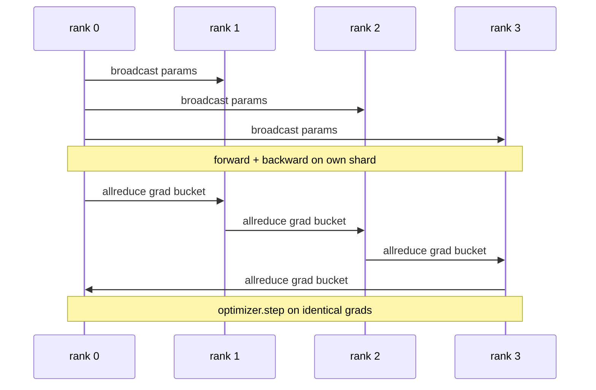

# Desde el principio los datos se han convertido en DDP

> Distribuido DatosParallel es un 子 sobre todo reduce ⋅ empaquetado un modelo, desde el nivel 0 comienza a difundir los parámetros iniciales, así cada nivel comienza a ser el mismo, en cada salida de la escala todo reduce en un parámetros de instalación hacia el posterior 子, lo que queda es la escala baja⋅ todo el diseño tiene 200 líneas⋅

**Type:** Build
**Languages:** Python
**Prerequisites:** 第 19 期 Track C 课程 42-49
**Time:** ~90 分钟

## El objetivo del aprendizaje

-                                                                                                                                                                                                                                                                                                                                                                                                                                                                                                                              `DistributedDataParallel`形形包装器, el packaging器广播 inicial parámetros y posteriormente reducir la gradiencia
- Spawn N CPU en el fondo de la reunión basada en archivos  `torch.multiprocessing.spawn`¿Qué es eso?
-                                                                                                                                                                                                                                                               
- 捍卫储桶 (梯度融合) y重叠 (重叠) 转通信) de uso, lo que se convertirá en dos cambios en la producción de DDP.

##  problemas

 Con un modelo de 10 mil millones de parámetros de 12 GB de capacidad activa no se adapta a una GPU de nivel de consumo  Incluso si se adapta, el entrenamiento también necesita varias semanas de tiempo  Los datos se dividirán en N 个级别, cada nivel calcula el sentido del frente y el sentido del trasero en su segmento, y en cada paso, cada nivel se agrupará para que todas las N 个副本保持相同  La búsqueda y el grado es el dispositivo de optimización utilizado 

Si no hay un nivel de sincronización, N 个副本会发生分歧在第二步. Este modelo ya no es un modelo entrenado en más datos, sino que por casualidad comparte el peso inicial de N 个独立模型. Si el nivel de sincronización no se hace bien, cada parámetro se reduce todo, no hay sobreposición, no hay compartimiento, la red se convierte en un botellado, el GPU se encuentra en el espacio.

## 概念



### DDP necesita de tres operaciones

|舞台|集体|为什么 |
|-------|-----------|-----|
|初始化|从排名 0 开始广播 |每个排名都以相同的参数开始 |
|后退|各梯度的 allreduce |平均梯度是优化器所采用的 |
|有时|缓冲区广播| Batchnorm 运行统计数据保持同步 |

### ¿Por qué es el valor medio y no el total?

Todo reducción-SUM se extrae de la tasa media de mundo_tamaño. El valor medio para el mundo_tamaño es invariable: la tasa de aprendizaje en primer nivel se modifica en cuarto grado, ya que la amplitud de cada paso no cambia.

### ¿Por qué usar la barrica?

El transformador tiene miles de parámetros de volumen. Cada volumen de tiempo se reduce una vez, se paga a la luz 延迟下限数千倍的费用. DDP se clasificará en un cubo de almacenamiento de aproximadamente 25 MB, y se emite un reducción para cada cubo de almacenamiento.

### ¿Por qué fijar las semillas?

Cada rango debe ser ajustado`torch.manual_seed(seed + rank)` hacer lavar, pero调用`torch.manual_seed(seed)` realizar inicialización de los parámetros.                                                                                                                                                                                                                                                          


```figure
ci-ddp-grad-sync
```

## Construirlo

`code/main.py` realización:

- `MiniMLP`3 Layer MLP, pequeño hasta suficiente para recibir en unos segundos, grande hasta suficiente para exponer el cable.
- `DistributedDataParallel(model, world_size)`: en la construcción, regresar a un envasador, su`sync_grads`Reduce la demanda y la escalación de la acumulación en tamaño mundial.
- `worker(rank, world_size, ...)`Por el Gloo, el progreso, el retorno, el paso, el paso.`torch.distributed`El ciclo de entrenamiento completo de init.
- `_reference_single_process_loop(...)`En una escala, en orden de los mismos datos, se entrena el mismo modelo, utilizado para evaluar la eficencia de los parámetros de los testes y los pasos de cada paso.

¿Qué es eso ?

```bash
python3 code/main.py
```

输出: por tabla de entrenamiento de paso, se comparará la pérdida de un solo proceso y el análisis de parámetros con DDP que se ejecuta en 4 niveles superiores.

## 野外生产模式 野外生产模式 野外生产模式 野外生产模式

Tres modos hacen que el DDP se endurezca hasta que se envíe suficiente.

**查找未使用的参数。**Algunos de los cambios de camino están condicionados a saltar los parámetros (también se puede ver en el DDP) pero los parámetros de salto no tienen escala, pero los parámetros de DDP están esperando y reducen el cierre.`find_unused_parameters=True` DDP                                                                                                                                                                                                                                                                                                                                                                                                                                                                                                                           

**静态图优化。**Cuando se transfiere a través de los pasos estables,`static_graph=True`让DDP 预先计算储备桶调度―― Optimización en la escala es importante: el cálculo anticipado ahorra varios mil segundos por paso, lo que se compone en 10.000 pasos―

**梯度累积需要小心。**En K 个微批次, cada micro批次 puede lograr un aumento de la capacidad de producción de 10 veces en función de la escala acumulada.`no_sync()`Publicado en el sitio web de la empresa, para subrayar el problema de la reducción de la carga de carga.

## Usalo

Modelo de producción:

- **PyTorch DDP。**规范的实现―― `torch.nn.parallel.DistributedDataParallel(model)`连接分桶、重叠和 no_sync 上下文──
- **HuggingFace Accelerate。**添加一个处理                                                                                                                                                                                                                                                                                                                                                                                                                                                                                                                         `torchrun`环境变量和模型包装的启动器──底层的DDP相似──
- **Megatron-LM 数据并行。**Combinar DDP con la línea de movimiento de la cantidad de datos para un modelo grande; la parte de la línea de datos es el mismo modelo de reducción total después de retroceso.

## 发货

Se trata de un sistema de reducción de los valores de los valores de los valores de los valores de los valores de los valores de los valores de los valores de los valores de los valores de los valores de los valores de los valores de los valores de los valores de los valores de los valores de los valores de los valores de los valores de los valores de los valores de los valores de los valores de los valores de los valores de los valores de los valores de los valores de los valores de los valores de los valores de los valores de los valores de los valores de los valores de los valores de los valores de los valores de los valores de los valores de los valores de los valores de los valores de los valores de los valores de los valores de los valores de los valores de los valores de los valores de los valores de los valores de los valores de los valores de los valores de los valores de los valores de los valores de los valores de los valores de los valores de los valores de los valores de los valores de los valores de los valores de los valores de los valores de los valores de los valores de los valores de los valores de los valores de los valores de los valores de los valores de los valores de los valores de los valores de los valores de los valores de los valores de los valores de los valores de los valores de los valores de los valores de los valores de los valores de los valores de los valores de los valores de los valores de los valores de los valores de los valores de los valores de los valores de los valores de los valores de los valores de los valores de los valores de los valores de los valores de los valores de los valores de los valores de los valores de los valores de los valores de los valores de los valores de los valores de los valores de los valores de los valores de los valores de los valores de los valores de los valores de los valores de los valores de los valores de los valores de los valores de los valores de los valores de los valores de los valores de los valores de los valores de los valores de los valores de los valores de los valores de los valores de los valores de los valores de los valores de los valores de los valores de los valores de los valores de los valores de los valores de los valores de los valores de los valores de los valores de los valores de los valores de los cuentas de los cuentas de los cuentas de los cuentas de los cuentas de los cuentas de los cuentas de los cuentas de los cuentas de los cuentas de los cu

##  ejercicios

1. Añadir un gran cubo de gradiente configurable, y medir en un modelo más profundo con cada parámetro una velocidad de reducción total.
2. ¿ Qué ?`no_sync()`实现为上下文管理器,并验证梯度累积与K个微批次的单进程基线相相相相相相相相相相相相相相相相相相相相相相相相相相相相相相相相相相相相相相相相相相相相相相相相相相相相相相相相相相相相相相相相相相相相相相相相相相相相相相相相相相相相相相相相相相相相相相相相相相相相相相相相相相相相相相相相相相相相相相相相相相相相相相相相相相相相相相相相相相相相相相相相相相相相相相相相相相相相相相相相相相相相相相
3. Añadir`find_unused_parameters`模式, en el que el anterior a veces salta una de las capas MLP; si no hay este signo, el operativo se encuentra en la trampa 局。
4. se sustituirá por`torch.distributed.barrier()`-solo con el mismo, la sensación de una diferencia entre el mismo basado en todo reducción y el mismo basado en barreras.
5. 量批量大小为 1、16、256 的梯度同步开销作为步长时间的一部分,并解释缩比例──

## 关键术语: "El hombre es un hombre"

|术语 |人们怎么说|它实际上意味着什么 |
|------|----------------|------------------------|
|DDP | “数据并行” |广播参数并减少每一步梯度的包装器 |
|桶| “保险丝梯度”| N组小都化为一大|
|重叠| “隐藏通讯” |当后面的层仍在向后计算时发出 allreduce |
|无同步 | 「积累」|跳过后向 allreduce 进行梯度累积 |
|查找未使用的 | “分支前进”|减少之前检测无梯度的参数 |

##  más阅读

- [PyTorch 分布式数据并行文档](https://pytorch.org/docs/stable/generated/torch.nn.parallel.DistributedDataParallel.html)
- PyTorch DDP interno教程](https://pytorch.org/tutorials/intermediate/ddp_tutorial.html(en inglés)
- [Li等人，PyTorch分布式：加速数据并行训练的经验](https://arxiv.org/abs/2006.15704)
- 第19 阶段 第76 课 - Colegio establecido por el DDP
- Sección 19 阶段 第 78 课 - ZeRO 分片将每参数的全部减少 替换为减少_scatter
