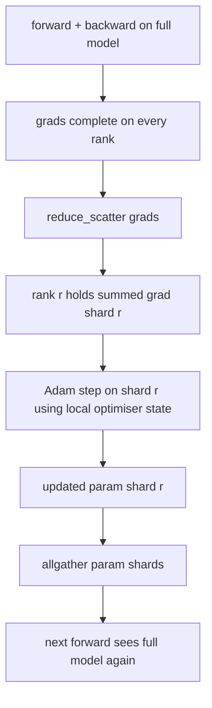

# ZeRO 优化器 estado分片

> Adam para cada parámetro de almacenamiento dos cuadrados de estimaciones, en forma de almacenamiento flotante.32. El modelo de parámetro 7B lleva un estado de optimizador de 56 GB. ZeRO primera etapa de parámetro de transcurrir N 个级别; cada nivel tiene un optimizador de 1/N. Después de los pasos locales, los parámetros de actualización de la parámetro de la parámetro de la distribución de vuelta, cada nivel reconstruye el modelo completo, y luego comienza el siguiente paso.

**Type:** Build
**Languages:** Python
**Prerequisites:** 第 19 期 Track C 课程 42-49
**Time:** ~90 分钟

## El objetivo del aprendizaje

- N 个级别的碎片优化器状态(第一时刻、第二时刻、fp32 主副本), por lo tanto cada grado tiene 1/N。
- Usar reduce_scatter sólo transmite cada nivel de su fragmento de gradiente y, luego todos se reunirán para actualizar los parámetros de fragmento de transmisión de vuelta.
- 根据普通 DDP 计算阶段 1、阶段 2、阶段 3 的内存节省表──
- En el modelo de tamaño y de ancho presupuesto, defender la elección de la primera fase, la segunda y la tercera fase.

##  problemas

Vanilla DDP  copió todo: el estado de los parámetros, gradientes y optimizadores en cada nivel es completo. Para el modelo de parámetros 7B en fp16, esto significa que cada nivel de 14 GB parámetros, 14 GB gradientes y 28 GB  estado de los optimizadores.  El estado de los optimizadores es el término más grande, también el más fácil de dividir, ya que se toca solo durante el paso, no durante el período anterior o posterior de retorno.

ZeRO la primera fase de hacer fragmentos en el estado del optimizador. Cada nivel tiene un 1/N de Adán 时刻. Más adelante, ZeRO no reducirá toda la escala y entrará en su lugar, sino que reducirá la dispersión, por lo que cada nivel sólo recibirá la escala de su fragmento en total.

## 概念



### Sección de ZERO

|阶段|分片对象 |每 rank 内存|每 step 通信|
|-------|----------------|------------------|---------------|
| DDP |无 |params + grads + optim | 1x allreduce |
| ZeRO-1 |optimizer state |params + grads + optim/N | 1x reduce_scatter + 1x allgather |
| ZeRO-2 |optim + grads |params + grads/N + optim/N | 1x reduce_scatter + 1x allgather |
| ZeRO-3 |optim + grads + params |params/N + grads/N + optim/N |每层 1x allgather + 每层 1x reduce_scatter |

La primera etapa es la victoria de menor costo, ya que el estado de optimización domina el presupuesto. La segunda etapa requiere de la escala de fragmentos acumulados, pero el ancho es el mismo. La tercera etapa (FSDP) paga por cada nivel de gastos de comunicación hacia adelante y hacia atrás, para obtener un parámetro de fragmentos de memoria.

###  记忆数学,实数

 Para el uso de Adán en el entrenamiento de precisión mixta con P 参数:

|术语 |vanilla|ZeRO-1 |为什么 |
|------|---------|--------|-----|
| fp16 参数 | 2P字节| 2P字节|需要转发|
| FP16 梯度 | 2P字节| 2P字节|需要落后|
| fp32 母版 | 4P字节| 4P/N 字节 |只有最优化的人才会使用它 |
| fp32 第一时刻 | 4P字节| 4P/N 字节 |只有最优化的人才会使用它 |
| fp32 第二时刻 | 4P字节| 4P/N 字节 |只有最优化的人才会使用它 |
|总计 | 16P字节| 4P + 12P/N 字节 |   |

N=8 时:vanilla 16P,ZeRO-1 5.5P, baja del 65%;; N=64 时:vanilla 16P,ZeRO-1 4.19P, baja del 74%;;

### ¿Por qué reducir_dispersar  mejor que todo reducir-también-disparado

Reducir todo para cada nivel proporciona una demanda y un gradiente completo. Si sólo se necesita un fragmento, entonces reducir el gradiente de la redondación. Reducir todo el segmento de cada nivel es igual a reducirlo.


```figure
cd-zero-shard
```

## Construirlo

`code/main.py` realización:

- `flatten_params(module)`Y `unflatten_into(module, flat)`Para que los parámetros del modelo se envuelvan en una cantidad de volumen continuo y se desplieguen de nuevo, la estructura de la diseño de la diseño de la diseño de la diseño de la diseño de la diseño de la diseño de la diseño de la diseño de la diseño de la diseño de la diseño de la diseño de la diseño de la diseño de la diseño de la diseño de la diseño de la diseño de la diseño de la diseño de la diseño de la diseño de la diseño de la diseño de la diseño de la diseño de la diseño de la diseño de la diseño de la diseño de la diseño de la diseño de la diseño de la diseño de la diseño de una simple pieza.
- `ZeroOptimizer(model, world_size, rank, lr)`拥有主副本和亚当时刻的等级碎片──
- `step()`En la escala plana se ejecuta reduc_scatter, se aplicará a Adam  para la clasificación de fragmentos, y se recogerá todos los parámetros de actualización de vuelta.
- Una demostración, entrenamiento de 3 niveles de MLP 20 pasos, y imprimir el presupuesto de memoria de cada paso y la línea de base ordinaria de DDP.

¿Qué es eso ?

```bash
python3 code/main.py
```

输出: por paso de pérdida y memoria muestra ZeRO-1 en comparación con la copia completa de DDP, conservando en cada nivel el estado de un 1/N de la optimizadora.

## 野外生产模式 野外生产模式 野外生产模式 野外生产模式

Tres modos hacen que ZeRO 足以交付──

**分片检查点很重要。**El estado de la máquina de control de ZeRO-1 se divide por grado; los puntos de control deben registrar qué nivel posee. La clase 80 construyó un listado de puntos de control de la misma clase de tiempo que ZeRO.

**混合精度是重点。**ZeRO es una técnica de precisión mixta; fp32 主副本是分片的. Se ejecuta sin precisión mixta, ZeRO le dará a fp32 master un impuesto de almacenamiento, y sin el correspondiente fp16 hacia el triunfo.

**第一阶段几乎是免费的。**通信在带宽方面与DDP相同──内存节省与N 成线性关系──唯一成本是优化器分片的簿记──生产堆默认为阶段 1,除非参数分片内存也是一个问题;然后第二或第三阶段用通信换取内存──

## Usalo

Modelo de producción:

- **DeepSpeed ZeRO。**参考实现。 `deepspeed_config.json`选择阶段 1/2/3 和分区大小──
- **PyTorch FSDP。**PyTorch 原生等效项── `ShardingStrategy.SHARD_GRAD_OP`Es el ZeRO-2;`FULL_SHARD`Es el ZeRO-3.
- **HuggingFace Accelerate。**Con el tiempo, el sistema de control de velocidad y de velocidad de carga de los sistemas de control de velocidad y de velocidad de carga de los sistemas de control de velocidad y de velocidad de carga de los sistemas de carga de carga de carga de carga de carga de carga de carga de carga de carga de carga de carga de carga de carga de carga de carga de carga de carga de carga de carga de carga de carga de carga de carga de carga de carga de carga de carga de carga de carga de carga de carga de carga de carga de carga de carga de carga de carga de carga de carga de carga de carga de carga de carga de carga de carga de carga de carga de carga de carga de carga de carga de carga de carga de carga de carga de carga de carga de carga de carga de carga de carga de carga de carga de carga de carga de carga de carga de carga de carga de carga de carga de carga de carga de carga de carga de carga de carga de carga de carga de carga de carga de carga de carga de carga de carga de carga de carga de carga de carga de carga de carga de carga de carga de carga de carga de carga de carga de carga de carga de carga de carga de carga de carga de carga de carga de carga de carga de carga de carga de carga de carga de carga de carga de carga de carga de carga de carga de carga de carga de carga de carga de carga de carga de carga de carga de carga de carga de carga de carga de carga de carga de carga de carga de carga de carga de carga de carga de carga de carga de carga de carga de carga de carga de carga de carga de carga de carga de carga de carga de carga de carga de carga de carga de carga de carga de carga de carga de carga de carga de carga de carga de carga de carga de carga de carga de carga de carga de carga de carga de carga de carga de carga de carga de carga de carga de carga de carga de carga de carga de carga de carga de carga de carga de carga de carga de carga de carga de carga de carga de carga de carga de carga de carga de carga de carga de carga de carga de carga de carga de carga de carga de carga de carga de carga de carga de carga de carga de carga de carga de carga de carga de carga de carga de carga de carga de carga de carga de carga de carga de carga de carga de carga de carga de carga de carga de carga de carga de carga de carga de carga de carga

## 发货

Se trata de un eje de la estructura de los tubos de la estructura de los tubos de los tubos de los tubos de los tubos de los tubos de los tubos de los tubos de los tubos de los tubos de los tubos de los tubos de los tubos de los tubos de los tubos de los tubos de los tubos de los tubos de los tubos de los tubos de los tubos de los tubos de los tubos de los tubos de los tubos de los tubos de los tubos de los tubos de los tubos de los tubos de los tubos de los tubos de los tubos de los tubos de los tubos de los tubos de los tubos de los tubos de los tubos de los tubos de los tubos de los tubos de los tubos de los tubos de los tubos de los tubos de los tubos de los tubos de los tubos de los tubos de los tubos de los tubos de los tubos de los tubos de los tubos de los tubos de los tubos de los tubos de los tubos de los tubos de los tubos de los tubos de los tubos de los tubos de tubos de tubos.

##  ejercicios

1. a través de la escala de fragmentos extendido a ZeRO-2: cada rango sólo almacena su escala de fragmentos, a través de la parte de la parte de la parte de la parte de la parte de la parte de la parte de la parte de la parte de la parte de la parte de la parte de la parte de la parte de la parte de la parte de la parte de la parte de la parte de la parte de la parte de la parte de la parte de la parte de la parte de la parte de la parte de la parte de la parte de la parte de la parte de la parte de la parte de la parte de la parte de la parte de la parte de la parte de la parte de la parte de la parte de la parte de la parte de la parte de la parte de la parte de la parte de la parte de la parte de la parte de la parte de la parte de la parte de la parte de la parte de la parte de la parte de la parte de la parte de la parte de la parte de la parte de la parte de la parte de la parte de la parte de la parte de la parte de la parte de la parte de la parte de la parte de la parte de la parte de la parte de la parte de la parte de la parte de la parte de la parte de la parte de la parte de la parte de la parte de la parte de la parte de la parte de la parte de la parte de la parte de la parte de la parte de la parte de la parte de la parte de la parte de la parte de la parte de la parte de la parte de la parte de la parte de la parte de la parte de la parte de la parte de la parte de la parte de la parte de la parte de la parte de la parte de la parte de la parte de la parte de la parte de la parte de la parte de la parte de la parte de la parte de la parte de la parte de la parte de la parte de la parte de la parte de la parte de la parte de la parte de la parte de la parte de la parte de la parte de la parte de la parte de la parte de la parte de la parte de la parte de la parte de la parte de la parte de la parte de la parte de la parte de la parte de la parte de la parte de la parte de la parte de la parte de la parte de la parte de la parte de la parte de la parte de la parte de la parte de la parte
2. Añadir un analizador de memoria, para imprimir en la categoría 0 la situación real de uso de fp32 字节 y la situación de la predicción formal.
3. 测量普通 DDP con ZeRO-1 en cada paso del tiempo, y se descompone en anterior, posterior, comunicación.
4. En ZeRO-1 se realiza la reducción de la escala: se debe pasar por la reducción total de la cantidad de cuadros de la superficie de la superficie de la superficie de la superficie de la superficie de la superficie de la superficie de la superficie de la superficie de la superficie de la superficie de la superficie de la superficie de la superficie de la superficie de la superficie de la superficie de la superficie de la superficie de la superficie de la superficie de la superficie de la superficie de la superficie de la superficie de la superficie de la superficie de la superficie de la superficie de la superficie de la superficie de la superficie de la superficie de la superficie de la superficie de la superficie de la superficie de la superficie de la superficie de la superficie de la superficie de la superficie de la superficie de la superficie de la superficie de la superficie de la superficie de la superficie de la superficie de la superficie de la superficie de la superficie de la superficie de la superficie de la superficie de la superficie de la superficie de la superficie de la superficie de la superficie de la superficie de la superficie de la superficie de la superficie de la superficie de la superficie de la superficie de la superficie de la superficie de la superficie de la superficie de la superficie de la superficie de la superficie de la superficie de la superficie de la superficie de la superficie de la superficie de la superficie de la superficie de la superficie de la superficie de la superficie de la superficie de la superficie de la superficie de la superficie de la superficie de la Tierra.
5. Utiliza todo reduce en lugar de reduc_scatter                                                                                                                                                                                                                                                                                                                                                                                                                                                                                                                 

## 关键术语: "El hombre es un hombre"

|术语 |人们怎么说|它实际上意味着什么 |
|------|----------------|------------------------|
|ZeRO-1 | “优化器分片”|每个等级拥有 1/N 的 fp32 master + Adam 时刻 |
| ZeRO-2 | “grads 也分片”|每个 rank 在 reduce_scatter 后也会丢弃非本分片的梯度 |
|ZeRO-3 | “分片参数” |每个等级保存 1/N 的 fp16 参数；向前每层allgather |
|master copy| “fp32 权重”|高精度参数复制优化器更新|
|reduce_scatter | “平分总和”|仅提供每个等级其分片的梯度总和 |

##  más阅读

- [Rajbhandari 等人，ZeRO：训练万亿参数模型的内存优化](https://arxiv.org/abs/1910.02054)
- [DeepSpeed ZeRO 文档](https://www.deepspeed.ai/tutorials/zero/)
- [PyTorch FSDP 文档](https://pytorch.org/docs/stable/fsdp.html)
- Sección 19 Sección 76 - El presente curso se refiere a la reducción de la dispersión y la recolección
- No 19 阶段 No 80 课 - ZeRO 状态必须使用的分片检查点
