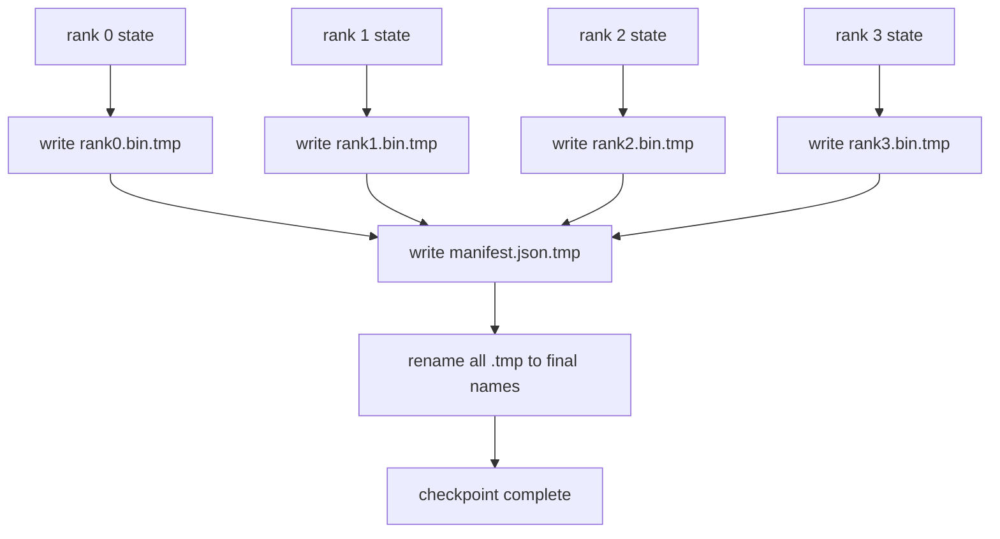

# Porción de control y recuperación del átomo

> Cada dos horas se suspende el entrenamiento de los parámetros 70B por fallas en los nodos. La forma del punto de control determina si se pierde 30 minutos o 30 horas. El punto de control de los nodos se escribe en el mismo modo en cada uno de los nodos y registra la propiedad en el listado. El resumen se carga de su propio archivo, cada uno de los nodos se vuelve a construir en el mismo estado de la pequeña escala, y el optimizador se vuelve a construir como si nada hubiera pasado.

**Type:** Build
**Languages:** Python
**Prerequisites:** 第 19 期 Track C 课程 42-49
**Time:** ~90 分钟

## El objetivo del aprendizaje

- Se conservarán varios puntos de control de cada nivel para los documentos de cada nivel y para el registro de qué nivel posee.
- Utiliza atomas escribir en el modo de escribir, entonces volver a nombrarlo), por lo que el proceso de escribir nunca se producirá un punto de revisión medio completo.
- Desde la lista de recuperación, la verificación de cada nivel en el estado de fp16 parámetros y ZeRO  optimización                                                                                                                                                                                                                                                                                                                                                                                                                                                                                                
- 保护清单架构免受三种故障模式的影响:

##  problemas

El punto de inspección normal leerá todos los parámetros y el estado del optimizador hasta el nivel 0, recogerá y escribirá en un solo archivo. Para el modelo 70B, a través del puerto de red de primera clase proporciona 1.1 TB de estado. El punto de inspección bloqueará a todos los demás niveles, ya que están en vacío y esperan la recopilación.

El punto de control de fragmentos se ha vuelto a cambiar de modo: cada nivel tiene su propio segmento y se escribe en su propio archivo. El registro registra qué nivel tiene qué segmento, por lo que la recuperación puede devolver cada segmento a su origen. El punto de control de 1 TB requiere 4 horas para completar una categoría, requiere 4 minutos para completar 64 categorías. Además, el sistema también le ofrece un contrato de complejidad de la historia: las pequeñas variaciones del mundo son verificables, la parte de la inscripción es verificable, y el camino de carga puede fracasar en gran voz, en lugar de usar silenciosamente los datos obsoletos.

## 概念



### 清单架构

```json
{
  "world_size": 4,
  "step": 1234,
  "wall_clock_seconds": 4521,
  "shards": [
    {"rank": 0, "path": "rank0.bin", "sha256": "...", "param_shard_offset": 0, "param_shard_numel": 65536},
    {"rank": 1, "path": "rank1.bin", "sha256": "...", "param_shard_offset": 65536, "param_shard_numel": 65536}
  ],
  "schema_version": 1
}
```

Tres juegos son todos de carga.`world_size`Para que las diferentes historias de gran tamaño fallecen, no se pierdan silenciosamente.`sha256`Captura de la parte o daño de la escritura.`param_shard_offset`Y `param_shard_numel`让载体在正确位置重建平面参数张量──

### 原子写入

标准模式:将每个分片写入 `<name>.tmp`,将清单写入 `manifest.json.tmp`,fsync Cada archivo, re-nombrado, re-nombrado lista. . . . . . . . . . . . . . . . . . . . . . . . . . . . . . . . . . . . . . . . . . . . . . . . . . . . . . . . . . . . . . . . . . . . . . . . . . . . . . . . . . . . . . . . . . . . . . . . . . . . . . . . . . . . . . . . . . . . . . . . . . . . . . . . . . . . . . . . . . . . . . . . . . . . . . . . . . . . . . . . . . . . . . . . . . . . . . . . . . . . . . . . . . . . . . . . . . . . . . . . . . . . . . . . . . . . . . . . . . . . . . . . . . . . . . . . . . . . . . . . . . . . . . . . . . . . . . . . . . . . . . . . . . . . . . . . . . . . . . . . . . . . . . . . . . . . . . . . . . . . . . . . . . . . . . . . . . . . . . . . . . . . . . . . . . . . . . . . . . . . . . . . . . . . . . . . . . . . . . . . . . . . . . . . . . . . . . . . . . . . . . . . . . . . . . . . . . . . . . . . . . . . . . . . . . . . . . . . . . . . . . . . . . . . . . . . . . . . . . . . . . . . . . . . . . . . . . . . . . . . . . . . . . . . . . . . . . . . . . . . . . . . . . . . . .

### 模式 must defend 的三种故障模式

|失败|症状|防御|
|---------|---------|---------|
|世界规模的变化|在 N=8 上恢复，并从 N=4 开始清单 |清单中的 world_size 不匹配，大声失败 |
|分片数量不匹配 |resume 看到的 rank*.bin 文件少于 manifest 中的分片 |枚举分片，验证每个分片都存在 |
|部分写入|分片文件在刷新过程中被截断|加载时进行 sha256 验证 |

Cada defensa rechazará una mala carga tan pronto como sea posible; otra opción es la pérdida silenciosa, cuando la pérdida se convierte en NaN, esto ocurrirá después de 100 pasos.

### ¿Por qué es un documento de cada nivel, y no un gran documento?

 Por el `O_APPEND`Para una escritura de un archivo se aplica a la escritura de un guión de POSIX, pero en realidad, el volumen de desplazamiento dentro de una fragmentación transcende una región de MB de tamaño, y se bloquea en su posición dominante. Cuando el sistema de archivos de nivel inferior es simultáneo, cada nivel de archivo no es necesario y puede beneficiarse de la articulación. Por lo tanto, la producción de archivos de tamaño profundo, la velocidad y la velocidad de trabajo (FSDP, NeMo) se utiliza por rango.


```figure
ci-sharded-checkpoint
```

## Construirlo

`code/main.py` realización:

- `ShardManifest`Los datos, con las estructuras mencionadas anteriormente.`to_json`- ¿ Qué ?`from_json`¿Qué es eso?
- `save_sharded(state_dict_per_rank, dir, step)`Utilizando el modelo de átomos temporales y luego renombrados, cada uno de los niveles escribirá su estado de sistema secundario en su propio archivo, y luego escribirá en el lista.
- `load_sharded(dir, expected_world_size)`读取清单,验证每个分片的 sha256,并返回每个级别的状态字典──
- 往返测试: Construir cada uno de los estados, conservar, cargar, hacer comentarios, etc.

¿Qué es eso ?

```bash
python3 code/main.py
```

输出:4 个分片文件以及写入的清单,然后通过字节相等验证重新加载──

## 野外生产模式 野外生产模式 野外生产模式 野外生产模式

Tres modos hacen que los puntos de inspección sean lo suficientemente sólidos para llevar a cabo el transporte.

**异步写入。**Producción de un conjunto de puntos de control en un proceso o trayectoria individual para que el entrenamiento continúe.`async_io`标志正是这样做──本课程保持写入同步,因此步骤可见──

**先本地快速磁盘，然后异步上传。**写入本地 NVMe(快速), luego异步上传到S3或GCS──两层模式使集群内检查点能够快速恢复,同时将持久副本发送到集群外进行存档──清单携带本地路径;上传清单携带远程路径──

**轮换很重要。**El ciclo de producción mantiene el último punto de control de K 个 (normalmente 3-5 个) y se rotule el primer punto de control. Si no se rotule, el disco se llena en el ciclo, y el siguiente punto de control fracasa.

## Usalo

Modelo de producción:

- **DeepSpeed 检查点。** `deepspeed.save_checkpoint(tag=step)` Escribir documentos de cada nivel y señales de actividad `latest`¿Qué es eso?
- **PyTorch FSDP 检查点。** `torch.distributed.checkpoint`Usando las decisiones de cada nivel de diseño `Planner`保存分片状态──
- **NeMo.**Utilizaciones de datos adicionales`save_to_checkpoint`API 封装 DeepSpeed y FSDP

## 发货

Se conservan los puntos de control de la DDP+ZeRO de un extremo a otro y se vuelven a cargar en el mismo mundo pequeño, para demostrar la creación de la alianza de recuperación.

##  ejercicios

1. 添加异步写入: en línea inicia la conservación y deja que el entrenamiento continúe.
2. 添加                                                                                                                                                                                                                                                                                                                                                                                                                                                                                                                           `last_5_steps`轮换: conservar 5 puntos de control más recientes, eliminar los más viejos y guardar nuevos puntos de control.
3. Para el ciclo recargarse añade sólo el CRC de la ruta de la rápida prueba de la actividad.
4. 添加跨世界小的负载: mediante la lectura de la lista, la conexión y la reapartición, la reapartición se volverá a equilibrar de N=4 a N=8──
5. Se trata de un proyecto de investigación que se desarrolla en el ámbito de la seguridad social.

## 关键术语: "El hombre es un hombre"

|术语 |人们怎么说|它实际上意味着什么 |
|------|----------------|------------------------|
|分片检查点 | “按等级保存”|每个rank并行写入自己的分片文件|
|清单 | “索引”|记录分片路径、偏移量和 sha256 的 JSON 文件 |
|原子写| “tmp 然后重命名” |写入 .tmp，然后 POSIX 重命名，以便崩溃使先前的文件保持活动状态 |
|部分写入| “截断的碎片” |写入过程中的崩溃会产生损坏的分片； sha256 抓住它 |
|旋转| “保留最后 K”|在写入新检查点以限制磁盘使用量之前删除最旧的检查点 |

##  más阅读

- [DeepSpeed 检查点](https://www.deepspeed.ai/tutorials/checkpointing/)
- [PyTorch torch.distributed.checkpoint](https://pytorch.org/docs/stable/distributed.checkpoint.html)
- [POSIX重命名原子性](https://pubs.opengroup.org/onlinepubs/9699919799/functions/rename.html)
- No 19 阶段 No 78 课 - 此检查点旨在保存的ZERO 状态
- Sección 19 阶段 Sección 81 课 - 端到端演示往返保存的状态
