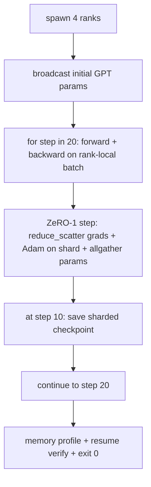

# 端到端分布式训练

> Se trata de un componente: un GPT de tipo pequeño entrenado en 4 filas de simulación, que utiliza DDP para realizar un sincronización de gradientes, ZeRO-1 para realizar un sincronización de estado de un optimizador, así como un punto de control de un punto de control de un punto de control de un punto de control de un punto de control de un punto de control de un punto de control de un punto de control de un punto de control de un punto de control de un punto de control de un punto de control de un punto de control de un punto de control de un punto de control de un punto de control de un punto de control de un punto de control de un punto de control de un punto de control de un punto de control de un punto de control de un punto de control de un punto de control de un punto de control de un punto de control de un punto de control de un punto de control de control de un punto de control de control de un punto de control de control de un punto de control de control de un punto de control de control de un punto de control de control de control de un punto de control de control de control de control de un punto de control de control de control de control de control de control de control de control de control de control de control de control de control de control de control de control de control de control de control de control de control de control de control de control de control de control de control de control de control de control de control de control de control de control de control de control de control de control de control de control de control de control de control de control de control de control de control de control de control de control de control de control de control de control de control de control de control de control de control de control de control de control de control de control de control de control de control de control de control de control de control de control de control de control de control de control de control de control de control de control de control de control de control de control de control de control de control de control de control de control de control de control de control de control de control de control de control de control de control de control de control de control de control de control de control de control de control de control de control de control de control de control de control de control de control de control de control de control de control de control de control de control de control de control de control de control de control de control de control de control de control

**Type:** Build
**Languages:** Python
**Prerequisites:** 第 19 期 Track C 课程 42-49
**Time:** ~90 分钟

## El objetivo del aprendizaje

- Se trata de un programa de formación de la escuela de la escuela de la escuela de la escuela de la escuela de la escuela de la escuela de la escuela de la escuela de la escuela de la escuela de la escuela de la escuela de la escuela de la escuela de la escuela de la escuela de la escuela de la escuela de la escuela de la escuela de la escuela de la escuela de la escuela de la escuela de la escuela de la escuela de la escuela de la escuela de la escuela de la escuela de la escuela de la escuela de la escuela de la escuela de la escuela de la escuela de la escuela de la escuela de la escuela de la escuela de la escuela de la escuela de la escuela de la escuela de la escuela de la escuela de la escuela de la escuela de la escuela de la escuela de la escuela de la escuela de la escuela de la escuela de la escuela de la escuela de la escuela de la escuela de la escuela de la escuela de la escuela de la escuela de la escuela de la escuela de la escuela de la escuela de la escuela de la escuela de la escuela de la escuela de la escuela de la escuela de la escuela de la escuela de la escuela de la escuela de la escuela de la escuela de la escuela de la escuela de la escuela de la escuela de la escuela de la escuela de la escuela de la escuela de la escuela de la escuela de la escuela de la escuela de la escuela de la escuela de la escuela de la escuela de la escuela de la escuela de la escuela de la escuela de la escuela de la escuela de la escuela de la escuela de la escuela de la escuela de la escuela de la escuela de la escuela de la escuela de la escuela de la escuela de la escuela de la escuela de la escuela de la escuela de la escuela de la escuela de la escuela de la escuela de la escuela de la escuela de la escuela de la escuela de la escuela de la escuela de la escuela de la escuela de la escuela de la escuela de la escuela de la escuela de la escuela de la escuela de la escuela de la escuela de la escuela de la escuela de la escuela de la escuela de la escuela de la escuela de la escuela de la escuela de la escuela de la escuela de la escuela de la escuela de la escuela de la escuela de la escuela de la escuela de la escuela de la escuela de la escuela de la escuela de la escuela de la escuela de la escuela de la escuela de la escuela de la escuela de la escuela de la escuela de la escuela de la escuela de la escuela de la escuela de la
- En la pequeña biblioteca de lenguaje sintetizado entrenamiento de 2 niveles Transformer 语言模型, a través de 4 模拟等级 realizar 20 步骤.
- Imprimir cada paso perdido, cada lista de archivos de configuración de memoria y la lista de puntos de control de los mismos tiempos de recuperación en el mismo mundo pequeño.
- Defender las composiciones: cada obra puede ser testada independientemente en el curso anterior, este curso prueba que son composiciones.

##  problemas

Capstone es la evidencia de que cada parte se ha unido juntos. La sección 76 de la aplicación de los conjuntos. La sección 77 de la clase los incorporará a la DDP. La sección 78 de la clase los utiliza para reducir_dispersón, optimizar los estados de los fragmentos. La sección 79 analiza el tubo. La sección 80 de la clase conserva un fragmento de punto de control. Cada sección tiene su propio test. La verdadera práctica se ejecuta al mismo tiempo que utiliza cada lengua original. Si la combinación de errores, pérdidas se dispersa, el punto de control se niega a recuperar, o cada uno de los puntos de control debe contraerse y crecer.

Esta demostración de curso de ejecución a prueba de cuatro variables: a) la pérdida en los 20 pasos de un solo movimiento en el ruido flotante, b) cada nivel mantiene el mismo parámetro en cada paso, c) cada nivel de un enriquecedor en el registro es igual a ZeRO-1  fórmula 12P/N 字节, y d) el punto de control de los pasos 10 en el reinicio de la fase de un nuevo cargamento de la fase de un nuevo movimiento, etc.

## 概念



### 迷你 GPT

El modelo es intencionalmente muy pequeño: 2 个Transformer块、嵌入dim 32、4 个注意力头、词汇 64、序列长度 16、批次 4。几千参数── suficientemente grande para ejecutar cada decisión de línea(Multi头注意力运行标准屏蔽路径;LayerNorm tiene que tener un peso de sincronización;LM 头是返回词汇的单独线性投影)── suficientemente pequeño, 4 个CPU 级别上的 20 步骤可以在几秒内完成──

### 组成规则 组成规则

|课程片段 |它拥有什么 |它留给循环什么？
|--------------|--------------|----------------------------|
| DDP广播 |初始参数同步 |构建时一次调用 |
| ZeRO-1 步骤 |梯度同步、母版更新、参数广播 |每一步调用一次，替换 optimiser.step |
|分片检查点 |保持每等级状态，用 sha256 体现 |通过 allgather 收集状态，调用等级 0 |
|训练循环 |向前、向后、丢失记录 |按顺序调用以上三个 |

El ciclo no sabe acerca de la reducción de dispersión o de los documentos de citas.

### ¿Por qué es un pequeño GPT y no sólo un MLP?

En la clase 77 se añade tres cosas: una pequeña GPT en el vocabulario: una cabeza LM única en el texto, en esta clase, para que se vea claramente, se desciende; un GPT completo normalmente se relaciona con los tokens (se levantó), se mezclaba con el punto de partida (se mezclaba con el punto de partida) y se mezclaba con el punto de partida (se mezclaba con el punto de partida).

### Desde el final significa regresar 0

循环运行固定的 20 步并退出──没有`while True`, sin intervención humana, sin recuperación de un estado externo. Puedes ejecutar en estado de seguridad y después de terminar encontrar la piedra de la historia completa.


```figure
ci-distributed-assembly
```

## Construirlo

`code/main.py` realización:

- `MiniGPT`• Cuenta con un transformer de 2 niveles de auto-atención y cabeza LM independiente.
- `make_corpus(seed, total_tokens)`: determinación de la siguiente:
- `_train_worker`: según la generación de niveles;广播初始化参数,运行循环,调用 ZeRO 步骤,在步骤 10 写入分片检查点──
- `verify_resume`Después del ejecutivo principal, el 10o paso del proceso de recarga, y la prescripción de la preservación de la parte principal con la correspondencia de la parte rápida de la memoria.
- `main`: organizar toda la presentación, imprimir el mapa perdido, archivos de configuración de memoria y resultados de verificación.

¿Qué es eso ?

```bash
python3 code/main.py
```

输出:20 行丢失表,4 行每列内存配置文件,检查点清单以及成功时的RESUME VERIFIED行──

## 野外生产模式 野外生产模式 野外生产模式 野外生产模式

Tres modos completaron la construcción de la verdadera operación.

**每 K 分钟检查一次，而不是每 K 步骤一次。**步骤时间 cambia con la secuencia de longitud y el número de pequeños grupos. No importa el tamaño del modelo, los pasos de control de 10 minutos capturan el mismo cálculo.

**及早检测分歧。**El proceso de producción se realiza hacia atrás añadiendo NaN 防护和丢失尖峰检测器; si la pérdida en el paso salta más de 2 veces, entonces vuelve a volver a un punto de control anterior, en lugar de dejar que el optimizador entre en un estado de degradación.

**跨等级聚合内存配置文件。**Cada nivel de producción tiene un valor máximo más que el valor medio de cada nivel; este curso se imprime en base a los niveles para mostrar la fórmula de coincidencia.

## Usalo

Modelo de producción:

- **DeepSpeed.**En una configuración se ha combinado DDP + ZeRO + Tubo + activar el punto de control.
- **PyTorch FSDP。**本机等效项. `FullyShardedDataParallel`Y `ShardingStrategy.SHARD_GRAD_OP`Es el ZeRO-2.
- **NeMo 和 Megatron-LM。**Para el modelo más grande añadir la cantidad de piezas; de lo contrario, la forma del compuesto es la misma.

## 发货

完整曲目到此结束── estos 6 cursos juntos constituyen un verdadero equipo que construirá un sistema de entrenamiento distribuido antes de adoptar DeepSpeed; este abstracto ha sido demostrado en el mundo entero, y el fallo de los modelos ya se ha puesto en práctica──第 17 阶段(infrastructure and production) es el lugar donde se convertirá en un verdadero grupo ‖

##  ejercicios

1.  Añadir la cantidad de cabeza de atención y la línea de división y la pérdida de prueba con la línea de clasificación única 
2. Añadir 4 pequeños grupos de gradientes acumulados, y demostrar que la gradiencia es igual a la de un gran grupo de gradientes.
3. Añadir un artículo de la ruta de recuperación desde el paso 10  para comenzar, el camino de la práctica continúa entrenando hasta el paso 20, y produce la misma pérdida final que la operación original.
4. Se añadirá a JSONL para que después se pueda ver el funcionamiento.
5. Añadir un NaN  defensa, en el punto de control perdido, volver a rodar en el punto de control anterior, y utilizar un solo paso LR  multiplicando el número de puntos de control para ejecutar el rodamiento.

## 关键术语: "El hombre es un hombre"

|术语 |人们怎么说|它实际上意味着什么 |
|------|----------------|------------------------|
|端到端| “将一切连接起来”|一次运行构成了每个部分，而不是每个部分的单元测试 |
|内存简介 | “每级 GB”|每个等级上保存的参数、梯度、优化器状态的字节数 |
|简历合同 | “保存并加载”|检查点往返后每列状态字节相等 |
|自动终止 | “有界奔跑”|固定步数，完成后退出 0，循环中没有人 |

##  más阅读

- DeepSpeed端到端训练教程](https://www.deepspeed.ai/getting-started/(en inglés)
- PyTorch FSDP进阶教程](https://pytorch.org/tutorials/intermediate/FSDP_advanced_tutorial.html(en inglés)
- Megatron-LM entrenamiento脚本参考]https://github.com/NVIDIA/Megatron-LM(en inglés)
- No. 19 阶段 No. 76-80 课 - 本课组成的每首曲子
- Sección 17 - El conjunto se desplazará a la verdadera colección
