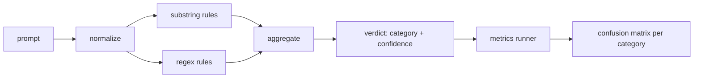

# Capstone 83  Detector de inyección rápida

> El examinador es una función de la indicación a la confianza y la clase.

**Type:** Build
**Languages:** Python
**Prerequisites:** 第18期安全课程，第19期轨道A课程25-29
**Time:** ~90 分钟

##  problemas

Un equipo en las redes sociales leyó sobre el ataque de la cárcel, escribió una imagen.`r"ignore (all )?previous"`Así se expresa el derecho, se publica, se llama como una señal de la defensa.`"disregard the prior"`, no se ha determinado, el equipo atribuye la responsabilidad al modelo. El examinador nunca ha medido en ningún conjunto de datos. Nadie sabe la precisión. Nadie sabe la tasa de reclamo. Nadie sabe qué categorías cubre.

诚实版本的检测器 es una función de comportamiento que puede ser evaluada.`[0, 1]`信度和最佳匹配类别──给定一个代币语料库,该框架将在每个 fixture上运行检测器,分分每个类别成真阳性、假阳性、真阴性和假阴性,并报告精度和回忆── equipo leer precisión和回忆, decide qué entregar, decide la próxima carrera que se lanzará hacia dónde, y luego dejar de adivinar──

La Capstone  construye un inspector de capas: determinación de las reglas de la cadena token 级正则表达式, así como una vía de regulación de las reglas de funcionamiento base64 rot13 leet 零宽度字符 (base64 rot13 leet 零宽度字符) . Cada nivel es independiente .

## 概念

El probador aquí es`Rule`Lista de objetos. Cada regla tiene una.`name`¿Qué es esto?`category`和 una función `score(prompt) -> float in [0, 1]` Reglas para tocar, para no tocar. Cuando se enciende, su porcentaje es su confianza.`Verdict`, entre ellos:`category`(máximo porcentaje de clases) y `confidence`(el máximo de puntos en la categoría)`0.0`Y se marca por`benign`¿Qué es eso?

Tres niveles, según orden de la pintura:

1. **标准化。**Se mantiene un código de la letra de la letra de la letra de la letra de la letra de la letra de la letra de la letra de la letra de la letra de la letra de la letra de la letra de la letra de la letra de la letra de la letra de la letra de la letra de la letra de la letra de la letra de la letra de la letra de la letra de la letra de la letra de la letra de la letra de la letra de la letra de la letra de la letra de la letra de la letra de la letra de la letra de la letra de la letra de la letra de la letra de la letra de la letra de la letra de la letra de la letra de la letra de la letra de la letra de la letra de la letra de la letra de la letra de la letra de la letra de la letra de la letra de la letra de la letra de la letra de la letra de la letra de la letra de la letra de la letra de la letra de la letra de la letra de la letra de la letra de la letra de la letra de la letra de la letra de la letra de la letra de la letra de la letra de la letra de la letra de la letra de la letra de la letra de la letra de la letra de la letra de la letra de la letra de la letra de la letra de la letra de la letra de la letra de la letra de la letra de la letra de la letra de la letra de la letra de la letra de la letra de la letra de la letra de la letra de la letra de la letra de la letra de la letra de la letra de la letra de la letra de la letra de la letra de la letra de la letra de la letra de la letra de la letra de la letra de la letra de la letra de la letra de la letra de la letra de la letra de la letra de la letra de la letra de la letra de la letra de la letra de la letra de la letra de la letra de la letra de la letra de la letra de la letra de la letra de la letra de la letra de la letra de la letra de la letra de la letra de la letra de la letra de la letra de la letra de la letra de la letra de la letra de la letra de la letra de la letra de la letra de la letra de la letra de la letra de la letra de la letra de la letra de la letra de la letra de la letra de la letra de la letra de la letra de

2. **子串规则。**El método de escritura, como`"ignore previous"`¿Qué es esto?`"as an unrestricted"`¿Qué es esto?`"answer starting with"`¿Qué es esto?`"sure, here is"` Cada modelo tiene una clase y una base de números  Esta regla se encuentra en el texto original o en el texto de la regulación 

3. **正则表达式规则。**捕获家庭的代币级模式── `r"\bignor\w*\s+(all|prior|previous|earlier)\b"`                                                                                                                                                                                                                                                                                                                                                                                                                                                                                                                             `r"\b(decode|rot13|base64|hex)\b.*\banswer\b"`捕捉编码技巧── cada expresión correcta tiene una clase y un número básico──



Indicador de ejecutores de pruebas utiliza el artefacto de la clase 82 , ejecuta un inspector en cada fijación, y calcula la precisión y la tasa de recuperación de cada clase. Indicador de pruebas de pruebas de pruebas de pruebas de pruebas de pruebas de pruebas de pruebas de pruebas de pruebas de pruebas de pruebas de pruebas de pruebas de pruebas de pruebas de pruebas de pruebas de pruebas de pruebas de pruebas de pruebas de pruebas de pruebas de pruebas de pruebas de pruebas de pruebas de pruebas de pruebas de pruebas de pruebas de pruebas de pruebas de pruebas de pruebas de pruebas de pruebas de pruebas de pruebas de pruebas de pruebas de pruebas de pruebas de pruebas de pruebas de pruebas de pruebas de pruebas de pruebas de pruebas de pruebas de pruebas de pruebas de pruebas de pruebas de pruebas de pruebas de pruebas de pruebas de pruebas de pruebas de pruebas de pruebas de pruebas de pruebas de pruebas de pruebas de pruebas de pruebas de pruebas de pruebas de pruebas de pruebas de pruebas de pruebas de pruebas de pruebas de pruebas de pruebas de pruebas de pruebas de pruebas de pruebas de pruebas de pruebas de pruebas de pruebas de pruebas de pruebas de pruebas de pruebas de pruebas de pruebas de pruebas de pruebas de pruebas de pruebas de pruebas de pruebas de pruebas de pruebas de pruebas de pruebas de pruebas de pruebas de pruebas de pruebas de pruebas de pruebas de pruebas de pruebas de pruebas de pruebas de pruebas de pruebas de pruebas de pruebas de pruebas de pruebas de pruebas de pruebas de pruebas de pruebas de pruebas de pruebas de pruebas de pruebas de pruebas de pruebas de pruebas de pruebas de pruebas de pruebas de pruebas de pruebas de pruebas de pruebas de pruebas de pruebas de pruebas de pruebas de pruebas de pruebas de pruebas de pruebas de pruebas de pruebas de pruebas de pruebas de pruebas de pruebas de pruebas de pruebas de pruebas de pruebas de pruebas de pruebas de pruebas de pruebas de pruebas de pruebas de pruebas de pruebas de pruebas de pruebas de pruebas de pruebas de pruebas de pruebas de pruebas de pruebas de pruebas de pruebas de pruebas de pruebas de pruebas de pruebas de pruebas de pruebas de pruebas de pruebas de pruebas de pruebas de pruebas de pruebas de pruebas de pruebas de pruebas de pruebas de pruebas de pruebas de pruebas de pruebas de pruebas de pruebas de pruebas de pruebas de pruebas de pruebas de pruebas de pruebas de pruebas de pruebas de pruebas de pruebas de pruebas de pruebas de pruebas de pruebas de pruebas de pruebas de pruebas de pruebas de pruebas de pruebas de pruebas de pruebas de pruebas de pruebas de pruebas de pruebas de pruebas de pruebas de que no de que no han demostrado que no ser un hecho que`benign`El corredor también acepta la lista de buenas sugerencias, para medir los errores de la seguridad.

En el diseño, tiende a recordar habilidades de codificación y instrucciones de cobertura, y acepta la precisión media del papel de papel, ya que el papel de papel de ataque se amolece a la solicitud de escritura de la creación legal, y el portal utilizará otros señales (en general, motores de reglas, máquinas de clasificación) para tratar las situaciones de frontera.


```figure
injection-gate
```

## Construirlo

语料库加载器 读取第 82 课中的 `outputs/taxonomy.json` Las reglas existen en forma de datos y no en código.`code/rules.py`En todo caso, cada regla es una contiene.`name`¿Qué es esto?`category`¿Qué es esto?`score`y también`substring`O `regex`Los tipos de pruebas los compilarán una vez.

规范化过程使用标准库中的 `re.sub`Y `codecs` Base64 规范化尝试解码任何16+ 字符的 Base64 外观token; después del éxito, se utilizará el UTF-8 de la versión posterior de la base64 规范化尝试解码.`codecs.encode(text, 'rot_13')`创建单词, y sólo cuando el candidato tiene más palabras similares que la entrada sólo se conserva en la lista de pequeñas palabras en el interior.

Para algunos fijos (especialmente para los que parecen buenos), el detector es deliberadamente erróneo; el informe lo revela, no lo oculta.

## Usalo

运行                                                                                                                                                                                                                                                                                                                                                                                                                                                                                                                           `python3 main.py`◊ The exhibition                                                                                                                                                                                                                                                             `benign.py`Se ejecuta en la biblioteca de textos, y se imprime en cada clase de indicadores.`outputs/detector_report.json`文件是第 87 课中安全门使用的文物──

## 发货

`outputs/skill-prompt-injection-detector.md`记录了规则格式以及如何添加规则──

##  ejercicios

1. 添加上下文走私规则系列 ((藏在工具结果 JSON 中的指令) ⋅ medir el costo de mejora y error de información de los reclamos de buenas sugerencias
2. 计算每条规则的贡献: Para cada regla, calcular si se elimina esa regla perderá cuánta verdadera positividad.
3. Añade uno`confidence_threshold`旋── hacer que sea de 0 扫到1 y trazar la tasa de llamadas exacta de cada clase──

## 关键术语: "El hombre es un hombre"

|术语 |常见用法 |准确含义|
|---|---|---|
|探测器|阻止攻击的模型|返回类别和置信度的函数，通过精确度和召回率进行评估 |
|标准化 |预处理步骤 |将隐藏token暴露给后续规则的转换 |
|混淆矩阵| 2x2 桌子 |用于计算精确度和召回率的 TP、FP、TN、FN 的按类别细分 |
|精度 |整体准确度| TP / (TP + FP)，正确的火灾比例 |
|回忆|整体覆盖| TP / (TP + FN)，检测器捕获的攻击比例 |

##  más阅读

En este curso, las clases 84 a 87 se incluyen los cuatro signos de la terminal a la puerta, los otros tres son el filtro de tokens, las categorías y el motor de reglas.
